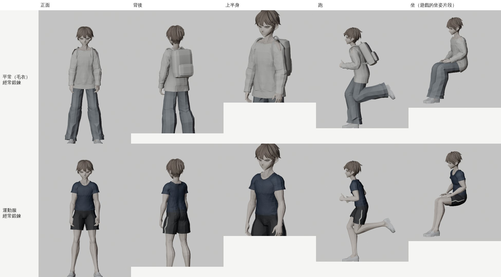
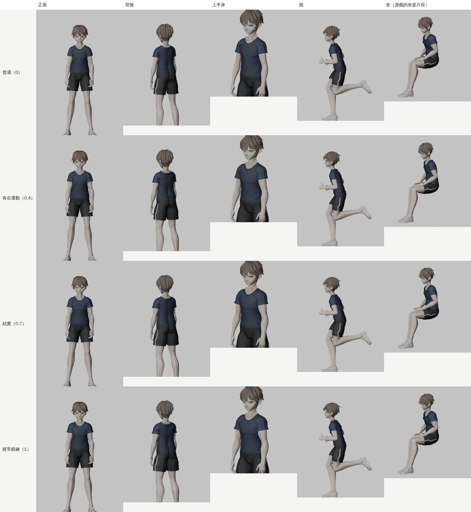
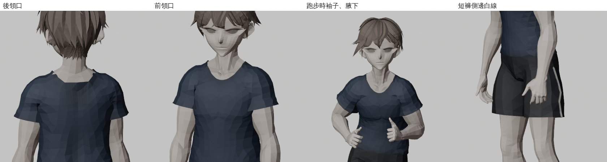

# GYM-FIT-1107 ③：祐廷的健身短袖運動服（LAWWW2-B 2026-11-07）

**派工**：LAWWW-B 05:46（人物外觀 LAWWW 定案，D128）。原文：

> 在健身中心換一套短袖運動服（只在 B1 健身中心／體育課時穿，出來換回原本的），請排在你佇列裡、和 fit morph 一起做（短袖要一樣吃 fit 形狀）

**起因**：使用者 11-07 說「肌肉線條更明顯」。祐廷平常穿長袖毛衣，體態第二階段的 fit 形狀只看得到輪廓。換短袖以後，手臂、肩膀、小腿都看得到。

**狀態**：**READY_FOR_ART_REVIEW**。角色美術照 D100a 由值班 LAWWW 驗、標。遊戲內瀏覽器畫面還沒拍（D131：交 CC）。



## 做法：在 VRM 裡加網格（和系外套 JACKET_ECON 同一套）

工具 `tools/gym_wear.py`，純 numpy 改 glTF，不用 Blender。

**用身體皮膚的網格切出來**：
- **上衣**：
  - 軀幹蓋到大腿根上面 7 cm；
  - 袖子到上臂的 42%；
  - **圓領**：繞脖子一圈，離脖子軸 6.2 cm、前面再放寬 1.8 cm；
  - 後領口在脖子根部。領口那一圈的邊照角度擬合成平順的曲線，切口不會鋸齒。
- **短褲**：腰頭在骨盆上 9 cm，褲管到大腿的 58%。

**往外推、平滑**：
- 上衣推 1.1 cm，袖口放寬到 2.1 cm；
- 短褲腰 1.1 cm，褲管外側到 4.6 cm、內側 2.2 cm：
  - 外側寬鬆；
  - 兩腿中間收一點，不會兩邊打架。
- Taubin 平滑：腹肌、肋骨、臀部的凹凸不會印在衣服上。第一版沒平滑，看起來像緊身衣。
- 上衣從胸口往下自然垂：肚子、側腰照胸口那一圈的寬度掛下來，下襬放鬆一點。

**同一副骨架、同一組權重**：
- 每個點用它原本皮膚頂點的骨頭權重，動起來和身體一起變形；
- 切口拉過來的點，用最近的範圍內頂點的權重。

**貼圖**（皮膚的 UV，各一張 1024）：
- 上衣：深藍灰 #2d3a52；領口、袖口、下襬有羅紋；
- 短褲：深灰黑 #22252b；兩側外側正中間一條 1.2 cm 的米白線；腰頭有羅紋。
- 沒有字、沒有品牌（D77、D115）。
- [上衣貼圖](tex_top.jpg)、[短褲貼圖](tex_shorts.jpg)。

**材質**：
- `G00_Tops_GymTee_CLOTH`、`G00_Bottoms_GymShorts_CLOTH`，複製原本毛衣的 MToon 設定（雙面、描邊、陰影色）。
- 名字是 `_CLOTH`，遊戲的衣服壓暗（CLOTH_K）照樣套用。

**fit 形狀**：
- 先加運動服，再跑 `tools/anim/fit_body_morph.py`，運動服一起吃 fit；
- 經常鍛鍊時，上衣最多撐開 1.8 cm、短褲 1.0 cm。

**模型數字**：
- 上衣 836 點、短褲 515 點，三角形加起來約 2,300 個；
- VRM 3.66 → 4.15 MB（多兩張貼圖）。

**做法順序**（之後要改，從沒有運動服、沒有 fit 的原檔重來）：

```
python3 tools/gym_wear.py --in <開發 c244ce20e 的 vroid_yuting.vrm（沒有 fit）> --out gym.vrm
python3 tools/anim/fit_body_morph.py gym.vrm assets/models/char/vroid_yuting.vrm
```

## 四階 × 站、跑、坐（Blender Workbench 預覽；Node 用遊戲的 CHAR.build＋動作）

坐姿用遊戲的坐姿動作片段（ual_sit_clips）。圖裡的顏色是預覽用的材質顏色，不是遊戲的光。





## 遊戲端 patch（`gym_wear_1107.patch`，對開發 923c0f521）

**`src/character3d.js`**：
- **`C.setGymWear(h, on)`**
  - 穿上：顯示 GYM_TOP、GYM_SHORTS，藏 Body 的毛衣（_Tops_）、褲子（_Bottoms_），藏系外套，拿下後背包；
  - 脫下：照原樣。外套照 `u.jacket`，後背包照穿之前的狀態（原本沒背就不背）。鞋子照舊。
- **`C.setJacket`**：穿著運動服時，外套不顯示，`u.jacket` 照記。脫下運動服時外套才出來。
- **`CHAR.upgrade`**：開發用模型換成正式 VRM 時，照樣穿著運動服；後背包的狀態也帶過去。

**`src/assets3d.js`**：`char.yuting` 的 `hide` 加 `GYM_TOP`、`GYM_SHORTS`，每次建模型都先藏起來；source 說明加一句。

**`src/fit3d.js`**：
- `FIT.GYM_WEAR_ZONES=['gym_b1']`：B1，健身中心、游泳池、置物櫃在這一層；
- `FIT.gymWearOn(GM)`：在 B1，或正在上體育課（`CLS.peWear`）；
- `FIT.gymWearSync(GM)`：值變了才換。`FIT.sync`（每 0.5 秒）呼叫它，所以換區域、讀檔、換正式模型以後都會對一次。

**`src/classes3d.js`**（體育課）：
- `attend` 的 `o.inGym`：設 `CLS.peWear=it.key`，馬上換上；
- 下課（`finally`）：清掉、換回。

**新測試 `tests/gym_wear_unit.js`**：
- ① VRM 有兩塊、和身體同一副骨架、有 fit、材質 _CLOTH；manifest 先藏
- ② 穿上／脫下：毛衣、褲子、外套、後背包；穿著時 setJacket(true) 外套也不出來；原本沒背後背包，脫下後也不背；upgrade 帶過去
- ③ 運動服跟著體態撐
- ④ 不穿模：站、跑、坐 × 體態 0、1。上臂、軀幹、大腿的皮膚，和同一根骨頭、同一段、同一個角度的衣服比離軸距離，跑到外面的 ≤ 1%
- ⑤ B1 穿、1F 球場（沒上課）和校園不穿、體育課穿；FIT.sync 進出 B1 會換；attend 的 inGym 設、清 `CLS.peWear`

## 測試（Node，雲端；瀏覽器畫面交 CC，D131）

**`tests/gym_wear_unit.js`**：
- 開發 923c0f521 原樣：**FAIL 9**；
- 加 patch＋新 VRM：**ALL PASS**。

穿模的數字（皮膚跑到外面／比較的點數）：

| 姿勢 | 體態 | 上臂 | 軀幹 | 大腿 |
|---|---|---|---|---|
| 站 | 0、1 | 0 | 0 | 0 |
| 跑 | 0、1 | 0 | 0 | 0 |
| 坐 | 0、1 | 0 | 0 | 1／37～38（大腿根，1% 以內） |

**相關的照舊過**（開發 923c0f521＋patch＋新 VRM）：fit_body、fit_posture、fit、jacket_econ、sk02_jacket_wear、sit_height、sit_feet、seated_look、pe_in_gym、pe_aa644、aa644_econ_pe_ff、gym_b1_fitness、gym、gym_crowd。

**gym_equip_use_1107 有 1 項 FAIL**：要讀企劃線的 commit 89da798d1，我這邊沒有 fetch 企劃線。開發原樣（沒套 patch）也是同一個 FAIL，和運動服無關。

## 還沒做、還沒驗、要決定的

- **遊戲內畫面（CC）**：進 B1 換上、出來換回；健身中心的器材上跑、騎、坐；體育課；四階站、走、跑、坐。
- **游泳週**：體育課在 B1 游泳池，也是穿這套短袖短褲（還沒有泳衣）。
- **只有 `vroid_yuting.vrm`**：`?blchar` 的 `bl_yuting.vrm` 沒有加運動服。setGymWear 會回 false，照舊穿原本的衣服。要的話再做一份。
- **換衣服是瞬間換的**：沒有更衣室的過場；進 B1 那一刻就是運動服。
- 顏色（深藍灰上衣、黑短褲白線）是我定的；要改顏色，改 `tools/gym_wear.py` 最上面的色碼，重跑兩步。
