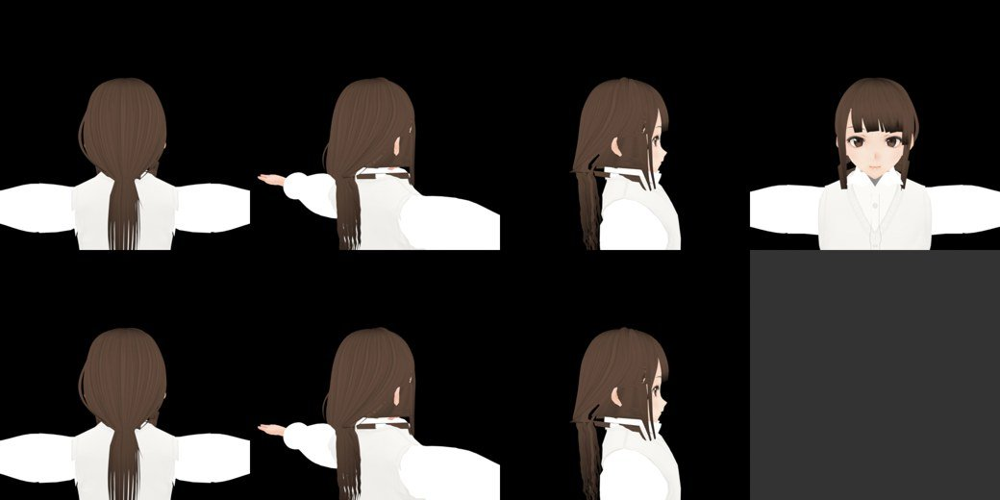
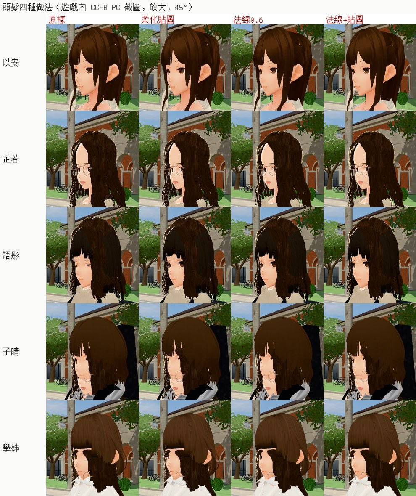
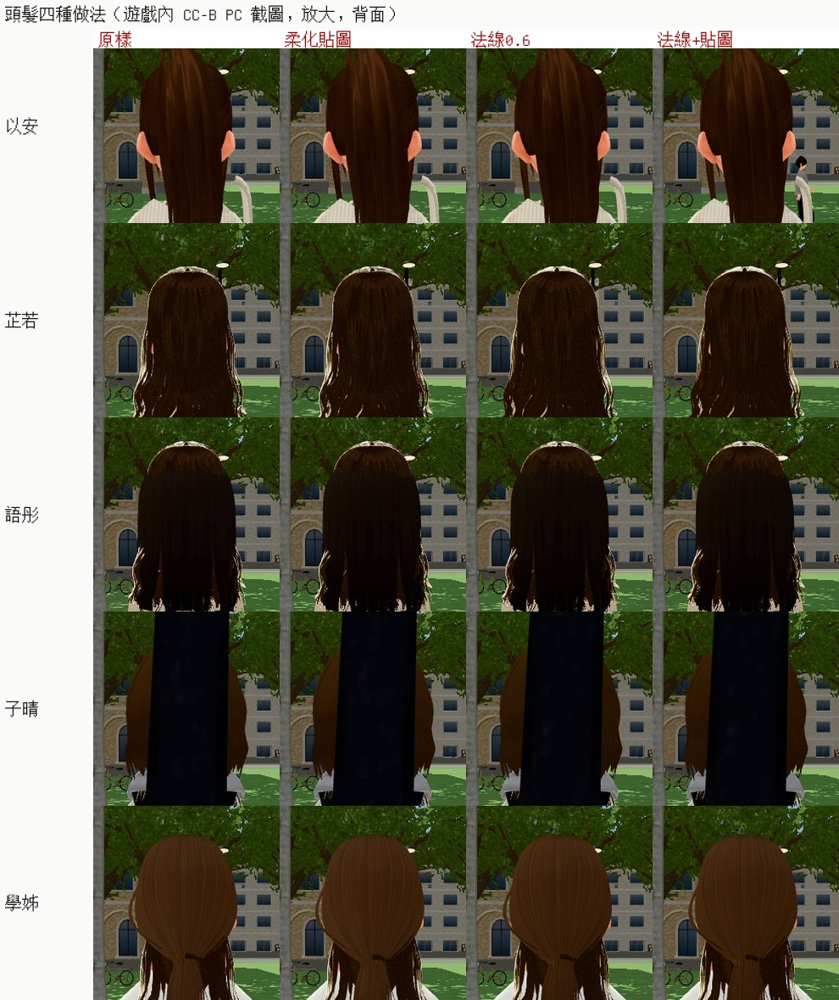
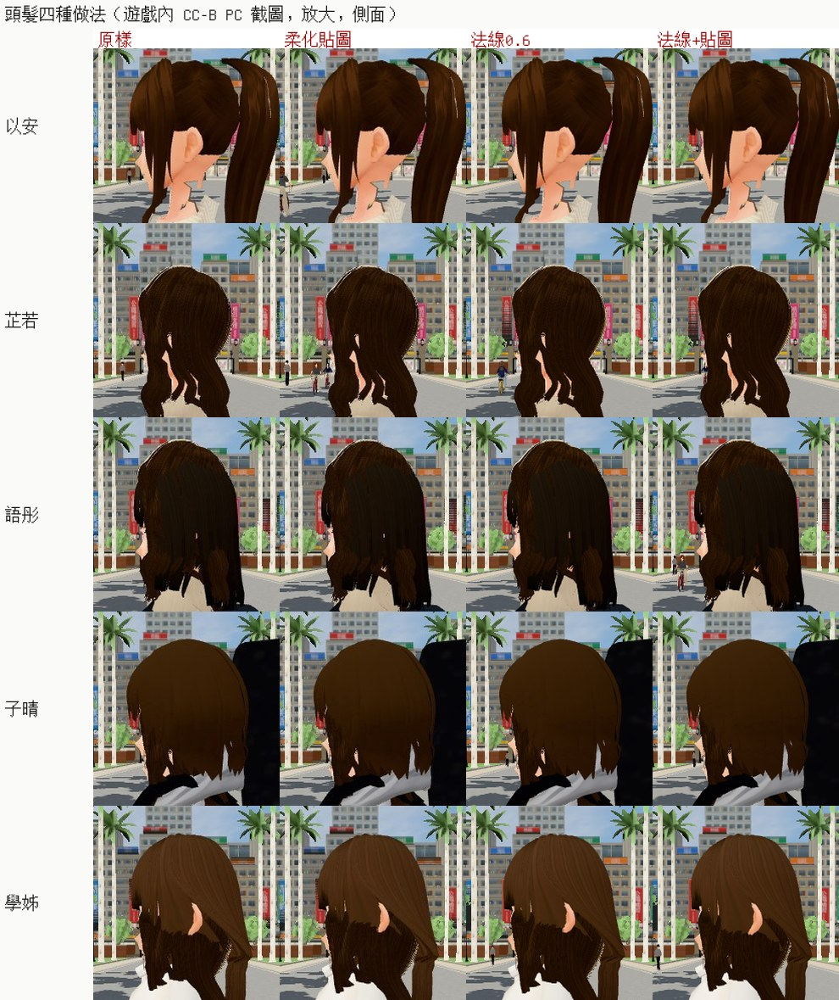
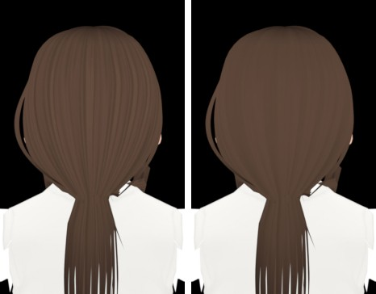
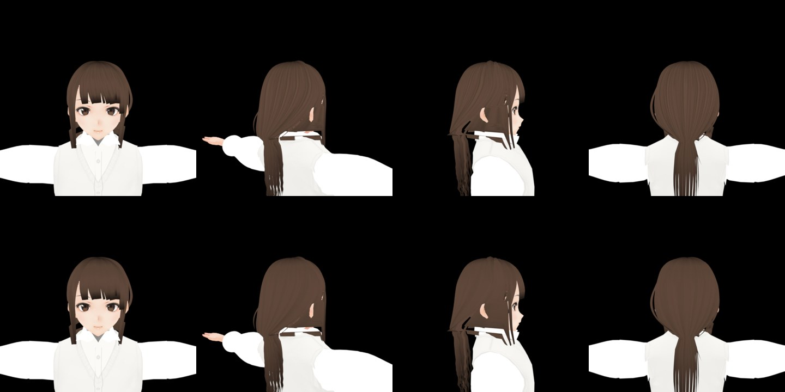
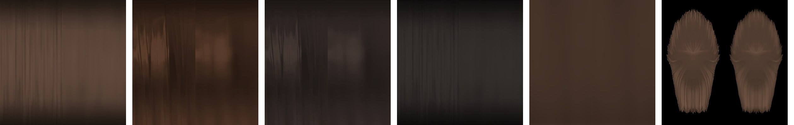

# HAIR-NOODLE-1104：頭髮「像泡麵」——改法候選＋遊戲內改前改後探針（LAWWW2-B 2026-11-07）

**起因**：使用者 11-04 13:2x 對 CC-C：「人物的頭髮真的太像泡麵了」（UA-CC-1104-03）。

**任務**：tasks.json `HAIR-NOODLE-1104`，P1，負責人 LAWWW2。
- 角色美術由值班 LAWWW 驗（D100a、D128），BB 可以給意見；
- 使用者點名的問題，不受 D99 人物凍結限制。

**狀態**：**改法還沒定，等遊戲內截圖**。這一包是：
- 讓 PC 一次拍出「原樣＋三種改法」的探針；
- 之後要烘進 VRM 的工具。

**VRM、遊戲檔都沒改。**

## 第二版探針（11-07 08:0x，CC-B 雲端試跑抓到的兩件）

1. `PLACE_JS` 回傳的 model 是整個 VRM 物件，Python 記錄時循環參照，一進校園就例外。CC-B 改成名字，這一版照收。
2. **以安的法線一個都沒改到**（「頭頂附近沒有頭髮」）：
   - 遊戲 `CHAR.build` 建好的人物，骨架的 `boneInverses` 帶了人在世界的位置；
   - 用頭骨算出來的頭在 (−58.9, 1.43, 5.9)，頭髮頂點在模型座標（x、z 在 0 附近），對不上；
   - 我第一版在 Node 是直接 `parseVRM` 比的，沒走 `CHAR.build`，所以沒抓到。
   - **改法**：頭的中心只看頭髮的幾何，不用骨架。頭頂＝所有頭髮頂點最高的一點；頭的軸＝頭頂往下 8 cm 那一圈頂點的 x、z 中心；同一個人的頭髮網格共用。`tools/hair_normals.py` 一起改。
   - **驗證**（Node，開發 `86f0c924f`）：
     - 用遊戲的 `CHAR.build` 建人物（和瀏覽器同一條路徑），六個人（祐廷＋五位女主角）的頭髮都改到了：
       - 祐廷 1 個網格、7,725 點；
       - 以安 2、8,553；
       - 芷若 1、9,600；
       - 語彤 2、17,161；
       - 子晴 3、9,239；
       - 學姊 2、12,468。
     - `CHAR.build` 路徑上，瀏覽器的 APPLY 和 `tools/hair_normals.py` 烘好的 VRM（`CHAR_FILE` 換檔）逐點比：以安、學姊**完全一樣**（0.000°）。
     - 中心和第一版（用頭骨）幾乎一樣，例如學姊 (0.003, 1.530, 0.001)。

## 為什麼卡了三天

- CC-C 11-04 寫好了頭髮近景探針（`cc_hair_compare_probe.py`，cc-testing `cc8c8ae6b`），但**沒有排進 PC 佇列**；
- 換了兩班（C → B）都在等它的結果。
- 這一班把它延伸成一次拍完改前、改後，請 CC-B 排。

## 已經知道的（BB-C `BB_259` B 節，11-04）

| 原因（影響大的在前） | 說明 |
|---|---|
| ① 每一束都是封閉圓管 | 法線是平滑的圓柱形，每一束各有一條自己的明暗 |
| ② 每一束貼同一條 256×512 貼圖 | 縱向細黑線、高光帶在每一束的同一個高度重複 |
| ③ 耳邊的細髮束、馬尾 | 一條一條等粗的深色圓管（看 BB 對照圖第一列） |
| ④ 貼圖解析度低 | — |

**BB-C 的離線試改**：
- ①「兩階明暗」（toony 0.9）會讓側面、背面多一條很硬的斜線；
- 這條線來自兩階明暗本身，**不是法線轉移**。

## 這一班加的

### 1. `tools/hair_normals.py`（之後烘進 VRM 用）

只改頭髮的法線，往一個膠囊狀的頭部外形混合：
- 頭頂下 11.5 cm 以上是球面，以下是往下 0.8 m 的垂直軸（長髮、馬尾照圓柱往外），兩段連續；
- 新法線＝normalize((1−k)·原本的＋k·外形的)；
- **不動** toony／shift（明暗邊界照舊柔和）、幾何、權重、貼圖；
- 認頭髮：材質名字有 `HAIR`，和遊戲 `character3d.js` 一樣；頭的中心只看頭髮的幾何（第二版；第一版用頭骨，遊戲裡對不上）；
- VRM 的 `asset.extras.hairNormals` 記 k、drop：重跑會擋下來，一律從沒改過的檔開始。

```
python3 tools/hair_normals.py --in <a.vrm> --out <b.vrm> --k 0.6
```

學姊、以安試跑：

| | 頭骨 | 頭頂 | 球心 | 轉的角度 中位數／p90 |
|---|---|---|---|---|
| heroine_05 | 1.417 m | 1.645 m | 1.530 m | 54°／145°（主髮） |
| heroine_01 | 1.422 m | 1.651 m | 1.536 m | 47°／115°（主髮） |

p90 很大的那些：每一束圓管「朝頭」那一面的法線，被轉成朝外。這正是要的：整頭像一塊，不再一束一束。

### 2. 探針 `cc_hair_fix_probe.py`（CC-C 原檔延伸）

`HAIRFIX`，預設 `0,n0.6,tex,n0.6+tex`。每個人只放一次，同一個位置、同一個鏡頭，連拍每一種：

| 做法 | 改什麼 |
|---|---|
| `0` | 原樣 |
| `n0.6` | 法線混合 0.6（＝`tools/hair_normals.py --k 0.6`） |
| `tex` | 頭髮貼圖的細線柔化：原圖 25%＋模糊 1.4 px 的 75%。只是看方向，正式要重畫貼圖 |
| `n0.6+tex` | 兩個一起 |

- **拍什麼**：
  - 祐廷＋五位女主角，校園白天 11:00；
  - 近拍 0.9 m 正面、45°、側面、背面，加遊戲跟隨鏡頭 4 m。
- **輸出**：每種做法一張總覽，`hair_overview_campus11_<做法>.png`。
- **改在哪裡**：都在瀏覽器裡改放好的那個人。原本的法線、貼圖記著，換下一種做法、下一個人前先還原；遊戲檔、VRM 不動。

**驗過的**（Node，D131 不在雲端開瀏覽器）：
- Python、四段 JS `node --check`；
- **瀏覽器裡的算法和 `tools/hair_normals.py` 一樣**：
  - 學姊、以安的 VRM 走遊戲同一條載入路徑（`ASSETS.parseVRM`，含 removeUnnecessaryVertices、combineSkeletons）；
  - 探針的 APPLY_JS 和 Python 改過的檔逐點比：最多差 0.024°（float 的捨入）；
  - 頭髮頂點改到 12,026／12,468、8,119／8,553。
- 所以遊戲內拍到的 `n0.6`，就是烘進 VRM 以後的樣子。

**排進 cc-local**：探針複製到 cc-testing `docs/story_planning/test_tools/cc/cc_hair_fix_probe.py`。

```
HAIR_FIX | <開發分支最新 SHA> | probe | docs/story_planning/test_tools/cc/cc_hair_fix_probe.py | index.html | 40 | CC_HEADLESS=0
```

- 預設 6 人 × 4 種 × 5 張＝120 張；
- 要室內晚上加 `ENVS=campus@11,linze@20`。

### 3. Blender 離線預覽（參考，不是遊戲畫面）

`hair_preview_h05.jpg`：學姊，接近 MToon 的柔和明暗（shift −0.3：大部分在亮面）。
- 上排原樣、下排法線 0.6：**差別很小**。
- 也就是說，照遊戲現在的明暗設定，法線不是主要原因；細線貼圖和細髮束的形狀比較可能是。
- 所以探針一定要有 `tex`。這是推論，等遊戲內截圖確認。



## 看了遊戲內截圖以後

| 看到的 | 下一步 |
|---|---|
| `n0.6` 明顯比較不像麵、沒有怪的明暗線 | `tools/hair_normals.py` 烘進要的 VRM（正式人物、路人底模），換檔、不改程式 |
| `tex` 比較有用 | 重畫頭髮貼圖：去掉每一束重複的細黑線、512×1024；高光改成整頭共用一圈（BB_259 第 3 項，半天） |
| 都不夠 | 動幾何：耳邊細髮束、馬尾併成 2～3 束、髮尾收尖；或換髮片（每個角色一天以上；人物外觀 LAWWW 定案） |

## 沒做、沒驗的

- 遊戲內截圖（CC）。
- 路人底模（`bl_npc_*`）、`?blchar` 的髮片版沒有試。
- 彈簧骨擺動時的樣子：只改法線，不影響彈簧骨；擺動時的明暗要看遊戲內。

## 遊戲內四種做法（CC-B PC，HAIR_FIX_v2＋v3，11-07 08:2x）

**來源**：cc-local `local_out/HAIR_FIX_v2`（`n0.6`、`n0.6+tex`）、`HAIR_FIX_v3`（原樣、`tex`）。校園 11:00，近拍 0.9 m，同一個位置、同一個鏡頭。
**缺**：祐廷的 `n0.6` 幾張超過 25 MB 沒推上來，所以下面只排五位女主角。





**我的讀法**（角色美術由值班 LAWWW 定，D100a）：

| 做法 | 看到的 |
|---|---|
| 法線 0.6 | **差別最大**：每一束各自的明暗條紋變淡，整頭比較像一塊（學姊背面、以安 45° 最明顯）；語彤整體暗一點 |
| 只柔化貼圖 | 細黑線淡一點，差別很小 |
| 法線 0.6＋貼圖 | 最平順。但貼圖是用模糊試方向，正式的要重畫（BB_259 第 3 項） |

**選了以後**：
- 法線：`tools/hair_normals.py --k 0.6` 烘進 VRM，只換檔、不改程式（Node 已驗：和探針逐點一樣）；
- 貼圖：照 README 上面「看了遊戲內截圖以後」那一表重畫。

## (a) 法線 0.6 烘進 VRM（LAWWW-B 11-07 08:40 選 (a)，D100a）

**換了哪些檔**（遊戲預設用的那一個，`ASSETS.manifest` 的 `url`；只換檔，不改程式）：

| 人物 | 檔案 | 頭髮頂點 | 備註 |
|---|---|---|---|
| 祐廷 | `assets/models/char/vroid_yuting.vrm` | 7,725 | |
| 以安 | `vroid_heroine_01.vrm` | 8,553 | |
| 芷若 | `bl_heroine_02.vrm` | 9,600 | 她的預設是 Blender 版 |
| 語彤 | `vroid_heroine_03.vrm` | 17,161 | 另外頭髮底色、陰影色 ×1.04 |
| 子晴 | `vroid_heroine_04.vrm` | 9,239 | |
| 學姊 | `vroid_heroine_05.vrm` | 12,468 | |

- 每個檔的 `asset.extras.hairNormals` 都記了 `{k:0.6, drop:0.115}`；語彤多記 `gain:1.04`。
- **驗證**（Node，遊戲的 `ASSETS.parseVRM`）：
  - 六個檔逐點和探針 HAIRFIX `n0.6` 的瀏覽器算法比，最多差 0.023～0.024°（float 捨入），頂點位置 0 個不同；
  - 頂點數和 CC 遊戲內探針改到的一樣。
- **語彤的亮度**（CC 截圖量，頭髮區）：
  - 背面頭髮中央 −3%，45°／側面／正面 +2～5%，平均差不多；
  - 但亮的髮束少了，看起來比較暗。照 LAWWW-B 的意思只提亮一點，×1.04。
- **子晴背後的黑色長方形**：是她的吉他袋。`props3d.js` 的 `guitarBag`，`#1e1f22`，掛在上胸骨，`character3d.js` 的 `MODEL_PROPS['char.heroine_04']`。本來就在，不是穿模。
- **沒換的**：
  - `blUrl`（`?blchar` 的 Blender 版）：`bl_yuting`、`bl_heroine_01／03／04／05`；
  - 路人底模（LAWWW-B：先不動）。
- **請 CC 同一組鏡頭重拍**：HAIRFIX=0，因為新檔本身就是 n0.6。祐廷用 JPG（`HAIR_JPG=1`）。

## (b) 頭髮貼圖去細線（LAWWW2-B 11-07；LAWWW-B 09:04 排在 (B) 之後）

**狀態**：READY_FOR_ART_REVIEW。角色美術由值班 LAWWW 決定、標記（D100a）。遊戲內畫面請 CC 拍。

**為什麼要改貼圖**：
- VRoid 的頭髮貼圖，寬度方向是橫跨一束，高度方向是沿著一束往下。
- 每一束頭髮的 UV 都是同一張貼圖，所以貼圖裡的每一條細黑線，每一束都有一份，整頭就變成一根一根的麵。
- 法線 0.6（a）讓每一束各自的明暗變淡，但細黑線是畫在貼圖裡的。

**工具 `tools/hair_texture.py`**（只動頭髮的底色貼圖；`_MainTex` 和 `_ShadeTexture` 是同一張）：
- **strip**（整張都是髮束的貼圖：`Hair_00_HAIR`、`HAIR_01`）：
  - 只沿寬度方向模糊（σ＝寬度的 4.5%），細線和每一束邊緣的深色線變成平順的寬帶；
  - 留 15% 的中頻層次，不變成塑膠；
  - 沿長度方向的明暗照留：髮根暗、髮尾亮、VRoid 畫在同一個高度的高光帶。每一束的高光帶在同一高度，整頭合起來還是一圈，所以不用另外加高光。
- **card**（後髮片 `HairBack`，有透明度的頭髮輪廓）：
  - 只在不透明的範圍裡沿 x 模糊（透明度加權，邊緣不會滲黑）；
  - 透明度不動。
- **不動**：
  - 瀏海那種一塊一塊的 UV 排版（`HAIR_02`、`HAIR_03`）：橫向模糊會把不同的 UV 島混在一起；
  - 芷若：她的預設是 Blender 髮片版 `P02_HairCard`，細線本來就是髮片的設計。
- **不加高光、不加 matcap**：之前 `no_hair_shine` 刻意拿掉頭髮的亮片，這裡不加回去。
- 解析度照原本（256×512、後髮片 512×512）。結果是平順的，放大只多吃記憶體，所以沒照原本計畫的 512×1024 放大。
- 照原本的格式存：以安、語彤、子晴、學姊的髮束貼圖原本是 JPEG，照舊存 JPEG。檔案大小差不多，例如學姊 3.77 → 3.74 MB。
- 檔案的 `asset.extras.hairTexture` 記了參數；同一個檔重跑會被擋下來。

**換了哪些檔**（都從 (a) 已經烘好法線的版本再處理）：

| 人物 | 檔案 | 改的貼圖 |
|---|---|---|
| 祐廷 | `vroid_yuting.vrm` | `Hair_00_HAIR`（strip） |
| 以安 | `vroid_heroine_01.vrm` | `HAIR_01`（strip） |
| 語彤 | `vroid_heroine_03.vrm` | `HAIR_01`（strip）、`HairBack`（card） |
| 子晴 | `vroid_heroine_04.vrm` | `HAIR_01`（strip；本來就幾乎是平的）、`HairBack`（card） |
| 學姊 | `vroid_heroine_05.vrm` | `HAIR_01`（strip）、`HairBack`（card） |

**驗證**（`hair_b_verify.txt`）：
- 除了頭髮貼圖，VRM 的其他資料都逐 byte 相同：網格、法線、骨架、其他貼圖、材質參數。JSON 只差檔案位置和 `extras.hairTexture`，五個檔都是。
- strip 貼圖：
  - 橫向細節（相鄰兩欄的平均差）少 80～90%（例如學姊 0.82 → 0.09）；
  - 每一列的平均顏色差 ≤ 0.66／255，所以沿長度的明暗不變；
  - 整張平均顏色不變。
- card 貼圖：
  - 透明度逐點相同；
  - 整張平均差 ≤ 0.5／255；
  - 髮尾稀疏那幾列的平均會變（最多 21／255），因為那幾列只有幾個不透明的點，會跟上下的顏色平均。
- 會讀這五個 VRM 的 19 支 Node 測試，換新檔後全過。







**還沒驗**：
- 遊戲內畫面（CC）：同 HAIR_FIX 那一組鏡頭、HAIRFIX=0，祐廷用 JPG。
- 彈簧骨擺動時。
- 手機實機。
