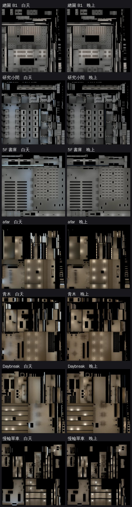

# 光照第二級：總圖 B1、研究小間、5F 書庫＋公館 afar、青木、Daybreak、慢輪單車（LAWWW2-B 2026-11-07～08；lm_audit_1107 第二級）

接在第一級三批後面：第一批 `a6509d2a0`、第二批 `09bbfefe2`、第三批溫州街六間 `50dab3abd`。
- LAWWW-B 11-07 17:49 說「lm_audit 第一級照排」、20:46 說「第二級照你排的做」。
- 做法和第一級一樣：在原檔上烘。只加第二套 UV、scene 的 `extras.lightmap`、拆開共用的材質；幾何、節點、名字、座標、配置、instancing 都不動。
- **遊戲程式不用改**：七間都走 `Z3.attachRoomGLB`，GLB 有 `extras.lightmap` 就接。

## 動了誰做的哪個檔
| 區域 | 檔案 | 誰做的 | 原檔 sha256 | 大小 |
|---|---|---|---|---|
| 總圖 B1 | `assets/models/env/second_ai/library_b1.glb` | **LAWWW2**（4.1 版，blob `87f1da5e`；**使用者已 ART_APPROVED**） | `3a616dbc8dad3d35035cd68a70f312e472affbc89bd46a84480bbc47ce4449c6` | 2,774,684 → 2,966,728 B |
| 總圖研究小間 | `assets/models/env/second_ai/library_carrels.glb` | **LAWWW2**（AA_399 第 3 節，blob `312b581d`） | `2dac709f9404b903398a7c3b840a22bcbb8f0fd720af034454c5d5462aa18e20` | 1,961,528 → 2,066,184 B |
| 總圖 5F 書庫 | `assets/models/env/second_ai/library_stacks.glb` | **LAWWW2**（AA_399 第 3 節，blob `4a26982f`） | `9353962d43aea1e0809294bbe2c6fd06d8edce46236b3d303d6ab3e7c7c0611b` | 2,008,724 → 2,087,576 B |
| 公館 afar | `assets/models/env/second_ai/aa_support/afar.glb` | **AA** | `5fa13fa9367efb71d058d452cbea09d719904da5244e48f11322bd96a6634ed7` | 3,143,276 → 3,193,220 B |
| 公館 青木 | `assets/models/env/second_ai/aa_support/aoki.glb` | **AA** | `24d15993559753ac6efcf7dc4152ecbdd4118124ce762f0422eca3c6f10337f9` | 2,909,760 → 3,003,112 B |
| 公館 Daybreak | `assets/models/env/second_ai/aa_support/daybreak.glb` | **AA** | `467095cf8b6dcf2a65ae586f1f054778746eb1e4b8a2230449a72f1a5073afad` | 3,069,088 → 3,169,556 B |
| 公館 慢輪單車 | `assets/models/env/second_ai/bb_support/bike.glb` | **CC**（開發 `933b9c36d`／`4daed9539`） | `6b02e2097326db2418734f5172643513ef209934ffac8e05c0591e917199892d` | 3,335,056 → 3,529,448 B |

- 原作者以後重新匯出，光照貼圖會不見，要再烘一次：
  - 總圖三間：`bash tools/blender/env_second/lightbake/bake_library_b1.sh`、`bake_library_upper.sh carrels|stacks`。這兩支腳本寫死原檔的 blob，不會拿烘過的檔再烘。
  - 公館四間：`bake_gg_new.sh aa_afar|aa_aoki|aa_daybreak|bb_bike`。
    - 輸入檔已經烘過（場景有 `extras.lightmap`）會停下來，要用 `IN=<原檔>`。
    - `IN=<原檔>` 是 11-08 起才有的，`1aa6be18a`。

## 要接的檔
各間的檔都在我的分支 `claude/funny-albattani-iawshm`：

| 間 | commit | 檔 |
|---|---|---|
| 總圖 B1 | `59702fc0d` | `library_b1.glb`＋`_lm_day.webp`／`_lm_night.webp`＋`tools/blender/env_second/lightbake/library_b1_lm.json` |
| 研究小間 | `be46b8878` | `library_carrels` 同一組四個檔 |
| 書庫 | `60c63348f` | `library_stacks` 同一組四個檔 |
| afar | `56d91b587` | `aa_support/afar` 同一組四個檔 |
| 青木、Daybreak | `19843fc3e` | `aa_support/aoki`、`aa_support/daybreak` 各一組四個檔 |
| 慢輪單車 | `1a5b92358` | `bb_support/bike` 同一組四個檔 |

另外：
- **腳本**：
  - `tools/blender/env_second/lightbake/bake_library_b1.sh`（重寫）、`bake_library_upper.sh`（新）、`mesh_lights.py`（新：把發光網格分群換成燈）。
  - `bake_gg_new.sh`、`bake_room.py`、`glow_points.py`：一盞那一包 `5a6f73313` 已經接過，這一批沒有再改。
- **測試 patch** `lib_lm2_1107_tests.patch`（對開發 `df95b5042`）：
  - 新增 `tests/library_lm2_unit.js`（總圖三間）。
  - `tests/gg_new_lm_unit.js` 加公館四間（7 行）。

## 怎麼烘的
| | 燈 | 烘（其他照舊即時光） | 天光 |
|---|---|---|---|
| 總圖 B1 | 日光燈 131 支，`mesh_lights.py` 從 `library_b1_tubes` 網格讀位置，面光源各 4.7 W；燈下往上補光 131 個 3.8 W；暖色檯燈 76 盞 3 W | 地板、天花板、柱子、木牆板、四面牆和牆裙 | 沒有。中庭天窗 `GLOW_library_b1_courtsky` 只在白天發光（`--dayemit` 3），西側玻璃開口 |
| 研究小間 | `WALL_C_tube` 17 支面光源 5 W＋往上補光 4 W | 地板、天花板、牆 | 東側開口；窗外天光板 `CARREL_SKY` 只在白天發光（2） |
| 5F 書庫 | `WALL_C_tube` 83 支 4 W＋往上補光 3.2 W（試烘 0.45／0.41 太亮 → ×0.8） | 地板、天花板、牆 | 南側開口；書架 instancing 53 個不展開 |
| afar | GLOW 標記 23 盞換點光源（倍數 2.4） | 地板、天花板、牆、牆上的木作 | 店面（+z）；**白天天光色調 1.32,1.0,0.72** |
| 青木 | GLOW 16 盞（倍數 1.7；試烘 2.4 → 0.38 太亮） | 同上 | 同上 |
| Daybreak | GLOW 15 盞（倍數 1.7；試烘 2.4 → 0.38 太亮） | 同上 | 同上 |
| 慢輪單車 | GLOW 18 盞（×1.8；試烘 ×1.0 → 0.24 太暗）；吊燈燈罩（instancing）烘的時候藏起來 | 地板、外露混凝土樓板＋樑、隔間牆、四面牆 | 店面整面玻璃；色調同上；instancing 46 個節點名字照原檔補回（沒有對不上的） |

- **白天天光色調**：公館四間第一次烘就套。
  - 這是 BB-B 判一盞「店門口木地板灰藍」以後加的 `--skytint`（`dd0502c68`）：只乘白天的天光，燈和晚上那一張不動。
  - 藍天光的亮度不變，顏色接近中性。
- **總圖三間沒有套**：B1 沒有天光，研究小間、書庫的天光是窗外的光板。

## 亮度（WebP 編碼後、有用到的像素平均）
| | 白天 | 晚上 | 過曝 |
|---|---|---|---|
| 總圖 B1 | 0.38 | 0.38 | 0% |
| 研究小間 | 0.35 | 0.30 | 0% |
| 5F 書庫 | 0.41 | 0.37 | 0% |
| afar | 0.35 | 0.31 | 0% |
| 青木 | 0.35 | 0.32 | 0% |
| Daybreak | 0.36 | 0.32 | 0% |
| 慢輪單車 | 0.33 | 0.31 | 0% |
| （參考）總圖 3F、社科圖 | 0.31／0.30、0.40／0.34 | | |
| （參考）咖啡店、西式店的目標 | 晚上約 0.32 | | |

- 總圖 B1 白天、晚上一樣：沒有窗，白天只多中庭天窗。中庭的光只照到西側玻璃附近，是預期的。
- B1 在遊戲裡，`library_b1_3d.js` 讓中庭天空的發光整天一樣亮。晚上那張光照貼圖沒有中庭的光，所以晚上天空那一塊可能照樣亮。這一點不大，請 CC 拍晚上時順便看。

## 測試（Node，D131；工作樹＝開發 `df95b5042`＋這一批）
- `library_lm2_unit.js`（新）：開發原樣 **FAILED 3**（三間都沒有 `extras.lightmap`）→ 加這批 **ALL PASS**（20 項）。
  - 要接的節點、窗景卡、instancing 個數（B1 10、書庫 53）、牆的 extras、`CARREL_SKY` 材質都照舊。
- `gg_new_lm_unit.js`（加四間）：開發原樣 **FAILED 4** → **ALL PASS**。
- 提到這七間、`attachRoomGLB`／`roomLightmap`、`lm_day` 的 **67 支全部過**。

## 還沒驗
1. **總圖 B1 是使用者 ART_APPROVED 的 4.1 版**：模型沒動，但光照變了（原本即時光、平光）。**請 BB-B 再看一次**，必要時問使用者。
2. 遊戲內（CC 拍、BB-B 判）：七間白天、晚上，從門口往裡看；書庫的書架走道、研究小間學姊的 03、B1 中庭邊。
3. GPU 顏色、手機效能（PC）。
