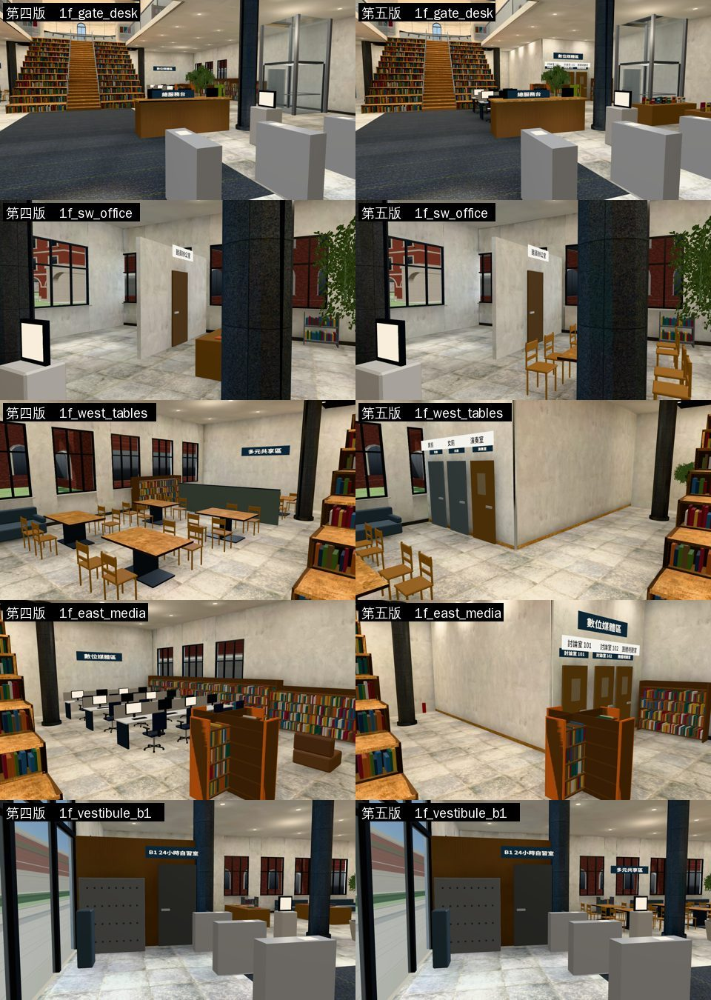
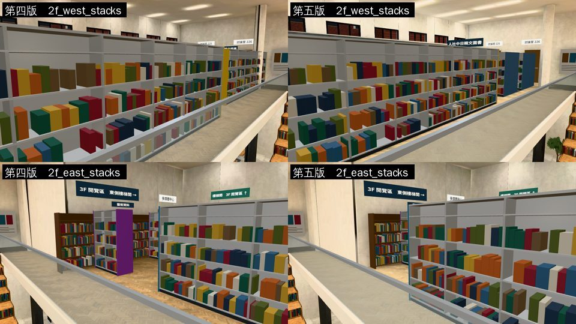
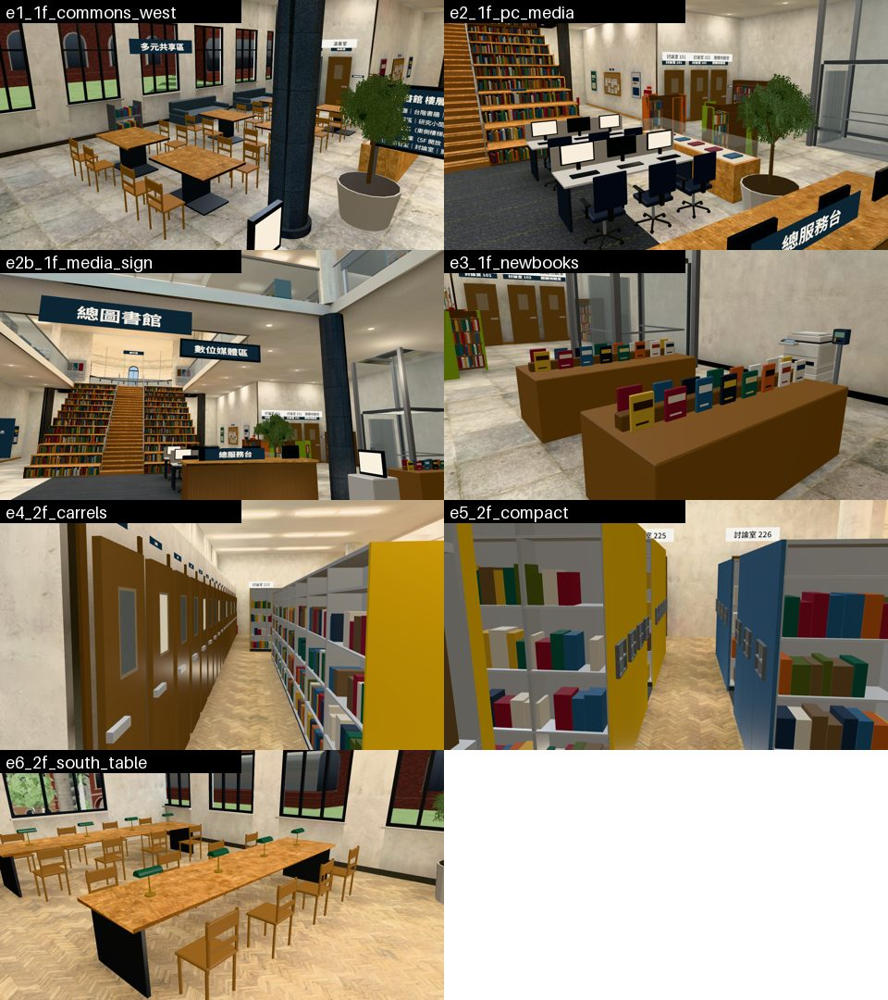

# 總圖一樓、二樓第五版（LIB-PLAN-1103 第五版，BB 11-03 12:11 的九點）——LAWWW2 2026-11-03

狀態：**`ART_APPROVED`（BB，11-03 20:14，第二輪 52dbf7f8e，D128）**，有條件：patch 接進開發分支以後，候選版要跑 flow_library_floors、flow_library_scene、nav、reachability，全部 PASS。出現走不到或卡住的地方，這個標記就取消。BB 記成 P3 的有四項：研究小間的窗偏灰、新書是色塊、研究小間的門長一樣、小房間的牆可以再多一點東西。原本的狀態：`READY_FOR_REVIEW`。建築美術照 D128，由 BB 驗收；整合由 LAWWW 做。patch 接開發分支 `b049c84e3`。

- 配置：照舊由 `tools/blender/env_second/library_hall_v2_layout.py` 產生。新增 `plan_1f_v5`、`plan_2f_v5`；用法是 `--base <第一版 library_layout.js 的 repo>`，第一版取自 `3b74f9b24`。
- 研究小間的關門說明照用開發分支 4fc0dda22 的句子（「研究小間。閉館時間，門鎖著。」）。和開發分支現在的 library_layout.js 比過，只差這一句。

## 一樓
| BB | 改了什麼 |
|---|---|
| ① 多元共享區在大廳「西半邊」 | 四人桌六張（1.4 m 寬，兩欄 x −8.9／−6.8，三排 z −4.4／−1.3／1.8）搬到大廳西半邊，從西牆的沙發排到中庭展示櫃前；西牆掛「多元共享區」 |
| ② 數位媒體區在「中間偏東、服務台北邊」 | 兩排電腦桌（各三個位子）在服務台北邊、台階前走道東側（x 1.6～4.0，z −4.6／−2.2）；十字形影音櫃照舊；影片櫃搬到東牆（原本的期刊架那裡） |
| ③ 北邊兩個翼樓放小房間 | `roomBlock` 兩塊：西北＝男廁、女廁、演奏室；東北＝討論室 101、102、團體視聽室。門關著、有門牌，演奏室、討論室門上有小窗。台階兩旁留走道（側牆 x ±7.2），一樓照樣走得到展演廳 |
| ④ 新書展台的白色卡片 | 搬到服務台東邊（x 8.4，z 3.4／1.2）。中間一道矮木條，兩面各立一排書，封面是底色＋書名色帶＋作者細帶 |
| ⑤ 金字塔書架 | 拿掉（共享區裡的矮隔屏、閱報架）；兩張視聽單人椅也拿掉，因為會擋到討論室的門 |

## 二樓
| BB | 改了什麼 |
|---|---|
| ⑥ 西牆研究小間 230～249、黃色書庫在中間偏西、自習長桌拿掉 | `carrelRow`：西牆一排 20 間研究小間，門朝東、門上小窗、每間一個門牌（230～249），有幾間窗裡亮著暖光（使用中）；備用模型有一個「看研究小間」的互動點。黃色「人社中日韓文圖書」三排長書架從北排到南（x −9.0／−7.4／−5.9，z −9.0～−1.4）。北邊兩張自習長桌拿掉，只留南邊靠窗的兩張（z 3.0 是小安「總圖的下午」那張，座位不變） |
| ⑦ 東半邊西文書庫要長、要多列 | 中段四列（x 5.21／7.07／8.93／10.79，z −5.3～−1.1）、南段三列（z 1.9～4.7）、北段紫色「藝術資料」兩列；書架間 1.24 m，中間留往 3F 樓梯間的東西向走道（z −6.0） |
| ⑧ 西北翼樓是密集書庫＋期刊 | `compact` 兩塊：西＝密集書庫（黃色端板）、東＝期刊（灰藍）；一列一列緊貼的雙面書架，中間拉開一條縫看得到書，朝走道那端有手輪。中間的走道 x −8.8～−7.6，北邊照舊是討論室 225、226 的門 |
| 地板 | 二樓人字拼木地板改成淺色（`parquet_l` #dcc39c，和展演廳同一個；原本 `parquet` #c7a77e）——D112 |

## 給 LAWWW：程式改的地方（都在 patch 裡）
- `src/library_hall_v2.js`：`furniture2` 新增三個型別 `roomBlock`、`carrelRow`、`compact`，都是備用模型＋導航阻擋；`carrelRow` 多一個互動點。
- `src/story3d.js`（一行）：總圖大廳背景讀書的人原本是 `E.zone.seats.slice(2)` 取第 3、8、13 個，二樓的座位少了兩張長桌（8 個），取到的會變成一樓的座位、卻被放到二樓。改成只取二樓的座位，超過就取餘數。小安「總圖的下午」用的是 z > 0 那張長桌，不受影響。
- 一起修的舊 bug：第四版把一樓還書車搬到 (−11.35, 0.6) 時，導航阻擋留在舊位置 (−6.45, −6.4)，變成一塊看不見的障礙。
- 導航：
  - 西北柱子 (−5.2, −14.4) 和台階中間只剩一格寬的縫，放一盆盆栽擋住，路線改從柱子西邊繞。
  - 二樓多媒體中心南牆的牆邊書架（第一版 x 4.7～9.3），西端縮 0.9 m，東側走道出口不再夾成一格寬。
- 門的 id：新加 `wc_m`、`wc_f`、`music`、`disc101`、`disc102`、`avroom`（都關著，`wall` 指 `rooms_w`／`rooms_e`）。研究小間 230～249 沒有門 id（備用模型有一個互動點）。
- **沒動**：電梯（東側，BB 同意記成已知差異）、遊戲能進去的研究小間 `library_carrels`（門照舊在二樓東牆）。如果要把它搬到西牆那一排，需要你決定（會動到 `library_carrels` 的出入口）。

## 交付檔（11-03 19:25）
- `library_v5_1103.patch`（4.3 MB，含二進位）：`src/data/library_layout.js`、`src/library_hall_v2.js`、`src/story3d.js`（只有上面那一行）、`assets/models/env/second_ai/library_hall_v2.glb`（10.9 MB）、`library_hall_v2_lm_day.webp`、`_lm_night.webp`。開發分支 `b049c84e3` 上 `git apply --check` 通過。`library_v5_layout_WIP.patch` 是之前的半成品，用這一份取代。
- 研究小間讀者的 patch（`wip/carrel_readers/`）也改 story3d.js，但改的是不同的行，兩份可以一起套用。
- 光照烘焙：`bake_library_hall_v2.sh 512 … 1024`，lm_probe 全部通過。原本「2F 西翼地板」只有 0.249（門檻 0.3），因為研究小間和密集書庫擋住了屋頂的採光；在西翼加了屋頂採光條（x −11、−9.8、−8、−6.65），烘焙後是 0.361。測量點和門檻都沒改。腳本 `library_hall_v2.py`、`bake_library_hall_v2.sh` 用同一份採光條清單。

## 前後比較（遊戲截圖，第四版的 7 個鏡頭）

- 「1f_west_tables」和「1f_east_media」這兩個鏡頭，第五版看到的是小房間的牆和門。BB ③ 要求小房間放在北邊兩翼，原本鏡頭對著的地方現在就是這些房間；四人桌和電腦桌已經搬到 ①、② 寫的位置，但這 7 個鏡頭裡都沒拍到。BB 驗收時，可以在遊戲裡從大廳中央往西、往東看。
- 還沒達到參考照片的地方：
  - 小房間的牆沒有任何裝飾，看起來太空；
  - 新書展台的書是貼圖色塊，不是一本一本建模的書；
  - 研究小間的門一排完全一樣。

## 第二輪（11-03 20:1x，BB 19:28 的意見）
`library_v5_1103.patch` 換成這一版，取代 7f3f04f41 那一份。一樣接開發分支 b049c84e3，`git apply --check` 通過。依序套 liufa_camvia → library_v5 → carrel_readers，三份都通過。

| BB | 改了什麼 |
|---|---|
| 「數位媒體區」的牌子掛在討論室門上，會被當成那幾扇門的名字 | 牌子改成吊牌，掛在電腦桌那一區的南端、二樓連廊樓板的北緣下（服務台北邊，x 2.8，高 4.15 m）。兩面都有字：從門廳看得到，從樓梯下來也看得到。底板和兩根吊桿是新家具型別 `hangSign`，備用模型只畫底板 |
| 小房間的兩面牆太素 | 兩道側牆朝大廳那一面各加：一個公告欄（木框、軟木、八張釘著的紙、圖釘，上面掛「公告」字牌）、兩個海報框、一個滅火器箱（紅色鐵箱、白色小窗、上面紅牌）；房間那一排最靠中間的那段牆加「請保持安靜」小告示 |
| 補拍（⑥要看得到幾間亮燈） | 補拍時發現：研究小間門上小窗的暖光塊放在門片後面，被門片擋住，整排都是灰的。改成放在門片前面、玻璃後面，用發光材質；20 間裡 7 間亮燈，其他是暗的 |

- 烘焙重跑兩次，lm_probe 都是 ALL PASS（最後一次 2F 西翼地板白天 0.33、門檻 0.3）。
- Node 13 支總圖測試，在 b049c84e3＋這份 patch 上都是 ALL PASS。

### 補拍（BB 列的 6 張＋吊牌一張；遊戲截圖，14:00，藏起人物）

各張拍的是：
- e1：多元共享區六張四人桌，西牆掛著「多元共享區」；
- e2：兩排電腦桌、十字形影音櫃，後面是東側小房間的牆（公告欄、海報框）；
- e2b：從門廳看吊牌「數位媒體區」；
- e3：新書展台近景；
- e4：研究小間 230～249，亮燈的窗是淺色的；
- e5：密集書庫、期刊和手輪；
- e6：南邊窗邊的兩張自習長桌，z 3.0 那張是小安的位子。

還沒達到參考照片、已記 P3 的地方：
- 新書是色塊；
- 研究小間的門一排完全一樣；
- 亮燈的窗在白天看起來偏白，不夠暖。

## 測試（開發分支 b049c84e3＋這個 patch）
- 都通過：`nav_buildings_unit`（含總圖「互動點都走得到」、62 個座位）、`library_copier_unit`、`library_media_unit`、`library_upper_unit`、`library_b1_unit`、`library_hall_v2_oldsave_unit`、`library_hall_cam_core_unit`、`library_hall_lightmap_unit`、`libq_aa_1102_unit`、`libq_out_1102_unit`、`aa379_sis_lib_unit`、`lib_front_unit`、`lib_lawn_unit`。
- 中途失敗、已經修好的：
  - 側牆在 ±5.9、±6.6 時走不到展演廳；
  - 新書展台在 x 8.0 時從門廳走不到電梯；
  - 東翼書架間只有 0.8 m 時走不過去；
  - 西北翼的密集書庫一開始是一整塊，壓到測試點 (−8.2, −13.8)。
- **沒跑**：瀏覽器的 `flow_library_floors`、`flow_library_scene`（SwiftShader 很慢）；手機實機也還沒看過。
