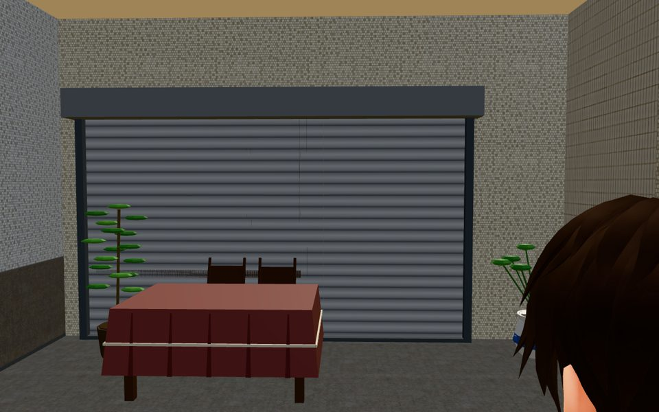
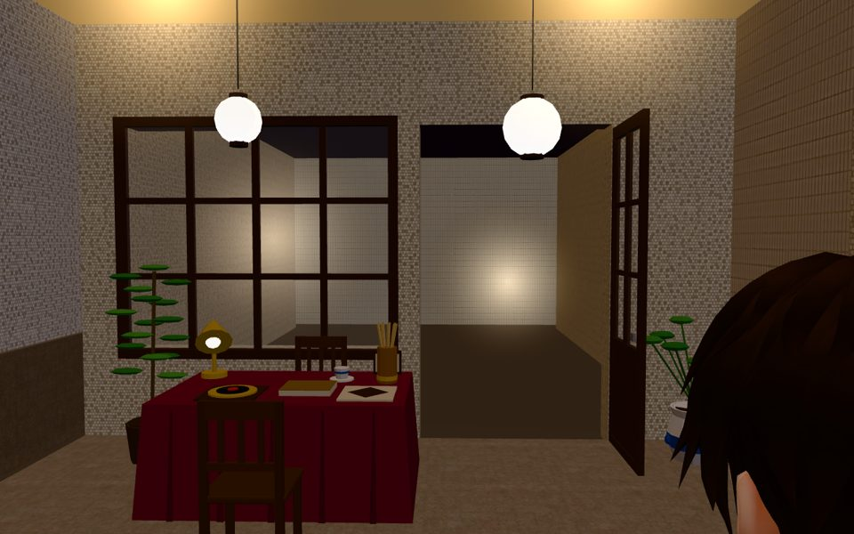

# LIMAO-DOOR-CLOSE-1114：禮貌生財打烊時收起往外開的格子門（LAWWW2-C 2026-11-14）

BB_379（BB-C 11-14 11:20）：「打烊時要把門收起來。§12 第 1 點規定打烊後不能看起來還開著，鐵捲門前面多一扇開著的格子門，會像還在營業。請把門扇拆成自己的節點，打烊時藏起來或轉成關著。」

## 改了什麼（patch：`limao_door_close_on_4cc26d4b8d.patch`，底是開發分支 4cc26d4b8d，已含 LIMAO-REAL-VIEW-1114）
1. **`tools/blender/env_second/wz_shopkit.py`**：往外開的門扇（`leaves`）可以收進自己的節點。
   - 設定 `leaf_node` 時，門扇用 `_copy_group` 收進那個節點。這和阿德影印的 `COPY_*` 兩種外觀是同一套：名字開頭 `COPY_` 就不參加合併。
   - 沒設定 `leaf_node` 的店照舊合進大網格。
2. **`tools/blender/env_second/wz_street.py`**：TZ_ARC limao 加 `leaf_node='COPY_LIMAO_LEAF'`。
3. **`assets/models/env/second_ai/tingzhou_street.glb`**：重建。
   - 和開發分支那一顆比：32 張貼圖逐張相同，多 4 個節點（門扇的群組＋3 個網格：木框、門把、玻璃）。
   - 三角形總數不變，只是從大網格搬到門扇節點。
   - 門扇看得到的時候多 3 個 draw call，打烊藏起來的時候不畫。
4. **`src/tingzhou3d.js`**：
   - 街景模型接上以後，找 `COPY_LIMAO_LEAF`，記在 `zone.tzLimao.leaf`。
   - 和算命桌、店燈同一個開關（`S.limaoOpen`，營業時間照 places.js）：營業顯示，打烊藏起來。
5. **`tests/limao_real_view_1114_unit.js`**：加 ⑥（3 項）。
   - 查三件事：門扇節點在、位置對（門軸、高 2.66、往騎樓開）、遊戲照營業開關。
   - 改之前這 3 項 FAIL（舊模型沒有這個節點），改之後 ALL PASS（19 項）。

## 測試（在 4cc26d4b8d＋這個 patch 上）
- `limao_real_view_1114_unit`：ALL PASS（19 項）。
- 檔名有 tz_／tingzhou／shop_／limao／place_gate／shutter／copy／wz_ 的 87 支：ALL PASS。
- `place_gate_unit`：ALL PASS，0 個新問題。

## 截圖（雲端 SwiftShader）
| 14:00 打烊：鐵捲門，門扇收起來了 | 20:00 營業：門扇開著 |
|---|---|
|  |  |

- 遊戲裡讀到的狀態：14:00 `leaf.visible false`，20:00 `leaf.visible true`。
- 20:00 這張是剛進區域就拍的，店內還沒輪到顯示（雲端算圖慢，見 LIMAO-REAL-VIEW-1114 的 README），所以門裡面是空的。

## 還沒做的
- LAWWW 套 patch → CC 拍第二層 → BB 判。
- BB 另外說：門口互動點的字要寫營業時間 19:00～23:30。這是 LAWWW／AA 的字（§12 第 6 點），不在這個 patch 裡。
