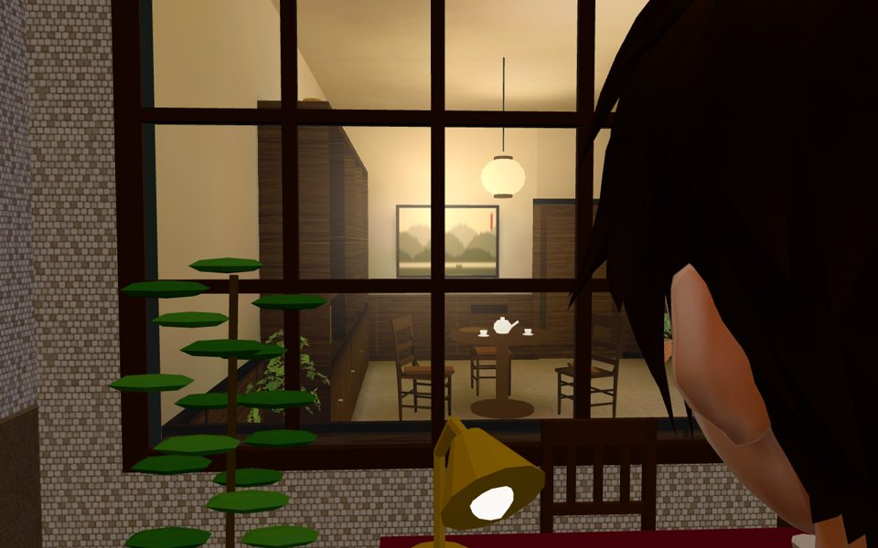
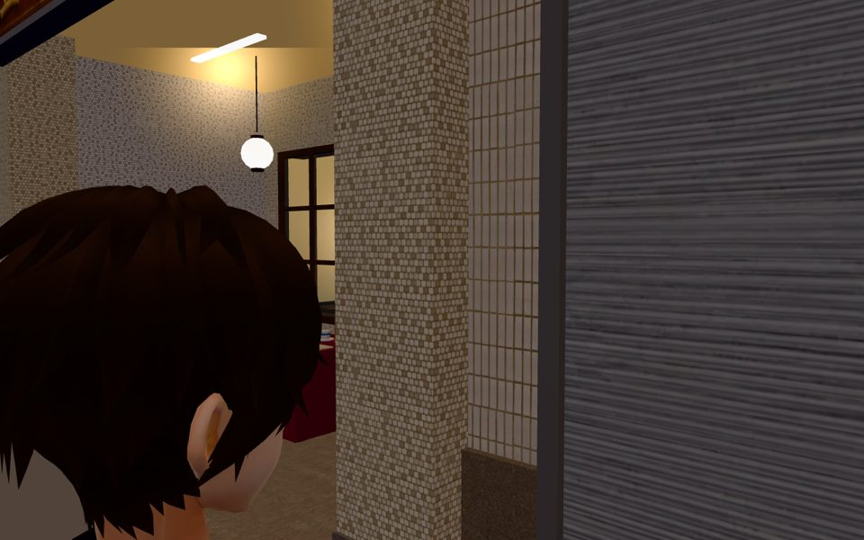
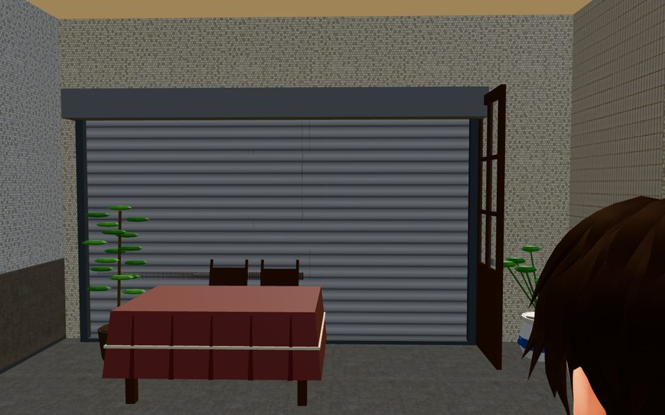

# LIMAO-REAL-VIEW-1114：禮貌生財從巷子看進去是立體的店內（LAWWW2-C 2026-11-14）

店面標準 §12 第 1 點：「從店外往裡看是立體的店內，視角移動會跟著變，不貼一張圖」。

## 原本
巷 A 南側的禮貌生財，格子窗和開著的木門後面各貼一張圖（`wz_street.py` TZ_ARC limao 的 `limao_win`、`limao_door`，在玻璃後面 0.8 m）。
走近了換角度，看進去的還是一張平的圖。汀州路那七間和溫特寶邸早就改成在玻璃後面放走進去的那一顆室內（`Z3.shopInsideReal`），只有這一間沒改。

## 改了什麼（patch：`limao_real_view_on_846c29e2ef.patch`，以開發分支 846c29e2ef 為底）
1. **`tools/blender/env_second/wz_street.py`**（TZ_ARC limao）：
   - `real=True`：窗、門後面不放圖、不做窗洞內牆。玻璃、深色木格子窗框、往外開的那扇格子門、招牌、騎樓都照舊。
   - 室內 `tz_limao_interior.glb` 深 10.4 m，但這一棟玻璃後面只有 7 m。新加一支 `real_w`：一樓量體只留室內兩邊（各留 6 cm 縫）和室內天花板（3.3 m）上面那一段，從玻璃挖到這一棟的後面（`back=7`）。
   - 室內的後半（書房）伸進後面水源市場那一排（TM_N，z 13～19）的一樓量體裡，從街上看不到。
   - 室內後面那一段不做護牆。
2. **`assets/models/env/second_ai/tingzhou_street.glb`**：重建（`wz_street.py -- --set tingzhou`）。
   - 和開發分支那一顆比：32 張貼圖逐張相同（md5）、節點 239 個名字一樣、材質一樣。
   - 只有 5 個網格變了：玻璃後面的圖、窗洞內牆、夜裡的亮光片拿掉；兩邊的牆加上；護牆拿掉。
   - 三角形 103,953 → 103,857；檔案 9.92 → 9.91 MB。
3. **`src/tingzhou3d.js`**：
   - `S.shopReal()` 加禮貌生財。
   - 它不在汀州路那一排（`T.shops`），所以從 `TINGZHOU_LAYOUT.limao` 算：
     - 玻璃線 z＝limao.z＋dep＝5.5；室內轉 π（正面朝巷子）；正面貼在玻璃後面 2 cm。
     - 沿著店面量距離（`ex`＝寬的一半）。
     - 打烊的鐵捲門蓋窗＋門那一段：室內 x −2.4～1.62，加上軌道到 1.72，高 2.75。右邊停在往外開的格子門門軸（1.75）前面——第一輪截圖看到軌道穿過門扇，改了。
   - 室內自己的正面牆（`WALL_S`、`WALL_Sfix_*`，`dir`＝[0,0,−1]）照 shopInsideReal 原本的規則藏起來，窗格只看到街景那一層。
   - `S.SHOP_LIT_PLACE` 拿掉 `limao`：街景模型沒有那一格亮光片了，亮暗由 shopInsideReal 管（和溫特寶邸 v2 一樣）。
4. **測試**：
   - 新的 `tests/limao_real_view_1114_unit.js`（16 項）。改之前 FAIL 6 項（而且找不到這一間就停了），改之後 ALL PASS。它查五件事：
     - ① 街景設定
     - ② 位置、轉向、離玻璃 2 cm
     - ③ 門窗對得上、門的互動點在室內的門洞裡、鐵捲門蓋得住而且不穿過門扇、室內在這一棟的寬度裡
     - ④ 正面牆會被藏、沒有零件穿出玻璃
     - ⑤ 重建後玻璃後面 0.8 m 沒有圖（改之前那一格 112 個頂點，改之後 0）
   - `tests/shop_real_inside_1112_unit.js` 的 ㉓ 原本寫死「汀州路 7 間」，改成 7 間＋禮貌生財。㉔～㉖ 是汀州路那一排的算法，略過禮貌生財，它由新測試查。

## 測試結果（在 846c29e2ef＋這個 patch 上）
- `limao_real_view_1114_unit`：ALL PASS（16 項）
- 檔名有 tz_／tingzhou／shop_／limao／place_gate／shutter 的 53 支：ALL PASS（含 shop_real_inside_1112、tz_front_lit_1112、shop_cc0_unit）
- `place_gate_unit`：ALL PASS，0 個新問題（PASS 788 項）。`--coplanar`：`tests/place_gate_coplanar.json` 沒有變。

## 截圖（雲端 SwiftShader，fast_shots.py；在 846c29e2ef＋這個 patch 上）
| 20:00 營業：從騎樓隔著格子窗看進去 | 20:00 從巷子斜看門裡面 | 14:00 打烊：鐵捲門 |
|---|---|---|
|  |  |  |

- 20:00 格子窗後面是走進去的那一顆室內：深色木書櫃、山水畫、紙燈籠、圓茶桌和木椅。視角移動會跟著變，不是一張圖。
- 14:00 鐵捲門放下。`shopReal` 的狀態：`k 0.07`（店內暗）、`shut true`。
- 雲端軟體算圖每一格很慢：前兩個鏡頭拍的時候室內還沒輪到顯示（`built true`、`on false`），玻璃後面是空的磁磚牆。第三個鏡頭以後就 `on true`。
- 在使用者電腦第一次走近要多久才顯示，請 CC 量。汀州路其他七間也是同一套預載，看到空的那一下以前就有。

## 還沒做的
- 打烊時往外開的那扇格子門還是開著，立在鐵捲門旁邊；門扇是合併在街景模型裡的。BB 覺得要收起來的話，把門扇拆成自己的節點，打烊時藏起來，另開一項。
- 算命桌下午 14:00 也擺在騎樓。這是原本的樣子，`nm_stalls.py` 的 LIMAO_TABLE，不是這次改的。
- CC 在使用者電腦拍第二層（從店外看進去立體、視角跟著變、打烊鐵捲門）→ BB 判。
- 白天（19:00 以前）禮貌生財沒營業：鐵捲門是放下來的（§12 第 1 點「打烊看得出來關了」）。如果 AA／BB 覺得命理館白天應該是「木門關著」而不是鐵捲門，改 `sb` 或另外做門片，另開一項。
