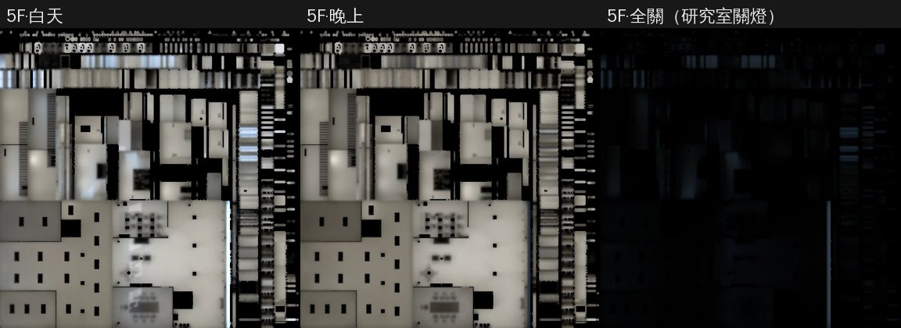

# 霖澤館 5F 光照烘焙：白天／晚上／研究室關燈（LAWWW2-B 2026-11-07）

**派工**：
- LAWWW-B 14:48：盤點完以後烘霖澤 5F 研究室；
- LAWWW-B 14:51：「5F：照宿舍做法多烘一張全關（roomDarkMap／z.lightsOff），linze_upper3d.js apply5 的 patch 附上我看，可以」。

**狀態**：READY_FOR_ART_REVIEW（場景：BB／使用者看）。遊戲內畫面要 CC 拍。

**5F 有什麼**：
- 北邊走廊、教授研究室 501～504 的門、會議室 P3（門上的「口試中」）；
- 西南角學姊的研究室（八張桌子，她的位子在門邊）；
- 南牆一排窗。

劇情：學姊的事件、口試、第三年聖誕夜（ev_sis_xmas_y3，2027-12-24 21:00，研究室只開她的檯燈）。

## 做法

腳本 `tools/blender/env_second/lightbake/bake_linze_5f.sh`：
- 直接烘 assets 裡現在的 GLB；
- 512 取樣，三張共約 28 分鐘。

**燈**（`tube_lights.py` 從 GLB 讀）：
- 走廊、會議室、教授研究室的嵌燈 `linze_5f_tubes` 15 盞，研究室的 `LAB_tubes` 3 盞；
- 每盞一個 30 W 面光源，在燈管下緣。
- 學姊桌上的檯燈（`LAB_SIS_LAMP`）不烘、不當光源：遊戲裡那裡有一盞即時的暖色點光。

**三張貼圖**：

| | 光源 | 平均亮度 |
|---|---|---|
| 白天 | 天空＋太陽（方位 160°、仰角 35°，窗在南面），和 3F、4F 同一組；燈也開著 | 0.36 |
| 晚上 | 只有燈 | 0.29 |
| **全關** | 燈全關，只剩窗外的夜空（`--darksky 0.045`，和宿舍熄燈同一個值） | 0.003 |

**全關那一張**：
- 研究室的燈有三種狀態（`LZUP.labLights`）：
  - `'all'` 全開；
  - `'sis'` 只開學姊的檯燈；
  - `'off'` 全關。
- 現在的遊戲在 `'sis'`、`'off'` 時把**整層**的環境光、天花板燈調暗（`k5`），所以全關那一張也是整層的燈都關。
- 用到 `'sis'` 的只有第三年聖誕夜 21:00，是晚上，所以只有夜空是對的。

**不烘（照舊即時光）**：
- 燈管、檯燈、冰箱燈、螢幕；
- 頂點色的小東西、金屬件、鋼板、印刷品；
- 會議室門上的「口試中」牌（`WALL_P3_EXAM_SIGN`：用材質的 visible 開關，不能和牆共用光照貼圖的材質）；
- 玻璃；
- 東西兩面牆上的木條：一千多個小島，3F、4F 也不烘。

## 遊戲端（patch：`linze_5f_lm_1107.patch`）

**`src/linze_upper3d.js` 的 `apply5` 加一行**：
- 研究室的燈不是全開時叫 `z.lightsOff(1)`，全開時叫 `z.lightsOff(0)`。
- `Z3.roomDarkMap` 在 GLB 有 `dark` 那一張時，attachRoomGLB 會自動接上。
- 燈管的自發光一起暗：`GLOW_l118_tube`，走廊和研究室共用。
- 學姊的檯燈材質（`GLOW_l118_warm`）不在 `tube|lamp_bulb` 裡，`'sis'` 時照舊亮。

**順序**：
- `lightsOff` 會把區域的點光源調暗，包括學姊的檯燈 `light5.sl`。
- 所以檯燈的亮度在 `lightsOff` 後面才設：`'sis'` 2.6、`'all'` 0.6、`'off'` 0。

**沒有 `lightsOff` 的舊 GLB**（或正式模型還沒載好）：照舊不出錯。正式模型載好時 `apply5` 會再叫一次。

## 檔案

| 檔案 | 大小 |
|---|---|
| `linze_5f.glb` | 2.84 → 3.07 MB（primitive 50 不變、材質 15 → 17） |
| `linze_5f_lm_day.webp` | 84 KB |
| `linze_5f_lm_night.webp` | 79 KB |
| `linze_5f_lm_dark.webp` | 16 KB |

## 測試（Node，開發 `e9d8c668f`）

新 `tests/linze_5f_lm_unit.js`：

| | 結果 |
|---|---|
| 開發原樣 | FAILED 4 |
| 只換 GLB、不加 patch | FAILED 3（研究室關燈沒換貼圖） |
| GLB＋patch | **ALL PASS** |

檢查五件事：
- ① 三張貼圖的檔都在；
- ② 該烘的有第二套 UV、不烘的沒有；
- ③ 沒有共用材質；
- ④ 牆、LAB_、口試中的節點都在；
- ⑤ `labLights` 'off'／'sis'／'all' → `lightsOff(1／1／0)`，檯燈 0／2.6／0.6；舊 GLB 不出錯。

另外，會讀 5F、`linze_upper3d.js`、`lab5f3d.js`、`LZUP`、`roomDarkMap`／`lightsOff`、`attachRoomGLB` 或光照的 60 支測試全過。工作樹另外放著今天其他幾包的檔，一起跑。

## 還沒驗

- **遊戲內畫面（CC）**：
  - 5F 白天 11:00、晚上 20:00，研究室門口往裡、走廊各一張；
  - 聖誕夜（2027-12-24 21:00，`'sis'`）研究室：只有檯燈那一圈亮，其他地方暗。
- 人物照同一間的光沒做，照舊是遊戲的半球光。
