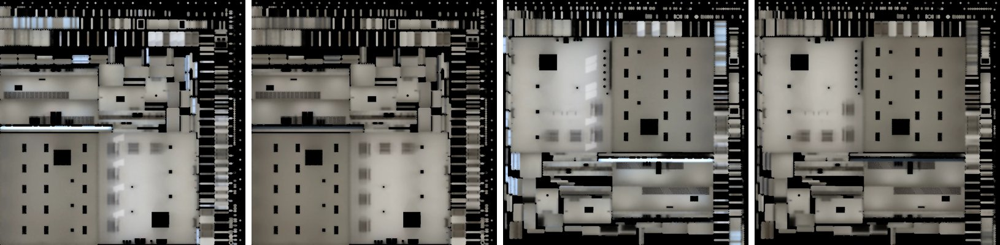

# 霖澤館 3F、4F 光照烘焙（INTERIOR-AAA-REVIEW-1028 P1；LAWWW2-B 2026-11-07）

**派工**：LAWWW-B 10:14「回去推 INTERIOR-AAA #113」。

**為什麼先做這兩層**：
- 我自己做的室內裡，還沒烘光照的有：霖澤 3F／4F／5F、萬才研討室、共同 3F、總圖三間小室、宿舍 205／洗衣間。
- 霖澤 3F 的討論區、4F 的自習討論區是法學院學生最常待的地方，所以先做。

**狀態**：READY_FOR_ART_REVIEW（場景：BB／使用者看）。遊戲內畫面要 CC 拍。

## 做法

**不用改遊戲程式**：
- `linze_upper3d.js` 用 `Z3.attachRoomGLB` 接正式模型；
- GLB 場景有 `extras.lightmap`，就自動接白天、晚上兩張光照貼圖（和 Café、溫州街三家一樣）。

**腳本** `tools/blender/env_second/lightbake/bake_linze_upper.sh`：
- 直接烘 assets 裡現在的 GLB，不重新產生（`linze_upper.py` 之後改過，重產會和交出去的不一樣）。
- 每層 384 取樣，CPU 約 15 分鐘。

**燈**：
- 天花板嵌的日光燈 15 盞（x −6、−3、0、3、6 × z −5.2、0.4、3.6），照 `linze_upper.py` 的位置。
- 每盞一個 30 W 面光源，放在燈管下緣。

**白天和晚上**：
- 白天：天空＋太陽（方位 160°、仰角 35°），從南牆一排窗進來。
- 晚上：只有燈。
- 外殼只開南面（窗）；教室的門、樓梯間都是關著的。

**不烘的（照舊即時光）**：
- 燈管、冰箱燈；
- 頂點色的小東西（販賣機、微波爐、飲水機、回收桶…）、金屬件、印刷品、玻璃；
- 東西兩面牆上的木條：一千多個小島，試烘時擠掉一大塊貼圖。

**解析度**（`uv_fill.py`，3F）：
- 每公尺 20～29 個像素，和 202 教室同一個水準；
- 填滿率 56%。

**檔案**：
- `linze_3f.glb` 1.13 MB、`linze_4f.glb` 1.12 MB；
- 光照貼圖每張 61～69 KB（WebP，1024×1024）。

- 地板上看得到長桌長椅腳的接觸陰影，燈下比較亮。
- 白天靠南窗那一側比較亮，晚上只剩燈。
- 平均亮度：

| | 白天 | 晚上 |
|---|---|---|
| 3F | 0.38 | 0.30 |
| 4F | 0.39 | 0.30 |

## 測試（Node，開發 `e70d19503`）

| | 開發原樣 | 換新 GLB＋貼圖 |
|---|---|---|
| 新 `tests/linze_upper_lm_unit.js`（`linze_upper_lm_1107.patch`） | **FAIL 4** | **ALL PASS** |
| 會讀 `linze_3f`／`linze_4f` 的 15 支＋光照相關 3 支 | — | 18 支全過 |

新測試檢查五件事：
- ① 兩層的白天、晚上貼圖都在；
- ② 地板、天花板、牆、腰牆、長桌長椅有第二套 UV；
- ③ 燈管、小東西、木條、玻璃沒有第二套 UV；
- ④ 淡出的牆節點都在；
- ⑤ `linze_upper3d.js` 照舊用 `attachRoomGLB`。

**18 支是**：
- linze_upper、linze_5f、lab5f、room_ceiling、room_map_labels、quick_travel_areas、campus_l123；
- aa355、aa496、aa581、exam_lib_crowd、lane118_sched、phone_unify、r2y3a、v6_ex；
- singleside_interiors、lm_instancing、room_rtnight。

## 還沒驗

- **遊戲內畫面（CC）**：3F、4F 各拍白天 11:00、晚上 20:00，玩家鏡頭兩個角度：
  - 從電梯出來往南；
  - 討論區往北。
- 人物照同一間的光沒做，照舊是遊戲的半球光，和其他烘過的房間一樣。
- 5F 研究室樓層還沒烘：有隔間、研究室的燈要能單獨開關（`LAB_tubes`、學姊的檯燈），要另外處理。
