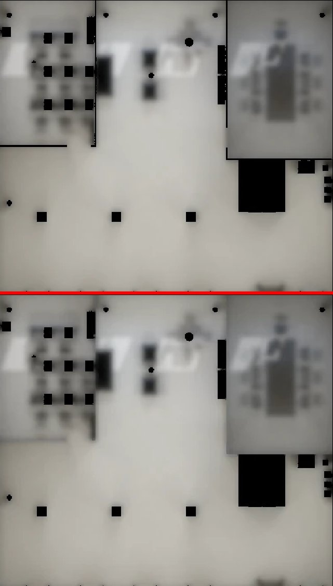
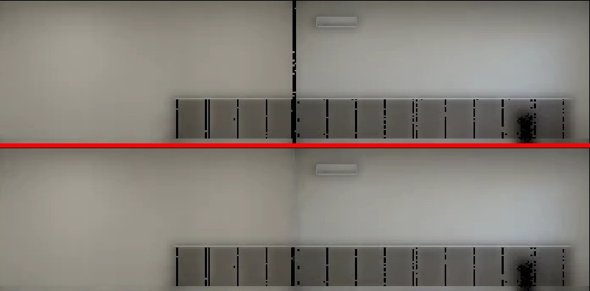

# 牆淡出以後露出烘焙陰影：開著的門板＋被牆蓋住的格子（BB-B 11-08 LM3_cloud；LAWWW2-B 修，D108）

## 現象
- BB-B 06:25 的判定，證據在 cc-testing `CC/logs/LM3_cloud/linze_5f_day.jpg` 第三排（lab_in）。
- 霖澤館 5F 研究室，鏡頭在走廊、玩家在研究室裡 (−5.8, 1.2)。
- 左邊那片隔間牆（P2）的背面，從靠鏡頭的牆腳斜到中段，有一大塊深褐黑的斜帶。c435933a6（第二批隔間牆兩面都烘）以後才有。
- BB-B 06:35：0c49eb7a7（隔間牆零件跟主牆一起淡出）前後一模一樣，所以不是同一面牆的零件。
- BB-B 要求兩批隔間牆都掃一遍，不要只修這兩面。

## 原因 1：開著的門板跟錯牆淡出（5F 那條斜帶）
- 研究室的門開著。門板 `WALL_P1_door` 和門把 `WALL_P1_doormetal` 轉了 90°，貼在 P2 背面前 15 cm（z 0.06～1.17、高 0～2.15 m）。
- 在模型裡，門板屬於門洞那面牆 P1（`dir [0,0,−1]`）。
- 鏡頭在走廊、P1 淡出的時候，門板跟著藏起來，露出它烘在 P2 背面的影子：
  - 把 P2 背面的光照貼圖照世界座標攤平看，靠鏡頭那一端 1.2 m 寬、2.1 m 高是暗的（0.18，旁邊 0.57）。
  - 畫面上看起來是斜的，是透視加上邊緣模糊。
- 為什麼 c435 以後才有：在那之前 P2 背面沒有真的烘，整片一個值，門板藏起來也看不出來。
- 同樣的門板還有兩片：美國公寓、合租戶的大門 `WALL_S_door`，屬於外牆 S，卻貼在廚房牆 `kit_e_wall_k` 前 16 cm。

**修法**：`glb_partition_at.py` 加了規則 B，把門板的淡出改成跟它貼著的那面牆（GLB extras 的 `dir`、`at`、`partition`）。
- 怎麼認門板：WALL_ 網格最薄的方向不是自己 dir 的方向（轉過 90°）、厚度 ≤ 20 cm，而且前面 30 cm 內有一面和它平行、面積 ≥ 1 m² 的牆。
- 套在所有房間 GLB 上，只認出這 4 個：5F 門板、5F 門把、美國公寓大門、合租戶大門。
- 效果：門板一直跟那面牆一起顯示或一起藏。
  - 牆在的時候，門板蓋住它自己的影子。CC 那一張，P1 淡出了，門板還在。
  - 牆藏起來的時候，門板也藏起來，所以不會露出門板朝牆那一面（烘成黑的）。
- 只動節點的 extras。幾何、材質、第二套 UV、光照貼圖都不變（`glbdiff` 逐節點比過）。

## 原因 2：被牆蓋住的那幾公分烘成黑的（兩批隔間牆都有，大部分是舊的）
烘焙時，被牆蓋住的地方照不到光，烘出來是黑的。牆在的時候本來就看不到，牆一淡出就露出一條黑線。常見的有這幾種：
- 牆腳下的地板；
- 隔間牆的一端插在外牆裡，或 T 字接在另一面牆上；
- 門板貼著門框的那幾公分；
- 天花板被牆頂、燈蓋住的地方。

BB-B 那張 5F 的畫面就有兩條，c435 前後都有：
- 最下面一條橫的黑線：P1 牆腳下的地板；
- 右邊外牆一條直的黑線：P1 接到外牆的地方。

**修法**：新工具 `lm_fill_covered.py`，把被蓋住的格子補成旁邊的顏色。只改光照貼圖，不動 GLB，不重烘。
1. 照 three.js＋`attachRoomGLB` 的規則，算每個 WALL_ 網格的淡出判斷，在 400 組鏡頭／玩家位置下算它顯示或藏。
2. 光照貼圖逐格算出世界座標。「被蓋住」的條件：
   - (a) 沿法線 2 cm 內碰到別的 WALL_ 網格，或 (b) 這一點在別的 WALL_ 網格的實心裡；
   - 而且有鏡頭／玩家位置會讓它露出來：這個面顯示、朝著鏡頭，蓋住它的網格卻藏起來。
3. 從同一個網格、沒被蓋住的相鄰格子一圈一圈往裡補。整塊島都被蓋住的，用這個網格的中位數。邊界外 4 格的留邊重新往外擴。
4. 白天、晚上（5F 加熄燈）用同一張遮罩補，存成 WebP（品質 90、method 6，和 `to_webp.py` 一樣）。
- 補過的格子在牆顯示的時候被蓋住、看不到，所以平常的畫面不變。
- 重新存 WebP，全圖平均差 1.5／255（有損壓縮再存一次），看不出來。

5F 光照貼圖攤平的改前（上）、改後（下）：

- 地板：牆腳下的黑線（研究室 P1、P2，會議室 P3、P4）都沒了。
- 留下的黑方塊、深灰方塊是桌腳、書櫃，不是牆，一直都在。

- 西牆：P1 接進來那條直的黑線沒了。
- 百葉護牆板的縫是同一面牆的零件，不會露出來，沒動。

## 新的檢查工具 `lm_fade_reveal_check.py`（不用改程式，交件時量給你看）
- 找出每一對「接收面、擋住它的 WALL_ 網格」，條件：
  - 擋住它的網格會藏起來、接收面還在；
  - 被擋那一塊比沒被擋的暗（< 0.75 倍）；
  - 至少 2% 的鏡頭組合會露出來。
- 量的是 30 cm 內的擋光，比 `lm_fill_covered` 的 2 cm 寬：2～30 cm 的接觸陰影是真的看得到的，不能補。

| 房間 | 改前（開發 7206a12de 的檔）：全部 對數／m²｜牆面 對數／m² | 改後 |
|---|---|---|
| 總圖 B1 | 21／7.26｜13／0.93 | 17／5.50｜13／0.86 |
| 研究小間 | 5／5.62｜2／3.97 | 1／3.79｜1／3.79 |
| 霖澤 5F | 17／8.18｜10／5.37 | 9／2.49｜5／0.44 |
| 體育館 B1 | 4／13.73｜1／0.21 | 2／0.28｜0／0 |
| 美國公寓 | 75／29.91｜36／19.95 | 55／17.27｜19／10.14 |
| 合租戶 | 57／13.76｜22／10.16 | 36／3.86｜8／1.00 |

## 要換的檔（16 個，光照貼圖 13 個＋GLB 3 個）
| 檔案 | sha256（開發 → 這一版） | 大小 |
|---|---|---|
| `library_b1_lm_day.webp` | `2d75f9c7…` → `5678dc11…` | 43,482 → 43,056 B |
| `library_b1_lm_night.webp` | `ded55185…` → `218e552b…` | 44,546 → 43,072 B |
| `library_carrels_lm_day.webp` | `f5f48cf5…` → `af17f4ca…` | 60,178 → 52,766 B |
| `library_carrels_lm_night.webp` | `5c2db48c…` → `acb5267a…` | 49,998 → 44,578 B |
| `linze_5f.glb` | `43f4fd92…` → `b42f20a6…` | 3,070,436 → 3,070,572 B |
| `linze_5f_lm_dark.webp` | `c7df22ea…` → `3b40bf4c…` | 16,740 → 15,890 B |
| `linze_5f_lm_day.webp` | `2ab85548…` → `d65be984…` | 89,658 → 84,974 B |
| `linze_5f_lm_night.webp` | `2a08f94c…` → `ade01564…` | 81,308 → 79,764 B |
| `gym_b1_lm_day.webp` | `6f177d56…` → `747cc9d0…` | 37,484 → 36,884 B |
| `gym_b1_lm_night.webp` | `f56b90ce…` → `ffc4a938…` | 37,652 → 37,244 B |
| `us_apartment.glb` | `652c2cbc…` → `762e9d2f…` | 4,343,228 → 4,343,300 B |
| `us_apartment_lm_day.webp` | `a392b4ec…` → `dc2f955f…` | 124,658 → 123,516 B |
| `us_apartment_lm_night.webp` | `3dc6e138…` → `00887e0f…` | 115,992 → 115,916 B |
| `us_shared.glb` | `5fddb9c8…` → `ea93fb6a…` | 3,979,344 → 3,979,412 B |
| `us_shared_lm_day.webp` | `e46844c1…` → `da9bb97c…` | 107,734 → 103,838 B |
| `us_shared_lm_night.webp` | `ec157ba7…` → `1c4e1117…` | 93,020 → 92,002 B |

- 都在 `assets/models/env/second_ai/`。「開發」＝7206a12de／d9646a770 上的版本，也就是 0c49eb7a7 那一版。
- 六間都是 LAWWW2 做的模型和烘焙。總圖 B1 是使用者 ART_APPROVED 的 4.1 版；這次只補被牆蓋住的格子，牆在的時候看到的畫面不變。
- `*_lm.json` 不變。
- 工具：
  - `tools/blender/env_second/lightbake/glb_partition_at.py`：加規則 B。
  - `lm_fade_reveal_check.py`、`lm_fill_covered.py`：新的。

## 測試（工作樹＝開發最新 `d9646a770`，Node＋Python，D131 不開瀏覽器）
- **`partition_fade_group_unit.js`**（這個資料夾；換掉 tests/ 裡 0c49 那一版，① ② 不變，加 ③）：
  - ③ 5F lab_in 那一張（鏡頭 (−5.8, 4.2, −2.6)、玩家 (−5.8, 0, 1.2)）：P1 淡出、P2 顯示，門板要留著。
  - ③ 三間的門板和它貼著的牆，300 組鏡頭／玩家位置下一起顯示或一起藏。
  - 開發原樣 **FAILED 4**：5F 那一張門板 ✗；三間 279／135／135 次不一致。這一版 **ALL PASS**。
- **`lm_covered_fill_check.py`**（新的，放 tests/；在 repo 根目錄跑 `python3 tests/lm_covered_fill_check.py`）：
  - 六間每一張光照貼圖：被蓋住、會露出來的格子，平均亮度要 ≥ 旁邊 3 格的 0.85 倍。
  - 開發原樣 **FAILED 12**：B1 0.68 倍、研究小間 0.14、5F 0.46、體育館 0.33、美國兩間 0.29～0.34。
  - 這一版 **ALL PASS**：0.89～0.98 倍。熄燈那一張本來就近乎全黑，差 ≤ 3／255 算過。
- 提到這六間或 `labLights` 的 Node 測試：結果見下面「全部 Node」一行（跑完補上）。

## 沒修、記下來的
1. **美國公寓 `WALL_bath_n_door`**：一個節點裡有兩片開著的門板，各貼不同的牆。
   - 西邊那片離臥室牆 2 cm，被蓋住的格子已經補了。
   - 東邊那片離外牆 22 cm：外牆淡出時，看得到門板朝外牆那一面偏暗（0.27 倍）。
   - 要在 Blender 拆成兩個節點才能各自跟牆，排在後面（P3）。舊的就有，BB-B 雲端判美國公寓 PASS。
2. **2～30 cm 的接觸陰影**：牆腳、牆角旁邊本來就有的柔和陰影。牆淡出時，留下一圈淡淡的影子。這是真的看得到的陰影，不能補。
3. **研究小間 `WALL_PN_trim`**：同一個節點裡混了西邊轉角的 10 個三角形，外框中心偏 0.9 m，所以沒加 at。
   - 5% 的組合會有一塊淡一點（0.70 倍）。
4. **其他有光照貼圖的房間**（約 40 間，沒有隔間牆）：外牆腳下的地板也有同樣的黑線，鏡頭在屋外、外牆淡出時看得到。
   - `lm_fill_covered.py` 可以照樣跑，要不要做等 LAWWW-B／BB-B 決定。

## 還沒驗
- 遊戲內：CC 用 LM3_cloud 同一個機位重拍 5F lab_in（白天、晚上），BB-B 判。
  - 應該看到開著的門板貼在左牆前，牆上沒有斜帶；最下面那條橫的黑線、右邊牆那條直的黑線也沒了。
- 其他五間的同機位重拍，加 PC GPU 一輪。
