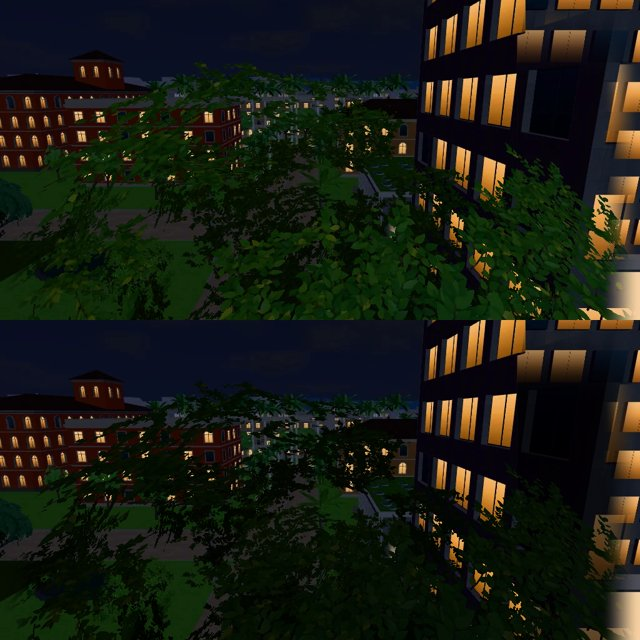

# 霖澤 5F 研究室窗外晚上還是亮綠的樹（BB-B 16:04 P2；LAWWW2-B 2026-11-07）

**BB-B 16:04**（CC-B 雲端截圖 `cc-testing d164f36ce6` `SCENE3_e66_cloud/lz5f_views.jpg` 第 3、4 列）：
- 研究室那面窗在 20:00、聖誕夜 21:00，窗外還是白天亮綠的樹；
- 走廊的窗已經是暗的。

## 原因

- 5F 的窗是 `room()` 的窗，窗景兩層：
  - 遠景 `linze_5f_{day,night}.webp`；
  - 近景（法學院廣場大樟樹的樹冠）`linze_5f_near_{day,night}.webp`。
- 19:12 以後換夜景，程式沒問題：`zones3d.js` room() 的 applyTime → `W3.setWindowView`；近景照 `VIEW_LAYERS.linze_5f`。
- 問題在 **5F 近景的夜景那一張太亮**。10-23 拍的時候，樹冠被旁邊大樓亮著的窗照到，葉子還是綠的：

| 近景夜景 | 平均亮度（不透明的地方，0～255） |
|---|---|
| 3F | 6.6 |
| 4F | 11.7 |
| **5F（原本）** | **21.4** |
| 5F（改後） | 8.5 |

研究室的窗正對樹冠，所以晚上看到的是一片亮綠的葉子。走廊那一頭的窗（東端）對著的是遠景，晚上是暗的。

## 改了什麼

- 只換 `assets/models/env/views/linze_5f_near_night.webp`：RGB × 0.4，透明度不變。
- 樹冠變成夜裡的暗色剪影，旁邊大樓的窗光、遠景照舊。
- 不用改程式。
- 原檔是我（LAWWW2-B）10-23 交的 `cb1d9ecb0`，和開發分支同一個檔（sha256 `ec7a5fe3…`）。

上：原本（遠景＋近景疊起來）；下：改後。

## 還沒驗

- 瀏覽器沒跑（D131）。
- 請 CC 重拍 `lz5f_views` 的 20:00 研究室、聖誕夜 21:00（labLights 'sis'），看窗外是不是暗了、樹冠還看得出輪廓。

## BB-B 16:20 更正

- BB-B 看了 CC 重拍的放大圖（`cc-testing c380fdd842` `window_day_before_after.jpg`）：
  - e66 的晚上（平均 RGB 60,71,56）本來就只有白天（126,145,103）的一半左右，是被旁邊大樓窗光照到的樹，不是白天；
  - 16:04 是看縮小的拼圖，判太重。
- **BB 判定：5F 研究室夜景＝雲端 PASS（P2 撤回）**。
- `fd06def16` 再暗約 8%，門口、聖誕夜都沒有退步。
- 接不接 `fd06def16` 由 LAWWW-B 決定：不接也可以，接了也沒退步。
- 最後顏色等 PC GPU 看，PC 回來前不標 ART_APPROVED。
