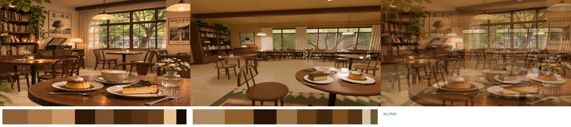
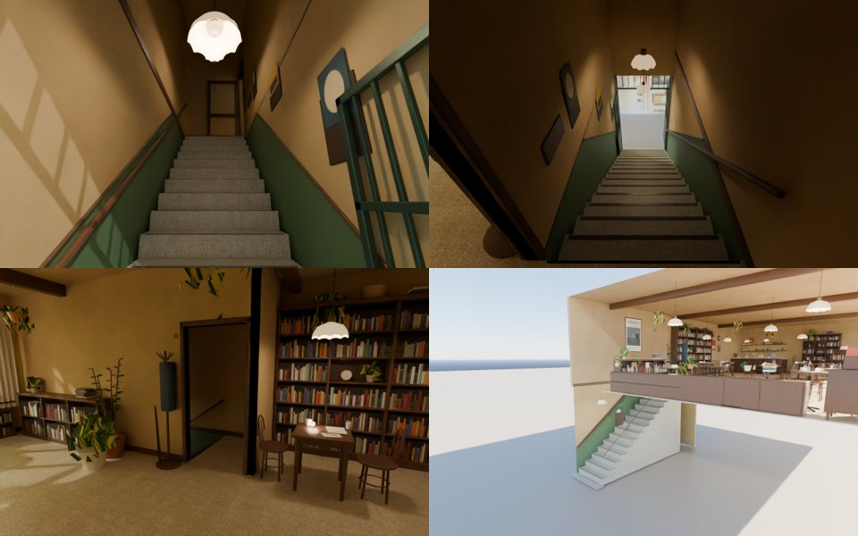
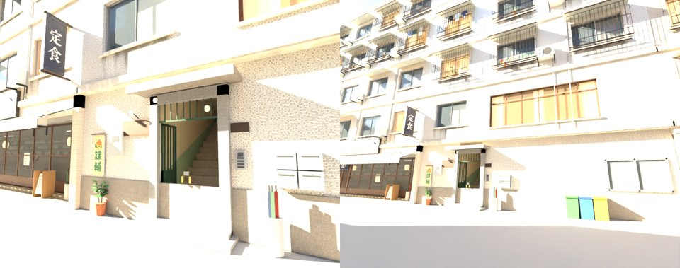

# 木曜日（wz_mokuyobi）整合包：WORK_IN_PROGRESS

- **編號**：ART-MOKUYOBI-1103（LAWWW2）
- **企劃**：AA_617、AA_618（企劃線）
- **室內**：AA 的 v3b（11-03 23:5x 我驗收，MODEL_READY）
- **狀態**：WORK_IN_PROGRESS，還不能整合。

## 放在哪裡
- 溫州街 B4（巷子中段北側，x 4～16）：小磁磚外牆、墨綠鐵門的老公寓，對得上參考圖 `mokuyobi_ref.webp` 左半。
- 這一棟二樓本來是「小書包兒童課輔」（ART-BG13）。
  - 沛珊的課輔班事件只用一樓門口的 2D 背景，沒有寫是幾樓。
  - 所以課輔班改到三樓（外觀的割字貼紙換到三樓的窗），二樓給木曜日。
- B4 的鐵門（本地 x −2.6）就是樓梯口。
  - 區域座標換算：溫州街 x ＝ 區域 x ＋ 11.15、溫州街 z ＝ 區域 z − 12.25。
  - 樓梯間 x −4.5～−3.0，對到溫州街 x 6.65～8.15。

## 樓梯為什麼要改（v3c，AA 的配置我改了樓梯附近）
- AA v3b 的樓梯開口只有 z 4.6～7.0（2.4 m）。
  - 一樓高 3.4 m 的話，算出來是 55°。
  - 引擎規定人物半徑 0.32 m 內高度差不超過 0.25 m（`engine3d.js` 的 `NavGrid.clear`），最陡大約 38°。
- 我的第一版（17 階、踏面 0.245、41°）在引擎裡也站不住，單元測試第 5 項卡在樓梯頂。
- 改成 v3c：
  - 二樓地板 3.2 m：老公寓的一樓常見 3.0～3.2 m。溫州街外觀的一樓高 3.4，差的 0.2 m 在看不到的樓板裡。
  - 16 階×0.2 m，踏面 0.294 m，約 36°。
  - 樓梯開口 z 2.54～7.0，平台 z 1.54～2.54。
  - 店門改開在東邊隔間牆（z 1.59～2.54，面向東）。
  - 西牆大書櫃縮成 z −1.9～1.4。
  - table 3 搬到 z 0.6、table 4 搬到 z −1.6。
  - 衣帽架搬到店門南邊，地上那疊書往北移。
  - 原本 (−4.1, 3.1) 的大盆栽搬到 (−2.6, 3.85)。
  - 沙發前的矮桌從 1.0×0.6 縮成 0.6×0.36，往西移到 (2.6, −5.3)。原本沙發中間和轉角那兩個位子走不進去。
  - 沙發三個位子加了 `ap`（「坐下」走到的位置）。
- 參考圖角度重拍，ref_match 照舊全過：
  - 亮度 0.336／0.344；
  - 對比 0.572／0.641；
  - 冷暖 +0.283／+0.295；
  - ΔE 6.4；
  - 九宮格 0.042。
- 那個角度看的是窗和唱片櫃，樓梯不在畫面裡。
- 店內 60,054 面（v3b 59,988）。

## 一樓的樓梯（LAWWW2 新做）
- 腳本：`tools/blender/env_second/mokuyobi_stair.py` → `assets/models/env/second_ai/mokuyobi_stair.glb`（4,166 面，10 個材質）。
- 內容：
  - 實心磨石子踏階＋止滑條；
  - 淡綠油漆腰牆，上緣是一條和樓梯平行的斜線，有木條收邊；
  - 西牆的木扶手；
  - 東牆三個小相框；
  - 兩盞波浪邊乳白吊燈；
  - 兩扇打開、靠在牆上的深綠鐵門，門上有鐵條氣窗；
  - 地墊。
- 門外是一張街景卡：溫州街 GLB 從 B4 門口往南看的 Blender 渲染，看得到對面的巷口書房和北巷，晚上調暗。

左上：從門口往上看；右上：從平台往下看；左下：店裡看店門；右下：剖面。

## 遊戲區域 `src/mokuyobi3d.js`
- 兩層導航（D36），cell 0.1：
  - 第 0 層＝一樓樓梯口；
  - 第 1 層＝二樓店內，y 3.2。
- 樓梯的上半段兩層共用，下半段只在第 0 層，平台只在第 1 層，所以上樓、下樓一定會換層。
- 店內用 `Z3.room`（和 wzShop 同一套），整組抬到 3.2。正式模型用 `attachRoomGLB` 接上。樓梯 GLB 的牆自己接淡出。
- 座位 24 席，都可以讀書（`study:true`），吧檯兩個高腳凳 `lift 0.25`。
- 點餐、看書櫃、唱片機、海報（配置的 `interact`）**沒有接**：LAWWW 照 AA_618 的台詞接，我不放空按鈕。
- 資產登錄在這個檔裡（和 118 巷店家一樣），不動 `assets3d.js`。

## 溫州街那一端
- zones3d.js（在 patch 裡）：
  - B4 鐵門前 (7.4, −4.55) 有「上二樓（木曜日）」；
  - B4 門口 x 6.3～8.5 不停機車：原本那一排機車把門口的人行道整段擋住。
- B4 外觀（`wz_street.py`、`wz_shopkit.py`，重出 `wenzhou_street.glb`）：
  - 鐵門白天開著：兩扇門往裡開、貼著兩側的牆。一樓牆挖出 4.9 m 深的樓梯間，從巷子看得到磨石子樓梯往上爬，還有淡綠腰牆（斜線）、吊燈。
  - 門左上的木招牌「木曜日」（`PLATE_FACE_mok_B4`，字在遊戲裡畫，serif）＋門燈。
  - 門牌 22 號 → 37 號（AA_617：照參考圖）。
  - 二樓整排木框窗：一格 0.9 m、上面一排小氣窗，奶油白紗簾，店裡的暖光晚上會亮。對齊店內的窗 x −2.6～2.6。
  - 小書包課輔班：割字貼紙移到三樓那扇窗，帆布布條移到門的更西邊（x −5.3）。
  - 三角形 93,381（原本 93,881，F4 拿掉以後的版本是 93,155）；材質 149 → 152。
- 下圖是 Blender 渲染（不是遊戲截圖），白天、曝光偏亮。招牌是空白板，字在遊戲裡畫。

- **還沒和參考圖左半比對**：參考圖是傍晚的暖光，外觀的光是遊戲的時段在打，要在遊戲裡 17:xx 截圖比，照 D131 排到使用者的電腦。

## patch（交 LAWWW）
- `mokuyobi_WIP.patch`：**要先套 `wip/xinsheng/xinsheng_zone_WIP.patch`**。兩份都接開發分支 e95e0e4e9；依序套，`git apply --check` 都通過。
  - 這份的 `wenzhou_street.glb` 已經包含新生南路那份拿掉 F4 的改動。
- 內容：
  - `src/mokuyobi3d.js`、`src/data/mokuyobi_layout.js`、`tests/mokuyobi_unit.js`；
  - `zones3d.js` 兩處（上二樓的互動點、機車空位）；
  - 三個 GLB：店內 `aa_support/mokuyobi.glb`、樓梯 `mokuyobi_stair.glb`、`wenzhou_street.glb`。
- **index.html 要加**（LAWWW 的檔案，不在 patch 裡）：在 `src/zones3d.js` 後面加
  - ``
  - ``
  - 資產登錄在 mokuyobi3d.js 裡面，不用動 assets3d.js。
- 還沒載入 mokuyobi3d.js 的時候：溫州街沒有「上二樓」，機車照舊停滿，B4 外觀已經是新的（門開著、看得到樓梯）。
  - 這個狀態不會卡住玩家，但會有一扇看得到、進不去的門。**兩份 patch 和 index.html 那兩行要一起整合。**

## 測試
- Node，在 e95e0e4e9＋新生南路 patch＋這份 patch 上跑，全部 ALL PASS：
  - `mokuyobi_unit`（18 項）、`xinsheng_unit`、`nav_buildings_unit`、`seat_reach_unit`；
  - 溫州街系列 17 支：wz_aa364_shops、wz_cat 三支、wz_copy_shop、wz_market 兩支、wz_park 三支、wz_shops 四支、wz_swing_front、wz_teahouse_seats、wz_work_spots。
- `mokuyobi_unit` 第一版（41°）在第 5 項失敗、樓梯下半段兩層都開的時候第 8 項失敗，改好以後通過。
- **還沒跑（瀏覽器，照 D131 排到使用者的電腦）**：
  - zone_transitions、reachability_all、touch_flow_wenzhou、wz_street_integration；
  - 實際走上樓梯、坐下、鏡頭在樓梯間的截圖。

## 還沒做
1. 遊戲裡的截圖（樓梯間鏡頭、店內、外觀 17:xx），排到使用者的電腦。
2. P3：曲木椅、天花板木樑、近景地毯、磨石子。
3. 點餐、看書櫃、唱片機、海報：LAWWW 照 AA_618 接。
