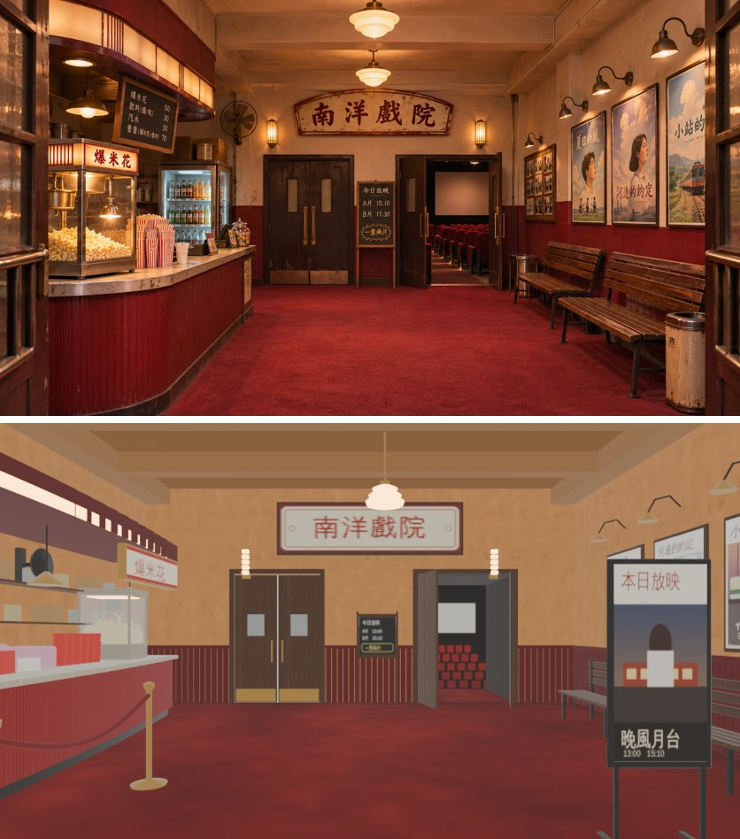
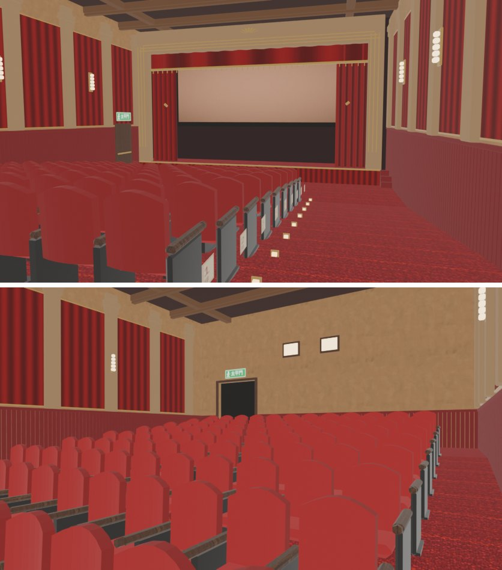

# 南洋戲院走得進去（ART-NANYANG-CINEMA-1103，LAWWW2-C 2026-11-05）

- **第 1 版進遊戲**（D141：先進遊戲，之後只改使用者說的、或擋玩的）。模型是 BB 的大廳 v5b、1 廳 v2；這一包做的是區域、導航、出入口、座位、測試、接線。
  - GLB、Blender 腳本和 BB 分支 `claude/wonderful-mayer-7fm9g6` 一模一樣（大廳 v5b `2cecefa9a`、1 廳 v2 `9e72db718`）；配置 `nanyang_layout.js` 加了出入口、camRef、1 廳的 enterAt。
- 企劃：AA_615 第 3、4 節（使用者 11-03「也要遇到在電影院打工的同學 遇到玩家送爆米花」「不是有電影情節嗎 怎麼沒有電影院阿」）。
- 排程：LAWWW-C 11-05 03:35 P1（X178 只剩這一塊；劇情 LAWWW 接）；04:2x 使用者 P0 以後排第一。
- 參考圖的種類（RULES_2D_TO_3D 第 1 步）：**使用者 11-03 生成的參考圖**——`docs/story_planning/ref_images/shops/nanyang_lobby.webp`、`nanyang_ext.webp`，在企劃線、BB 的分支上。所以疊圖可以 commit。
- 驗收狀態：大廳、1 廳 **INTEGRATED（Node 模擬）**，還沒在瀏覽器跑。BB 只擋五種（走不到、坐不下、穿模、卡住、黑畫面）。

## 1. 玩家可以做什麼

- 新生南路上，南洋戲院的店門是「**進南洋戲院（二輪戲院）**」。
  - 新生南路建區域的時候看得到 `Z3.ZONES.xs_nanyang`，店門就自動換成「進」（`src/xinsheng3d.js` 原本就有這個機制）。
  - 09:30～24:00 以外按店門，跳出「南洋戲院 現在沒有開（今天 09:30–24:00）。下次開門：今天 09:30。」（接線 patch）
- **大廳**（區域 `xs_nanyang`）：
  - 進來站在入口裡面 1.4 m、面向後牆。
  - 四張長椅「坐下等開演」。
  - 爆米花櫃檯、黑板架「今日放映」、海報牆、「進 1 廳」都走得到。
  - 入口的「出去（新生南路）」。
- **1 廳**（區域 `xs_nanyang_hall`）：
  - 從大廳後牆右邊那組開著的門進來，站在門口、面向銀幕。
  - 地板前低後高：門那一頭 y 0，第一排前面 y −0.96。人走下去會照高度往下。
  - 九排，每排靠右走道那一張「坐下看電影」。座位帶那一排的地板高度，坐下不會浮起來。
  - 「回大廳」：回到那組門前面。
- 劇情要用的位置（選單、台詞 LAWWW 照 AA_615 接；這裡不放空按鈕）：
  - `NY3.INTERACT`：爆米花、黑板架、海報。
  - `NY3.HALL_INTERACT`：銀幕。
  - `NY3.CLERK`：Alison 打工時站在櫃檯後面的位置（週五、週六 18:00～23:00）。
  - `NY3.TICKET`：騎樓下的售票口 (−15.6, 30.2)。
  - `NY3.houseLights(on)`：開演時關掉、散場打開 1 廳的場燈。

## 2. 和參考圖比（camRef＝BB v5 對參考圖的鏡頭：眼睛 (0.2, 1.5, 3.4)、往後牆看、24 mm）

- 上：參考圖 `nanyang_lobby.webp`；下：`glb_preview.py` eevee 640×360。均勻光，不是遊戲畫面。
- 左右順序和參考圖一樣：
  - 左：爆米花櫃檯、爆米花機。
  - 中：「南洋戲院」大招牌、左邊關著的門、黑板架、右邊開著的門（看得到 1 廳的紅椅子和銀幕）。
  - 右：海報牆、長椅、垃圾桶。
  - `tests/nanyang_unit.js` ⑨ 用角度鎖住：櫃檯 −26°、爆米花機 −32°、大招牌 0°、兩組門 ∓11°、海報牆 32°、長椅 30°（視角 ±37°）。
- R2 疊圖（`same_angle_check.py --mode shop`）：[lobby_refcam_overlay.jpg](lobby_refcam_overlay.jpg)、[lobby_refcam_structure.json](lobby_refcam_structure.json)

| 項目 | 數字 | 說明 |
|---|---|---|
| 消失點 | 差 0.8%（PASS） | 鏡頭方向對 |
| 垂直線傾斜 | 差 0.6°（PASS） | 俯仰對 |
| line_F | 0.37（隨便移開 25% 的平均 0.23） | 對好以後 0.42 |
| ssim 大形狀 | 0.60 | |
| 「參考圖東西多很多」的格子 | 14／24（FAIL） | EEVEE 均勻光一定會多（RULES 第 3 節第 10 條）；要等遊戲內截圖才準 |

- 1 廳沒有自己的參考圖（參考圖只看得到大廳那扇門後面的一角）：

## 3. 先將就的（D141：給使用者看的清單；不擋進遊戲）

1. **燈光**：還沒烘光照貼圖。遊戲裡是即時光加三盞吊燈的點光源，沒有參考圖那種暖黃的燈光和陰影。
2. **「本日放映」立牌**（BB v5b「近景加東西」加的）：從 camRef 看，擋住右邊的長椅。參考圖那裡是長椅和垃圾桶。
3. **靠右走道才能坐**：1 廳每排只有靠右走道那一張能坐，其他座位是裝飾。
4. **牆的接縫**：牆上的 T 形接頭，大廳 12 處、1 廳 6 處（`glb_tjunctions.js`）。烘光照以後可能看得到細縫；現在是即時光，看不太出來。
5. **極小的疊面會閃**：大廳兩處各 0.01 m²，在售票亭背牆、x −1.5 附近；1 廳一處，在舞台口右上角（`check_coplanar.py`）。
6. **效能**：12 個材質裡 11 個是雙面材質，背面也畫，比單面耗。
7. **場次**：場次的字照外觀參考圖：10:00／13:00／16:00／19:30。黑板架寫「A 片 13:00、B 片 15:10」。AA_615 原本寫 12:00、15:00、18:30、21:30（配置的 todo；AA 要跟著改）。
8. **颱風天**：AA_615 沒寫颱風天要不要關，先不關。要關就把 `xs_nanyang` 加進 `PLACES.typhoonShops`。

## 4. 測試（Node，不用瀏覽器；在開發分支 `07dfffe15`＋這一包上跑）

`node tests/nanyang_unit.js`：ALL PASS（16 項）

- ① 登記
- ② 大廳的進來位置
- ③ 四張長椅、互動點
- ④ 新生南路的店門、從大廳出來的位置、售票口
- ⑤ 1 廳：進來位置、九排座位
- ⑥ 斜地板：導航高度、座位高度、一路往下
- ⑦ 大廳 ↔ 1 廳
- ⑧ 牆的淡出方向
- ⑨ camRef 構圖
- ⑩ 營業時間、店門擋

照實寫，這一輪的修改前後：

- ④「走得回店門」原本 FAIL：**測試寫錯**，不是導航的問題。目標點設在店門互動點的 x −0.6＝店的玻璃裡面，本來就站不住。改成 +0.5（騎樓上、在互動點的範圍裡）。
  - 整理時以為是騎樓柱子擋住從大廳出來的位置，查下去不是：出來的位置一直站得住。
  - 不過柱子那一查，查到新生南路另一個真的問題，另外交 → `../xs_arcade_nav_1105/README.md`。
- ⑨ 原本 FAIL：櫃檯取樣點取在櫃檯中間 (−3.9, −1.0)，在 −43°，畫面外。櫃檯沿整面左牆（z −5.6～3.6），camRef 看得到 z −1.6 以後那一段。改取裡面那一半的正面 (−3.4, −4.0)，在 −26°。

相關的 Node 測試：

- 22 支 ALL PASS：`seat_reach_unit`（xs_nanyang 4 個座位、xs_nanyang_hall 9 個）、`xinsheng_unit`、`tongxian_unit`、`aa619_guitar_zone_unit`、`aa653_shops_unit`、`bike_park_1104_unit`、`bike_shop_park_unit`、`gg_interiors_1104_unit`、`gg_shops2_1104_unit`、`mokuyobi_aa618_unit`、`prop_restand_unit`、`spawn_exit_unit`、`wz_offbeat_unit`、`placemap_unit`、`calendar_hours_unit`、`v3_typhoon2_unit`、`quick_travel_unit`、`exit_ring_unit`、`scene_bg_keys_unit`、`rooms_glb_unit`、`shop_rename_1104_unit`、`lamppost_nav_unit`。
- 讀 index.html 載入全部程式的：`aa117_notes_unit`、`aa187_pair_unit`、`aa347_y1_unit`、`aa351_kx_drift_unit` ALL PASS。
- `aa619_guitar_unit` FAILED 21，**修改前就一樣**：它要讀企劃線的 commit `c4b14a901`，這台機器上沒有。和這一包無關。
- 乾淨的 `07dfffe15` worktree 驗過兩種接法，都 ALL PASS：只套接線 patch；接線 patch 加上新生南路 patch。

瀏覽器沒跑（D131）。真實玩家流程、遊戲內 camRef 截圖、手機都還沒驗。

## 5. GLB 規格（BB 做的，沒有改）

| 檔案 | 大小 | 三角形 | 網格 | 材質（雙面） | 貼圖 | WALL_ |
|---|---|---|---|---|---|---|
| `nanyang_lobby.glb` v5b | 3,188,876 B | 36,254 | 20 | 12（11） | 10 | 13 |
| `nanyang_hall.glb` v2 | 4,647,808 B | 47,742 | 29 | 12（11） | 10 | 22 |

- BB 的 GLB 沒有 `extras.dir`，1 廳的 front／back 名字和位置相反。`NY3.wallDirs` 照牆在房間的哪一邊補淡出方向（⑧ 檢查每一塊都朝房間裡）。

## 6. 接法（LAWWW-C）

1. 拿檔案：`git checkout <這一包的 SHA> -- src/data/nanyang_layout.js src/nanyang3d.js tests/nanyang_unit.js assets/models/env/second_ai/bb_support/nanyang_lobby.glb assets/models/env/second_ai/bb_support/nanyang_hall.glb tools/blender/env_second/bb_support/nanyang_interior.py tools/blender/env_second/bb_support/nanyang_hall.py`
2. 套 patch：`git apply docs/art-rebuild/second_ai/wip/nanyang_zone_1105/nanyang_wire_1105.patch`（在 `07dfffe15` 上乾淨）。內容：
   - `index.html`：在 tongxian3d.js 後面載入 `src/data/nanyang_layout.js`、`src/nanyang3d.js`。
   - `src/data/places.js`：
     - 名字：`xs_nanyang` 南洋戲院、`xs_nanyang_hall` 南洋戲院 1 廳。
     - 營業：每天 09:30–24:00（`shop:true`，關著時說「下次開門」）。
   - `src/story3d.js`：店門照營業時間擋。只擋從新生南路進大廳，從 1 廳回大廳不擋。
   - `tests/seat_reach_unit.js`：加南洋的兩個檔。
   - `LICENSES.md`：兩列（BB 的 Blender＋Poly Haven CC0：`painted_plaster_wall`、`granite_tile_03`、`wood_table_001`、`dirty_carpet`）。
3. 新生南路騎樓的修正是另外一包（`../xs_arcade_nav_1105/`），可以分開接。
4. 劇情（LAWWW，AA_615）：
   - 售票口買票（150 元）。
   - Alison 週五、週六 18:00～23:00 在櫃檯（`NY3.CLERK`）、送爆米花。
   - 1 廳坐下＝看電影：`houseLights(false)`、轉暗、時間過去、隨機旁白，演完 `houseLights(true)`。

## 7. 檢查清單（RULES_2D_TO_3D 第 7 步）

- [x] 參考圖是哪一種：使用者生成的圖，疊圖可以 commit。
- [x] 「最重要的那一塊」在 camRef 的畫面裡：左邊爆米花櫃檯（Alison 打工的地方）、後牆招牌和往 1 廳的門。左右順序一樣。
- [x] 店名、片名虛構（D77）；沒有商標、品牌配色。「新生南路」是真實地名，照 WORLD_NAMING 留著。
- [x] 沒有複製貼上：模型是 BB 的，這一包沒有加東西。
- [x] 構圖寫進 Node 測試（⑨）。修改前：區域不存在，① 就 FAIL；修改後 ALL PASS。
- [x] 驗收狀態：預覽疊圖＝MODEL_READY 的層級；遊戲內 camRef 截圖、重跑 R2 等瀏覽器（CC／GitHub 機器）。
