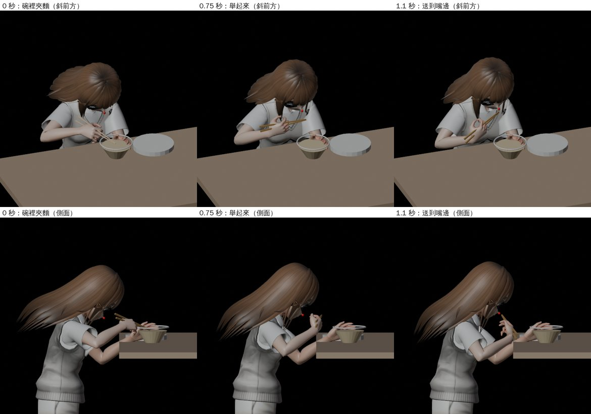
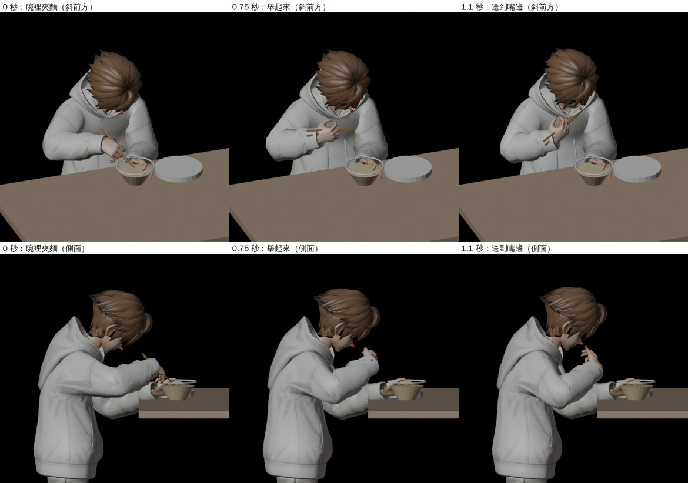
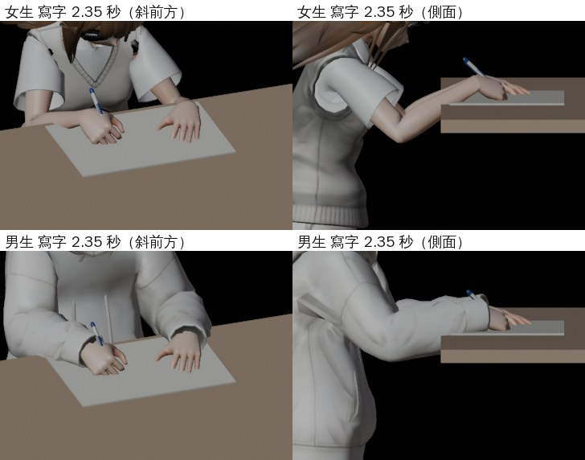

# NPC-ANIM-LOOPS-1104：坐在桌前做事的七個循環動作

LAWWW2-C 2026-11-04。狀態：**MODEL_READY**。新增兩個檔案，**遊戲要接線（LAWWW-C）**：

- 動作片段 `assets/models/char/second_ai/ual_sit_tasks.glb`（＋`.json`）
- 手上配件 `assets/models/char/second_ai/hand_props.glb`（＋`.json`）

還沒在瀏覽器看過。Node 測試用遊戲自己的換算程式，量過人物的手在哪裡。

## 補件：右手筷子、吃飯片段重擺、筆尖碰紙（LAWWW-C 11-04 21:42Z 的 1 和 4；LAWWW2-C 11-04 22:xx）

狀態：**MODEL_READY**。換了這四個檔：`ual_sit_tasks.glb`／`.json`、`hand_props.glb`／`.json`。遊戲的接線（LAWWW-C 的檔）另外給 patch。

### 1. 右手的筷子 `hand_chopsticks`，吃飯片段照筷子尖重擺

- 配件：兩支 23 cm 的竹筷（尾端 7 mm 方、尖端 4 mm），24 面，和杯子、手機、筆在同一顆 `hand_props.glb`。
  - 一樣擺在右手骨頭的座標裡，掛法相同：複製到骨頭底下、位置 0、不轉。
  - 兩支夾在虎口；上面那支在拇指那邊，尖端靠在一起（差 3 mm）。
- 原本的吃飯片段只有「握筷子的手形」，沒算過筷子尖在哪裡。這版改成像寫字照筆尖那樣，照筷子尖擺手：
  - 每 2.5 秒一口。
  - 碗裡夾麵：筷子尖在碗裡的麵上。碗照 SEATACT `S_meal` 的麵碗：桌緣往裡 0.16 m、湯面 5.8 cm、碗口 7.5 cm。
  - 送到嘴邊：筷子尖在下唇前面 1.5 cm。
  - 左手扶著碗的左前側（手心貼碗壁）。原本左手平放在桌上，會壓進左邊的盤子。
- 姿勢是在兩種骨架上搜尋出來的：
  - 筷子朝的方向和要的一樣（0°），手腕彎在人做得到的範圍內，手、手指不碰到碗和桌面。
  - 碗裡：筷子往左前下插進碗。女生的桌子在胸口，所以筷子平一點（往下 20°），男生往下 38°。
  - 嘴邊：筷子從右前方往左、往上一點送進嘴（往左 70°、往上 23°）。
  - 手腕最多：女生往手心彎 42°、男生 37°；往小指那邊 ≤ 15°。範圍是 60°／30°。
- 圖（Blender Workbench 預覽，不是遊戲畫面）：0 秒碗裡、0.75 秒舉起來、1.1 秒嘴邊；紅點是嘴。





### 4. 寫字的筆尖壓進紙（LAWWW-C「約 4～5 mm」）

- 原因：筆尖照桌面擺，可是攤開的筆記本紙面比桌面高 4.1 mm（desk_props `nb_top_y`）。
- 改成照紙面擺：碰紙那一格（2.35 秒），筆的最低點在紙面上 0.5 mm（女）、0.6 mm（男）。原本女生是紙面下 3.9 mm。



### 順便修的：男生手上的配件位置

- 配件是照女生的手做的，掛在右手骨頭上；遊戲照人物縮放（男生 0.907）。
- 所以掛在男生手上，配件比照男生自己的手算的近手腕約 9%：筆尖近 8.5 mm、杯子近 6 mm。
- 這版每一種身材都用「配件真的掛上去以後」的位置擺手（`sit_task_loops.prop_on`）。男生的寫字、喝飲料、滑手機片段因此動了 3～7 mm。女生的不變。
- 舊的 `hand_props.glb` 裡的紙杯，比當時的程式（`2962616ac`）產生的偏 1 mm：檔案比程式舊。這次重新產生，對齊了。

### 測試（Node，不是瀏覽器）

在開發分支 `9039f2b20` 換上這四個檔、套上下面的 patch：

- `tests/sit_task_loops_unit.js`（這次加了吃飯和配件）：**ALL PASS**。
  - 照遊戲的掛法把 GLB 裡的筷子掛到右手骨頭上量：筷子尖和預期的差 0～1 mm。1 秒離嘴 1.5 cm；0、2.35 秒在碗裡夾麵的那一點 0～4 mm（女生、男生都一樣）。
  - 寫字的筆尖：碰紙那一格在紙面上 0.5／0.6 mm。
  - 開發分支原樣跑：8 項 FAIL（沒有筷子、女生的筆尖在紙面下 3.9 mm、吃飯片段還是舊的）。
- `tests/sit_task_wire_unit.js`（LAWWW-C 的，patch 改了吃飯那一項）：54 項 **ALL PASS**。
  - 吃飯的人播 `Sit_Eat_F_Loop`、右手拿筷子、桌上那雙拿掉（碗和盤子留著）。
  - `WIN` 照舊不比量到的鬆。
  - 只換檔、沒套 patch：53 PASS、2 FAIL。吃飯對不上 `HANDS`，判「合不上」。
- `seat_activity_1104_unit`、`exam_lib_crowd_unit`、`npc_ambient_unit`、`seat_ambient_unit`、`crowd_seat_talk_unit`、`crowd_unit`、`indoor_crowd_unit`：ALL PASS。

### 給 LAWWW-C

```
git checkout <SHA> -- assets/models/char/second_ai/ual_sit_tasks.glb assets/models/char/second_ai/ual_sit_tasks.json assets/models/char/second_ai/hand_props.glb assets/models/char/second_ai/hand_props.json tests/sit_task_loops_unit.js tools/anim/sit_task_loops.py tools/anim/sit_task_props.py tools/anim/preview_vrm_clip.py
git show <SHA>:docs/art-rebuild/second_ai/wip/npc_anim_loops_1104/npc_eat_chopsticks_1104.patch | git apply
```

patch（以開發分支 `9039f2b20` 為底）改三個檔：

- `src/character3d.js`：
  - `C.SIT_TASK.HANDS` 六格：女生寫字、吃飯；男生寫字、滑手機、喝飲料、吃飯。值＝`ual_sit_tasks.json` 的 `expect.hands0`，其他格的差 < 0.6 mm。
  - `PROP` 加 `eat:'hand_chopsticks'`。
  - `LOOK.eat` 改成看碗裡夾麵那一點 `[0,0.06,0.15]`。
- `src/seatact3d.js`：
  - `S.TASK` 加 `eat`、`eat2`，吃飯打開。要不要開你決定；不開就把這一行還原，其他照套。
  - `S.PROP_FAM` 加 `hand_chopsticks:/^item_chopsticks$/`，桌上那雙會拿掉。
- `tests/sit_task_wire_unit.js`：「吃飯先不用片段」那一項改成「吃的人播 Sit_Eat、右手拿筷子、桌上那雙拿掉」。原本「併回以後」那一段拿掉，因為已經併回了。

### 還沒做／已知的不足

- 女生坐在 0.75 m 的桌子前，桌子在胸口（舊問題，見下面）。吃飯時頭離碗很近：嘴只比桌面高 12～14 cm。
- 左手扶碗、筷子插進碗，是照 `S_meal` 的碗（桌緣往裡 0.16、左右置中）擺的。
  - `S_meal2` 的碗偏 2 cm，`S_meal_t` 的碗近 3 cm：左手會離碗 2～3 cm，或碰到碗壁。
- 筷子上沒有麵；碗裡的麵是 desk_props 的模型，筷子只是插進去。
- 打字、翻書、滑手機（女生）沒動。
- 21:42Z 的 2（另外兩組骨架的片段）、3（Café 桌緣 0.20 的版本）還沒做，接著做。
- 還沒在瀏覽器看過（D131）。美術要 BB 判（D120／D128）。

## 派工

LAWWW-C：「打字（加觸控板版本）、寫字、滑手機、翻書頁、喝飲料（含杯子配件）、吃飯，交 GLB 片段和要動的骨頭」。

## 交什麼

| 片段（`_F_Loop`／`_M_Loop` 各一） | 做什麼 | 手上配件 | 桌上（SEATACT） |
|---|---|---|---|
| `Sit_Type` | 兩手放在筆電上打字，手指輪流敲；看螢幕 | — | `tset_laptop` |
| `Sit_TypePad` | 打字；每 5 秒右手去觸控板一次（1.6～3.4 秒） | — | `tset_laptop` |
| `Sit_Write` | 右手往右寫一行七個字，最後 0.8 秒回到行頭；左手壓著筆記本 | `hand_pen` | `tset_notes`（桌上那支筆要藏） |
| `Sit_Phone` | 右手拿手機，在桌子前緣上面；拇指每 5 秒往上滑 3 次；左手放桌上 | `hand_phone` | — |
| `Sit_Page` | 兩手放在攤開的書上；每 5 秒右手翻一頁（1.7～3.0 秒） | — | `tset_book` |
| `Sit_Drink` | 右手握杯放在桌上；每 5 秒喝一口（1.7～2.9 秒杯緣碰到嘴） | `hand_cup` | 桌上那個杯子要藏 |
| `Sit_Eat` | 右手從碗上面送到嘴前面，每 2.5 秒一口；左手放桌上 | （筷子還沒做） | （桌上還沒有碗盤） |

- 每個片段 5 秒、頭尾接得起來（UAL 坐姿循環剛好 3 圈）。
- **兩種身材各一份**：
  - `_F`：女生 VRoid 骨架（`vroid_npc_f1`；所有 `nf`、女主角）。
  - `_M`：男生（`vroid_npc_m1`；`nm`、yuting、zhe…）。
  - 怎麼分：右前臂長度（`RightHand` 的位置）0.214＝女生、0.249＝男生。
  - 為什麼要兩份：同一張 0.75 m 的桌子，女生坐下以後肩膀只比桌面高 11 cm，男生高 22 cm（VRoid 女生的身體比較短）。一份片段兩邊都對不準，手會差 5 cm。
- 格式和 `ual_sit_clips.glb` 一樣：只有骨架節點和旋轉軌道（UAL 骨架的名字），遊戲現在的 `ambClip`／`UAL_BONE` 直接讀得到。
  - 14 個片段，426 KB。
  - 每個片段的 `extras`：`desc`、`loop`、`kind`、`body`、`ref`（參考的桌子）。

## 要動的骨頭

| 骨頭 | 來源 |
|---|---|
| `spine_01`～`03`、`neck_01`、`Head` | 坐姿循環（`Sitting_Idle_Loop`：呼吸、身體前後）；`spine_02`、`spine_03` 再往前傾，`neck_01`、`Head` 再低頭（喝的時候抬頭） |
| `clavicle_l`／`_r` | 照坐姿循環（沒改） |
| `upperarm`、`lowerarm`、`hand`（兩手） | 這次擺的 |
| 手指 `thumb`／`index`／`middle`／`ring`／`pinky` 的 `01`～`03`（兩手 30 根） | 這次擺的 |
| `pelvis`、腿 | 片段裡是坐姿循環的值；遊戲本來就不吃（骨盆、腿照舊 `SIT_VRM`） |

接線時要注意：遊戲現在只有「手上沒東西」才讓手臂吃片段（`armsFree`）。這七個片段的手臂一定要吃片段，肩膀到手指（`grp 2`）全部都要。

## 怎麼做的（`tools/anim/sit_task_loops.py`，numpy，不用 Blender）

1. **在遊戲人物真正的骨架上擺**：
   - 讀 VRoid 的骨架，換成 UAL 的名字和方向，縮到遊戲的身高（女 1.62、男 1.74，`char.npc_f1`／`npc_m1` 的 height）。
   - 坐下的高度照遊戲：往下 0.47×身高/1.75。
2. **參考的桌子**：
   - 總圖自習桌：桌高 0.75 m，桌緣離座位 0.30 m（`library3d.js` 的 studyTable）。
   - 桌上的東西照 `desk_props.glb` 的尺寸：筆電中心離桌緣 0.112 m、杯子直徑 9.4 cm、高 12.3 cm…
3. **手臂**：
   - 兩段式 IK。手肘只繞真的關節彎；上臂自己的扭轉照手肘要朝哪裡決定。
   - 每個動作指定手心和手指的方向：打字手心朝下、握杯虎口朝上、滑手機手心朝上…
   - 翻手心的轉，65% 給前臂、35% 給手腕。VRoid 沒有扭轉骨，全部放在手腕會扭成麻花。
   - 手腕超過人做得到的範圍（往手心 60°、往手背 50°、往小指 30°、往拇指 20°），就把手轉回範圍內，再算一次手臂。
4. **寫回 UAL 骨架**：每根骨頭的「世界旋轉差」寫回 UAL 骨架的片段。遊戲換算回來，就是第 1 步擺好的樣子（下面的測試證明了）。

### 關節範圍（套到 VRoid 骨架上量）

- 手肘彎 66°～117°。
- 前臂扭最多 56°，手腕扭最多 29°。
- 手腕往手心最多 55°、往手背最多 24°；往小指最多 30°。

## 手上配件 `hand_props.glb`

- 三個網格，共 350 面、81 KB：
  - `hand_cup`：紙杯，和桌上的 `item_cup` 一樣。
  - `hand_phone`：`item_phone_on`。
  - `hand_pen`：`item_pen`。
  - 貼圖用 `desk_props` 同一張，遊戲的貼圖去重會共用。
- **已經擺在右手骨頭的座標裡**（VRoid `J_Bip_R_Hand`；PROPS 的 `bone:'rightHand'`）：
  - 掛上去位置 0、不轉。
  - 照 `boneGlb` 的做法，用名字挑節點：`c.scene.getObjectByName('hand_cup').clone(true)`。
- 一次只開一個：喝飲料開 `hand_cup`、滑手機開 `hand_phone`、寫字開 `hand_pen`。其他時候藏起來。
- 照女生的手算。男生的手大 4%，配件離手心差 2～3 mm，沒有另外做。
- 喝的那一下（2.35 秒），靠嘴那一邊的杯緣離嘴：女生 1.0 cm、男生 0.5 cm（`ual_sit_tasks.json` 的 `expect.sip`）。

## 預覽

Blender Workbench 拍的，不是遊戲畫面：VRoid 人物照遊戲的坐法，配參考的桌子，配件掛在右手骨頭上。

頭髮在 Blender 裡沒有彈簧骨，所以往後翹；遊戲裡會垂下來。


工具：`tools/anim/preview_vrm_clip.py`（`--props` 掛配件）、`tools/anim/sit_task_props.py`（產生配件）。

## 測試

`tests/sit_task_loops_unit.js`（Node，不是瀏覽器）在開發分支 `effb5d9b3` 加上這兩個檔案跑：**ALL PASS**。

- 做法：把 `char.ual_sit_clips` 換成這個檔，用遊戲自己的 `ambClip`／`sitAmbient` 讓 `char.npc_f1`、`char.npc_m1` 坐著播。測試時把每個人自己的坐姿偏移和小動作關掉。
- ① 14 個片段都載得到。
- ② 打字、喝飲料、寫字在 0、1、2.35 秒：兩手手腕、右手中指根和 Python 算的位置差 **≤ 0.1 cm**（門檻 2.5 cm）。
- ③ 打字時手腕在桌面上 5.0～5.3 cm。喝飲料時手腕抬高 12.5 cm（女）、21.8 cm（男），杯緣碰到嘴。

## 給 LAWWW-C（接線）

拿檔案：

```
git checkout 2962616ac -- assets/models/char/second_ai/ual_sit_tasks.glb assets/models/char/second_ai/ual_sit_tasks.json assets/models/char/second_ai/hand_props.glb assets/models/char/second_ai/hand_props.json tests/sit_task_loops_unit.js
```

1. `ASSETS.manifest` 加 `char.ual_sit_tasks`（lazy）、`prop.hand_props`。
2. SEATACT 決定好要做 laptop／notes／textbook／phone 的路人：
   - 片段名字＝`Sit_` + 動作 + `_F`／`_M` + `_Loop`。
   - 速度 1。坐姿循環的 `baseRate` 0.5 是給 1.7 秒那個循環的，這裡已經是 5 秒。
   - 手臂吃片段（見上面「要動的骨頭」）。
3. 配件：開關跟著片段走。桌上同一件東西（杯子、筆）這時候要藏起來。
4. **桌子不是參考值的座位**：桌子高或低多少，手就跟著差多少。
   - 建議：桌高差超過 3 cm 的位子（吧台、矮桌）先不用這些片段，照舊。
   - 要的話我可以照那幾種桌子再出一份。只要改 `REF` 一行重跑，約 1 分鐘。

## 還沒做／已知的不足

- **女生坐在 0.75 m 的桌子前，桌子在胸口**：肩膀只比桌面高 11 cm，手要往上抬，看起來像坐在太低的椅子上。
  - 原因是遊戲的坐姿高度（−0.47×身高/1.75）配上 VRoid 女生比較短的身體。片段已經照這個高度擺手了。
  - 要改是改坐姿高度（LAWWW-C 的程式）。改了以後，`REF`／坐下的高度改一下、片段重跑就好。
- **吃飯**：沒有筷子、碗，桌上也還沒有吃的（SEATACT 的 `S.FOOD`）。手是握筷子的手形，送到嘴前面約 10 cm。
- 打字、寫字的手指只是彎曲的節奏，不是真的按到某個鍵、寫出字。
- 預覽只看了 `vroid_npc_f1`、`vroid_npc_m1`。`bl_npc_*` 的骨架長度一樣，但沒有一個一個看。
- 還沒在瀏覽器看過（D131）。美術要 BB 判（D120／D128），我不標 ART_APPROVED。
