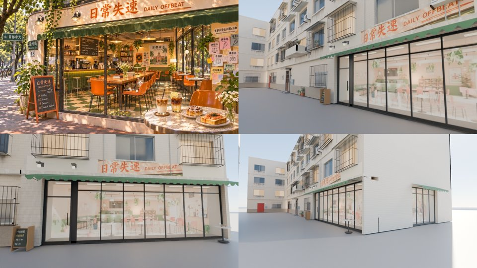

# 日常失速（wz_offbeat）外觀＋區域整合包：MODEL_READY（外觀）／WORK_IN_PROGRESS（遊戲內未截圖）

- **編號**：WZ-OFFBEAT-1104（LAWWW2）
- **企劃**：AA_617、AA_618；使用者 11-04 00:5x「店面排的沒問題」、日常失速可以玩桌遊（經 AA）
- **室內**：AA v3c（`aa_support/daily_offbeat.glb`，企劃線 d5c5c51c9；我 11-03 驗收 MODEL_READY）
- **patch**：`offbeat_WIP.patch`，接開發分支 `d5138cd27`＋`wip/spawn_exit/spawn_exit.patch`（＝LAWWW 已整合的 dc5c8c78d 那一份），依序 `git apply --check` 通過。

## 放在哪裡
- 溫州街 W2：西側橫巷靠主巷那一頭，一樓朝 +x（往新生南路的橫巷）。
  - 原本 z −13、寬 10；往北挪 0.5、加寬到 11，和 W0 之間不留縫。
  - 室內 11×10 m，對到本地座標：本地 x＝室內 x，本地 z＝室內 z − 5。
  - 換成溫州街座標：溫州街 x＝室內 z − 42.2，溫州街 z＝−13.5 − 室內 x。
- 店門在室內 (−3.9, 5)，也就是溫州街 (−37.2, −9.6)。
  - 「進去日常失速」在 (−36.5, −9.6)，範圍 1.2。
  - 出來站在 (−34.8, −9.6)，面向橫巷。

## 外觀（照參考圖 `ref_images/wz_cafes/daily_offbeat_ref_v2.webp`）
- 腳本：
  - `wz_street.py`：W2 的 `OFFBEAT_XS`，一樓牆挖出側窗；
  - `wz_shopkit.py`：`xs_front` 的非騎樓模式 `xs_street_front`，加上 `xs_awning`、`xs_side_window`、`bistro_table`；
  - `xs_front_tex.py`：`wz_fronts_atlas`。
- 正面：
  - 落地窗：黑鐵窗框，每 1.1 m 一格，2.65 m 一道橫框；
  - 玻璃門＋直把手；
  - 綠色帆布雨棚，前緣是一排半圓的波浪邊；
  - 奶油色牆面上的「日常失速 DAILY OFFBEAT」：參考圖裁的字；
  - 兩盞黑鐵門燈，晚上亮；
  - 門口一個 A 字黑板立牌，轉角一張大理石小圓桌（兩杯冰咖啡、肉桂捲、小花瓶）。
- 北面（側面）：一段落地窗，對到室內東牆的窗 z −3.8～0.3，上面也有雨棚。
- **玻璃後面的店內不是參考圖**：是 AA 的室內 GLB 從街上的位置渲染出來的。
  - 正面那張：鏡頭正對玻璃，畫面寬＝玻璃寬。
  - 側面那張：52.7 mm。
  - 從外面看到的店內＝走進去看到的店內。
  - 參考圖畫的店內配置和 AA 做的不一樣，以走得進去的那一個為準。
  - 渲染圖在 `tools/blender/env_second/textures/src/offbeat_{int,side}_render.jpg`。
- 二樓窗下就是招牌，所以那一層不掛冷氣、雨遮：原本有一台冷氣蓋住「OFFBEAT」。
- 規格：`wenzhou_street.glb` 三角形 93,381 → 94,809（+1,428），Blender 材質 152 → 158，8.19 MB。
- 下圖：左上是參考圖；其他三張是 Blender 渲染（不是遊戲截圖）。
  - 右上：從北邊的橫巷看；
  - 左下：正面；
  - 右下：北面的側窗。

- 和參考圖不一樣的地方：
  - 參考圖左邊是圓弧轉角＋「溫州街 18」路牌。W2 的南邊緊貼 W0，做不出那個轉角。
  - 參考圖右邊的窗上貼滿社團傳單；AA 的室內把佈告欄做在東牆窗旁邊的牆上（室內 z 0.55～4.55），所以北面靠轉角那一段是實牆。
  - 參考圖是傍晚的光。

## 遊戲區域 `wz_offbeat`（zones3d.js 的 wzShop，和林家乾麵、巷子裡定食同一套）
- 配置 `src/data/daily_offbeat_layout.js`：AA 的檔，我填了 exit、enterAt，另外：
  - 吧檯四張高腳凳加 `lift 0.27`；
  - 出生點 z 4.3 → 3.0：離「離開日常失速」1.55 m，在它的範圍 1.3 外面；
  - 五個座位加 `ap`：卡座三個（裡面是牆、前面是桌子，四周站不下人）、最西邊的高腳凳、轉角桌靠窗那一張。
  - **沒加 ap 以前，單元測試第 3 項這五個 FAIL。**
- 資產登錄：`bldg.wz_offbeat_interior` 寫在 zones3d.js（和林家、定食一樣），不動 assets3d.js。
- 座位 32 個，都不能讀書。使用者 11-03：「日常失速是吃飯打屁桌遊」。
- 點東西吃、桌遊、店長（貓）、佈告欄（配置的 `interact`）**沒有接**：LAWWW 照 AA_618 接。
- zones3d.js 的改動：
  - W2 的套件備用改成 z −13.5、寬 11；
  - 溫州街的「進去日常失速」；
  - `WZ_PROP_BLOCKS` 加門口的 A 字立牌。這一格要等正式模型載入才擋，和其他雜物一樣。
- **index.html 要加**（LAWWW 的檔）：在 `src/data/wz_shops_layout.js` 後面、`src/zones3d.js` 前面加
  - ``
  - 沒載入的話，沒有這個區域，溫州街也沒有「進去日常失速」。外觀照樣是新的，門看得到但進不去，不會卡住玩家。
- LICENSES.md（LAWWW 的檔）：要加 `aa_support/daily_offbeat.glb`（本作 Blender，Poly Haven CC0 貼圖），以及 `wz_fronts_atlas`（使用者參考圖裁的招牌＋本作渲染）。

## 測試（Node，d5138cd27＋spawn_exit＋這份 patch）
- ALL PASS：
  - `wz_offbeat_unit`（8 項，新）、`spawn_exit_unit`（多了日常失速的進出兩項）、`mokuyobi_unit`、`xinsheng_unit`、`nav_buildings_unit`、`seat_reach_unit`；
  - `street_props_nav_unit`、`zone_prewarm_unit`、`lampshade_flip_unit`；
  - 溫州街 17 支。
- **`singleside_streets_unit` 第 3、4 項 FAIL，但在 d5138cd27 原本就 FAIL**：
  - 它比的是 10-25 的數字：93,881 面、FACE 4 個、材質 44。
  - 開發分支現在：93,381、FACE 5、44，木曜日接進來以後就是這樣。
  - 這份 patch 之後：94,809、FACE 5、46。
  - 我沒改它的基準數字，請 LAWWW 決定要不要更新。
- 還沒跑（瀏覽器，照 D131 排 PC）：
  - zone_transitions、reachability_all、touch_flow_wenzhou、wz_street_integration；
  - 遊戲內截圖：W2 外觀 15:00／17:xx／20:00、店內坐下、從店裡往窗外看。
