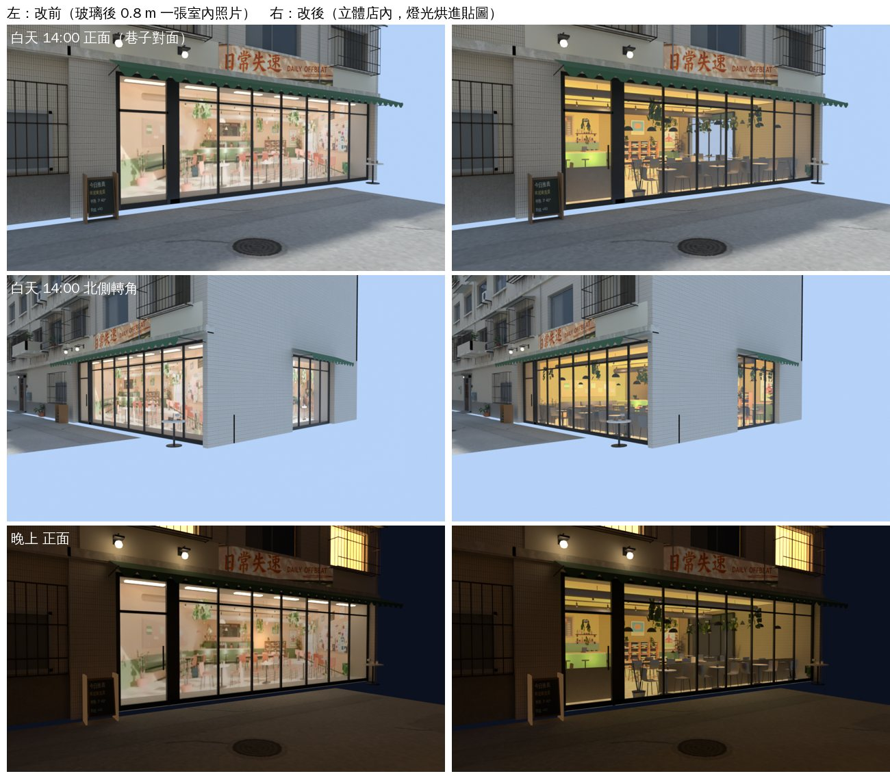

# 日常失速：從街上看店裡改成立體的（SHOP-WINDOW-2D-1105 試做；LAWWW2-B 2026-11-07）

- **第 1 版**。
- 起因：使用者 11-05 06:5x「店外看店裡很 2D」（落地窗後面是平面窗卡）；08:2x（UA-LAWWW-1105-34）「**只拿日常失速試做，不比現在的櫥窗漂亮就照舊**」。
- 狀態：`MODEL_READY`，**等使用者／BB 判要不要換**（試做）。下面的圖是 Blender Cycles 渲染，不是遊戲畫面；遊戲內同角度截圖排 CC（D131）。

## 改了什麼

- **原本**：落地窗後面 0.8 m 一張景深卡（AA 室內從街上渲染的圖）＋淺淺的地板和側牆；一樓量體的前牆就在卡的後面。走過去窗裡不會跟著角度變。
- **這一版**：
  1. `tools/blender/env_second/offbeat_storefront.py`（新）：拿 AA 的室內正式模型（`aa_support/daily_offbeat.glb`）——
     - 拿掉臨街兩面牆（前面、北面：窗框、玻璃、窗景卡）；切掉伸出大樓、伸出玻璃的部分；
     - 在 `GLOW_*` 的位置放 30 盞燈（吊燈、軌道燈、吧檯 LED、桌燈），Cycles 把燈光、陰影、反射光烘成一張 2048² 貼圖（浮點烘、中位數拉到 0.18、亮處 Reinhard 壓），換成一個**只有自發光**的材質：遊戲裡不吃街上的光，白天晚上都是「店裡開著燈」；
     - 葉子（透明貼圖剪形狀）不烘，照原本的材質另外留著（烘成一張圖會變方塊）；
     - 減面 5.1 萬 → 2.2 萬三角形。
  2. `wz_street.py`：W2（日常失速）一樓量體只留店內後面那一段，北面窗兩側改薄牆；擺 `offbeat_storefront.glb`（室內 (x, z) → 溫州街 (z − 42.2, −13.5 − x)），抬 1 cm、高度縮 1%（地板、天花板不和街面、樓上量體同一個平面）。
  3. `wz_shopkit.py`：`int3d` 時不畫景深卡和淺盒子，只畫玻璃和窗框（正面、北側）。
- 導航、店門互動點都沒動（`wenzhou_street.props.json` 沒變）。
- 不用改遊戲程式。

## 規格（`wenzhou_street.glb`）

| | 改前（開發） | 改後 |
|---|---|---|
| 三角形 | 135,522 | 158,124（+22,602：店內 21,808＋葉子） |
| 材質 | 182 | 184（+2：店內、葉子） → draw call 約 +2（只在看得到 W2 的時候） |
| 檔案 | 12.03 MB | 13.78 MB（+1.74 MB，主要是 2048² 的店內貼圖） |

- 想省下載量：`offbeat_storefront.py -- --res 1024` 重做（約 +0.5 MB），遠看差不多、近看比較糊。
- 瀏覽器的 draw call、FPS 沒量（D131 排 CC：主巷三個鏡頭的效能測試照舊跑）。

## 接法（給 LAWWW-B）

1. 換二進位（從我的分支）：`assets/models/env/second_ai/wenzhou_street.glb`、`wenzhou_street.json`、`offbeat_storefront.glb`（後者只是素材來源，遊戲不讀；溫州街模型已經包含它）。
2. 不用改程式。
3. patch `offbeat_storefront_1107.patch`：只改 `tests/singleside_streets_unit.js` 鎖住的溫州街三角形、材質數（135,522／53 → 158,124／55）。
4. **不要的話**（使用者或 BB 判「沒有比較好」）：不換這三個檔就好；或在我的分支 `wz_street.py -- --no-int3d` 重做一顆回到景深卡。

## 測試（Node）

- 開發 `148999dd2`＋新的 `wenzhou_street.glb`：讀到溫州街、日常失速的 23 支 Node 測試，22 支 ALL PASS；`singleside_streets_unit` FAIL 2（鎖住的三角形、材質數）→ 套 patch 後 ALL PASS。
- 沒跑：瀏覽器、手機（D131）。請 CC 拍：巷子對面看日常失速正面、北側轉角（白天、晚上），和進店以後從店裡往外看（確認沒有被這一包影響）。

## 先將就的

1. 店內燈光是烘死的：白天晚上一樣（店開著燈）。打烊時間沒有關燈。
2. 店裡沒有人（路人、店員）：只有在店裡面那一區才有人。
3. 葉子照即時光：在大樓裡面、光線比烘好的店內暗一點。
4. 從很近、很斜的角度看，2048² 的貼圖在大面積（地板）上會有一點糊。
5. 這是 AA 的 v2 室內；AA 改了室內就要重跑 `offbeat_storefront.py` 和 `wz_street.py`。

## 檢查清單

- [x] 參考圖：`ref_images/wz_cafes/daily_offbeat_ref_v2.webp`（使用者給的生成圖）；這一包沒有疊圖，只和原本的櫥窗比。
- [x] 沒有新的招牌字。
- [x] 沒有複製貼上（D133）：店內就是 AA 的室內模型本身。
- [x] Node 測試跑過；鎖住的數字是刻意改的。
- [x] 驗收狀態：MODEL_READY；要使用者／BB 判換不換。
