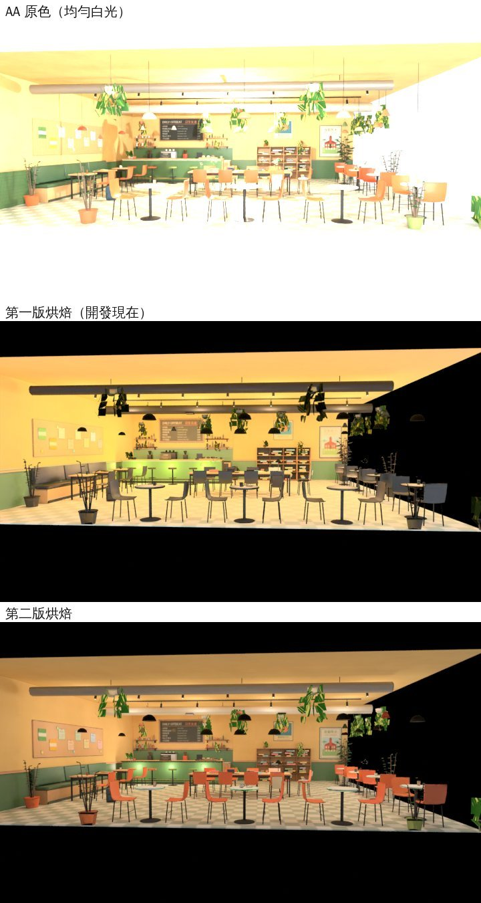
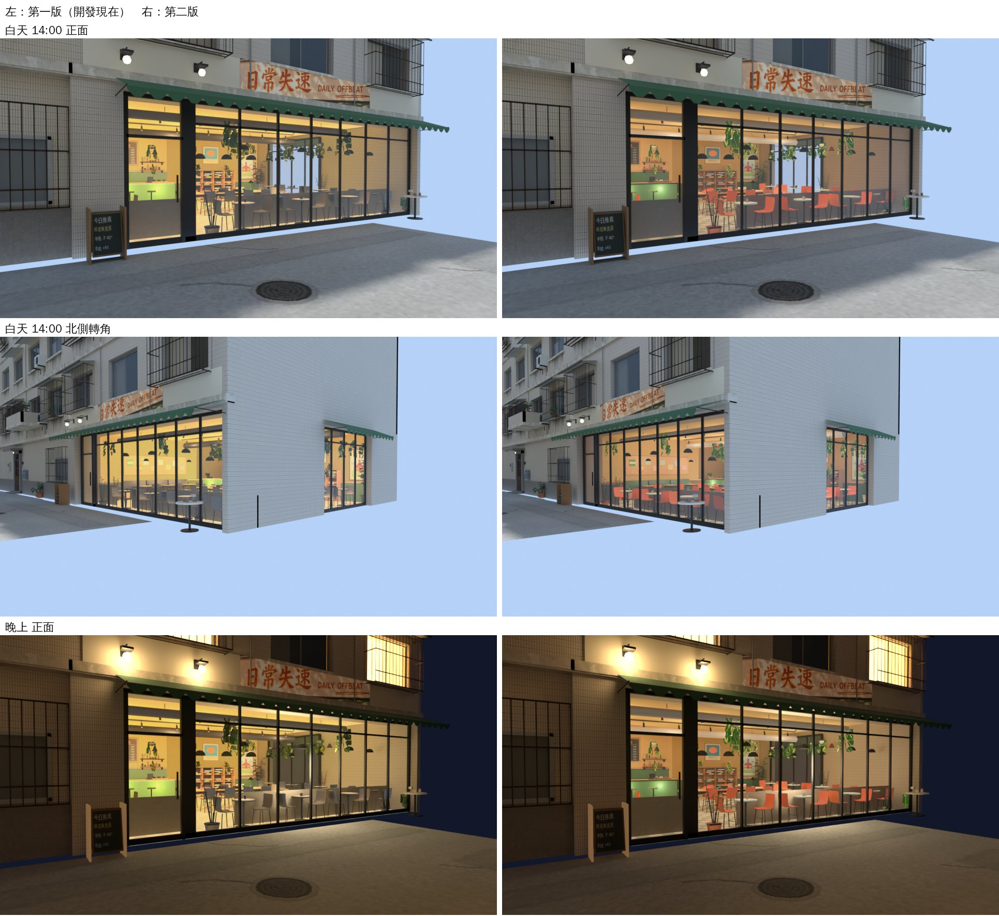

# 日常失速：從街上看的立體店內，第二版（#167；LAWWW2-B 2026-11-07）

**起因**：BB-B 11-07 判「換新版」（CC 在使用者電腦拍的同角度對照，elegant-brown `90a10d010` 的 `test_shots/shopwin1107/`），另外提了兩點，不擋，之後再調：

1. 「店內整片偏黃綠，有點單調。舊版那張圖有粉色椅子、綠色植物，新版可以加幾個顏色點」；
2. 「店前那一格最低 fps 8.6（舊版 20），像第一次進鏡頭頓一下；三角形多 4.4 萬（24.6 萬對 20.2 萬）」。

**狀態**：**READY_FOR_ART_REVIEW**（場景美術：BB-B／使用者看）。
- 下面的圖是 Blender Cycles 渲染，不是遊戲畫面；
- 遊戲內同角度截圖、店前的 fps 要 CC 量（D131）。

## 一、顏色：不是缺顏色點，是第一版的烘焙工具把顏色弄丟了

AA 的室內模型（`aa_support/daily_offbeat.glb`）本來就有珊瑚色的椅子、陶土盆栽、綠色植物和吧檯。舊版那張景深卡，就是從這個模型渲染的。

**bug**（`tools/blender/env_second/offbeat_storefront.py` 第一版）：
- AA 的三個頂點色材質（`dof_vc`／`dof_vc_gloss`／`dof_vc_metal`），顏色節點沒寫層名，等於讀「預設那一層」；
- 我把整間合成一個網格時，第一個物件是燈泡，沒有顏色層，合出來的網格就沒有預設層；
- 結果椅子、盆栽、吊燈都讀不到顏色，烘成灰色。

**另外**：AA 的燈（`GLOW_*`）是 2700K 左右的琥珀光，奶油色的牆被照黃、橄欖色磁磚被照成黃綠。



**第二版**：
- 合併後指定讀 `Color` 那一層，三個材質也寫上層名；
- 燈色只留 AA 原本暖色的 45%，其餘往白光拉（`--warm 0.45`；1＝第一版）；
- 葉子和店內一樣「店裡開著燈」：自發光＝葉子貼圖 × 0.75，底色壓暗。第一版葉子照街上的光，在大樓裡面偏黑。

烘好的圖裡的比例（工具寫進 `extras.storefront.color`）：

| | 第一版 | 第二版 |
|---|---|---|
| 珊瑚色（椅子、陶土盆栽） | 2.3% | **9.2%** |
| 綠色（植物、吧檯） | 0.1% | **3.2%** |

**沒有另外加靠墊、杯子**：顏色點本來就在 AA 的模型裡，修好就出來了。如果還要更多，要加在 AA 的室內模型本身，店裡、店外才會一致；這要 AA 決定。

## 二、店前那一格的三角形

**原因**：店內 2.2 萬三角形在陰影那一輪又畫了一次，兩輪加起來就是 BB-B 量到的 +4.4 萬。
- 遊戲的 `wzCastsShadow`（`zones3d.js`）只認得 `NOSHADOW_` 開頭的節點不投影；
- 第一版的節點叫 `offbeat_storefront`，所以會投影。

**第二版**：
1. 店內和葉子兩個節點改名 `NOSHADOW_offbeat_storefront`、`NOSHADOW_offbeat_storefront_leaf`：陰影那一輪不畫。店內本來就是自發光，不需要影子。
2. 街上看不到的面不放進模型：
   - 從巷子對面、北側橫巷的 135 個鏡頭位置（高度 1.2／2.2／3.4 m），往每個面的中心和三個角附近射線；
   - 第一個打到的是這個面，就算看得到；0.04 m² 以上的大面一律留；
   - 49,839 個面裡有 11,297 個看不到（椅子底、桌子底、櫃台後面、背對街的面）；
   - 這些面在烘焙時還在（照樣擋光、反光），匯出前刪掉；
   - 貼圖只分給看得到的面，同樣 2048² 用到的面積 47% → 51%。

**數字**：

| | 第一版 | 第二版 |
|---|---|---|
| 店內三角形 | 21,808 | **18,771** |
| 溫州街模型三角形 | 158,124 | **155,087** |
| 店前那一格多出來的三角形（主畫面＋陰影） | 約 +4.4 萬 | 約 +1.9 萬（只剩主畫面） |
| 材質 | 55 | 55 |
| 檔案 | 13.78 MB | 13.66 MB |

**fps 8.6 那一頓**：BB-B 說像第一次進鏡頭頓一下。可能是第一次看到店內時，GPU 才上傳 2048² 的貼圖、編譯這個材質的 shader。
- 這一包沒有改貼圖大小；
- 要省可以 `offbeat_storefront.py -- --res 1024`：GPU 記憶體約 22 → 5.6 MB；遠看差不多，近看比較糊；
- 遊戲端也可以進溫州街時先 `renderer.initTexture`／`compile`。
- 實際有沒有改善，要 CC 在使用者電腦重量。

## 三、街景對照（三個鏡頭）



## 接法（給 LAWWW-B）

1. **換二進位**（從我的分支）：
   - `assets/models/env/second_ai/wenzhou_street.glb`、`wenzhou_street.json`；
   - `offbeat_storefront.glb`：素材來源，遊戲不讀，開發分支沒有也沒關係；
   - `wenzhou_street.props.json` 沒變：導航、店門互動點都不動。
2. **不用改遊戲程式**。
3. **patch `offbeat_storefront_v2_1107.patch`**（對開發 0f4b0394a，`git apply --check` OK）：
   - `tests/singleside_streets_unit.js` 鎖住的溫州街三角形 158,124 → 155,087（材質 55 不變）；
   - 新測試 `tests/offbeat_storefront_unit.js`（只讀 GLB 的 JSON）：
     - ① 第二版、珊瑚色 ≥ 5%、綠色 ≥ 1%；
     - ② 兩個節點 NOSHADOW_、wzCastsShadow 認得這個前綴、店內 ≤ 19,500 三角形、有分出看不到的面；
     - ③ 葉子自己亮、店內只有自發光。

## 測試（Node，雲端）

- **新測試** `offbeat_storefront_unit`：
  - 開發 0f4b0394a 原樣：**FAIL 5**；
  - 換新模型＋patch：**ALL PASS**。
- **讀到溫州街、日常失速、Café 街景、單面的 Node 測試 31 支都 exit 0**（換新模型＋patch）：
  - singleside_streets、wz_offbeat、offbeat_aa618、offbeat_cat_board、street_props_nav、cafe_street_live、wz_views_1105、zone_prewarm、shop_crowd_new、quick_travel、lampshade_flip、teach_east_drawcall…
- **沒跑**：瀏覽器、手機（D131）。請 CC：
  - 拍巷子對面看日常失速的正面、北側轉角（白天、晚上）；
  - 進店以後從店裡往外看；
  - 量店前那一格的 fps，和 BB-B 那次同一個位置。

## 先將就的、要知道的

1. **店內燈光是烘死的**：白天晚上一樣（店開著燈），打烊沒有關燈（和第一版一樣）。
2. **重做溫州街模型時，另外三家店的店內小東西三角形切法不同**：
   - A4、B2、B5i、B7，每家 6～16 個三角形，位置範圍一模一樣，看不出來；
   - `wz_street.py` 本來就這樣（多次重跑比對過），不是這一包改的。
3. **工具重跑**：
   ```
   /opt/blenv/bin/python tools/blender/env_second/offbeat_storefront.py -- --src <開發的 aa_support/daily_offbeat.glb>
   /opt/blenv/bin/python tools/blender/env_second/wz_street.py
   ```
   - 我的分支沒有 AA 的室內模型，要用 `--src` 指到開發分支的檔案；
   - `--no-cull` 回到不拿面，`--warm 1` 回到第一版的燈色。
