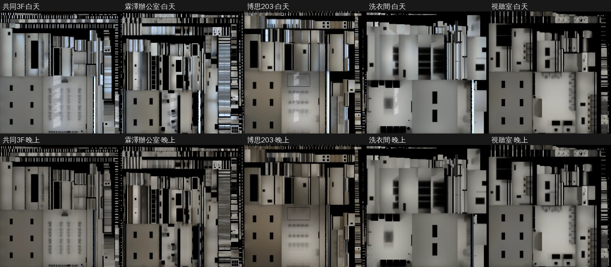

# INTERIOR-AAA 第三批光照：共同 3F、霖澤辦公室、博思 203、洗衣間、總圖視聽室（LAWWW2-B 2026-11-07）

**派工**：LAWWW-B 10:14「回去推 INTERIOR-AAA #113」。
- 接在霖澤 3F／4F、萬才研討室後面。
- 都是 AA_399 那一批走得進去的房間（`rooms_glb3d.js`），之前只有即時光。

**狀態**：READY_FOR_ART_REVIEW（場景：BB／使用者看）。遊戲內畫面要 CC 拍。

**遊戲端不用改程式**：
- `rooms_glb3d.js` 本來就用 `Z3.attachRoomGLB` 接正式模型，GLB 有 `extras.lightmap` 就會接上。
- 只要換 GLB、加 10 張 WebP。
- 新測試 `tests/rooms_ab3_lm_unit.js` 在 `rooms_ab3_lm_1107.patch`。

| 房間 | 劇情裡 | 窗 |
|---|---|---|
| `gongtong_3f` 共同教學館 301 | 考場 | 南面 |
| `linze_office` 法律學院辦公室 | 辦事 | 南面 |
| `boya_203` 博思 203 | 即興劇社的小演出 | 南面 |
| `dorm_laundry` 宿舍洗衣間 | 洗衣服 | 南面 |
| `library_media` 總圖 2F 多媒體中心 | 視聽室 | 沒有窗 |

## 做法

腳本 `tools/blender/env_second/lightbake/bake_rooms_ab3.sh`：直接烘 assets 裡現在的 GLB，不重新產生。每間 512 取樣，CPU 15～30 分鐘，五間共約 1 小時 50 分。

**燈**：
- `tube_lights.py` 從每間 GLB 的燈管網格讀出每一盞燈，每盞放一個 30 W 面光源，在燈管下緣。
- 和看得到的燈管一定對得上。

| 房間 | 燈 |
|---|---|
| 共同 3F | 6 盞 |
| 霖澤辦公室 | 4 盞 |
| 博思 203 | 4 盞 |
| 洗衣間 | 2 盞 |
| 視聽室 | 6 盞 |

**博思 203 的檯燈、螢幕，洗衣機的面板**：不當光源，也不烘。

**白天和晚上**：
- 白天是天空＋太陽（方位 160°、仰角 35°），和 202、研討室同一組；晚上只有燈。
- 外殼只開南面（窗）。
- 視聽室沒有窗，五面都包，白天和晚上一樣。遊戲把它當沒有窗的房間（`windowless`），晚上也不會變暗。

**不烘的（照舊即時光）**：
- 燈管、發光的東西；
- 頂點色的小東西；
- 金屬件、玻璃；
- 博思的螢幕、檯燈，洗衣機的面板；
- 辦公室的信件格：幾百個小格子。

這些東西照樣擋光，所以地上桌椅的接觸陰影照樣烘進去。

## 檔案

| 房間 | GLB 原本 → 現在 | 光照貼圖（WebP 1024²）白天／晚上 | 平均亮度 白天／晚上 |
|---|---|---|---|
| 共同 3F | 1.28 → 1.37 MB | 63／53 KB | 0.36／0.22 |
| 霖澤辦公室 | 0.86 → 0.96 MB | 71／62 KB | 0.32／0.20 |
| 博思 203 | 0.83 → 0.91 MB | 59／53 KB | 0.30／0.21 |
| 洗衣間 | 0.58 → 0.60 MB | 38／29 KB | 0.41／0.31 |
| 視聽室 | 2.04 → 2.12 MB | 38／36 KB | 0.26／0.26 |

- **draw call 不變**：每間的 primitive 數和原本一樣（25、32、25、22、21）。
- **材質多 1～2 個**：和沒烘的東西共用的材質複製一份，分給有、沒有第二套 UV 的網格。可能多編 1～2 個 shader。

- 白天看得到窗那一側亮、地上有窗格的光。晚上是燈下面一塊一塊亮。
- 天花板上黑色的小方塊是燈具貼著的地方，遊戲裡被燈具蓋住。

## 測試（Node，開發 `e9d8c668f`）

| | 開發原樣 | 換這一包的 GLB＋貼圖 |
|---|---|---|
| 新 `tests/rooms_ab3_lm_unit.js` | **FAILED 5**（五間都沒有光照貼圖） | **ALL PASS** |
| 會讀這五間、`rooms_glb3d.js`、`room_glb_layouts.js` 或光照的其他測試 | — | 49 支全過 |

新測試檢查五件事：
- ① 每間的 GLB 有 extras.lightmap，白天、晚上的檔都在；
- ② 地板、天花板、牆、收邊條有第二套 UV；燈管、小東西、金屬、玻璃沒有；
- ③ 沒有材質同時給有、沒有第二套 UV 的網格；
- ④ 淡出的牆節點都在；
- ⑤ `rooms_glb3d.js` 照舊用 `Z3.attachRoomGLB`。

## 還沒驗

- **遊戲內畫面（CC）**：每間白天 11:00、晚上 20:00 各一張，從門口往裡面；視聽室拍一張就好。
- 人物照同一間的光沒做，照舊是遊戲的半球光，和其他烘過的房間一樣。
