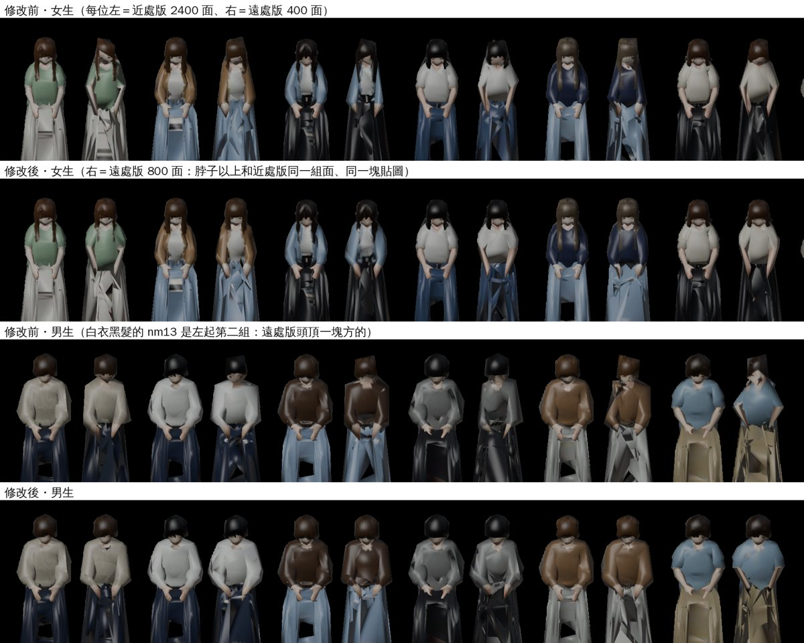

# SEATFIG-LOD1-HAIR-1104 坐著的替身：遠處版頭頂一塊方的

LAWWW2-C 2026-11-04。狀態：**MODEL_READY**。只換 `assets/models/env/second_ai/seated_figures.glb`（和 `.json`），**遊戲程式不用改**。還沒在瀏覽器看過。

## 問題

- BB-C 17:19 轉來 CC 的 `SITAMB_CLOUD_1104` 第 ⑧ 項（`cc-testing` 分支 `docs/story_planning/CC/shots/SITAMB_CLOUD_1104/`）：博思 101 的替身頭上有深色方塊，例如穿白衣的那幾位。
- CC 查到：那一堂 17 個替身全部是遠處版 `fig_npc_*_c0_lod1`（400 面）。把桌上小物藏起來方塊還在，所以是替身模型本身。
- 我查到：遠處版是從外殼直接減到 400 面，頭只剩幾十面。男生的頭多半變成尖角或方塊，白衣黑髮的 `npc_nm13` 最明顯：頭頂是一塊平的黑色方塊。近處版（2400 面）的頭是圓的。

## 改法（`tools/blender/env_second/seated_figures.py` 第四版）

1. **遠處版從近處版再減，脖子以上整個不減**：頭和頭髮就是近處版那一組面（300～372 面），只減身體。Blender 的 Decimate 遇到頂點群組權重 0 的頂點，連著的邊都不減。
2. **總數 400 → 800 面**：試過 500、600、700，身體分到的面太少，烤顏色會烤錯。700 面時 `nf6` 肚子、`nm2` 胸口有深色斑；800 面就沒有。
3. **遠處版的顏色從近處版烤**，不是從原始的高模烤：兩個形狀很接近，射線不會穿過去打到別的地方。
4. **遠處版頭上的面直接用近處版的 UV**：兩邊是同一組面。近處版那一塊貼圖解析度高，頭髮也已經清過。
   - 原本遠處版只分到每格貼圖最下面的四分之一，頭頂有一片三角形只有 4 px，取到旁邊白衣服的顏色：`nm13` 頭頂一小塊白。
5. 舊的做法還在：`--head-keep 0 --lod1 400` 就是第三版。



Blender Workbench 預覽，不是遊戲畫面。鏡頭和博思 101 講台那一端差不多：從前面往下 28°。

## 規格

| 項目 | 修改前 | 修改後 |
|---|---|---|
| 網格名字 | 72 個：`fig_<底模>_<姿勢>_c0`、`…_lod1` | 一樣（遊戲 `classes3d.js` 的 figPlace／figLod 照名字找） |
| 近處版（LOD0） | 2400 面 | 2400 面（沒動） |
| 遠處版（`_lod1`） | 400 面 | 800 面（頭 300～372 面） |
| GLB | 3.29 MB | 3.64 MB |
| 貼圖集 | 2048×1536（12 位、每位 512×512） | 一樣 |

成本：遠處的替身每個多 400 個三角形。CC 拍的那一堂 17 個 → 多 6,800 個。**還沒量手機上的 fps。**

## 測試（Node，不是瀏覽器）

開發分支 `effb5d9b3`（`claude/adoring-meitner-mqzst8`）放新的 GLB：

- `tests/seated_figures_unit.js` ALL PASS
- `tests/seated_figures_lod_unit.js` ALL PASS
- `tests/desk_furniture_unit.js` ALL PASS

舊的 GLB 在同一個 commit 上也是三支都過，所以測試只證明「沒有弄壞」，沒有檢查頭的形狀。頭的形狀只看了上面的 Blender 預覽。

我的分支上 `desk_furniture_unit` 第 D 項 FAIL，是因為我分支上的 `src/classes3d.js` 比開發分支舊；換回舊的 GLB 也一樣 FAIL，和這次的修改無關。

## 給 LAWWW-C

```
git checkout <交件 SHA> -- assets/models/env/second_ai/seated_figures.glb assets/models/env/second_ai/seated_figures.json
```

不用改程式。

## 給 CC（電腦上跑瀏覽器，D131）

用 `SITAMB_CLOUD_1104` 第 ⑧ 項同一個鏡頭重拍：講台那一端上方 (−11.1, 4.8, 5.15) 往後排 (−11.1, 1.1, −1.85)。看穿白衣的替身頭上還有沒有方塊。

CC 那時候寫：玩家走到替身中間，替身照舊是 `_lod1`。開發分支上 `seated_figures_lod_unit.js`（換 LOD 的測試）是過的，但我沒有在瀏覽器確認。

## 還沒做／已知的不足

- 遠處版的身體有幾位還有碎面，多半在桌子下面，講堂裡看不太到。
- 有一兩位的近處版，頭髮背面靠近頸子的地方有幾個深色鋸齒（第三版就有，不是這次造成的）。
- 美術要 BB 判（D120／D128）。我不標 ART_APPROVED。
