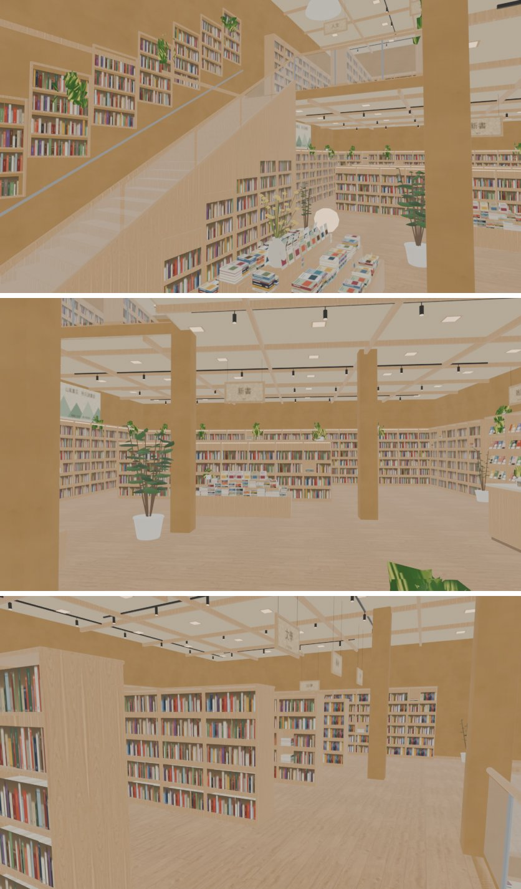

# 山嵐書店走得進去（ART-SHANLAN-BOOKSTORE-1103，LAWWW2-C 2026-11-05）

- **第 1 版進遊戲**（D141）。模型是 AA 子代理的 v5（AA 已經改過三版：v3 LAWWW2 驗收 MODEL_READY、v4／v5 對參考圖 ref_match ALL PASS）。
  - GLB、配置、Blender 腳本照企劃線 `claude/cool-heisenberg-o8kuqx` 搬過來，GLB 一模一樣。
  - 這一包做的是：區域、兩層導航、樓梯、座位、出入口、測試、接線。
- 企劃：AA_613 第 3 節。
  - 店名原創「山嵐書店」。
  - 營業 11:00～22:00，週五、週六到 23:00。
  - 一樓：新書平台、雜誌牆、文具、結帳。
  - 二樓：人文、文學、藝術、童書、法律區，有人坐在地板看書。
- 位置：AA_615 第 1、2 節，新生南路那一排、側門對面。
- 參考圖的種類：使用者 11-03 生成的參考圖 `shanlan_int.webp`、`shanlan_ext.webp`（企劃線）。對照圖在 AA 的 `model_renders/shanlan_v5_refcam_cmp.jpg`，這一包沒有重做疊圖（D141）。
- 驗收狀態：INTEGRATED（Node 模擬）。瀏覽器沒跑（D131）。

## 1. 玩家可以做什麼

- 新生南路上山嵐書店的店門變成「進山嵐書店」。進去站在店門內 1.5 m，面向店裡。
- **一樓**：
  - 三張靠窗長椅「坐靠窗長椅」。
  - 新書平台兩座、雜誌牆、文具、結帳櫃檯都走得到（互動點給 LAWWW 接）。
- **樓梯**：沿西牆，從一樓南邊往北爬上二樓。
  - 25 階×0.168 m、踏面 0.28，約 32°，真的走得上去（D38 第 4 點）。
  - 上半段兩層共用：上樓過了一半換到二樓那一層，下樓過了一半換回一樓。
  - 模型的 24 個踏面和導航算的一階一階一樣高（讀 GLB，最大差 0.000 m）。
- **二樓**：
  - 五張靠窗長椅、兩張閱讀桌八個位子「坐下看書」。
  - 四排書架的走道、法律區、童書都走得到。
  - 挑空邊是玻璃欄杆，挑空那一塊站不住。
- **坐地板看書** 10 個位置（二樓 8、一樓 2）：
  - 走近點都走得到（離書架那一面 0.35 m 的坐點前面）。
  - 姿勢、按鈕、轉暗、旁白由 LAWWW 照 AA_613 接，資料在 `SH3.FLOOR_SIT`。
- **鏡頭**：
  - 人在一樓、鏡頭拉高過二樓地板時，二樓整層藏起來（剖面視角，`levelGroups`）。
  - 人在樓梯上時，鏡頭不穿過二樓樓板（`slabs`）。

上中下三張都是 `glb_preview.py` eevee（均勻光，不是遊戲畫面）。

## 2. 先將就的（D141：給使用者看的清單；不擋進遊戲）

1. **二樓兩盆大盆栽在一樓的網格裡**：位置 (−1.15, 1.6)、(6.5, 1.6)，網格 `shl_vc`、`shl_vcg`。
   - 結果：人在一樓、鏡頭拉高、二樓藏起來的時候，這兩盆會浮在半空。
   - 要 AA 在 Blender 把它們放進 `L2_` 開頭的網格。`tests/shanlan_unit.js` ⑨ 把它們列為已知，其他位置再出現就 FAIL。
2. **貫穿兩層的柱子**：三根柱子是一樓那一組。二樓藏起來的時候，柱子會從一樓頂上冒出來（剖面視角）。
3. **窗外沒有街景**：AA_613 寫「窗外是公館街景」，現在臨街那一整面玻璃外面是暗的。之後做窗卡（2:30 AM 那一套）。
4. **燈光**：還沒烘光照貼圖。用即時光：一樓兩盞、挑空的大燈籠、二樓兩盞，加 GLOW_ 光暈。
5. **新生南路的店門字**：「進山嵐書店（書店（兩層））」括號套括號。這是 `xinsheng3d.js` 照配置的 type 組的字，同弦也是「進同弦樂器（吉他行（二樓））」。要改的話改 xinsheng3d.js 的組字。
6. **坐地板、互動點**：還沒有按鈕（LAWWW 接，同南洋、同弦、木曜日）。
7. **效能**：12 個材質裡 11 個是雙面；三角形 82,836（一樓 57,826、二樓 23,380、兩層共用的牆 1,630）、GLB 5,440,888 B（5.19 MiB）。
8. **颱風天**：AA_613 沒寫，先不關。

## 3. 測試（Node，不用瀏覽器）

`node tests/shanlan_unit.js`：ALL PASS（19 項，套上接線 patch 以後含 ⑩ 營業時間）

| | 檢查 |
|---|---|
| ① | 登記、正式模型 |
| ② | 兩層同尺寸同原點、二樓 4.2；進來的位置 |
| ③ | 樓梯一階一階的高度、坡度、GLB 的 24 個踏面 |
| ④ | 一樓 → 樓梯 → 二樓、二樓 → 一樓；找路經過樓梯 |
| ⑤ | 一樓的長椅、互動點、坐地板的走近點 |
| ⑥ | 二樓 13 個座位、互動點、8 個坐地板的走近點；16 個按鈕都帶樓層 |
| ⑦ | 挑空站不住；一樓從樓梯頂、側邊走不出去 |
| ⑧ | 新生南路的店門、走出來的位置 |
| ⑨ | GLB 分兩層（L2_ 在二樓；一樓那一組高過二樓地板的只在挑空、牆邊、柱子）、WALL_ 有 dir |
| ⑩ | 營業時間（週四 11:00 開、22:00 關；週五到 23:00）、店門擋 |

照實寫：

- 第一次跑 FAIL 3 項，都是**測試寫錯**：
  - ⑤⑥：檢查「坐地板的位置本身站得住」。那是離書架 0.35 m 的坐點，本來就不是站的地方。改成檢查前面的走近點。
  - ⑨：原本假設一樓的東西都在 4.3 m 以下。挑空裡的樓梯、書牆、欄杆、柱子本來就兩層高，改成照位置判斷。
- 改了以後，查出上面「先將就」第 1 條的兩盆盆栽。

在開發分支 `07dfffe15`＋南洋接線＋新生南路騎樓＋這一包上跑：

- `shanlan_unit`、`nanyang_unit`、`seat_reach_unit`（xs_shanlan 16 個座位都碰得到「坐下」）、`xinsheng_unit`、`tongxian_unit`、`spawn_exit_unit`、`placemap_unit` ALL PASS。
- 另外 19 支也 ALL PASS：aa619_guitar_zone、aa653_shops、bike_park_1104、bike_shop_park、gg_interiors_1104、gg_shops2_1104、mokuyobi_aa618、prop_restand、wz_offbeat、calendar_hours、v3_typhoon2、quick_travel、exit_ring、scene_bg_keys、rooms_glb、shop_rename_1104、lamppost_nav、aa117_notes、aa347_y1。

## 4. 接法（LAWWW-C）

1. 拿檔案：`git checkout <SHA> -- src/data/shanlan_layout.js src/shanlan3d.js tests/shanlan_unit.js assets/models/env/second_ai/aa_support/shanlan.glb assets/models/env/second_ai/aa_support/shanlan.json`
   - Blender 原始檔：`tools/blender/env_second/aa_support/shanlan_*.py`、`README_shanlan.md`、`shl_views.json`，照企劃線搬過來，要留就一起拿。
2. **先套南洋的** `../nanyang_zone_1105/nanyang_wire_1105.patch`，**再套** `shanlan_wire_1105.patch`。
   - 它的前後文接在南洋那幾行後面。單獨套在 `07dfffe15` 上會失敗；套在 `07dfffe15`＋南洋接線上是乾淨的。
   - 內容：
     - `index.html`：在 nanyang3d.js 後面載入兩個檔。
     - `places.js`：名字「山嵐書店」；營業時間：週日～週四 11:00–22:00，週五、週六 11:00–23:00。
     - `story3d.js`：店門照營業時間擋。
     - `seat_reach_unit`：加山嵐的兩個檔。
     - `LICENSES.md`：一列。
3. 劇情（LAWWW，AA_613）：
   - 坐地板看書：轉暗、過一小時、隨機旁白，不加數值。
   - 互動點的台詞：新書平台「給第一次打官司的人」、二樓「走道上坐了三個人」。
   - 學姊、以安。

## 5. 檢查清單（RULES_2D_TO_3D 第 7 步）

- [x] 參考圖是哪一種：使用者生成的圖。
- [x] 「最重要的那一塊」：寬木樓梯＋挑空＋二樓欄杆，在 AA 的 refcam 和上面第一張裡。
- [x] 店名原創（D77）；沒有商標、品牌配色。
- [x] 沒有複製貼上：模型是 AA 的，這一包沒有加東西。
- [x] 走得到、坐得下、上下樓梯，都寫進 Node 測試。區域原本不存在，① 就 FAIL。
- [x] 驗收狀態：INTEGRATED（Node 模擬）。遊戲內截圖等瀏覽器。
