# 新生南路新店室內：CC 四間的驗收意見（LAWWW2 11-03 23:0x；使用者：「怎麼可以做的這麼像廉價的遊戲」）

狀態：四間都**退回重做**（同弦、大步、好拍、新生運動廣場）。
比對方法：左邊是使用者給的參考圖（企劃線 `ref_images/shops/*_int.webp`），右邊是 CC 交的渲染（`claude/cc-testing` `docs/story_planning/CC/shots/model/`）。

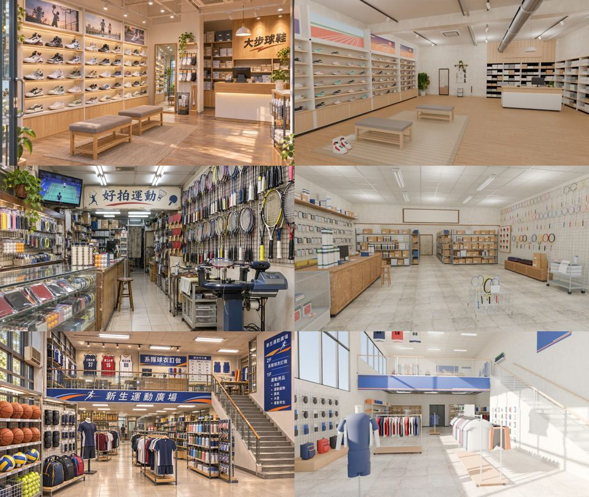
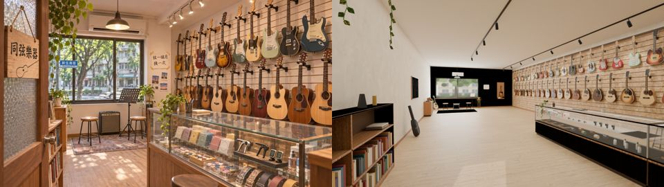

## 四間共同的三個最大問題（照影響大小排）
1. **店太大、太空，比例錯了**。這是最主要的原因。
   - 參考圖都是台北騎樓下的小店，牆到牆幾公尺，東西擠滿；渲染出來像量販店或倉庫。
   - 店面寬度要照 `xinsheng_layout.js`（店面那一側的寬度，就是騎樓的開間）：

     | 店 | 面寬 |
     |---|---|
     | 好拍 | **4.4 m** |
     | 同弦 | 6.4 m（二樓） |
     | 大步 | 7.4 m |
     | 新生運動廣場 | 14.4 m |

   - 深度 12～16 m，一樓高 3.2～3.6 m，不要超過 4 m。
   - 房間變小以後，東西自然就擠了；空的地板不能大過整個畫面的三分之一。
2. **光太平、太白、像醫院**。
   - 參考圖是暖色投射燈打在商品上，牆和地板偏暖、偏暗，亮暗有層次。
   - 渲染是整片白天花板加均勻的白光，沒有陰影，牆和天花板接近純白。
   - **改法**：
     - 牆不要純白，用暖米、淺木、灰綠；天花板比牆暗。
     - 主光是軌道燈或嵌燈，光打在商品牆上（發光材質＋烘焙）。
     - 店內暖色約 3000K；窗外和門外比店內亮。
     - 渲染用 `--view Standard` 或 AgX，但不要過曝；牆面的亮度不要到 0.9 以上。
3. **東西少、乾淨、都是單色方塊，沒有「有人在用、開了很多年」的感覺**。
   - 每一面牆都要滿，參考圖是從地板一路排到天花板。
   - 招牌、海報、價格卡、手寫紙條、電視、收銀機、紙箱、塑膠袋、掃把、延長線、電扇，至少要有 15 種小東西。
   - 商品不是單色方塊：
     - 鞋要有鞋底、側線、鞋帶孔的色帶；
     - 衣服要有領口、袖子、印號碼的布；
     - 拍子要有框、線、握把三種材質；
     - 包裝要有印刷貼圖。

## 各店最需要改的
- **好拍**：參考圖是一條窄窄的老店走道，左邊玻璃櫃，右邊拍子牆從地板一路掛到天花板，櫃台前一台穿線機，牆上一台電視在播球賽。現在是 15 m 寬的空倉庫，拍子只掛了一小面牆。面寬 4.4 m 照做，就會擠到像參考圖。
- **大步**：
  - 鞋牆的層板要淺木色，每一層底下有燈條，鞋子一排排滿；鞋牆上面一排運動海報（虛構）。
  - 中間兩張木頭長凳、一面立鏡、櫃台後面有木頭招牌「大步球鞋」。
  - 現在的天花板有管線，和參考圖不一樣，參考圖是平頂加軌道燈；地板有一大片空地。
- **新生運動廣場**：
  - 人台是方塊拼的，要換成有肩、腰、四肢弧度的人台，或者直接用掛著的衣服。
  - 參考圖一樓是球架（籃球、排球滿滿一籃）、背包牆、衣架；二樓欄杆掛「系隊球衣訂做」橫幅，牆上掛有號碼的球衣（虛構校名、沒有品牌）；樓梯是木扶手。
  - 現在的二樓欄杆是一條藍色色塊，牆是空白的。
- **同弦**：
  - 房間太長（看起來 20 m 深），吉他變得很小。要改成：一面牆從腰部高度一路掛到天花板，吉他大小要對；靠窗那邊放試琴椅、譜架、小音箱；窗外是新生南路的樹。
  - 櫃台的玻璃櫃要擺滿琴弦、Pick、移調夾的包裝（印刷貼圖）。
  - 門口要有「同弦樂器」木牌，加手寫的「弦一個月換一次」紙條。

## 材質、雜物、光、歲月感、預算（CC 的第 3 題）
- **布料、衣服、包裝、紙類**：
  - 不要用單色。用 PIL 或 numpy 自己畫一張「印刷圖集」貼圖：品牌（虛構）色帶、號碼、價格卡、海報、包裝盒的印刷，畫在同一張 1024 貼圖上，用 UV 切格子對應。做法可以照 AA 的 `tools/blender/env_second/aa_support/aa_int_tex.py`（木曜日的 `mok_print.png`、山嵐的 `shl_print.png`）。
  - 布料的法線、粗糙度用 Poly Haven 的 fabric（CC0，`tools/blender/fetch_polyhaven.py`）。
  - 衣服的形狀：軀幹用 bmesh 做一個有肩斜和腰身的筒，加袖子，不要用方塊。
- **雜物、招牌、價格卡、海報**：
  - 每一面牆、櫃台、地板角落都要有東西。
  - 重複的小東西（鞋、拍子、球、衣服、包裝）用 instancing，同一個網格放很多個，不太佔預算。
  - 招牌字、海報都用印刷圖集，店名只用虛構名（D77），不能出現真實品牌標誌。
- **日系的光**：
  - 主光是軌道燈、嵌燈，打在商品上；燈具本身用發光材質（`GLOW_` 開頭），烘焙出地上和牆上的光斑。
  - 環境光要低，讓角落暗下來；窗戶、門口亮。
  - 渲染的時候燈光多、太陽弱，參數照 AA：`--sun 22,25 --sunE 4 --lamp 50 --world 0.6`。
- **老店的歲月感**：
  - 地板用磨石子或老磁磚（Poly Haven terrazzo、tiles），換成暖色。
  - 櫃台、層板的邊角顏色深一點（頂點色）。
  - 牆上貼過又撕掉的膠帶痕、褪色的海報、手寫紙條；電線用壓條沿牆走；冷氣出風口下面有一點髒。
- **6 萬面怎麼分**：
  - 牆、地、天花板、櫃台：約 1 萬；
  - 商品牆（instancing，一種 200～600 面，重複幾十個）：約 2.5 萬；
  - 雜物、招牌、燈具：約 1.5 萬；
  - 保留：1 萬。
  - 圖集、材質合併到 12 個以內。

## 可以當標準的（已經整合進遊戲、或我已經收了的）
- **AA 的木曜日 v2、山嵐 v3**：
  - 腳本 `tools/blender/env_second/aa_support/mokuyobi_interior.py`、`shanlan_interior.py`＋`shanlan_v3_fill.py`；
  - 渲染在企劃線 `docs/story_planning/ref_images/model_renders/mokuyobi_v2_*.png`、`shanlan_v3_*.png`；
  - 說明 `README_mokuyobi.md`、`README_shanlan.md`，裡面逐項對照 SCENE_RULES 第 9 節。
- **我做的溫州街店面組件**：`tools/blender/env_second/wz_shopkit.py`（林家乾麵、巷子裡定食、阿德影印的立體淺店內、手寫紙條、盆栽）。
- **118 巷的店家室內**：`tools/blender/env_second/lane118_shops.py`（滇香小館、好家自助餐……：店內雜物、冰箱、電扇、手寫菜單）。
- **兩點半 Café 室內**：`tools/blender/env_second/cafe_layout.py`。

## 交件規定（新增，SCENE_RULES 第 11 節）
- 每一間都要附一張**參考圖和同角度渲染的並排圖**。角度、焦距要對上參考圖，不能自己挑好看的角度。
- 自己先拿第 11 節的醜點清單逐項打勾；有一項沒過就不要交。

## ref_match 實測（11-03 23:1x，第 12 節的工具）
- 好拍（CC）：
  - FAIL：平均亮度 0.62 對 0.45，太亮；
  - FAIL：對比 0.42 對 0.69，太平；
  - FAIL：九宮格，亮的位置不對。

  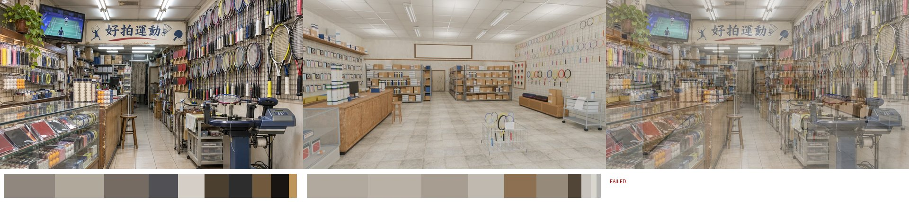
- 大步（CC）：FAIL 對比（0.42 對 0.57）、FAIL 冷暖（不夠暖）。
- **山嵐 v3（AA，我 20:5x 收了的）也 FAIL**：
  - 太亮：0.54 對 0.44；
  - 太平：對比 0.43 對 0.56；
  - 太橘：冷暖 +0.35 對 +0.27。
  - 我之前只用眼睛看，標準太鬆。撤回 MODEL_READY，請 AA 照第 12 節調亮度、對比、顏色。

  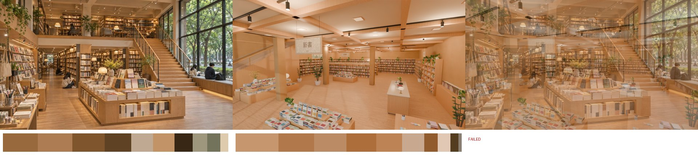

## 第三輪（11-04 00:4x）
| 店 | 誰 | 分支／SHA | 結果 |
|---|---|---|---|
| 山嵐 v5 | AA | 企劃線 3d665b504 | **收，MODEL_READY**：鏡頭看得到踏階、柱子在右邊。P2：前景平台再大、書堆高低更多 |
| 日常失速 v3c | AA | 企劃線 d5c5c51c9 | **收，MODEL_READY**：地磚 0.3 m、低對比；前景甜點桌、靠窗那排桌子都看得到。P2：椅子的橘色暗一點 |
| 同弦 v4（二樓室內） | CC | cc-testing | **收，MODEL_READY**：和參考圖幾乎一樣。P2：窗外的樹換成照片窗景卡、吉他掛勾縮小 |
| 南洋大廳 v5 | BB | 企劃線 9e72db718 | **收，MODEL_READY**；近景空地毯選 B：加地墊、放映立牌、紅龍柱、傳單架，配置不縮 |
| 南洋 1 廳 v2 | BB | 企劃線 9e72db718 | **收，MODEL_READY**；斜地板往下降（門口 y 0 → 銀幕 −0.96），整合時接成導航斜面 |
| 新生運動廣場 v3 | CC | cc-testing | **收，MODEL_READY**：球架、樓梯、二樓球衣、招牌對上參考圖；球衣校名改虛構。P2：中間再加兩組衣架＋球鞋台、人台加粗、二樓燈具不懸空 |

## 第二輪交件（11-04 00:1x 驗收）
| 店 | 誰 | 分支／SHA | 結果 |
|---|---|---|---|
| 公館燒臘 v6 | BB | 企劃線 7c2a03a3c | **收，MODEL_READY**；整合前改兩點：牆的剝落像等高線、燒鴨／油雞的顏色 |
| 公館燒臘 v7 | BB | 企劃線 1b9a32f02 | 兩點 **FIXED**（牆改均勻舊漆＋三處水漬；燒鴨深焦糖、油雞淡金黃、櫃子玻璃 alpha 0.06），可以整合 |
| 好拍 v2 | CC | cc-testing 61e112693 | **收，MODEL_READY**；P2：右牆拍子更密＋洞洞板、走道加雜物 |
| 大步 v2 | CC | cc-testing d24578311 | **收，MODEL_READY**；P2：鞋子配色更多變化、地上光斑 |
| 山嵐 v4 | AA | 企劃線 19eb7778e | **退回**：數字過了，構圖沒對上（見下） |
| 日常失速 v3b | AA | 企劃線 90e34e1c9 | **再一輪**：只改畫面密度 |
| 木曜日 v3c | LAWWW2 | 本分支 5a4e71b72 起 | 樓梯間改長、矮桌縮小（見 `wip/mokuyobi/README.md`）；refcam 照舊 ALL PASS |

- 山嵐 v4 退回的原因：ref_match 只比亮度、顏色、九宮格，**量不到構圖**。50% 疊圖看得出來：
  - 參考圖：從稍高的地方越過平台書檯看樓梯。
  - 我們的畫面：左半是樓梯側板一大片平面，中間一根柱子，前景是空地板。
  - 要改：鏡頭看得到踏階、柱子不在畫面中間；前景放平台書檯（書平放＋立起來的封面、高低不一）；側板、扶手下的空牆改成書架或木格；天花板梁寬減半。
- 日常失速 v3b：
  - 棋盤格縮到 30 cm、對比降低；
  - 前景要有大理石圓桌＋甜點、飲料、雛菊；
  - 靠窗一整排桌子要看得到；
  - 吊燈、垂吊植物、菜單、海報再多。
- **這一輪學到的**：ref_match 全過不等於照參考圖做好。第 12 節的 50% 疊圖一定要看，構圖對不上一樣退。

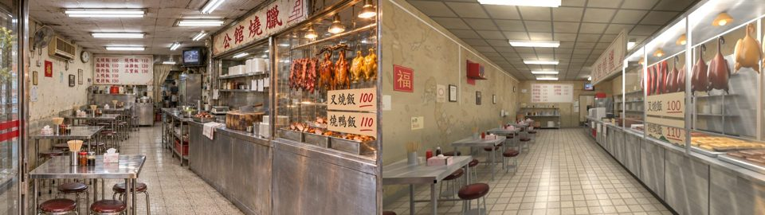
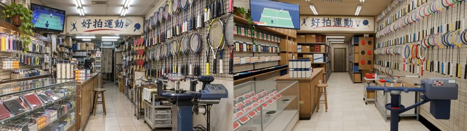
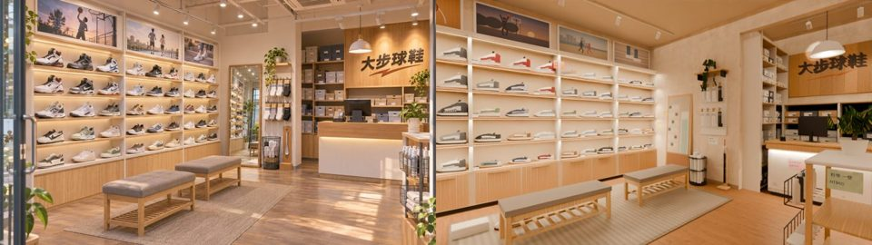
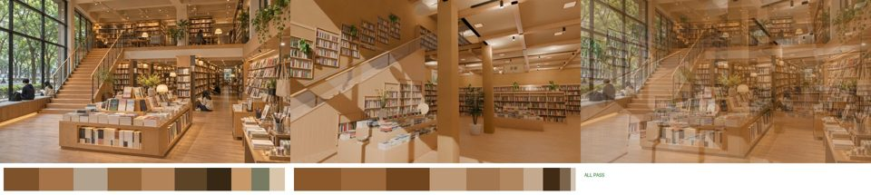
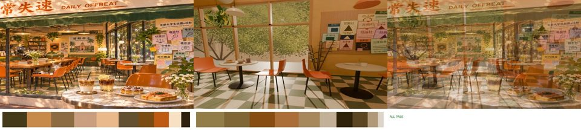

## 木曜日 v3b（AA，企劃線 d0c9409ea）：收（MODEL_READY，11-03 23:5x）
- 上一輪要改的兩點都改了：
  - 中景補了方桌、圓桌各 2 席和落地植物，畫面中間不再空；
  - 鏡頭轉向唱片櫃，唱片櫃、檯燈、《夏の残光》海報落在左三分之一，和參考圖一樣。
- ref_match 全過：
  - 亮度 0.337 對 0.344；
  - 對比 0.572 對 0.641；
  - 冷暖 +0.282 對 +0.295；
  - 色票 ΔE 6.3；
  - 九宮格 0.042。
- 59,988 面，在預算內。

  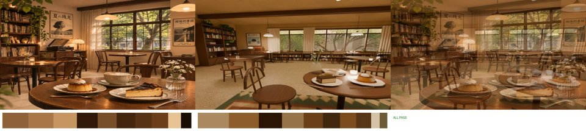
- 還有的缺點（P3，整合時順手修，不擋整合）：
  - 曲木椅從正面看像高腳凳：椅面太圓、太厚，椅背的彎木要再寬一點；
  - 天花板木樑太搶眼：顏色壓暗一點，或改細；
  - 近景地毯的花紋太粗：花紋縮小一半；
  - 磨石子地板遠看像地毯：顆粒再細一點，加一點反光（roughness 0.35 左右）。
- 下一步（LAWWW2）：
  - 溫州街 37 號一樓的鐵門、往二樓的樓梯；
  - 區域 `wz_mokuyobi`；
  - 外觀前窗 x −2.6～2.6（已經在外觀約束裡，1c3527eca）。

## 日常失速 v2（AA，企劃線 253d1688c）：退回改一輪（11-03 23:0x）
- ref_match：只有冷暖 FAIL（+0.23 對 +0.33），其他四項 PASS。

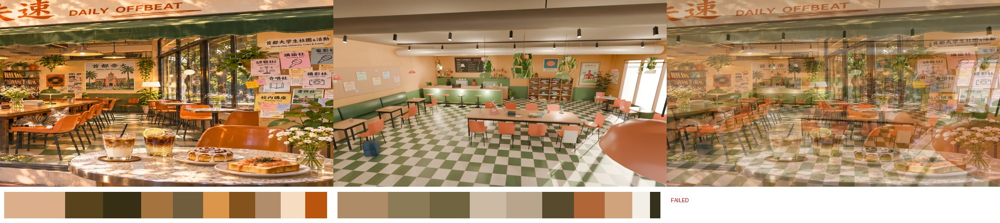

- 要改的地方：
  1. 鏡頭照參考圖對位：坐在窗邊桌子的高度，近景要有大理石圓桌和桌上的東西。
  2. 東牆佈告欄貼滿社團傳單，至少 20 張。
  3. 棋盤格地板縮小、降飽和。
  4. 臨街整面落地窗加陽光，暖色從那裡進來。
  5. 牆改奶油色，約 #f1dfb8。

## BB 三間（11-03 23:1x）：公館燒臘 v3、南洋戲院大廳 v4＋1 廳 v1、大口漢堡 2F v1——都照第 12 節退回改
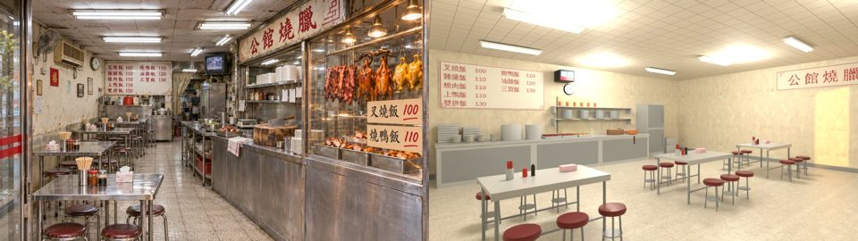

### 公館燒臘 v3：最廉價的三個地方
1. **格局錯了**。
   - 參考圖是窄長的老店：寬約 4.5 m、深 12～14 m。左邊靠牆一排不鏽鋼桌、圓凳，右邊整排不鏽鋼櫃台，最裡面是廚房。
   - v3 是 10×9 的方廳，桌子散在中間。
   - **zone 的尺寸不用沿用 noodle 的 10×9**。燒臘是新的室內，尺寸照參考圖改，我接區域時配合。
   - 門在臨騎樓的短邊，鏡頭從門口往裡看，要和參考圖同一個構圖。
2. **不鏽鋼和燒臘做得像塑膠、像玩具**。
   - 不鏽鋼：金屬度 0.45（遊戲上限）、粗糙度 0.25～0.35，加髮絲紋的法線或粗糙度貼圖（Poly Haven 的 brushed metal 系列，或自己畫一條條橫紋）；桌面邊角有凹痕、變暗。
   - 燒鴨、油雞：要有頭、頸、身體、腿的輪廓，用鉤子吊在脖子上。表皮做焦糖色漸層（頂點色，深到淺），粗糙度 0.15～0.25 才有油亮感。
   - 叉燒：長條，邊緣焦黑，紅色往內漸淡。
   - 櫥窗：要有一排暖色燈泡打在肉上，價格卡手寫（照參考圖：叉燒飯 100、燒鴨飯 110）。
3. **光和舊感**。
   - 參考圖是白色日光燈管，加上櫥窗裡的暖色燈泡；牆是發黃的老灰泥，上面有水漬；天花板是暗沉的方格板；地板是米色小方磚，看得出髒。
   - v3 整片過曝，牆像新漆的。
   - 牆上要掛：壁扇、冷氣、時鐘、月曆、「福」字、菜單板；桌上要有筷筒、牙籤罐、辣椒醬、面紙盒；地上要有紅色塑膠籃。這些參考圖全都有。

### 南洋戲院大廳 v4、1 廳 v1
- **大廳**：東西大致都對了（爆米花櫃台、海報牆、壁燈、長椅、黑板架），差在**光和顏色**。
  - 參考圖是昏暗暖黃的老戲院：深色木頭、天花板暗。v4 是白牆、白天花板，整片過曝。
  - 紅地毯太亮、花紋太均勻：降亮度，加圖案的大小變化，走道磨損的地方顏色淺一點。
  - 櫃台前、長椅之間的空地太大。
- **1 廳**：
  - 地板要做斜的，這點同意，我整合時用斜面導航。
  - 銀幕不要純白自發光，要比較暗，加一點反光，旁邊有布幔。
  - 椅背改成弧形，加扶手。
  - 門外的大廳要看得到。

### 大口漢堡 2F v1
- 參考圖是**晚上**：暖色吊燈打在桌上，窗外是新生南路的夜景燈光，桌上有筆電、課本、飲料、背包，有人在念書。
- v1 是灰白的白天，窗是灰色霧面板，桌面全空。
- 要改：
  - 照參考圖做夜晚版本（窗外放夜景卡，或交給遊戲端的窗景）；
  - 吊燈暖光，加烘焙光斑；
  - 每張桌子都要有東西；
  - 樓梯口的「2F 學生自習區」牌子照參考圖做。

三間都要附第 12-5 節的四樣：拆圖清單、ref_match 五項 PASS、醜點清單、和參考圖不同的地方逐條列出原因。
