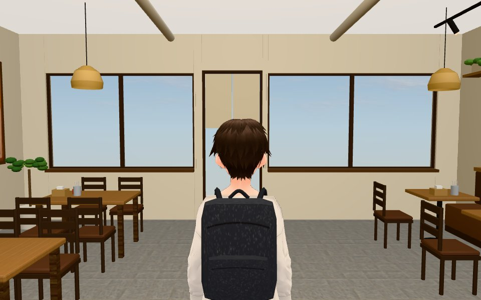
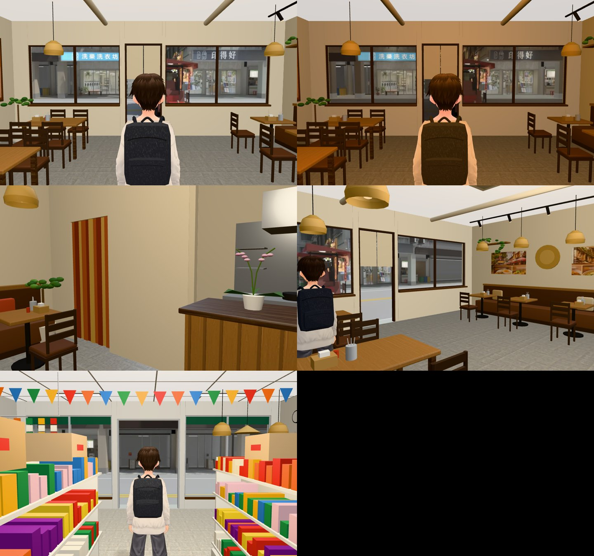
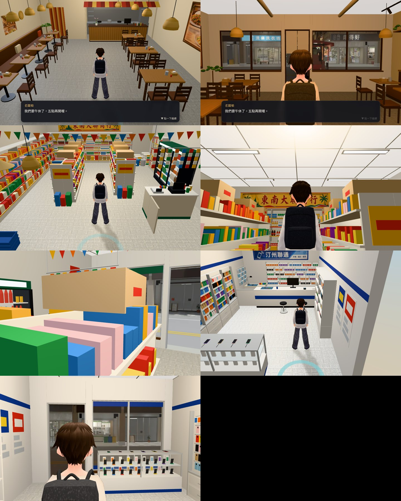
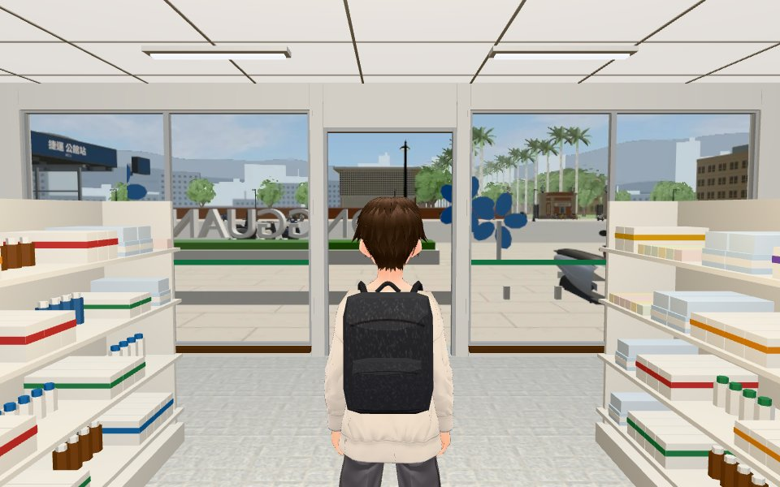

# 新店室內的窗景、天花板、鏡頭被擋、蘭花（SHOP-INTERIOR-VIEW-1112；LAWWW2-C 2026-11-12）

使用者 11-12 進泰米村食：「窗景呢 我現在才看第一家 都給你電腦測試 你看不出來???」（兩扇大窗和門外面一片藍、一堆紫紅色的球）。BB 追加：東南大聯、汀州聯通抬頭看到天空；進門後鏡頭被窗框、門框、布簾擋住。

## 修改前（雲端瀏覽器，泰米村食 14:00）

## 修改後（都是遊戲畫面，雲端瀏覽器 SwiftShader）

第二張：左上泰米跟隨鏡頭、右上泰米往窗外、第二排東南大聯跟隨鏡頭／抬頭看天花板、第三排東南大聯櫃台往門口／汀州聯通跟隨鏡頭、最下汀州聯通 21:00 往窗外（晚上的照片）。

## 原因和改法
| 問題 | 原因 | 改法 |
|---|---|---|
| 窗外、門外一片藍（十一間都是） | `src/tz_shops3d.js` 蓋的這一批從來沒有放窗景，玻璃外面是區域的背景色 | 正面牆外 0.3 m 放一片視差窗（`Z3.shopViewPane`，新生南路同一套）。汀州路八間的照片是 Blender 用汀州路正式模型、站在各店玻璃中心往街上拍的（白天、晚上各一張）；公館三間先用同一條店面街在遊戲裡拍的現成照片（配置的 `view`） |
| 紫紅色球 | 泰米村食櫃台上的「蘭花」是七顆洋紅色的球浮在盆子上，沒有莖葉 | 改成兩支彎的花梗、三片葉子、小而扁的淺粉色花。其他十間沒有這種花 |
| 東南大聯、汀州聯通抬頭看到天空 | 天花板 3.1／3.0 m，跟隨鏡頭 3.18 m 高過天花板，遊戲把天花板藏起來 | 兩間加高到 3.3 m |
| 進門後前景被窗框、門框、布簾擋住 | 正面牆會淡出，但牆上的零件在一般的網格裡、不跟著淡出 | 十一間的窗框、窗台、門框、布簾、玻璃、玻璃色帶改放 `WALL_Sfix_*`（跟著正面牆一起淡出） |

- patch：`shop_views_v1.patch`（`git apply --binary`；在開發分支 `1fd2cb7e1` 上 `--check` 過）。動：`src/tz_shops3d.js`、`src/data/tz_shops_layout.js`（`viewDepth`、公館三間 `view`、兩間的 `h`）、`tools/blender/env_second/tz_shops_interior.py`、十一間的 GLB／json、`assets/models/env/views/tz_*_{day,night}.webp` 18 張、新測試。
- 重拍窗外：`render.sh`（這個資料夾；地面是 `tz_slabs.json`）。Blender 拍的總覽：`views_sheet_blender.jpg`。

## 驗證
- 新測試 `node tests/tz_shop_views_1112_unit.js`：8 項 ALL PASS（修改前 1、2、3、5、6、7、8 FAIL）。
- `node tests/tz_shops_unit.js` ALL PASS；讀到店面配置、窗景、attachRoomGLB 的 69 支 `*_unit.js` 全部 ALL PASS。全部 Node 測試沒有另外跑。
- 雲端瀏覽器進去看過：泰米村食（窗外、蘭花、跟隨鏡頭）、東南大聯（窗外、天花板、跟隨鏡頭）、汀州聯通（跟隨鏡頭、21:00 窗外）、安泰藥局（窗外）。截圖沒有報錯。

## 沒做／先將就的
1. **其他七間沒有進去看**（洗樂、印得好、禮貌生財、越好吃、客居雲南、汀州鮮果、榮恩典）：同一段程式、同一套模型做法，Node 測過，但畫面沒看。請 CC 逐間拍。
2. 泰米村食晚上的窗外沒拍到（我設 21:00 那張實際還是下午，老闆娘的午休對話跳出來）；晚上的照片只在汀州聯通看過。
3. 公館三間的窗外不是在那三間的位置拍的（差幾十公尺），對街的東西位置會不對。要準要在遊戲裡各拍一張。
4. 汀州路的照片是 Blender 拍的：沒有路人、機車、行道樹；地面是純色。攤車白天也在路上（照模型）。之後水源市場巷子改了要重拍。
5. 一間只放一片（蓋住整面正面牆），沒有近景那一層（騎樓柱子不會比對街移動得快）。
6. 安泰藥局（3.1 m）、禮貌生財（3.0 m）天花板也比跟隨鏡頭低，這次沒加高（之前 BB 驗過禮貌生財的做法是藏天花板）；要一起加高說一聲。
7. 店外看進去和店內對不上（BB 第 3 點）是 SHOP-WINDOW-3D-1112，另外做。
