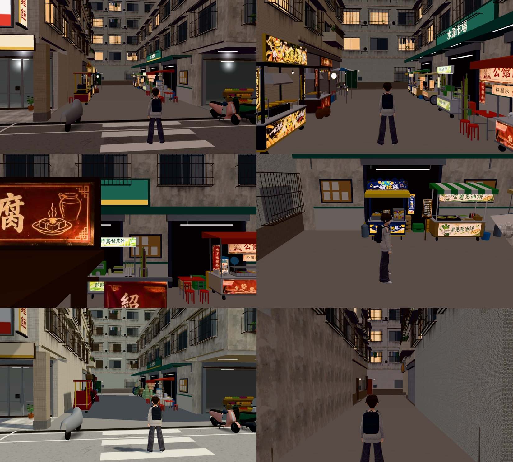
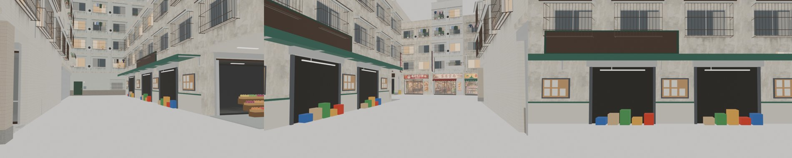

# 水源市場一棟樓＋市場旁的巷子（SHUIYUAN-MARKET-LANE-1112；LAWWW2-C 2026-11-12）第 1 版

使用者 11-12（截圖：攤販擺在掛「水源市場」招牌的騎樓前）：
- 「夜市攤販也沒有店員阿 而且水源市場是一棟建築!!! 公館有很多攤販的地方就是水源市場那一棟的旁邊 羅斯福路跟汀州路中間阿」
- 「你現在公館走到汀州路就應該是這一條，改道水源市場旁邊的巷子才合理，那條通道要有這些攤販」

做法照 LAWWW-C 11-12 04:40 的裁定（草圖六點）。顧攤的人、出入口文字、快速前往、NPC 路線是 LAWWW 的部分。

## 遊戲畫面（雲端瀏覽器；上兩排 19:00，左下 14:00，右下原本的巷 A 19:00）

左上：汀州路巷口往裡（斑馬線搬到這裡）。右上：巷子中間往公館那一頭（右邊是水源市場的側門和遮雨棚，棚上「水源市場」）。
左中：站在北側攤位裡往市場那一面看（鏡頭卡在炸豆腐的招牌後面，只看得到市場側門、甘蔗汁、甜湯）。右中：從公館進來的那一頭（遊戲的跟隨鏡頭）。
左下：白天的巷口（攤位收著）。右下：原本的巷 A，攤位搬走了，照舊走得進去（禮貌生財在右邊）。

## 水源市場臨巷子那一面（Blender 預覽，不是遊戲畫面）

## 改了什麼
| 項目 | 原本 | 現在 |
|---|---|---|
| 水源市場 | 只有臨汀州路的一片立面（深 14 m 的一般樓房） | 一整棟三層樓 x 5～31、z 28～40（深 26 m）；北面臨巷子：三個敞開的側門（裡面暗、疊著的菜籃）、捲門箱、整排墨綠遮雨棚＋棚下日光燈、磁磚腰牆、公告欄、棚上「水源市場」字牌（字由遊戲畫） |
| 通公館的巷子 | 巷 A：x 5～29、z −2.5～2.5（寬 5 m） | 水源市場旁的巷子（`alleys[1]`，id `M`）：x 5～29、**z 19～28（寬 9 m）** |
| 被佔掉的店 | e_shoes（19～23.5）、e_cvs（23.5～28）兩格沒名字的通用店面 | 拿掉（LAWWW 裁定：不留殘格）。**巷寬因此是 9 m，不是草圖寫的 7 m**（鞋店整格拿掉、海南雞飯不擴，中間不留 2 m） |
| 巷子北側、盡頭 | — | 北側臨街那一段是海南雞飯那一棟的側牆（開窗）；x 19～31 新的一棟 `TM_N`（4 層、鐵捲門）；盡頭 `TM_END`（6 層） |
| 原本的巷 A | 兩側擺攤、盡頭通公館 | 留著可以走（禮貌生財在裡面）、不擺攤、盡頭不通 |
| 斑馬線 | z 0（巷 A 口） | z 23.5（新巷口） |
| 巷口停車 | — | 新、舊巷口整段不停機車 |

## 新舊座標對照（汀州路區域座標，x 東、z 南）
| 東西 | 原本 | 現在 |
|---|---|---|
| `fromGongguan`（從公館進來站的地方） | (27.0, 0.0)，面向西 | (27.0, 23.5)，面向西 |
| `toGongguan`（回公館的互動點） | (28.6, 0.0)，r 1.4 | (28.6, 23.5)，r 1.4；`spawn`（公館那一側）不變 (37.1, 18.0) |
| `crossings[0]` | z 0，寬 4 | z 23.5，寬 4 |
| 胡椒餅 `st_pepper` | (−4.2, −11.5) 朝西側路邊 | (10.5, 20.2) 北側，yaw 0 |
| 玉米 `st_corn` | (−4.2, −16.5) | (14.4, 20.2) 北側 |
| 炸豆腐 `st_stinky` | (−4.2, −21.5) | (18.2, 20.2) 北側 |
| 套圈圈 `st_ring` | (4.0, −27.5) | (22.0, 20.4) 北側 |
| 襪子 `st_socks` | (4.2, −15.5) | (25.2, 20.2) 北側 |
| 阿婆甜湯 `st_jelly` | (4.2, 35.0) 水源市場前 | (12.2, 26.8) 南側（貼市場），yaw π |
| 甘蔗汁 `st_cane` | (4.2, 29.6) | (17.6, 26.8) 南側 |
| 雞蛋糕 `st_eggcake` | (10.5, −1.65) 巷 A | (20.9, 26.8) 南側 |
| 蔥油餅 `st_scallion` | (14.5, 1.65) 巷 A | (24.0, 26.8) 南側 |
| 地瓜球 `st_ball` | (18.5, −1.65) 巷 A | (26.9, 26.8) 南側 |
| 路人路線 2（`tingzhou_walk.js`） | 巷 A 中間 z 0 → 過斑馬線到西側 (−6.2, 2.2) | 新巷子中間 z 23.5 → 過斑馬線到西側 (−6.2, 26.0) |

- 攤位的 `where` 都改成 `"laneM"`（原本 `alleyA`／`road`）。有煙的三攤（胡椒餅、玉米、炸豆腐）在最靠汀州路那一頭。兩排攤中間的走道約 4.6 m。
- 公館那一側的三攤（鮮奶、紅豆餅、手機殼）和巷口互動點的位置、文字都沒動。
- 汀州路配置是十攤（不是我草圖寫的十二攤：甜湯、甘蔗汁本來就在這十攤裡）。

## 檔案
- patch：`shuiyuan_lane_v1.patch`（`git apply --binary`；在開發分支 `d6e6a6f21` 上 `--check` 過）。
- `src/data/tingzhou_layout.js`：`alleys` 兩條、`crossings`、`shops` 少兩格、`e_market.deep`、`from／toGongguan`、十攤的座標。
- `src/tingzhou3d.js`：走得進去的巷子不只一條（導航、地面、鏡頭碰撞、路燈、停車都照 `alleys` 做）。
- `src/data/tingzhou_walk.js`：第三條路線。
- `tools/blender/env_second/wz_street.py`＋`tingzhou_street.glb／json／props.json`：整條汀州路重建（重建前先確認過：不改任何東西重建出來和線上版的貼圖、三角形數、檔案大小完全相同）。
- 測試：`tests/tingzhou_unit.js`、`tests/tingzhou_walkers_1110_unit.js` 照新配置改。`tingzhou_stalls.glb` 沒動（攤位位置是配置決定的）。

## 驗證
- `node tests/tingzhou_unit.js`：ALL PASS（新增：新巷子擺了十攤還留 ≥ 3.5 m、巷 A 照舊走得進去而且不通公館、兩側各五攤同側不重疊、有煙的在路口那頭、模型多 TM_N／TM_END 兩棟）。
- 讀到汀州路、攤位、機車的 25 支 `*_unit.js`：23 支 ALL PASS；`l118_shops_redo_1111`、`l118_street_fix_1111` 沒印結果行（rc 0，本來就這樣，和這次無關）。全部 Node 測試沒有另外跑。
- `tools/glb_coplanar.py`：新巷子這一帶新增的都是同材質的接合面（遮雨棚支架），沒有不同材質疊在一起的。
- 雲端瀏覽器：上面六張，沒有報錯。

## 沒做／先將就的
1. **巷寬 9 m**（草圖 7 m）——見上表；太寬的話要把海南雞飯那一棟往南擴或在北側加一排東西。
2. 巷口不停機車的修改是截圖以後才加的，沒有重拍（上圖巷口左右各有一台機車）。
3. 水源市場側門裡面是暗的＋幾疊菜籃，沒有真的市場內部；門不能進。白天晚上都開著（沒有收市的樣子）。
4. 市場臨汀州路那一面沒改（還是原本的騎樓店面樣子＋直立招牌）；屋頂沒有大招牌。
5. 新巷子北側 `TM_N`、盡頭 `TM_END` 是通用的樓房（鐵捲門、住家門）。
6. 今天稍早交的汀州路各店窗外照片（`views/tz_*`）是攤位搬家以前拍的：客居雲南、東南大聯、汀州聯通、溫特寶邸看出去的對街現在多了巷口，泰米、洗樂、印得好窗外路邊的攤車不見了。要重拍（`wip/shop_views_1112/render.sh`），排在櫥窗立體那一包一起。
7. 顧攤的人、公館那一側巷口的字、快速前往、劇情裡提到「巷 A」的地方：LAWWW／AA。
8. PC 瀏覽器、手機沒看；晚上人多的時候走不走得順沒試（Node 只驗了路線站得住）。
