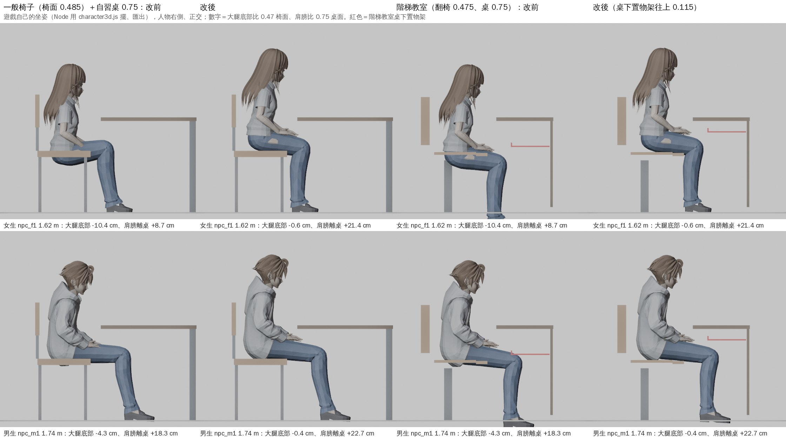

# SIT-HEIGHT-1104：坐下的高度（＋階梯教室置物架、坐著做事的片段重出）

LAWWW2-C，2026-11-05。派工：LAWWW-C 11-04 22:57Z、22:59Z（BB-C 22:43「女生、男生吃飯都彎很低，頭幾乎埋到碗上；桌子在胸口」、22:55「階梯教室的椅子高度、深度和坐姿對不上，大腿陷進扶手和椅面」）。

狀態：**MODEL_READY**。Node 測試都過了；瀏覽器沒有跑（D131，要等 CC）。人物動作的美術由 LAWWW 判（D128），BB 看 CC 的截圖。



上圖是遊戲自己的坐姿：用 Node 載入 character3d.js 擺好姿勢再匯出，人物右側、正交投影。家具照遊戲的尺寸畫，紅色是階梯教室桌下的置物架。工具是 `tools/anim/sit_pose_export.js` 和 `tools/anim/sit_height_preview.py`。

## 玩家會看到什麼

- **坐的高度**：
  - 坐在椅子上的人，屁股和大腿貼在椅面上，不再陷進去。
  - 改前女生、女主角陷 10～15 cm，從旁邊看椅面整片插在大腿裡；男生也陷 4～6 cm。
- **桌子的高度**：
  - 桌子回到肚子的高度。
  - 女生肩膀離桌面從 9 cm 變成 21 cm，男生從 18 cm 變成 23 cm。
- **吃飯**：
  - 頭不會再埋到碗上。
  - 眼睛離碗：女生 27 → 37 cm、男生 32 → 37 cm。
  - 身體少彎一點：前傾 0.2 → 0.14、低頭 0.4 → 0.34 弧度。
- **腳**：
  - 一般椅子的腳都踩在地上。
  - 腿比較短、坐高椅子的人，原本腳會離地 1～2 cm；現在大腿往下放，腳踩到地（sitFeet 新增往下放的那一邊）。
- **階梯教室**（法律系館A 201、博思 101／102、共同 101）：
  - 男生的膝蓋不再穿過桌下置物架。
  - 原本置物架離平台 0.515 m，男生膝蓋頂到 0.53～0.58 m。

## 原因

原本坐下一律往下移 0.47 m×身高比例，這是照男生 npc_m1 校的。我在遊戲自己的骨架和靜態坐姿上量，大腿底部只在座位地面上 0.32～0.48 m（中位數 0.37），遊戲的椅面卻在 0.45～0.485。三個原因：

1. **腿長比例不一樣**：VRoid 女生的大腿根在身高 53～55%，npc_m1 在 57%。
2. **大腿厚度不一樣**：大腿根到大腿底部是身高的 4.8～8.6%。
3. **npc_m1 本身也低**：它的大腿底部在 0.42，0.47 的椅面會陷 4.3 cm。

## 改法

### 坐下往下移多少（character3d.js）

- **公式**：往下＝身高×(ul − bt) − (SIT_TOP − SIT_PRESS)。
  - 結果是每個人的大腿底部都在座位地面上 0.465 m。
  - SIT_TOP＝0.47、SIT_PRESS＝0.005（衣服、坐墊壓下去 5 mm）。
- **ul、bt 從哪裡來**：`C.SIT_FIT['檔名']=[ul, bt]`，67 個 VRoid 模型。
  - 在遊戲骨架上量的（`tools/anim/sit_fit_survey.js`，結果在 `tools/anim/sit_fit.json`）。
  - ul＝大腿根離腳底 ÷ 身高。
  - bt＝坐姿時大腿根到大腿底部 ÷ 身高。
- **裙子**：綁在骨盆上的長裙量不到大腿，用 0.06（褲子模型的中位數 0.059）。
- **表裡沒有的模型**：GLB、vrm_player 照舊 0.47×身高比例。
- **sitFeet 新增往下放**：腳踝比站著高 3 mm 以上（腳懸空）時，大腿往下放，最多到水平以下 26°。
  - 膝蓋反轉同樣的角度：小腿方向不變、腳掌方向不變。
  - 和原本往上抬的做法對稱。
  - 只在一般椅子作用；階梯教室、高腳椅、跪坐照舊關著。

### 知道座面高度的座位：抬高＝座面 − SIT_TOP

原本是座面 − 0.45，現在統一改成座面 − SIT_TOP：

- 高腳椅：crowd3d、mokuyobi3d、zones3d 的 seatH 和 Café 吧台、us3d。
- us3d 的長椅。
- 鞦韆：`CHAR.sitButtOf`。
- 腳踏車後座：`E.PASSENGER.y` 0.334 → 0.314。
- 118 巷吧台：配置資料 lift 0.31 → 0.29，四間店、17 個座位。

### 家具

- **teach3d 自習椅**：放大到椅面 0.47（`CHAIR_FIT` 0.485/0.454 → 0.47/0.454）。
- **階梯教室長桌的桌下置物架**：往上 0.115 m（`tools/blender/env_second/lecture_shelf_raise.py`）。
  - 架子在 0.63～0.64、前緣擋片到 0.665，桌板底在 0.72。
  - 直接改 GLB，不用重烘：鋼的網格沒有光照貼圖。
  - 每排 48 個頂點：架子、擋片兩個方塊。
  - Blender 腳本 `classroom_201.py`、`teach_interior.py` 改成同一個高度，重跑也一樣。

### 坐著做事的片段

- 28 個片段重出（ual_sit_tasks.glb，F、M、F2、M2 各 7 個）。
- `sit_task_loops.py` 的桌子高度照新的往下（`sit_drop()`，讀 `sit_fit.json`）。
- 吃飯少彎一點（見上面「吃飯」）。
- `C.SIT_TASK.HANDS` 換成新的 `expect.hands0`，差 ≤ 1.2 cm，主要是吃飯。
- hand_props.glb 不變：配件是照手擺的。

## 數字

### 坐在桌前（椅面 0.47、桌面 0.75）

pose sit、靜態坐姿。測試：`node tests/sit_height_unit.js`。

| 人物（身高） | 往下 改前 → 改後 | 大腿底部比椅面 | 骨盆離座位地面 | 肩膀離桌面 | 手肘離桌面 | 眼睛離桌面 |
|---|---|---|---|---|---|---|
| 女生 npc_f1（1.62） | 0.435 → 0.308 | −10.4 → −0.6 cm | 0.479 → 0.606 | +8.7 → +21.4 cm | −11.9 → +0.8 cm | +26.2 → +39.0 cm |
| 男生 npc_m1（1.74） | 0.467 → 0.423 | −4.3 → −0.4 cm | 0.573 → 0.618 | +18.3 → +22.7 cm | −0.9 → +3.5 cm | +36.2 → +40.8 cm |
| F2 npc_nf10（1.65，裙） | 0.443 → 0.364 | −5.0 → +2.6 cm（裙子下面） | 0.523 → 0.601 | +12.6 → +20.5 cm | −7.5 → +0.3 cm | +28.9 → +36.8 cm |
| M2 npc_nm11（1.74） | 0.467 → 0.362 | −7.4 → +0.3 cm | 0.526 → 0.632 | +16.7 → +27.2 cm | −4.1 → +6.4 cm | +36.2 → +46.7 cm |
| 以安 heroine_01（1.66） | 0.446 → 0.316 | −10.2 → −0.5 cm | 0.485 → 0.615 | +10.6 → +23.7 cm | −10.9 → +2.2 cm | +28.3 → +41.5 cm |
| 語彤 heroine_03（1.59） | 0.427 → 0.283 | −11.9 → −0.9 cm | 0.462 → 0.606 | +6.8 → +21.1 cm | −13.8 → +0.6 cm | +23.8 → +38.2 cm |
| 祐廷 yuting（1.75） | 0.470 → 0.359 | −9.0 → −0.1 cm | 0.521 → 0.632 | +16.1 → +27.2 cm | −4.7 → +6.4 cm | +35.8 → +47.1 cm |
| 高個 npc_nm6（1.82） | 0.489 → 0.501 | +1.3 → +0.1 cm | 0.607 → 0.595 | +23.6 → +22.3 cm | +3.4 → +2.1 cm | +42.3 → +41.0 cm |

說明：

- **手肘**是靜態坐姿、手放大腿的高度。遊戲裡坐姿循環的片段也是手放在大腿上。
- **全部 67 個模型**：往下少的中位數 9.5 cm（坐高），範圍 −1.2～+14.4 cm。
  - 照男生校過的 Sakurada 高個子（nm2、6、10、12、16、18、zhe、weilun、zhengxun）幾乎不動。
- **真人比例**：1.74 m 的男生坐 0.45 的椅子、0.75 的桌子，肩膀大約比桌面高 30 cm。
  - VRoid 的上半身比真人短（npc_m1 肩到髖 0.39 m，真人約 0.50），所以就算改了，還是比真人低 7 cm 左右。這是模型比例，不是坐的高度。

### 吃飯：眼睛離碗多遠

碗＝桌緣往裡面 16 cm、麵的高度 6.2 cm；取片段裡最近的一格。

| | 改前 | 只改坐高 | 改後（坐高＋少彎） |
|---|---|---|---|
| F（npc_f1） | 26.8 cm | 34.9 cm | 37.3 cm |
| M（npc_m1） | 31.5 cm | 34.7 cm | 37.0 cm |
| F2 | 29.6 cm | 34.7 cm | 36.9 cm |
| M2 | 29.9 cm | 38.0 cm | 40.5 cm |

改後筷子尖照樣在碗裡夾到麵（≤ 0.4 cm），1 秒送到嘴邊（1.5 cm）（`tests/sit_task_loops_unit.js`）。

### 階梯教室（女生 1.62、男生 1.74）

以 201、博思、共同的正式模型為準：

- **翻椅椅面**：0.475，前緣往下彎 3.2 cm。
- **長桌**：桌面 0.75，近緣在座位點前 0.32 m。
- **扶手**：沒有。三間的翻椅、長桌都沒有扶手。和大腿、膝蓋撞在一起的是**桌下置物架**（平台上 0.515～0.55、座位點前 0.44～0.74）。BB 說的「扶手」我判斷是這個，**請 BB 看 CC 的截圖確認**。

| | 女生 改前 → 改後 | 男生 改前 → 改後 |
|---|---|---|
| 椅面 | 0.475 | 0.475 |
| 大腿底部比椅面 | −10.9 → −1.1 cm | −4.8 → −0.9 cm |
| 骨盆（hips）離平台 | 0.479 → 0.606 | 0.573 → 0.618 |
| 桌面 | 0.75 | 0.75 |
| 肩膀離桌面 | +8.7 → +21.4 cm | +18.3 → +22.7 cm |
| 腳踝比站著（階梯教室 sitFeet 關） | −12.3 → +0.5 cm | −5.6 → −1.2 cm |
| 膝蓋在置物架範圍裡的最高點 | 沒伸到 → 沒伸到 | 0.531 → 0.576（架底 0.515 → 0.63） |

改前男生的膝蓋（0.531）、高個 nm6（0.585）就已經穿過 0.515 的架底，這就是 BB 說的「舊的靜態坐姿也一樣」。

8 個人裡，用原本 0.515 的架底，改後有 6 個人的膝蓋會撞到：

| 人物 | 膝蓋最高點 |
|---|---|
| 男生 | 0.576 |
| F2 | 0.584 |
| M2 | 0.541 |
| 以安 | 0.514 |
| 祐廷 | 0.546 |
| nm6 | 0.572 |

架子搬到 0.63 以後，最高的 F2 也還空 4.6 cm。

### 遊戲裡的椅面高度

人物的大腿底部在 0.465，各種椅面和它的差：

| 椅子 | 椅面 | 和大腿底部 |
|---|---|---|
| Z3.chair（程序化備用、宿舍、麵店）、宿舍與麵店正式模型 | 0.485 | 陷 2 cm |
| 自習椅（teach3d，這次放大到 0.47） | 0.47 | 陷 0.5 cm |
| Café 曲木椅 | 0.47 | 陷 0.5 cm |
| 階梯教室翻椅 | 0.475 | 陷 1 cm |
| 平面教室 | 0.46 | 浮 0.5 cm |
| 202 | 0.455 | 浮 1 cm |
| 長椅、竹椅、樹圍座椅 | 0.45 | 浮 1.5 cm |
| 沙發 | 0.44 | 軟的，陷進去看起來自然 |

高腳椅、鞦韆、腳踏車後座照座面算，陷 0.5 cm。

## 坐著做事的片段合得上多少路人

44 個路人底模。用同一套規則（`C.sitTaskFit`），以 Python 估算：

| 動作 | 改前：只用 F／M → 加 F2／M2 | 改後：只用 F／M → 加 F2／M2 |
|---|---|---|
| 打字 | 38 → 43 | **44 → 44** |
| 寫字 | 24 → 38 | **37 → 39** |
| 滑手機、翻書 | 29 → 41 | **42 → 43** |
| 喝飲料 | 29 → 41 | **43 → 43** |
| 吃飯 | 29 → 41 | **41 → 43** |

坐高改對以後，多數人的手自然在參考的位置，F2／M2 只多補幾個人，主要是寫字和吃飯。F2／M2 的接線（ALT）一起放在這次的 patch 裡，**取代 `npc_f2m2_1104.patch`，兩份不要一起套**。要拿掉也可以：只差寫字 2、滑手機 1、翻書 1、吃飯 2 個人。

## 接法（LAWWW-C）

以開發分支 226e8ce4e 為底，`git apply --check` 乾淨；最新的 6a1592a26 也乾淨（中間的 commit 沒有碰到這些檔）。

```
git checkout <交件 SHA> -- assets/models/char/second_ai/ual_sit_tasks.glb assets/models/char/second_ai/ual_sit_tasks.json assets/models/char/second_ai/hand_props.json \
  assets/models/env/classroom_201.glb assets/models/env/second_ai/boya_interior.glb assets/models/env/second_ai/gongtong_interior.glb \
  assets/models/env/second_ai/l118_cafe2.layout.json assets/models/env/second_ai/l118_omu.layout.json assets/models/env/second_ai/l118_pasta.layout.json assets/models/env/second_ai/l118_tea.layout.json \
  tests/sit_height_unit.js tests/sit_task_loops_unit.js \
  tools/anim/sit_fit_survey.js tools/anim/sit_fit.json tools/anim/sit_task_loops.py tools/anim/preview_vrm_clip.py tools/anim/sit_pose_export.js tools/anim/sit_height_preview.py \
  tools/blender/classroom_201.py tools/blender/env_second/teach_interior.py tools/blender/env_second/lecture_shelf_raise.py
git apply docs/art-rebuild/second_ai/wip/sit_height_1104/sit_height_1104.patch
```

### patch 的內容

**src（9 個檔）**：

- `character3d.js`：
  - C.SIT_FIT、SIT_TOP／SIT_PRESS、sitDropOf、sitButtOf；原本 5 處 0.47×k 改成 sitDrop(u)。
  - sitFeet 往下放。
  - HANDS、WIN、H、ALT 加 F2／M2；sitTaskFit 照 ALT 試。
  - 註解更新。
- 抬高改成座面 − SIT_TOP：`crowd3d.js`、`mokuyobi3d.js`、`zones3d.js`、`us3d.js`。
- `engine3d.js`：E.PASSENGER.y。
- `teach3d.js`：CHAIR_FIT。
- `l118_shops3d.js`：註解。
- `src/data/l118_shop_layouts.js`：0.29。

**tests（4 支）**：

- `sit_task_wire_unit.js`：
  - B／C 的 M 樣本 nm8 → nm9（新的坐高下 nm8 的手低 3 cm）。
  - D2 換成 nm8（往上坐 1.5 cm、寫字照舊）、nm11（寫字換 M2、打字往下坐 1.5 cm）。
  - sitY 照 CHAR.sitDrop。
- `wz_park_people_unit.js`：鞦韆照 sitButtOf。
- `desk_furniture_unit.js`：椅面對準 C.SIT_TOP，從原始檔讀。
- `l118_bar_lift_unit.js`：lift＝0.76 − SIT_TOP。
- 這四支都是**期望值跟著設計改**：原本寫死 0.47×k、0.31、0.485，判定的標準沒有放寬。

### 吃飯片段

可以開了，請 LAWWW-C 決定：

- `seatact3d.js` 的 `Object.assign(S.TASK,S.TASK_EAT)`。
- 這次沒有放在 patch 裡。

## 測試

都在開發分支 226e8ce4e＋這份 patch＋上面的檔。

- **這次的四支**：
  - `tests/sit_height_unit.js`：①～⑥ ALL PASS。
    - ①大腿底部在 0.47 椅面 −1.5～+0.5 cm（褲子 7 人）。
    - ②改前女生陷 8 cm 以上（量得到原本的問題）。
    - ③npc_m1 改前陷 4 cm 以上、改後往上 3～6 cm。
    - ④肩膀離桌 ≥ 20 cm。
    - ⑤一般椅子腳踝 ±1 cm。
    - ⑥階梯教室膝蓋比置物架底低 1.5 cm 以上，用原本 0.515 會撞。
  - `tests/sit_task_loops_unit.js` ALL PASS，四種身材。
  - `tests/sit_task_wire_unit.js` 55 項 ALL PASS。
  - `tests/seat_ambient_unit.js` ALL PASS。
- **座位、坐下相關 25 支**：
  - 24 支直接過：sit_feet、sit_floor、bike、bike_seat、mokuyobi、mokuyobi_aa618、eat、shop_diners、seat_activity_1104、shop_enc_seat、crowd_seat_talk、walk_seated_standup、seated_look、gym_pose、stairs_feet、fit_posture、heroine_circle3d、aa453_us、l118_shops、cafe230_aa657、wz_teahouse_seats、zq_arcade_seat、inv_sit_together、seat_occupied。
  - `l118_bar_lift_unit` 改期望值以後過；改前的版本照舊過，會照原始檔讀 SIT_TOP。
- **改到 GLB、家具的**：boya_lecture_glb、gongtong_interior_glb、indoor_crowd、room_ceiling、seat_fold、teach_east_drawcall、desk_furniture、wz_park_people：ALL PASS。
- **沒跑**：瀏覽器、Playwright（D131）。

## 已知不足、沒做的

- **裙子**：綁在骨盆上的長裙，坐下以後直直垂著，穿過椅面。這是舊問題，坐高改不了。
  - 模型：LAWWW2 的 bl_npc_nf9、10、12、14、16、17、19、20、peishan、xinci、xiuqin、yu。
  - 這些人的大腿用 0.06 算，大腿在裙子下面浮 1～3 cm，看不到。
- **階梯教室的腳**（sitFeet 關著）：Sakurada 改的高個子男生，腳陷進平台最多 7 cm（nm6；改前也有 5.6 cm），被桌子擋住。
  - 要開 sitFeet 的話，膝蓋會往上頂到新的置物架。
- **Z3.chair 和 0.45 的椅子**：
  - Z3.chair 和宿舍、麵店正式模型的椅面是 0.485，還陷 2 cm。
  - 0.45 的長椅浮 1.5 cm。
  - 要更準就給座位加 `top`（椅面高度）照椅子調；這次沒做。
- **WIN**：女生最近 0.29 的範圍是改高度以前量的，現在肩膀高了，可以再放寬（和 Café 桌緣 0.20 那一件一起做）。
- **坐著的替身**（seated_figures：博思 101 的人群）是另外做的 GLB，不受影響。
- **瀏覽器**：沒看過。要 CC 拍：
  - 林家乾麵近景（吃飯開了以後）。
  - 總圖自習桌。
  - 教室、階梯教室女生坐著（NPCTASK_shots）。
  - 118 巷吧台。
  - 鞦韆、腳踏車後座。
