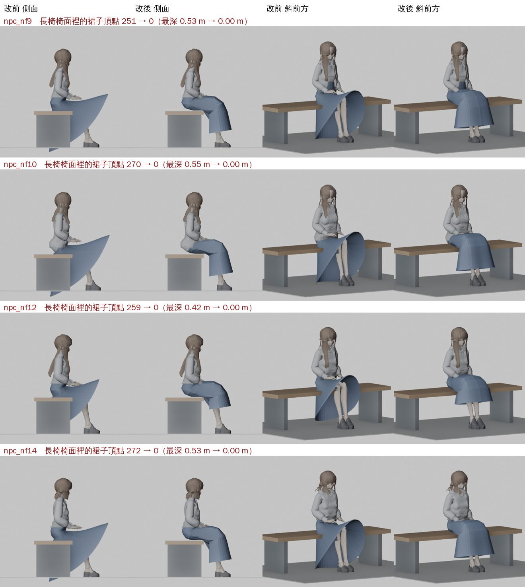
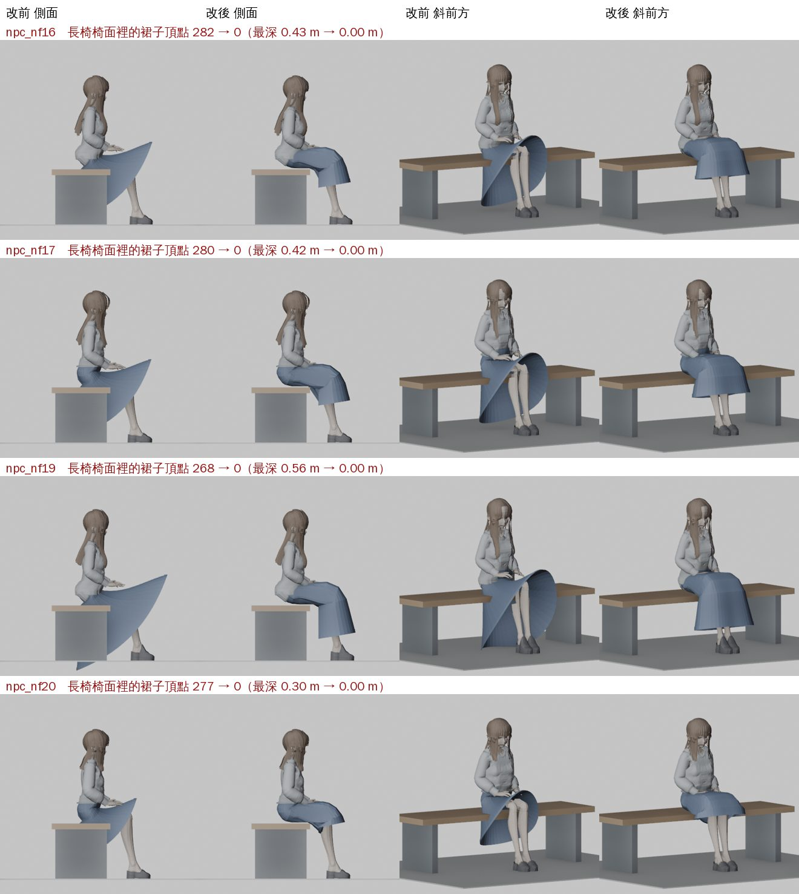
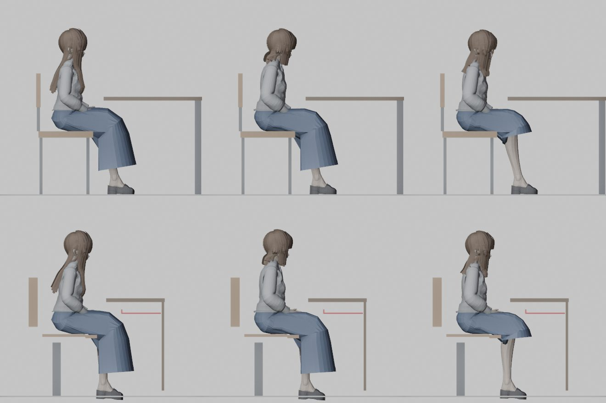
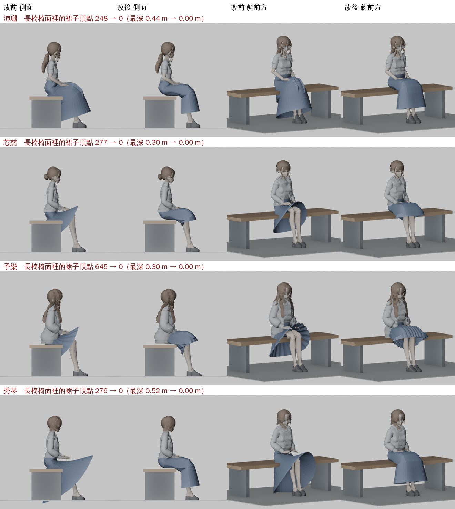

# SKIRT-BENCH-CLIP-1105：坐長椅的路人裙子穿進椅面（LAWWW2-B 2026-11-07）

使用者 11-05：「路人裙子卡進椅子（體育館一樓長椅截圖）」。驗收：坐在長椅上的路人，裙子不穿進椅面。

狀態：**READY_FOR_ART_REVIEW**（角色美術的 ART_APPROVED 由值班 LAWWW 標，D100a；BB-B 11-07 05:22 看過 Blender 圖，意見是通過）；遊戲內瀏覽器截圖還沒拍（D131：交 CC）。

## 原因

穿裙子的路人有 8 個：npc_nf9、nf10、nf12、nf14、nf16、nf17、nf19、nf20（長裙、中長裙、及膝裙）。
它們的 A 字裙（`npc_layered.py`＋`x_xinci_clothes.skirt_weights`）只綁在臀部和大腿上：前片 0.9、側邊 0.5、後片 0.15 跟著大腿，其餘留在臀部。這樣走路時兩腿之間的布不會被拉開。
坐下時大腿往前轉 85°，留在臀部的那一份照樣直直往下垂：

- 後片、側邊從椅面一路穿到地上；
- 前面斜 45° 撐開，像一個大喇叭。

量法：Node、遊戲自己的坐姿、體育館一樓長椅（椅面 0.42～0.47 m，人物坐在中心前 6 cm）。
結果：每個人在椅面範圍裡、低於椅面的裙子頂點有 251～282 個，最深 30～56 cm。遠距離版本（室內 7 m 外換的低面數模型）也有 22～58 個。

## 做法：坐下才打開的裙子形狀（morph target `skirt_sit`）

- **不改權重**：站著、走路、上下樓梯的裙子和原本的 VRM 完全一樣，因為 morph 是關的。
- **遊戲端**：只在靜態坐姿（`pose sit`／`read`）時把 morph 開到 1。跪坐（`sitFloor`）、健身器材、騎車、躺著都不開。
- **目標形狀**照遊戲自己的坐姿算，工具是 `tools/anim/skirt_sit_morph.js`。在 Node 裡用 `CHAR.build`＋`CHAR.animate`（pose sit 40 格＋坐姿循環片段）擺好坐姿，然後：
  1. **跟腿**：髖關節以下的布跟同一側的大腿走；從膝蓋上 6 cm 到膝蓋下 10 cm，漸漸換成跟小腿（從膝蓋垂下）。
  2. **前面不鼓起來**：A 字往外放的那一部分，前面只留 25%。不然坐下時放寬的布全部往上翹，在腿上鼓成圓頂，把放在腿上的手蓋住（試做第一版就是這樣）。
  3. **兩側往下垂**：大腿外側的布往下垂到椅面，不是水平伸出去。
  4. **不穿進椅面**：人物座標裡 z＜0.26、y＜0.478、|x|＜0.40 的盒子裡的點，推到最近的面：上面＝攤在椅面上；前面＝從椅子前緣垂下。
     - y 0.478：遊戲的椅面在 0.45～0.485，`C.SIT_FIT` 讓大腿底部落在 0.465。
     - z 0.26：教室翻椅前緣 0.25、一般椅子 0.22、長椅 0.19。
  5. **反推位移**：同一組權重的蒙皮是仿射變換，所以綁定空間的位移＝（蒙皮的線性部分）⁻¹·（目標－現在）。
- **遠距離版本**（`lod/*.lod.glb`）：和 VRM 同一副骨架、同一個綁定空間，頂點是原本頂點的子集。位置一樣的頂點用同一份位移，遊戲端一起開關。

## 結果

### 遊戲坐姿＋體育館長椅

量測工具是 `report.json`、`tests/skirt_sit_morph_unit.js`。

| 路人 | 椅面裡的頂點（改前 → 改後） | 最深（m） | 遠距離版本 |
|---|---|---|---|
| nf9 長裙 | 251 → 0 | 0.53 → 0 | 24 → 0 |
| nf10 長裙 | 270 → 0 | 0.55 → 0 | 31 → 0 |
| nf12 中長裙 | 259 → 0 | 0.42 → 0 | 27 → 0 |
| nf14 長裙 | 272 → 0 | 0.53 → 0 | 56 → 0 |
| nf16 中長裙 | 282 → 0 | 0.43 → 0 | 38 → 0 |
| nf17 中長裙 | 280 → 0 | 0.42 → 0 | 24 → 0 |
| nf19 長裙 | 268 → 0 | 0.56 → 0 | 58 → 0 |
| nf20 及膝裙 | 277 → 0 | 0.30 → 0 | 22 → 0 |

### 改前／改後圖

Blender Workbench，遊戲坐姿匯出的 OBJ＋長椅的尺寸。顏色是固定的示意色，不是裙子本來的顏色。

其他座位也檢查過：一般椅子（有椅背、前面有自習桌）和階梯教室翻椅（遊戲在那裡不調腳）。下圖上排是椅子，下排是翻椅；左到右是 nf9、nf14、nf20。裙子坐在椅面上，沒有碰到椅背、桌子、桌下置物架。

## 檔案

- **模型**（只加 morph，權重、形狀、貼圖都不動）：
  - `assets/models/char/second_ai/bl_npc_nf{9,10,12,14,16,17,19,20}.vrm`：每個大約多 80 KB，是一份 VEC3 位移。
  - `assets/models/char/second_ai/lod/bl_npc_nf{…}.lod.glb`：遠距離版本。
- **工具**：`tools/anim/skirt_sit_morph.js`。在開發分支的根目錄跑，輸出到別的資料夾，不覆蓋原檔：
  - 指令：`node tools/anim/skirt_sit_morph.js <輸出> char.npc_nf9,... [--obj]`
  - 什麼時候要重跑：改了遊戲的坐姿（`SIT_VRM` 的腿、`sitFeet`、`C.SIT_FIT`）或人物縮放。
  - 重跑的輸入：已經有 `skirt_sit` 的 VRM 也可以當輸入，會換掉舊的那一份。
- **程式 patch**：`skirt_sit_1107.patch`，對開發分支 148999dd2。
  - `src/character3d.js` 加 4 行：建立 VRM 時找 `skirt_sit`（遠距離版本用 morph 0）；`animate` 裡在靜態坐姿時開、其他時候關。
  - 新測試 `tests/skirt_sit_morph_unit.js`。
- 新 VRM 沒有 patch 也能用：morph 一直是 0，和原本一樣。

## 測試（Node，雲端；瀏覽器截圖交 CC，D131）

- `tests/skirt_sit_morph_unit.js`：
  - 開發分支原樣（舊 VRM）：**FAIL 32**。8 個人「沒有 skirt_sit」「椅面裡 251～282 個」「遠距離版本 22～58 個」「坐著沒有打開」各 1 項。
  - 新 VRM＋patch：**ALL PASS**。
  - 這支測試量的是：椅面裡的頂點（近的、遠的）、坐著打開、站著關、站起來走路關、跪坐不開。
- 全部 Node 單元測試（1,067 支，含這一支；新 VRM＋patch，開發 148999dd2）：**1,059 PASS／8 FAIL**。
  - 這 8 支在開發分支原樣（舊 VRM、沒有 patch）也一樣 FAIL，不是這一包造成的：
    - aa311_l118、aa655_wz_rename、inv_sit_together、invites、sis_no_three：故事的時間和字串；
    - gift、study_scenes：scratch worktree 裡沒有故事分支的 commit；
    - ladder_headroom：爬梯子的平滑度。

## 還沒做、還沒驗

- **遊戲內實際畫面還沒拍**：體育館一樓大廳長椅、教室、Café。坐的人的模型是隨機的，要拍到穿裙子的那幾位。
- **有名字、穿裙子的角色也一樣會穿進椅面**，用同一支量法，長椅：
  - 沛珊 248 個（最深 0.44 m）
  - 芯慈 277 個（0.30）
  - 外校室友 645 個（0.30）
  - 秀琴、秀琴（圍裙）276 個（0.52）

  同一支工具可以做（裙子材質名稱是 Skirt 的要加一個比對）。這一包沒有動她們；BB-B、LAWWW-B 11-07 同意用同一支工具做（順序沛珊、芯慈，再外校室友、秀琴），驗收照 D100a。
- **健身器材上的坐姿**（臥推、飛輪、划船）不開這個形狀，腿的角度不一樣。穿裙子的路人被排到健身器材上，是排人的問題。
- **遠距離版本的位移是近的那一份照抄的**（頂點位置一樣）。減面以後，裙子邊緣少數頂點對不到原本的頂點，那些點不動。量起來椅面裡是 0。

## 第二批：有名字的角色（11-07 下午；BB-B、LAWWW-B 同意，驗收 D100a）

沛珊、芯慈、外校室友、秀琴（`bl_xiuqin`、`bl_xiuqin_apron` 兩套）用同一支工具做。工具改了一處：也認材質名稱是 Skirt 的裙子。

| 人物 | 椅面裡的頂點（改前 → 改後） | 最深（m） |
|---|---|---|
| 沛珊 | 248 → 0 | 0.44 → 0 |
| 芯慈 | 277 → 0 | 0.30 → 0 |
| 外校室友（百褶裙） | 645 → 0 | 0.30 → 0 |
| 秀琴（兩套） | 276 → 0 | 0.52 → 0 |

- 檔案：`assets/models/char/second_ai/bl_classmate_peishan.vrm`、`bl_classmate_xinci.vrm`、`bl_yu.vrm`、`bl_xiuqin.vrm`、`bl_xiuqin_apron.vrm`（只加 morph，其他不動）；`report_named.json`。
- 沛珊本來就有裙擺輔助骨頭（PS-SKIRT-LEG），坐姿時一起算進去了。
- 遊戲端：第一批的 `character3d.js` patch 就夠了，不用另外改。
- `skirt_named_1107.patch`：要接在第一批 patch 後面套。改的是 `tests/skirt_sit_morph_unit.js`：
  - 加這五個人物；
  - 裙子材質也認 Skirt；
  - 沒有遠距離版本的人物，不檢查那一項。
  - 套在第一批後面：**ALL PASS**。

