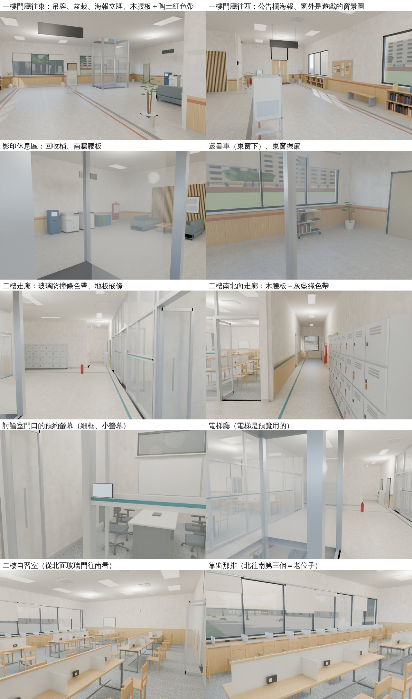
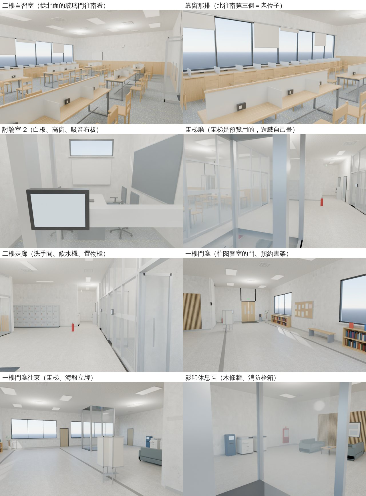

# SOCLIB-2F-1104 社科院圖書館東側館（一樓門廳＋樓梯＋電梯、二樓自習室、討論室、洗手間）

LAWWW2-C 2026-11-04。狀態：**MODEL_READY**（第二版：BB_260 §5 的四點改了，見下一節）。配置、區域程式、Blender 正式模型、光照烘焙（白天／晚上）、導航單元測試都做了，但**還沒在遊戲畫面看過**：要 LAWWW-C 套接線 patch、CC 在電腦上跑瀏覽器。不進 v9.10.20。

## 第二版（BB_260 §5，11-04 18:xx）

BB-C 17:44 看了第一版的 Blender 預覽：方向過，標 ART_APPROVED 以前要改四點（P2，不擋 LAWWW-C 接線）。

**接線 patch 不用改**：第二版只換配置（`src/data/soclib2f_layout.js`）、區域程式（`src/soclib2f3d.js`）、正式模型和光照貼圖（`soclib2f_interior.glb`、`_lm_day.webp`、`_lm_night.webp`、`.json`）。
LAWWW-C 18:22 說第一版已經接進開發分支 `f8d17bfb7`，第二版請以它為底。`f8d17bfb7` 上這幾個檔和第一版 `d393b6f3c` 一模一樣（逐檔比過 blob），所以直接換檔：

```
git checkout SOCLIB2F_V2_SHA -- src/data/soclib2f_layout.js src/soclib2f3d.js \
  assets/models/env/second_ai/soclib2f_interior.glb assets/models/env/second_ai/soclib2f_interior.json \
  assets/models/env/second_ai/soclib2f_interior_lm_day.webp assets/models/env/second_ai/soclib2f_interior_lm_night.webp
```

（`tools/blender/env_second/lightbake/soclib2f_interior_lm.json` 是烘焙的紀錄，要不要一起拿都可以。）

在 `f8d17bfb7` 開乾淨的 worktree、放第二版這 6 個檔跑過（Node，不是瀏覽器）：`soclib2f_unit`、`exam_lib_crowd_unit`（你加的第 12 節）、`soclib_hours_unit`、`nav_soclib_unit`、`guide_unit`、`guide_declutter_unit`、`placemap_unit`、`ntu_zones_gym_unit`，**8 支都 ALL PASS**。
`exam_lib_crowd_unit` 要讀企劃線的 `468a1d0b9`：本機沒有那個 commit 時第 0、12 項會 FAIL（原檔也一樣），先 `git fetch origin claude/magical-albattani-bk7b4n` 再跑。
第二版沒有動座位、`WALK_ROUTE`、老位子，你加的 `soclib2f_people3d.js` 不用改。互動點多一個「看還書車」（95 個）。

| BB 說的 | 改了什麼 |
|---|---|
| 1. 一樓門廳和影印休息區太空。加還書車、「自習室在二樓」的指示牌、「請保持安靜」的牌子、盆栽、回收桶、公告欄上的海報 | ①還書車（影印區東窗下）：不鏽鋼框、三層、四個輪子、推把，下兩層書排滿，最上面一本夾著紙條。看了有說明：「請勿自行上架」。②吊牌：「自習室在二樓」掛在門廳中間、面向入口，兩面都有字；「影印區」掛在影印區。深色框、兩支吊桿到天花板，字由遊戲畫。③「請保持安靜」貼在門廳公告欄上面。④門廳兩盆大盆栽。⑤影印區南牆一組回收桶。⑥海報立牌搬到門廳中間、面向入口。⑦兩個公告欄各有三張 A3 海報（標題色塊、圖、幾行字）和幾張 A4 公告、便條 |
| 2. 牆、地、天花板幾乎全白，像醫院 | ①竹木腰板延伸到一樓門廳（西、北、東牆）、影印區（南、西牆）、樓梯 B 跑下面那面牆。二樓三段走廊原本是淺灰腰板，改成竹木。②腰板上緣下面嵌一條樓層色帶：一樓陶土紅 `#b86f4f`，二樓灰藍綠 `#3f7f8c`。③二樓的玻璃隔間（討論室、自習室北面）霧面防撞條中間，加一條同色的線。④地板：一樓門廳原本的深色嵌條裡面多一圈陶土紅；二樓東西向、南北向走廊各一條灰藍綠嵌條，往自習室的方向。⑤牆的顏色 `#efeee9` → `#ede8df`、磨石子 `#d8d5ce` → `#d3cdc2`，稍微暖一點。天花板不動 |
| 3. 討論室門口的預約螢幕黑框太粗太大 | 框從 0.28×0.20×0.04 改成 0.188×0.123×0.024（框邊 4 mm），螢幕從 0.24×0.16 改成 0.18×0.115，加一支短臂接到玻璃牆的框。**順便修了第一版的錯**：第一版的螢幕面在 `f.z+0.023`，遊戲畫的字在 `f.z+0.022`，字會被螢幕擋住。現在螢幕面在 `f.z+0.015`，字在前面 7 mm |
| 4. 一樓門廳右邊那扇窗曝光過頭 | 第一版預覽的窗外是 Blender 的天空，很亮。遊戲的窗外是窗景圖：一樓 `soclib_north`（平均亮度 0.29），比 Blender 的天空暗很多。這一版的預覽加了 `--preview-view`，窗外放遊戲用的同一張圖，看起來就接近遊戲。`render_cycles.py` 讓這張圖只給鏡頭看，不擋天光。一樓東面兩扇窗也加了捲簾（幾格放下一些）。烘焙後窗邊的亮度見「規格、效能」的量測表。**遊戲畫面要 CC 拍了才知道**：還是太亮的話，壓暗窗景 |

另外查到、修好一個第一版的錯：一樓影印區南牆（和那一段西牆）原本高到 4.2 m，牆頂和二樓地板同高、疊在一起。二樓南北向走廊地上會有一條黑線，遊戲裡會閃。用 Blender 射線查到的，現在牆只到一樓天花板（3.95 m）。之後用射線把兩層走得到的地板全部掃過，沒有別的疊面。



## 使用者要求

- 使用者 11-04 16:1x 對 AA-C 說：「我那時候大學最喜歡去社科院圖書館2樓，你現在好像沒有2樓，你查一下他的2樓有一個專門的讀書室還會有洗手間啊」（UA-LAWWW2-1104-08，USER_WANTS X228）。
- 規格是 AA_669 第 6 節（企劃線 468a1d0b9）。館方 2020 年的公告寫到 2 樓有自習室和討論室（epaper.ntu.edu.tw/view.php?id=29815，只留網址）。
- 做法照 D136（像，但不照抄）、D112（不用深色木地板）。

## 做法

一樓閱覽室（`soclib`）挑高 5.6 m，有樹狀柱和天窗，是單層的大空間，二樓不能蓋在它上面。所以在閱覽室東邊另外接一棟兩層樓的「東側館」，做成新的區域 `soclib_2f`：

- 閱覽室東牆開一扇門「往 2F 自習室、討論室」，通到東側館一樓西牆的門。
- 一樓：門廳、雙跑樓梯、電梯、影印休息區。
- 二樓：走廊、男女廁、討論室、自習室。
- 一樓閱覽室的樹狀柱不延伸到這裡（D136）。

```
東側館（x 往東、z 往南；外牆 16 × 22.4 m）
二樓：
  北邊一排 ┃男廁┃女廁┃討論室 1┃討論室 2┃討論室 3┃   ← 玻璃牆＋玻璃門＋預約螢幕
  走廊     ━━ 飲水機（男女廁門中間）━━━━━━━━━━━━━━━━━━━ ← 寬 1.9 m
  樓梯間   ┃A 跑↓（空）┃B 跑↑┃ 南北向走廊 ┃ 電梯廳（電梯、長椅、回收桶）
  研究小間 ┃ A ┃ B ┃ C ┃（置物櫃、公告欄、消防栓箱）┃ 自習室（北面玻璃隔間＋玻璃門）
                                                    ┃ 南北向長桌 2 排 × 3 張＝36 位、東面整排窗前長檯面 13 位
一樓：門廳（往閱覽室的門、窗下預約書架／新書推薦、長椅、公告、自助服務機、傘架、海報立牌）、
      樓梯、電梯、影印休息區（兩台影印機、儲值機、沙發、木條牆＋樓層導覽框、消防栓箱）、書庫和館員辦公室的門（關著）
```

### 對照 AA_669 第 6 節

| 規格 | 做成 |
|---|---|
| 樓梯、電梯從一樓接上來 | 雙跑樓梯：A 跑往南到 2.1 m 平台，B 跑往北到 4.2 m，兩層共用（D36）。電梯用 `B3.buildElevator`，一樓、二樓各一個「搭電梯」 |
| 一樓的特殊柱子不延伸到二樓 | 東側館是另外接的樓，沒有樹狀柱 |
| 自習室一間，有玻璃門 | 北面整片玻璃隔間，有玻璃門；西牆另有一扇側門，門都是推開的 |
| 長桌加矮隔板 | 南北向長桌 6 張。中間一道霧面矮隔板（34 cm），位子和位子之間也有小隔板 |
| 每張桌子都有插座 | 每個位子一個插座盒，共 49 個（長桌在隔板底下，靠窗的在檯面邊） |
| 靠窗那排看得到樹 | 東面整排窗（0.85～2.85 m），窗外的景用 `B3.outView`，有捲簾。**二樓高度的窗景照片還沒拍**：目前先用閱覽室西面的 `soclib_west`，見「還沒做」 |
| 約 40～60 位 | 自習室 49 位（長桌 36＋靠窗 13）。討論室另有 12 位，不算在內 |
| 期末要看起來是滿的 | 座位都在。讀書的人要 LAWWW 加，建議見下面「給 LAWWW-C」 |
| 靠窗那排第三個是「老位子」 | 靠窗那排北往南第三個：(6.82, 1.5)，table `sw0`，`seat.old=true`。劇情用 `SL2.oldSeat()` 拿 |
| 討論室兩三間，玻璃牆、門口預約小螢幕 | 3 間，每間 4 位。南北向會議桌、北牆白板＋白板上方高窗、側牆吸音布板。門口有預約螢幕（字由遊戲畫：「討論室 1」…；看了有說明） |
| 洗手間在樓梯旁邊、男女分開、門口飲水機 | 男廁、女廁在走廊北側，對著 B 跑頂端（測試量到 ≤ 3 m）。飲水機在兩扇門中間。門關著，看得到說明 |
| 走廊有公告欄和一排置物櫃 | 南北向走廊西牆：置物櫃 8 欄 × 4 層（有的格子插著鑰匙）、公告欄。一樓門廳另有樓層簡介 |
| D112 不要深色木地板 | 走廊、門廳是淺色磨石子，和一樓閱覽室同一種；自習室、討論室是淺灰藍地毯 |

### D136：保留了什麼、改掉了什麼

- **保留**：
  - 館方說的「二樓有自習室和討論室、有洗手間」。
  - 和一樓閱覽室同一套材質：磨石子地、白牆、竹集成材家具。
  - 圖書館的日常東西：預約書架、影印區、置物櫃、公告欄、預約制討論室。
- **改掉／自己設計**：
  - 「東側館」這棟樓、走廊和房間的配置。
  - 桌子的排法：南北向兩排，加一排窗前長檯面。
  - 討論室數量和尺寸。
  - 竹木腰板、木條牆這些細節。
  - 沒有照任何照片的格局去做；我沒有實際平面圖，這是遊戲化的設計。

## 檔案

| 檔案 | 說明 |
|---|---|
| `tools/blender/env_second/soclib2f_layout_gen.py` → `src/data/soclib2f_layout.js` | 配置。遊戲和 Blender 讀同一份。牆的中心線在 0.4 的整數倍，走得到的範圍邊界在 0.2 的奇數倍，走道至少 3 格（1.2 m） |
| `src/soclib2f3d.js` | 區域 `soclib_2f`：兩層導航、樓梯高度（A 跑往南、B 跑往北）、電梯、座位 61、互動點 95（第二版多「看還書車」）、程序化備用模型、鏡頭碰撞、樓板（slabs）。正式模型在這支自己登記（`bldg.soclib2f_interior`） |
| `tools/blender/env_second/soclib2f_interior.py` | Blender 正式模型：L0_root／L1_root、外牆 WALL_L<層>_<面>（dir）。椅子用 instancing：木椅 49、辦公椅 12 |
| `tools/blender/env_second/lightbake/bake_soclib2f.sh` | 建模 → 光照烘焙（白天／晚上）→ WebP（燈的位置從模型的統計 JSON 讀） |
| `assets/models/env/second_ai/soclib2f_interior.glb`／`.json`、`soclib2f_interior_lm_day.webp`、`_night.webp` | 正式模型＋光照貼圖 |
| `tests/soclib2f_unit.js` | 導航單元測試（Node，不用瀏覽器） |
| `soclib2f_wiring.patch` | 接線（LAWWW 的檔案，以開發分支 ae5248250 為底） |
| `soclib2f_blender_v1.jpg`、`soclib2f_blender_v2.jpg` | Blender 預覽（沒有學校照片）：第一版見下面，第二版見上面「第二版」那一節 |



預覽是 Cycles 直接渲染 GLB，不是烘焙後的遊戲畫面。電梯是 `--preview-elev` 加的，遊戲裡由 `B3.buildElevator` 畫。窗外是 Blender 的天空，遊戲裡是照片。霧面隔板在 Cycles 看起來比較白，遊戲裡是半透明（0.62）。

## 規格、效能

第二版的數字（括號裡是第一版）：

| 項目 | 數字 |
|---|---|
| GLB | `soclib2f_interior.glb` 3.7 MB（3.1 MB）。一樓閱覽室 6.9 MB、總圖大廳第二版 9.6 MB |
| 三角形 | 不重複的 40,216（33,820）；畫出來 58,036（51,640；椅子 instancing 展開算） |
| 網格 | 41 個（41）：每層每個材質合併一個、外牆一面一個。**draw call 沒有變多**：新的東西都併進原本的材質 |
| 材質 | 16 個（16） |
| 椅子 | GPU instancing 3 組（木椅 49、辦公椅 12） |
| 光照貼圖 | 1024²：白天 116 KB（99 KB）、晚上 97 KB（83 KB），WebP |
| 烘焙 | Cycles CPU，256 取樣，317 秒；天花板燈 39 盞面光源；太陽 110°／35° |
| 量測 | `lm_probe.py` 23 點全過，列在下面 |

**還沒量手機上的 fps**（要電腦上的瀏覽器）。

`lm_probe.py` 的 23 點（數值＝光照貼圖亮度；括號裡是第一版）：

| 位置 | 白天 | 晚上 |
|---|---|---|
| 自習室地毯 | 1.45（1.44） | 1.39（1.40） |
| 長桌桌面 | 1.54（1.52） | 1.58（1.49） |
| 老位子前的檯面 | 1.26（1.27） | 0.76（0.77） |
| 自習室西牆 | 1.24（1.25） | 1.21（1.23） |
| 二樓走廊地板 | 0.84（0.90） | 0.79（0.81） |
| 討論室地毯 | 0.54（0.50） | 0.50（0.50） |
| 二樓天花板 | 0.55（0.59） | 0.53（0.50） |
| 二樓走廊天花板 | 0.40（0.32） | 0.34（0.26） |
| 一樓門廳地板 | 1.56（1.71） | 1.10（1.19） |
| 一樓天花板（門廳） | 1.19（1.33） | 0.58（0.62） |
| 一樓天花板（影印區） | 0.89（1.25） | 0.45（0.54） |
| 影印區地板 | 1.36（1.44） | 0.96（1.00） |
| 樓梯平台 | 0.29（0.28） | 0.31（0.28） |
| 樓梯間頂 | 0.31（0.34） | 0.30（0.33） |
| 北窗前的地板（門廳右邊那扇窗，BB 第 4 點） | 1.03 | 0.83 |
| 東窗邊的地板（北段） | 0.96 | 0.66 |
| 東窗邊的地板（還書車旁） | 1.13 | 0.69 |
| 一樓東牆腰板 | 1.08 | 0.70 |
| 一樓西牆腰板（門邊） | 0.81 | 0.47 |
| 二樓走廊腰板（洗手間前） | 0.36 | 0.38 |
| 二樓走廊腰板（研究小間那面） | 0.45 | 0.40 |
| 二樓走廊腰板（自習室西牆外） | 0.36 | 0.33 |

窗邊的地板比門廳中間暗：光照貼圖裡窗邊沒有過曝。一樓的地板、天花板比第一版暗一點，因為磨石子調暗了、東窗加了捲簾。

量的時候要注意：探針找的是「法線方向對、2 cm 內」的面。腰板離牆面只有 1.8 cm，點放在腰板前面不到 1 cm，才不會量到後面被腰板擋住的牆（第一次放在牆面上，量到 0.001）。

第一版第一次量的時候，「一樓天花板」那一點 (0, −8) 量到 0.015。那裡剛好在空調出風口上面，被出風口蓋住，所以是黑的。換到旁邊沒東西擋的點就正常。

## 測試（開發分支 ae5248250＋接線 patch，Node 模擬；不是真實玩家流程）

`node tests/soclib2f_unit.js` 全部通過。它檢查：

- 閱覽室東牆的門走得到；回來的位置離門超過門的半徑。
- 一樓 ⇄ 二樓用走的，也用跑的、低幀率走。樓梯 26 階，畫面上的高度和台階一致。B 跑頂端在第 0 層站不住。
- 61 個座位「坐下」的位置都走得到，老位子只有一個、位置對。
- 95 個互動點都站得住、走得到（第一版 94，第二版多還書車）。
- 電梯：門關著車廂裡站不住，門開著站得住；車廂側面、後面走不進去。
- 兩層的電梯運鏡位置都在房間裡，和車廂之間沒有實心的牆。
- 牆的中心線上站不住（門的開口除外），兩層沒有小孤島。

這個測試在有問題的版本會失敗：第一版配置的走道只有 0.7 m、討論室太擠，跑起來 6 項失敗，改了以後才通過。

開發分支上照舊全部通過的：

- `nav_soclib_unit.js`（閱覽室加了東牆的門）
- `soclib_hours_unit.js`（多一個案例：人在東側館 22:01 一樣被請出去。沒套 story3d.js 那一行會失敗）
- `guide_unit.js`、`guide_declutter_unit.js`、`placemap_unit.js`、`ntu_zones_gym_unit.js`

## 給 LAWWW-C

### 接線 patch：`git apply docs/art-rebuild/second_ai/wip/soclib2f_1104/soclib2f_wiring.patch`

先把 `src/soclib2f3d.js`、`src/data/soclib2f_layout.js`、`tests/soclib2f_unit.js` 和模型、貼圖從我的分支拿過去，再套 patch。patch 改了這些：

- `index.html`：載入 `src/data/soclib2f_layout.js`、`src/soclib2f3d.js`，放在 `soclib3d.js` 後面（版本字樣照 9.10.19，發布時你照慣例改）。
- `src/soclib3d.js`：閱覽室東牆的門。
  - 互動點 (14.4, 8.8)，半徑 0.8，回來的出生點是 (13.4, 8.8)。
  - 門的畫面是雙開門加「2F 自習室・討論室」指標，放在 g0。它加進 `z.winParts`，跟著東牆淡出；正式模型載入後再加回去，因為 `attachRoomGLB` 會重設 winParts。
- `src/story3d.js`：閉館廣播和請離館也看 `soclib_2f`，開放時間跟著閱覽室。
- 11 份清單加 `soclib_2f`：
  - `game3d` NTU_ZONES、`grades3d` LIBS、`seatact3d` LIB_ZONES、`libquiet3d` ZONES、`romance3d` CAMPUS_ZONES
  - `guide3d` LINKS（soclib ⇄ soclib_2f）、`classes3d` OUTER、`placemap3d` ZONE_PIN、`social3d` PLACE_LABEL、`crowd3d` DEPT_SIT、`zrzq3d` zoneCat
- `tests/soclib_hours_unit.js`：東側館 22:01 的案例。

### 不在 patch 裡、建議你做的

1. **自習室讀書的人（AA_669「期末要看起來是滿的」）**。照 `story3d.js` 社科圖的作法，在 `zoneId==='soclib_2f'` 開館時：
   - 從 `E.zone.seats` 挑 `kind` 是 `study`／`window` 的位子放讀書的人（`pose:'read'`、`lv:1`、`frozen`）。
   - 平常大約 30～40%（15～20 位）；日曆 `exam==='final'` 那週和前一週大約 85%（40 位左右）。
   - 老位子（`seat.old`）不要放人，留給劇情。
   - 討論室偶爾放 2～4 個人（坐在 `kind:'discuss'` 的位子）。
   - 散步路線用 `SL2.WALK_ROUTE`：一樓門廳 → 電梯前 → 影印區 → 樓梯下 → 二樓走廊 → 南北向走廊 → 自習室 → 電梯廳 → 回門廳。`soclib2f_unit` 檢查每一段走得到（走路、跑步、低幀率）。
   - 樓梯中段不要放點：兩層共用的樓梯中段算第 0 層，指定第 1 層會走到一半就結束。
2. **「老位子」的劇情鉤子**：`SL2.oldSeat()` 回傳 `{lv:1, x:6.82, z:1.5, yaw:π/2, kind:'window', table:'sw0', old:true}`。AA 寫劇情時用。
3. **窗景**：二樓東面的窗目前用 `soclib_west`（一樓的高度拍的）。要二樓高度的照片，`tools/shots/window_views.py` 加一個從校園上社科院東側 2 樓高度往外拍的鏡頭（X75 以後，室內 +x 在校園上是西）。這要在電腦上拍。

## 給 CC（電腦上跑瀏覽器，D131）

- 真實流程（不用 turbo）：
  - 從校園進社科圖，走到東牆的門，進東側館。
  - 走樓梯上二樓，進自習室，在老位子坐下。
  - 回頭搭電梯下一樓，回閱覽室。
- 截圖：二樓自習室從北面玻璃門往南看、靠窗那排、討論室裡、二樓走廊（洗手間＋飲水機）、一樓門廳。各拍 11:00 和 20:30；手機直向和橫向。

## 還沒做／已知的不足（誠實）

- **沒有在瀏覽器、手機上看過**：只有 Node 模擬和 Blender 渲染。
- 二樓的窗景照片是一樓高度的（見上面）。
- 洗手間、研究小間、書庫、館員辦公室都是關著的門，只有說明，沒有做室內。
- 自習室沒有人（要 LAWWW 加讀書的人）；期末看起來滿不滿，要看那一段。
- 閱覽室東牆的門是程式畫的另一個物件，不在 `soclib_interior.glb` 裡。光照貼圖沒有門的影子，門看起來會比牆亮一點；要更好的話下次重烘閱覽室時把門加進模型。
- 美術驗收：場景美術要 BB 判（D120／D128），我不標 ART_APPROVED。
