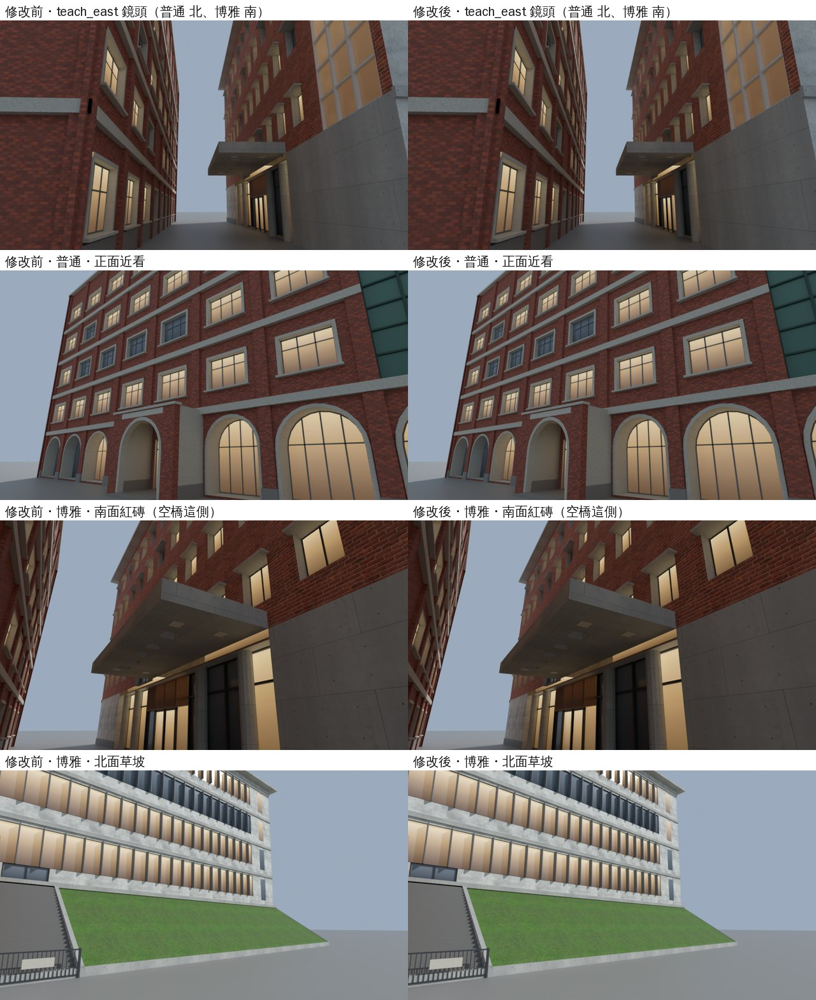

# TEACH-EAST-DRAWCALL-1104：普通、博雅教學館少畫幾次

LAWWW2-C 2026-11-04。狀態：**MODEL_READY**。

- 只換 `campus_putong.glb`、`campus_boya.glb`（和 `.json`），**遊戲程式不用改**。外觀沒變：同一組貼圖、同一個樣子。
- 另外附一個測試 patch：`tests/campus_glb_integration.py` 博雅的匾額清單少了一塊（舊問題，見「測試」）。
- 還沒在瀏覽器看過（D131）。

## 起因

- BB-C 15:4x（P3）：CC 跑 `campus_glb_integration.py`（PARK_glb_r3），`teach_east` 鏡頭（(−15, 1.7, −69) 看 (−38, 8, −70)，普通和博雅中間）：
  - draw call 218 → 243（×1.115），超過 1.1 倍。
  - 三角形 370,861 → 342,166：還有 28,695 的餘裕。
- 「改之前」那一輪在 CC 的幾次跑裡是 217～225 次，量測會跳。要穩過 1.1 倍，正式模型那一輪要 ≤ 238。

## 做法（`tools/blender/env_second/campus_teach.py` 的 `finish`）

1. **有貼圖的材質合成一張貼圖集**（`lib2.atlas_tiles`）：
   - 普通：面磚 `ck_wall`、洗石子 `ck_trim`。
   - 博雅：紅磚 `by_brick`、灰泥 `ck_wall`、清水模 `ck_trim`、草 `by_grass`。
   - 一格 512 px，和原本每個週期 512 px 一樣清楚。
   - 收邊（洗石子、清水模）一格放 2×2 個週期：切開的三角形少一半，每個週期的像素變一半。牆、紅磚、草照舊一格一個週期（最常近看的面不糊）。
2. **頂點色的零件也併進同一個材質**（新的 `lib2.fold_vc`）：窗框、鋁鰭、木格柵、花崗石腰帶、樓梯塔綠框、天花板…
   - 貼圖集最上面多一條 32 px 的白色帶子。頂點色零件的 UV 全部指到帶子中間，顏色照舊是頂點色。
   - 有貼圖的面頂點色補白。
   - 底色＝貼圖 × 頂點色（glTF 的 `baseColorTexture` × `COLOR_0`；three.js 看到 `COLOR_0` 就開 `vertexColors`）。
   - 材質名沿用 `wz_vc_pt`／`wz_vc_by`：遊戲的 `wzCastsShadow` 照舊讓它投影。
3. 粗糙度：ORM 圖一格只有一個值，縮成 1/8 大。
4. 沒動的：玻璃 `ck_glass`（夜間的窗）、燈罩 `wz_lamp_lens`、匾額 `PLATE_FACE_*`。

## 結果

| | 普通 | 博雅 |
|---|---|---|
| 網格（遊戲裡畫幾次；匾額遊戲會合成一個） | 6 → 4 | 8 → 4 |
| 會投影的 | 3 → 1 | 5 → 1 |
| 三角形 | 8,558 → 13,704 | 5,626 → 8,630 |
| GLB | 0.78 → 1.27 MB | 0.72 → 0.96 MB |
| 貼圖（GPU，RGBA＋mipmap） | 5.6 → 6.0 MB | 8.8 → 11.7 MB |

- `teach_east` 的估計：
  - 主畫面少 6 次 → 243 → 237（×1.087）。
  - 陰影那一輪也算到這兩棟的話再少 6 次 → 231（×1.060）。遊戲白天每一格都更新影子，但影子的範圍跟著玩家，量的時候不一定包到這兩棟。
- 三角形：主畫面多 8,150，陰影也算的話多 16,300。`teach_east` 的餘裕 28,695；所有鏡頭裡最緊的 `bell_avenue` 是 24,585。
- GLB 變大的原因：面沿著貼圖的週期切開（三角形變多），而且整個網格都要帶頂點色（`COLOR_0` 是 float）。
- 博雅的貼圖變大：草原本 256 px，在貼圖集裡佔一格 512。

## 畫面



- Blender Cycles 預覽，不是遊戲畫面。
- 這幾個角度看不出差別。近看收邊（洗石子、清水模）會比原本糊一點（每個週期 244 px）。

## 測試

**新的 `tests/teach_east_drawcall_unit.js`**（Node，不是瀏覽器）：

- 建出遊戲真正的校園，用遊戲自己的 `attachWenzhouModel` 接上兩顆模型，在 `teach_east` 鏡頭裡數。
- 開發分支 `effb5d9b3` 原樣（現在的 GLB）：② ② ④ ④ FAIL。普通 6＋3、博雅 8＋5，還沒合併。
- 換新 GLB：ALL PASS。
  - 兩棟都是 4＋1。
  - 三角形 44,148 ≤ 48,000。
  - 頂點色零件都在白色帶子，有貼圖的面頂點色是白的。

**一起跑（新 GLB）**：`plate_text_dir_unit`、`scene_bg_keys_unit`、`nav_buildings_unit` ALL PASS。

**瀏覽器的 `campus_glb_integration.py` 沒跑**（D131）。照它的檢查項目對過：

- 陰影那一項（`ck_wall`、`ck_trim` 要投影）：普通、博雅不再有這兩個材質名。別棟（行政、文學院、校史館、總圖、校門）都有、都投影，照舊過。
- 玻璃（`GLASS_ONLY`）、匾額：沒動。
- **博雅的匾額那一項本來就會 FAIL**（舊問題，不是這次造成的）：
  - TEACH-PTBOYA v2b（`9be98513b`）加了屋頂花園的告示牌 `PLATE_FACE_BOYA_GARDEN`，測試的清單只有 `PLATE_FACE_BOYA`。
  - 附 patch `campus_glb_integration_boya_plates.patch`：只改那一行。在開發分支 `effb5d9b3` 用 `git apply --check` 確認過可以套。

## 給 LAWWW-C

```
git checkout d164ac9a8 -- assets/models/env/second_ai/campus_putong.glb assets/models/env/second_ai/campus_putong.json assets/models/env/second_ai/campus_boya.glb assets/models/env/second_ai/campus_boya.json tests/teach_east_drawcall_unit.js
git show d164ac9a8:docs/art-rebuild/second_ai/wip/teach_east_drawcall_1104/campus_glb_integration_boya_plates.patch | git apply
```

- 程式不用改。
- 請 CC 跑 `campus_glb_integration.py`：看 `teach_east` 的 draw call、各鏡頭的三角形。

## 還沒做／已知的不足

- 陰影那一輪算不算到這兩棟，要看量的時候玩家在哪裡。上面兩種都列了。
- GLB 兩棟一共多 0.73 MB。要再小可以把頂點色、位置量化（KHR_mesh_quantization／meshopt），這次沒做。
- 收邊的洗石子、清水模，每個週期的像素少一半。
- 法線的強度烤進貼圖集的像素（`atlas_tiles` 的做法），細微的凹凸比原本少一點精度。
- 外觀沒變，不用 BB 重判；這兩棟本來就在等 BB 判（TEACH-PTBOYA-REF-1104）。
- `lib2.atlas_tiles` 多了兩個參數 `solid`、`orm_div`，預設值的行為和以前一樣（溫州街 `wz_street.py` 照舊）。
