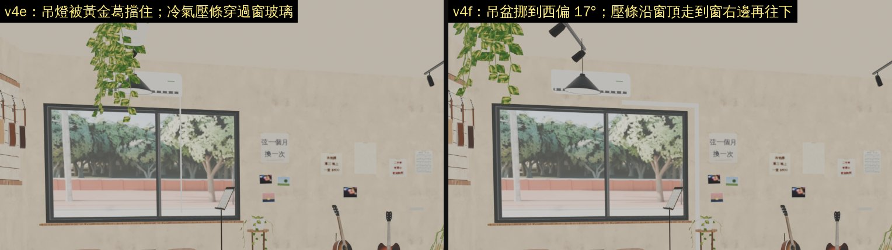
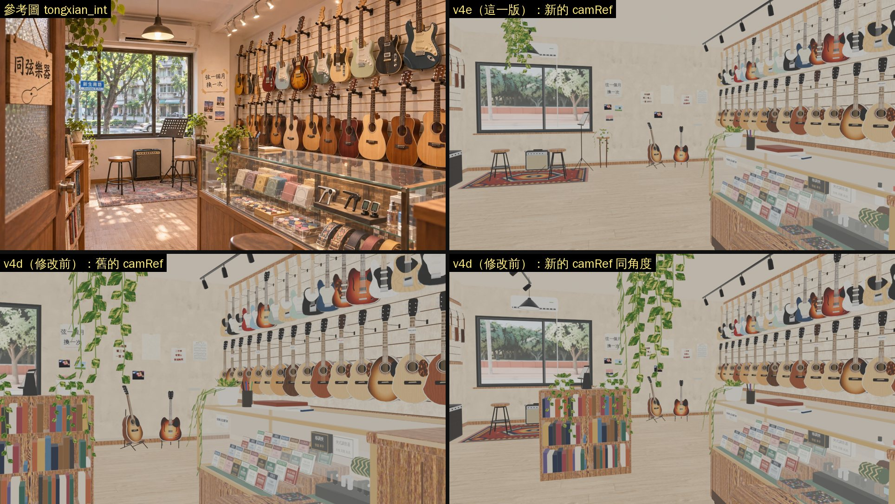
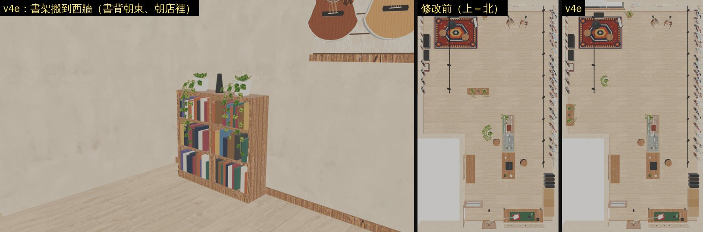

# TONGXIAN-REF-1105：同弦樂器店內照參考圖的排法（v4e／v4f）

LAWWW2-C，2026-11-05（P2，不擋 v9.10.20）。

- 起因：BB-C 02:08（D132 由 BB 代驗）說「店內和參考圖差太多，要改」。
- BB 同意 CC 做的 v4d 由 LAWWW2 接手改。

狀態：**MODEL_READY、可以整合**（BB-C 03:21 R2 判定）。

- 交件：v4e `b49d3016b`；**v4f（BB-C 03:21 的一處）見下一節，交件 commit `308b5c025`**。
- ART_APPROVED 等 CC 的遊戲內同角度截圖（BB 已派）。

## v4f（BB-C 11-05 03:21 R2 判定）

BB-C 的判定（全文在企劃線 BB_255 03:2x，ad417bafd）：

- 新的 camRef 照用，不改回舊的。內容和左右順序對；窗的位置被外觀綁住，消失點差 15% 接受。書架搬到西牆 OK，D112 OK。
- 要改一處：吊燈被黃金葛擋住。



| BB-C 說的 | v4f |
|---|---|
| 從 camRef 看，吊燈 (−1.65, 2.55, −4.15) 在西偏 10.5°，黃金葛 (−1.2, 2.45, −1.6) 在西偏 10.8°，燈被葉子擋住。挪開至少 5°，最低葉子 ≥ 1.75 m 照舊 | 吊盆挪到 (−1.44, −0.8)：西偏 17°、仰 18°，和吊燈差 6.5°。藤垂在窗的左上角前面，參考圖左上也是這樣。最低的葉子 1.87 m，照舊在走道上方 |
| 窗右邊從冷氣往下那條細白線是什麼 | 是冷氣的配管壓條（冷媒管、排水管）。v4c 窗照外觀搬到冷氣下面以後，它剛好從窗玻璃中間垂下來，這不合理。<br>改成從冷氣底下沿著窗的上緣，走到窗的右邊（窗框外 10 cm），再沿著牆往下到牆腳。寬度也改成一般配管槽的 6 cm（原本 1.5 cm） |

測試：

- `tests/tongxian_unit.js` ⑪ 新加一項「從 camRef 看得到吊燈」：眼睛到燈罩中心的視線 3° 以內、比燈近的地方沒有葉子。
  - v4e：FAIL，擋住的葉子頂點 388 個，最近的離視線 0.1°。
  - v4f：PASS，0 個，最近的 5.3°。
- 在開發分支 335b47844 上換 v4f 的檔：`tongxian_unit` ALL PASS；`aa619_guitar_unit`、`aa619_guitar_zone_unit`、`seat_reach_unit`、`scene_bg_keys_unit` ALL PASS。
- GLB：畫的三角形 56,605 → 56,641（壓條兩段），2,997,640 bytes。

接法和下面 v4e 的一樣（同一組十個檔＋LICENSES patch）；下面的指令已經換成 v4f 的 SHA `308b5c025`。

- 預覽是 Blender EEVEE。光線是均勻的天空光，不是遊戲的燈。
- 遊戲內畫面還沒拍：照 D131 要 CC 在 PC 上拍。
- ART 由 BB 判。

## 先說結論

| BB 02:08 說的 | 實際是什麼 | 這一版 |
|---|---|---|
| 參考圖最重要的那一塊（左邊的大窗、窗前的試琴角）沒有出現在畫面裡 | 試琴角其實已經在窗前：CC 在 v4c 跟著窗搬過。<br>看不到的原因：窗照外觀搬到西半邊以後，舊的 camRef 只拍得到窗的一條邊 | **camRef 重選**（下一節）：窗、冷氣、吊燈、試琴角在左，吉他牆在右，玻璃展示櫃在右下 |
| 補上天花板的吊燈、冷氣 | v4d 已經有：窗上面的冷氣、試琴角上方的吊燈 | 新的鏡頭看得到 |
| 外觀限制窗的位置，就保留窗、試琴角跟著搬、camRef 重選 | 窗照外觀在 x −3.0～−0.4（外觀 3a81bf5a1） | 窗不動，只重選鏡頭 |
| 左前方的白色書架：參考圖沒有、看起來是一整塊白的 | 原本在店中間 (−0.47, −1.2)，從門口看過去正好擋住試琴角。<br>「一整塊白」是預覽的問題：Workbench 不畫頂點色，書是頂點色（v2 README 說過） | **搬到西牆**：烏克麗麗牆和樓梯間中間 (−3.03, −0.05)，轉 90°、書背朝店裡。導航阻擋跟著搬 |

另外兩件，是這一版自己找到的：

1. **吊盆黃金葛**：
   - 原本吊在 (0.1, 0.8)。這個位置在新鏡頭的正中間，最低的葉子只離地 1.02 m，人走過去會穿過葉子。
   - 改成搬到往試琴角的走道上方 (−1.2, −1.6)，藤短一半（配置的 `vine: 0.5`）。
   - 現在最低的葉子離地 1.87 m；從新鏡頭看，是左上垂下來的藤，參考圖的左上也是這樣。
2. **v4e 第一版的錯，交件前修好了**：
   - 書架整組轉 90° 時，原本用「轉之前記下的頂點數」分新舊，只轉後面新加的頂點。
   - 但 bmesh 刪掉頂點以後（倒角方塊會刪），新頂點會補進空出來的位置，排在舊頂點前面。
   - 結果吊燈的電線被轉到牆外，從天花板拉出一大片黑色三角形；書架也可能有幾塊沒轉到。
   - 改法：轉之前替舊頂點標一個整數層 `_old`，只轉沒有標記的頂點。
   - 測試新加「店裡的零件都在房間裡」一項：第一版 FAIL（`tx_vc` 12 個頂點），修好以後 PASS。



上面這張四格（都是 Blender EEVEE 1280×720，光是均勻的天空光）：

- 左上：參考圖 tongxian_int。
- 右上：**v4e，新的 camRef**。
- 左下：修改前（v4d），舊的 camRef：窗只剩最左邊一條，前面是書架。
- 右下：修改前（v4d），用新的 camRef 同角度：書架擋住試琴角，吊盆的藤垂在畫面中間。



## 新的 camRef，以及為什麼和參考圖不能完全一樣

`src/data/tongxian_layout.js` 的 `camRef`：

- 眼睛 (−0.4, 1.3, 2.6)，在長椅旁邊的走道上，站得到。
- 看的點 (1.41, 1.06, −4.16)：往北偏東 15°、俯 2°。
- 24 mm（感光元件寬 36 mm，水平 73.7°），16:9，shift_y 0。

為什麼不用參考圖原本的角度：

- **參考圖的鏡頭往右斜看。** same_angle_check 量到參考圖的主要消失點在畫面左邊約 17%。參考圖的窗靠近吉他牆，中間只隔約 1 m 的實牆。
- **這間店的窗被外觀固定在西半邊。** 窗和吉他牆中間隔 3.6 m 實牆，所以照參考圖那樣斜看，窗會被切掉。
  - 舊的 camRef 就是參考圖的方向，消失點在 10%，結果窗只剩一條邊。
  - 我算過：要讓窗、實牆、吉他牆在畫面上的比例和參考圖一樣，鏡頭要站在西牆邊、用 105° 左右的超廣角。
- **這一版的取捨**：窗整個留在畫面裡，鏡頭盡量往右轉，消失點在 32%。
  - 我比了 9 個鏡頭位置（Blender EEVEE 640×360＋same_angle_check）：這一個消失點最接近，ssim 和九個裡最高的差不到 0.01。
  - 窗、試琴角、吉他牆、玻璃展示櫃、收銀檯的左右順序都和參考圖一樣。
  - 代價：窗和試琴角比參考圖小，在畫面左邊 6%～31%；參考圖是 15%～43%。

## R2 疊圖（`tools/art/same_angle_check.py --mode shop`，D138）

檔案：

- `tongxian_refcam_overlay.jpg`、`tongxian_refcam_structure.json`：新的 camRef，v4e。
- `tongxian_v4d_refcam_structure.json`：修改前，舊的 camRef，給比較用。

| | 新 camRef（v4e） | 舊 camRef（v4d） |
|---|---|---|
| 畫面裡看得到 | 窗、冷氣、吊燈、試琴角（椅子兩張、音箱、譜架、地毯）、吉他牆、玻璃展示櫃、收銀檯 | 窗的一條邊、書架、吉他牆、展示櫃 |
| 消失點（參考圖 17%） | 32%（差 15.3%） | 10%（差 7.8%） |
| 長直線 line_F（最佳 2D 對位後） | 0.15（0.29） | 0.30（0.31） |
| 大形狀 ssim | 0.52 | 0.49 |
| 最佳 2D 對位 | 縮放 1.10、平移 +9.5%／+8.0% | 縮放 1.01、平移 +6.5%／+2.0% |

**照實說：只看線條，舊鏡頭對得比較好。**

- 舊鏡頭就是參考圖的方向，吉他牆、櫃台的長直線比較對得上。
- 但它看不到窗和試琴角，這正是 BB 要改的地方。
- 新鏡頭用線條換畫面內容。BB 如果覺得線條比較重要，可以改回舊鏡頭；配置裡寫了舊的數字。

兩個鏡頭都 FAIL 的兩項：

1. **消失點差 ≤ 2%**：原因見上一節（窗的位置）。
2. **「參考圖東西多很多」的格子 ≤ 3／24**：新的 22 格，舊的也有 20 格以上。
   - 預覽光線是均勻的天空光、沒有陰影，而參考圖接近照片。邊緣密度差主要來自這一點。
   - 雲端分不出哪些格子是真的少放東西、哪些是光線。要等 CC 用遊戲內截圖量。

## 測試

在開發分支 335b47844 上換這次的檔：

```
node tests/tongxian_unit.js
```

| 檢查 | 修改前（v4d／v2，只換新測試） | 修改後（v4e） |
|---|---|---|
| ⑪ 參考圖的構圖：camRef 左半邊有窗、試琴椅、音箱，右半邊有吉他牆、玻璃展示櫃，看試琴角的視線沒有家具擋 | **FAIL**：窗 −32°、試琴椅 −38°（視角 ±28°，在畫面外）；書架擋住試琴椅 | PASS：窗 −24°、試琴椅 −30°／−21°、吉他牆 18°、展示櫃 21°（視角 ±37°） |
| ⑪ 走道上方的吊盆黃金葛：最低的葉子離地 ≥ 1.75 m | **FAIL**（1.02 m） | PASS（1.87 m） |
| ⑪ 店裡的零件都在房間裡 | PASS | PASS（v4e 第一版 FAIL：吊燈電線 12 個頂點） |
| ①～⑩：導航、座位、互動點、出入口、營業時間、地板、樓梯間、接線 | PASS | PASS |

- 修改前：FAILED 2。修改後：ALL PASS。
- 其他讀同弦的測試，在 335b47844＋這次的檔上都是 ALL PASS：
  - `aa619_guitar_unit`、`aa619_guitar_zone_unit`：AA619 吉他店劇情，用到試琴椅、互動點。
  - `scene_bg_keys_unit`、`seat_reach_unit`。

GLB 規格：

| | v4e | v4d |
|---|---|---|
| 畫的三角形 | 56,605 | 57,262 |
| 檔案大小（bytes） | 2,995,264 | 3,032,464 |

- 兩版都是 12 個材質、179 個物件、62 個網格，同樣用 EXT_texture_webp、EXT_mesh_gpu_instancing。
- 三角形少了 657 個，全部是葉子（`tx_leaf` 2,298 → 1,641）：吊盆的藤短一半。

## 接法（LAWWW-C）

換檔：

- 這幾個檔在開發分支上，和我分支的基準是同一個 blob（335b47844 上比對過），換掉不會蓋到別人的修改：
  - `src/data/tongxian_layout.js`
  - `assets/models/env/second_ai/bb_support/tongxian.glb`、`tongxian.json`
  - `tests/tongxian_unit.js`
- 其他是新檔：CC 的腳本和產生的貼圖，原本只在 cc-testing。

```
git checkout 308b5c025 -- src/data/tongxian_layout.js \
  assets/models/env/second_ai/bb_support/tongxian.glb assets/models/env/second_ai/bb_support/tongxian.json \
  tests/tongxian_unit.js \
  tools/blender/env_second/bb_support/tongxian_interior.py tools/blender/env_second/bb_support/tongxian_tex.py \
  tools/blender/env_second/textures/gen/tongxian_atlas.json tools/blender/env_second/textures/gen/tongxian_guitar.png \
  tools/blender/env_second/textures/gen/tongxian_props.png tools/blender/env_second/textures/gen/tongxian_props_emit.png
git apply docs/art-rebuild/second_ai/wip/tongxian_ref_1105/tongxian_v4e_licenses.patch   # 335b47844 上乾淨：LICENSES 同弦室內那一列改 v4e
node tests/tongxian_unit.js
```

- `src/tongxian3d.js` 不用改：書架的導航阻擋寫在配置的 `blocks`，區域照讀。
- 店門、出入口、座位、互動點都沒動。AA619 的「看看」「買東西」「試彈」照舊。

## 重新匯出（腳本現在在 repo 裡）

```
python3 tools/blender/env_second/bb_support/tongxian_tex.py      # 貼圖（cc-testing 0b6033c46 那一份，沒改）
nice -n 10 /opt/blenv/bin/python tools/blender/env_second/bb_support/tongxian_interior.py -- --out <暫存>/raw.glb
python3 tools/blender/env_second/glb_floor_hole.py <暫存>/raw.glb assets/models/env/second_ai/bb_support/tongxian.glb tx_floor -3.2,-1.14,1.0,5.2
```

- `tongxian.json` 照匯出的 json，再補 `post`（地板洞）和 `version`。
- 預覽：
  ```
  /opt/blenv/bin/python tools/blender/env_second/glb_preview.py -- <glb> <資料夾> 'refcam:-0.4:1.3:2.6:1.41:1.06:-4.16:73.74' 1280 0.5625 eevee
  ```

v4e 改了 CC 腳本的這幾個地方：

1. 木地板 `target='#d6bc96'`。這是 D112 要的淺色，以前是匯出以後才用 `glb_tint_image.py` 調。
2. 書架那一段的前後加 `_mark_old()`、`_rot_new()`：照原本「沿著 x、書背朝南」建好，再整組轉配置的 `ry`。
3. 吊盆的藤乘配置的 `vine`。
4. 說明文字。

## 給 CC（帳號 A，只用 GitHub 交接，D75）

- 同弦店內的腳本，最新的一份在 repo 的 `tools/blender/env_second/bb_support/tongxian_interior.py`（v4e）。cc-testing 的 0b6033c46 是 v4d。
- 以後要再改店內，請從 v4e 這一份改。
- bmesh 的提醒：
  - 不要用「頂點數」分新舊頂點：刪過頂點以後，新頂點會補進空出來的位置。
  - 要分新舊，就先替舊的標一個整數層（`_mark_old`）。
- 遊戲內同角度：用配置的 `camRef` 拍，白天、晚上各一張，再跑 same_angle_check `--mode shop`。

## 還沒做、還沒驗

- **遊戲內畫面（D131）**：camRef 的同角度、白天和晚上、店門進來的樣子，都要 CC 在 PC 上拍。
- **參考圖左前方的店門和「同弦樂器」木牌**：
  - v4b 起，店門照外觀的樓梯搬到樓梯間的東牆。
  - 從看得到窗和展示櫃的位置，店門在鏡頭後面，所以參考圖左邊 15% 那一塊在 camRef 裡沒有。
  - 從店門口看進去的話，前面是收銀檯的木頭檯面，窗很遠。
- **店比參考圖深**：這間 10.4 m，試琴角離鏡頭約 7 m，所以窗和試琴角看起來比參考圖小。
- **玻璃展示櫃的細節**：參考圖的 Pick、移調夾、調音器、背帶都很清楚；24 mm 拍出來東西很小。要不要在櫃子前段多放幾樣、放大一點，BB 判斷。
- 「參考圖東西多很多」的格子要用遊戲內截圖量。
