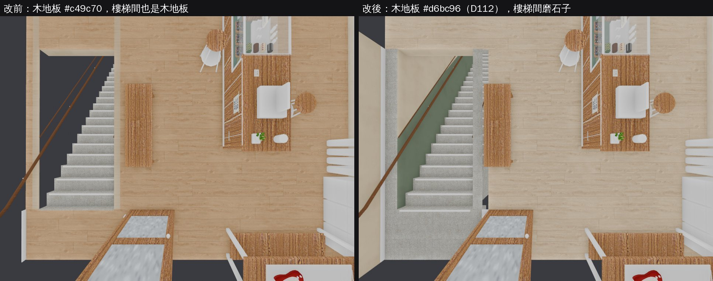
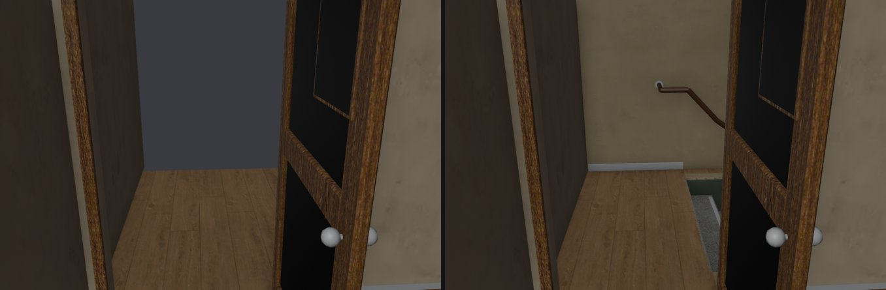
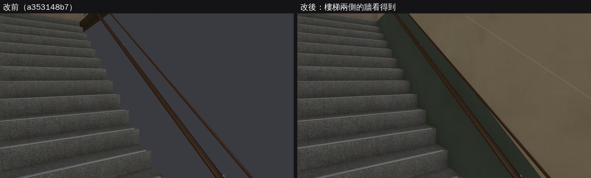
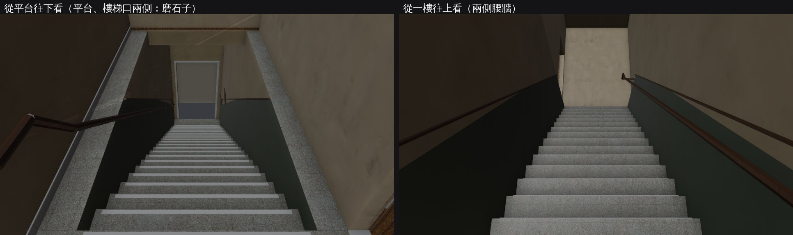
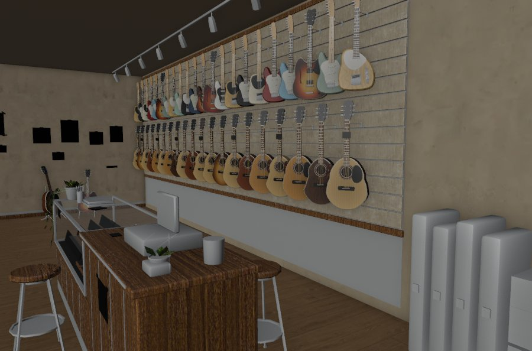
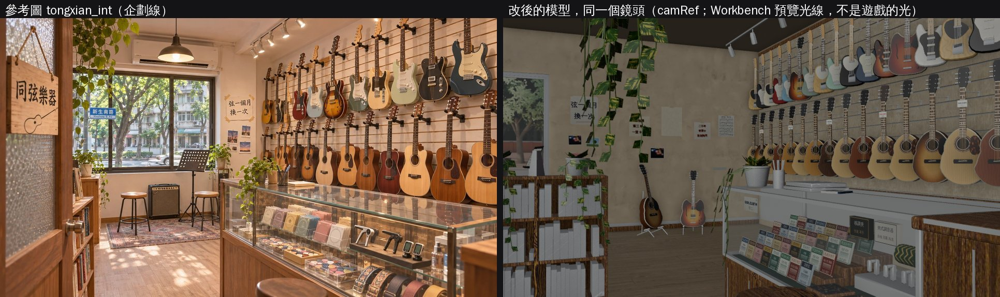
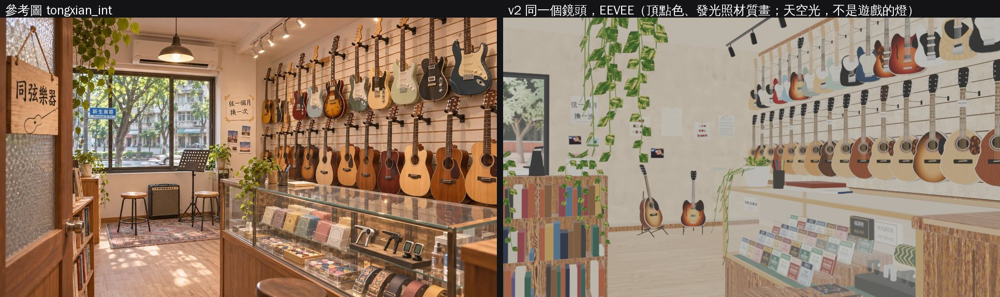

# GUITAR-SHOP-ZONE-1105：吉他店「同弦樂器」走得進去（區域 xs_tongxian）

LAWWW2-C，2026-11-05。LAWWW-C 11-05 00:43Z 派的（X196，P2；使用者 11-03「安排一家吉他店」；企劃 AA_619 第 1、4 節，企劃線 22a6c4d43）。D108：場景程式歸 LAWWW2。

狀態：**MODEL_READY**（區域、導航、樓梯間）。Node 測試都過了；瀏覽器還沒跑（D131）。

- v1（a353148b7）LAWWW-C 已經接進開發分支 1a67c9947。
- v2（這一版）是 BB-C 11-05 01:39Z 三點的修改，再加上我重拍時發現的 v1 兩個錯。換檔方法見「v2 接法」。
- 店內是 CC（帳號 A）的 tongxian.glb v4d，還在等 BB 照 D132 代驗。
- 選單和台詞（看看、試彈、買東西、老闆、打烊請你出來）是 LAWWW 的，這一包沒做。

## v2（BB-C 01:39Z 三點＋v1 的兩個錯）

### 玩家會看到什麼不同

1. **店內木地板變淺（D112）**：
   - CC 給的 #c49c70（L* 67）改成 #d6bc96（L* 78）。BB 看起來是「中間偏深的咖啡色」，也比其他淺色木地板深（溫州街店內 #cdb594 L* 75、總圖人字拼 #dcc39c L* 80）。
   - 只換 GLB 裡那一張顏色貼圖。工具 `tools/blender/env_second/glb_tint_image.py`，做法和 `b3lib.img_adj(target=)` 一樣：從 Poly Haven 原圖重算，紋路保留、平均色＝目標色。
2. **門外的平台、樓梯口兩側改磨石子**，和樓梯同一種：
   - 店門口加一條淺灰石頭門檻，平台邊加一條止滑條。
   - 店內木地板在樓梯間整塊挖掉（x −3.2～−1.14、z 1.0～5.2），兩個模型的地板不疊在一起。
3. **左牆的黑方塊不是缺貼圖**：
   - 是我 v1 的預覽只顯示到發光貼圖。便條紙、照片那幾格的發光是黑的，預覽就變成黑方塊。
   - 模型的底色貼圖裡是三張照片、手寫「弦一個月換一次」、課程公告、樂譜，遊戲和 CC 的 Cycles 渲染都看得到。
   - 下面的圖都用修好的預覽工具重拍。
4. **v1 我自己的錯一：牆看不到**。
   - 樓梯兩側的腰牆、牆，和二樓樓梯間的西牆，正面朝外。
   - 牆是單面材質，遊戲裡從樓梯看過去會被剔除，看到的是牆後面的黑。
   - v1 的預覽（Blender Workbench）不剔除背面，所以沒看出來：v1 的 cmp_door、stair_views 和遊戲裡不一樣。
   - 現在牆面翻正，預覽也照遊戲剔除背面。
5. **v1 我自己的錯二：疊面閃爍**。
   - v1 在樓梯兩側牆頂各放了一條實心頂（y −0.02～0），和店的地板同高。
   - 店裡 x −3.07～−2.95、−1.45～−1.33、z −2.0～1.0 那兩條會疊面閃爍。
   - v2 拿掉。











### 給 BB：參考圖、鏡頭（D133 疊圖）

- 參考圖：`docs/story_planning/ref_images/shops/tongxian_int.webp`（1672×941；外觀是 `tongxian_ext.webp`）。在企劃線 `claude/cool-heisenberg-o8kuqx`，AA 6d5116261。
- 鏡頭位置：`src/data/tongxian_layout.js` 的 `shop.camRef`，遊戲座標。
  - 眼睛 (−0.36, 1.17, 2.9)，看向 (1.58, 1.207, −1.71)。
  - 焦距 34.4 mm（感光元件寬 36 mm），水平視角 55.3°。
- CC 自己的對照（v4c）在 cc-local 的 `docs/story_planning/CC/shots/model/tongxian/`：
  - `tongxian_v4c_ref_vs_render.jpg`、`tongxian_v4c_refmatch_cmp.jpg`、`tongxian_v4c_refmatch_report.json`（五項 PASS）。
  - v4d 只換窗外的景，沒有另做對照。
- 這個鏡頭下，窗在畫面最左邊，大半在畫面外。參考圖的窗和試琴角在畫面左半邊。
  - 原因：CC v4c 把窗搬到外觀開窗的位置（x −3.0～−0.4），試琴角跟著搬。這是 CC 的設計，我沒改。
  - 對不對參考圖由 BB 判。



### 工具

- **`tools/blender/env_second/glb_floor_hole.py`（改）**：
  - 洞可以碰到地板外緣。
  - 從外框重切：輸入可以是原本的方塊，也可以是已經挖過的。
  - 換掉的網格資料寫回時拿掉（`compact`）。
  - 只有這個網格自己用的 accessor 才原地換。
    - CC 的匯出把地板和吉他牆灰泥（`WALL_right_plaster`）的方塊索引合成同一個。
    - 我這次第一個版本原地換，弄壞了灰泥的索引；Blender 匯入時報錯，所以發現了，那一版沒有交出去。
    - 測試 ⑨ 加了 GLB 索引檢查，抓得到這個錯。
- **`tools/blender/env_second/glb_tint_image.py`（新）**：把 GLB 裡一張顏色貼圖校正到另一個平均色。
- **`tools/blender/env_second/glb_preview.py`（新）**：Workbench 快速預覽，和遊戲看得到的一樣。
  - 單面材質剔除背面。
  - 顏色用底色貼圖。
  - 不畫 Workbench 的陰影：它會在三角形的邊上漏出細亮線，看起來像牆有縫。
  - `flat` 光線只看底色。
- `tools/blender/env_second/tongxian_stair.py`：平台、窄條、門檻；牆面翻正；拿掉牆頂兩條。2,644 三角形（v1 2,544）、304 KB。

### 測試（`node tests/tongxian_unit.js`，在開發分支 ed7600ec5＋v1 的 patch＋v2 的檔上）

⑨ 的模型檢查換成六項。用 v1 的兩個 GLB 跑會 FAIL 4（新的檢查抓得到 v1 的錯），v2 ALL PASS：

| 檢查 | v1 | v2 |
|---|---|---|
| 店內木地板鋪滿店裡、樓梯間裡沒有木地板 | FAIL（樓梯間有木地板 112 點） | PASS |
| 平台、樓梯口兩側是磨石子；樓梯口空著；樓梯間的模型在店裡沒有 y 0 的朝上面（不疊面） | FAIL（平台 0/96、店裡 7） | PASS |
| D112：木地板貼圖平均色 L* ≥ 72 | FAIL（67.0） | PASS（77.6） |
| 樓梯兩側的牆、二樓西牆正面朝樓梯間 | FAIL（朝內 0.12／0.12／0 m²） | PASS（25.4／25.4／13.4） |
| 兩個 GLB 每個網格的索引都在頂點數裡面 | PASS | PASS |
| 22 階 | PASS | PASS |

其他 20 支（新生南路、溫州街、公館的店、座位、出入口等，和 v1 同一組）ALL PASS。

### v2 接法（LAWWW-C：v1 已經在 1a67c9947，這次只換檔＋LICENSES 兩列）

```
git checkout baaef5e54 -- assets/models/env/second_ai/bb_support/tongxian.glb assets/models/env/second_ai/bb_support/tongxian.json \
  assets/models/env/second_ai/tongxian_stair.glb assets/models/env/second_ai/tongxian_stair.json \
  tools/blender/env_second/tongxian_stair.py tools/blender/env_second/glb_floor_hole.py tools/blender/env_second/glb_tint_image.py \
  tools/blender/env_second/glb_preview.py tests/tongxian_unit.js src/tongxian3d.js
git apply docs/art-rebuild/second_ai/wip/tongxian_zone_1105/tongxian_v2_licenses.patch   # 在 9e99d4977 上乾淨
node tests/tongxian_unit.js
```

`src/tongxian3d.js` 只改了開頭的說明和 ASSETS 的 source 字串。

### CC 重新匯出店內時（帳號 A：只用 GitHub 交接，D75）

- `tongxian_interior.py` 的 `floor` 改成 `target='#d6bc96'`。
- 再跑一次：`glb_floor_hole.py 輸入 輸出 tx_floor -3.2,-1.14,1.0,5.2`。
- 也寫在 `tongxian.json` 的 `post`。

### 還沒做、還沒驗

- 瀏覽器（D131）：遊戲光線下的地板顏色、磨石子平台、牆看不看得到，等 CC 拍（BB-C 說 LAWWW-C 接好以後 CC 會拍）。
- 預覽是 Workbench 的光線（STUDIO、flat），不是遊戲的燈。
- ART_APPROVED 由 BB 判（D120／D128）。

## BB-C 判定（11-05 02:08，D132 代驗）

- 樓梯間、門外平台（磨石子、門檻）、店內地板 #d6bc96：**PASS**。01:39 那一次的 PASS 作廢（看的是 v1 錯的預覽）。
- 店內和參考圖（D133）差太多。這件排成 TONGXIAN-REF-1105（P2，不擋 v9.10.20）：
  - 這個鏡頭下，窗只剩最左邊一條；
  - 試琴角不在畫面裡；
  - 左前方是一排書架。
- 「左前方一整塊白的書架」是我的預覽又一個問題：Workbench 的貼圖模式不顯示頂點色，書是頂點色材質（tx_vc，14 種顏色）。
  - 下面是 EEVEE 照材質畫的，書脊有顏色。
  - 預覽工具加了 `eevee` 模式。
  - 書架位置、大小和參考圖不一樣，這一點還是要改。



## v1（a353148b7）

（下面是 v1 的說明。裡面的圖已經換成 v2 的，v1 的樣子看上面的對照圖。）

## 玩家會看到什麼

- 新生南路那一排的「同弦樂器（吉他行（二樓））」店門，從「看櫥窗」變成「進同弦樂器（吉他行（二樓））」。
  - xinsheng3d.js 原本就照 `Z3.ZONES['xs_'+id]` 判斷室內做好了沒，不用改。
- 進去站在店門內（樓梯上來的平台旁邊），面向店裡：東北邊是吉他牆和臨街的窗（參考圖的方向）。
- 店門外看得到樓梯間：
  - 平台旁邊的牆、扶手收進牆裡；
  - 22 階磨石子樓梯往下，一直到一樓騎樓的樓梯口。
  - 以前 CC 的模型樓梯間裡只有平的地板，門開著看出去是空的，西邊沒有牆。
- 座位三個：
  - 兩張試琴椅「試彈」，座面 0.6 m；
  - 櫃台前的木凳「坐下」，座面 0.66 m。
  - 都照座面抬高坐姿（lift，SIT-HEIGHT-1104 的做法）。
- 店門口的「下樓（回新生南路）」：站在騎樓的樓梯口外面、面向馬路。
- 營業時間（AA_619）：
  - 12:00～21:30，週一公休，颱風天關。
  - 時間外按店門：「同弦樂器 今天公休。下次開門：明天 12:00。」（和溫州街的店同一句 `PLACES.closedText`）。

（v1 當時的對照圖：CC 的模型門外是平地板、沒有西牆；v1 補了樓梯口、往下的樓梯、扶手、西牆。圖已換成 v2，見上。）


## 給 LAWWW：互動點的 id、label（選單、台詞照 AA_619 第 1、4 節接）

這一包只放座位和出口。看看、買東西的按鈕不放空的，和木曜日一樣交給你。

配置在 `src/data/tongxian_layout.js` 的 `shop.interact`，程式裡用 `TX3.INTERACT()` 拿：

| id | kind | label（草稿） | 位置 (x, z) | 備註 |
|---|---|---|---|---|
| `wall_n` | look_guitars | 看看（吉他牆） | (2.3, −2.6) | 面向東 |
| `wall_s` | look_guitars | 看看（吉他牆） | (2.3, −0.8) | 面向東 |
| `buy` | buy | 買東西（櫃台） | (0.25, 0.6) | 櫃台北段的玻璃櫃前 |
| `ukes` | look_ukes | 看看（烏克麗麗） | (−2.4, −2.95) | 西牆；AA_619 沒有這一句，要不要放你決定 |
| `try` | try | 試彈（試琴椅） | (−1.65, −3.3) | **不放按鈕**：兩張試琴椅中間，子晴 CG 的站位（`npc.ziqing_cg`） |

座位（這一包放了「坐下」的按鈕；`it.shop==='tongxian'`、`it.tongxian`＝下面的 id）：

| id | label | 位置 | 座面 |
|---|---|---|---|
| `try_w` | 試彈 | (−2.2, −4.05) | 0.6 |
| `try_e` | 試彈 | (−1.1, −3.85) | 0.6 |
| `counter_stool` | 坐下 | (0.42, 1.3) | 0.66 |

- 試彈：坐上試琴椅就是試彈。AA_619 的旁白「（你拿下一把，彈了社課教的 C 和弦……）」接在坐下以後（照木曜日 `STORY.onSeat` 的做法）。
- 老闆站的位置：`TX3.OWNER`＝(1.75, 1.0)、面向走道（−x）。在櫃台後面，從櫃台北端進去，測試走得到。
- 打烊時人還在店裡「請你出來」：照 `mokuyobi_sys3d.js`。出來的點用 `TX3.streetOut()`。

## 改了什麼

### 新檔

- **`src/tongxian3d.js`**：區域 `xs_tongxian`。
  - 用 `Z3.room`。導航照配置的 blocks；店門內那一條放寬，見下面。
  - 座位、出口；店內、樓梯間兩個正式模型（`bldg.xs_tongxian`、`bldg.xs_tongxian_stair`）；燈罩的 GLOW_ 合成光暈（`Z3.glowBatch`）。
  - 載入前、載入失敗：room() 的牆、地板、家具色塊（D38 ③）。
- **`src/data/tongxian_layout.js`**：CC 的配置，填了 `exit`、`enterAt`，座位、互動點加 `id`。
- **`assets/models/env/second_ai/bb_support/tongxian.glb`**（＋.json）：CC 的 v4d，只在樓梯口把地板挖洞。
  - 工具：`tools/blender/env_second/glb_floor_hole.py`。
  - 只換 `tx_floor` 一個網格；其他網格、材質、instancing 不動；木紋 UV 照原本的對應；重跑不會挖兩次。
- **`assets/models/env/second_ai/tongxian_stair.glb`**：樓梯間。
  - 腳本：`tools/blender/env_second/tongxian_stair.py`，2,544 三角形、295 KB。
  - 22 階 0.191 m、踏面 0.27 m，從平台（y 0）到騎樓（y −4.2，新生南路一樓高）。
  - 寬 1.5 m，對齊外觀的樓梯門：x −2.95～−1.45。
  - 兩側灰綠腰牆（上緣順著樓梯斜線）、木扶手（收進西牆）、樓板下面的天花板、一樓樓梯口的門洞和騎樓的光。
  - 二樓樓梯間的西牆：CC 的模型沒有。
  - 兩盞吸頂燈。
- **`tests/tongxian_unit.js`**：見「測試」。

### 給 LAWWW 的檔（patch：`tongxian_zone_1105.patch`，在 ed7600ec5 上乾淨）

- `index.html`：在 `src/xinsheng3d.js` 後面載入 `src/data/tongxian_layout.js`、`src/tongxian3d.js`。
- `src/data/places.js`：
  - `names.xs_tongxian`＝同弦樂器；
  - `hours.xs_tongxian`：週二～週日 12:00–21:30、週一公休；
  - `typhoonShops` 加 `xs_tongxian`。
  - 為什麼寫在 places.js：places.js 在 index.html 裡比新生南路晚載入，區域檔裡補會來不及。
- `src/story3d.js`（onInteract 一行）：店門照開放時間擋，和溫州街的店同一句。颱風天用上面那一行通用的 `typhoonClosed`。
- `tests/seat_reach_unit.js`：多載入新生南路、同弦，三個座位也照座位測試檢查。
- `LICENSES.md`：同弦店內（CC，地板洞 LAWWW2-C）、樓梯間（LAWWW2-C）兩列。

### 區域 id 用 `xs_tongxian`（不是任務寫的 `tongxian`）

- 新生南路的店門程式照 `'xs_'+id` 找室內；照這個名字，店門不用改。
- 交宿舍梯子那一則訊息裡已經跟你說，沒回就照這樣。
- 另外：`shopenc3d.js` 的山嵐書店找的是 `Z3.ZONES['shanlan']`，和店門的 `xs_shanlan` 不一樣。山嵐做的時候兩邊要統一。

### 店門內那一條放寬

- room() 離牆 0.4 m 一律擋住。加上開著的門片（貼著 z 4.2），店門內只剩 0.5 m，人（直徑 0.64 m）過不去。
- 改成：門片北邊不動，南邊放到離南牆 0.2 m（x −1.0～0.68，到工作桌為止）。
- 照 CC 的 walkNote：店門進來往東、再往北。

### 樓梯不走

- 進出都在店門口，樓梯是看得到的那一段。
- 平台本身不開放走：樓梯間的東牆（有店門那一面）和店的西牆在 CC 的模型裡是同一個淡出網格。人站在平台上、鏡頭在店裡時牆不會淡出，會擋住人。
- 木曜日那種兩層、走得上去的樓梯，要等一樓的樓梯間模型（店的樓板下面那一段，這次只做到看得到的程度）和鏡頭的處理。要做再排。

## 接法（LAWWW-C）

```
git checkout a353148b7 -- src/tongxian3d.js src/data/tongxian_layout.js \
  assets/models/env/second_ai/bb_support/tongxian.glb assets/models/env/second_ai/bb_support/tongxian.json assets/models/env/second_ai/tongxian_stair.glb \
  tools/blender/env_second/tongxian_stair.py tools/blender/env_second/glb_floor_hole.py tests/tongxian_unit.js
git apply docs/art-rebuild/second_ai/wip/tongxian_zone_1105/tongxian_zone_1105.patch
node tests/tongxian_unit.js
```

- CC 之後重出 tongxian.glb 的話，地板要再挖一次：
  ```
  python3 tools/blender/env_second/glb_floor_hole.py 新的.glb assets/models/env/second_ai/bb_support/tongxian.glb tx_floor -2.95,-1.45,1.0,4.2
  ```
  測試第 ⑨ 項會抓到。
- 單檔版（build.py）照 index.html 的 script 順序，沒特別處理。

## 測試

都在開發分支 ed7600ec5＋這一包（Node，不是瀏覽器）：

- **`tests/tongxian_unit.js`：ALL PASS（15 項）**。用引擎真正的找路（E.pathTo）和移動碰撞（E.simWalk：人物半徑 0.32 m，dt 1/30 和 0.1，走路和跑步）：
  - ① 區域、兩個正式模型有登記。
  - ② 進來的位置站得住，離出口 0.85 m（出口範圍 0.7）。
  - ③ 三個座位的走近點（GAME.seatApproach 的候選）走得到；試琴椅、木凳照座面抬高（0.13、0.19）。
  - ④ 互動點（按鈕範圍 0.9 m 裡）、老闆站的位置走得到。
  - ⑤ 店裡（窗前）走得到出口；出口通到新生南路、面向馬路。
  - ⑥ 樓梯間站不住、走不進去。
  - ⑦ 新生南路那一邊：
    - 店門「進同弦樂器（吉他行（二樓））」→ xs_tongxian；
    - 出來的點站得住、離店門 1.7 m（範圍 1.4），不會一出來又看到「進」；
    - 走得到側門、走得回店門。
  - ⑧ 營業時間：週一 13:00 關、週二 12:00 開、21:30 關、11:54 關、週日開、颱風天（日曆第 757 天）關。
  - ⑨ 店內地板在樓梯口有洞；樓梯間 22 階對得上。
  - ⑩ index.html 載入順序；story3d.js 擋門那一行、places.js 的營業時間（patch 有沒有套）。
- **`tests/seat_reach_unit.js`（加了同弦）：ALL PASS**，同弦三個座位都碰得到「坐下」。
- 另外 19 支也 ALL PASS：
  - aa653_shops、aa655_wz_rename、bike_park_1104、bike_shop_park、calendar_hours、dl04b；
  - gg_interiors_1104、gg_shops2_1104、mokuyobi_aa618、offbeat_aa618、prop_restand、shop_rename_1104；
  - spawn_exit、wz_aa364_shops、wz_offbeat、wz_shops、xinsheng、quick_travel、mokuyobi。
- 沒跑：瀏覽器的 reachability_all.py、zone_transitions.py（D131，CC 的電腦）。

## 已知不足、沒測的

- **選單、台詞、老闆**：LAWWW（AA_619）。這一包只有座位和出口。
- **瀏覽器沒看過**。要 CC 拍：
  - 新生南路店門 → 進去；
  - 店裡白天、晚上；
  - 店門往外看樓梯間；
  - 試琴椅坐下；
  - 下樓。
- **CC 的店內**還在等 BB 代驗（D132）。
- **樓梯間的樣子 BB 判**：磨石子、灰綠腰牆、木扶手，和木曜日的樓梯間同一套。
- **窗景晚上沒有換**：CC 的窗景是道具圖集的一格（tx_props），晚上不能單獨調暗。照小路的做法要另外一張夜景圖。
- **樓梯不能走**：見上面「樓梯不走」。
- 一樓的樓梯口：外觀（xinsheng_street.glb）的樓梯門和這裡的樓梯口位置一樣（店面本地 x 1.45～2.95）；從騎樓看進去的樣子沒有對過，CC 拍了再看。
