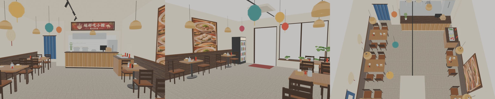
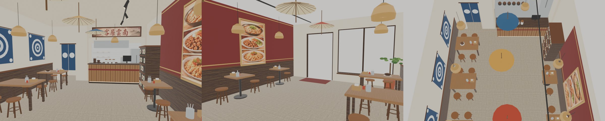
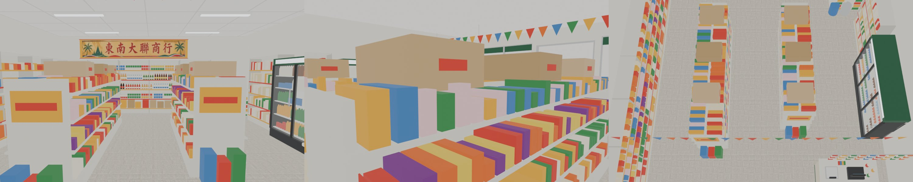

# 汀州路五間店的室內（TINGZHOU-SHOPS5-1110；LAWWW2-C 2026-11-12）——一間一件，做好一間交一間

- 使用者 11-12 03:5x（對 LAWWW-C）：外觀「你們自己決定」；04:1x（對我）：「沒做的快點阿」。
- 外觀第 2 版（五間直接臨人行道）帳號 A 11-10 已交（`wip/tingzhou_1110/README_v2.md`）；這裡只做室內。
- 做法照六間那一套（`wip/gg_shops6_int_1110/README.md`）：配置 `src/data/tz_shops_layout.js`、區域 `src/tz_shops3d.js`（不用改）、模型 `tools/blender/env_second/tz_shops_interior.py --shop <店>`、測試 `tests/tz_shops_unit.js`（配置裡每一間都測）。
- 使用者只給了五間的**外觀**概念圖（`ref/tingzhou_1110/concept/`），沒有室內圖；室內是照外觀看進去的樣子設計的。

| 店 | 區域 | 狀態 |
|---|---|---|
| 越好吃小館 | `tz_yuehaochi` | **第 1 版已交、已整合**（`tz5_yuehaochi_v1.patch`；LAWWW-C dev `4786cb89c`）；菜單貼圖小修併在客居雲南的 patch |
| 客居雲南 | `tz_keju` | **第 1 版已交**（`tz5_keju_v1.patch`） |
| 東南大聯商行 | `tz_dongnan` | **第 1 版已交**（`tz5_dongnan_v1.patch`） |
| 汀州聯通 | `tz_liantong` | 還沒做 |
| 溫特寶邸 | `tz_wente` | 還沒做 |

## 越好吃小館 第 1 版（D141 1／3）

上圖是 Blender 預覽（左：門口往內；中：櫃台往門口；右：俯視），**不是遊戲截圖**；沒有暖色的光。

- patch：`tz5_yuehaochi_v1.patch`（base＝開發分支 `85c51a05e`；含 GLB、貼圖集，`git apply --binary`）。
- 區域 `tz_yuehaochi`（6 × 9 m、高 3.2 m），模型 1.95 萬三角形、1.1 MB。
- 進出：汀州路店門口原本是「看越好吃小館」，有了區域自動變成「進越好吃小館」；店裡門口「離開越好吃小館」→ 汀州路 (−5.4, 29.0)。
- 內容：
  - 正面照外觀：左邊深木框大玻璃、中間偏右玻璃門、門口紅腳踏墊；窗邊大盆栽、窗台三小盆。
  - 左牆三張四人木桌、右牆兩張兩人桌，共 16 個座位；桌上筷子筒、面紙盒、是拉差、海鮮醬、檸檬辣椒小碟。
  - 兩側牆下半深木護牆板；左牆三頂斗笠、一幅藍染布；右牆照片菜單（外觀概念圖裁的）。
  - 後方木櫃台（正面竹條、底下燈條、收銀螢幕、外帶紙袋、小盆竹子）；後面開放式廚房（白磁磚、兩口大湯鍋、燙麵爐、排煙罩、冰箱、層架上的碗）；廚房上方店名匾（概念圖招牌裁的）。
  - 右牆櫃台前自助香草檯（九層塔、豆芽、檸檬、辣椒）；門邊玻璃門飲料冰箱。
  - 左後方藍染布簾的門（後面不能進去）。
  - 藤編吊燈六盞（概念圖有）、會安燈籠五顆、軌道燈。
- 給 LAWWW 接的互動點（現在各只有一句暫時的「看」）：

| kind | 位置 | 標籤 | 建議內容（請 AA 寫） |
|---|---|---|---|
| `tz_yue_order` | 櫃台前 (1.0, −1.75) | 點餐 | 河粉、春捲、法國麵包、越南咖啡的選單和價錢 |
| `tz_yue_menu` | 右牆菜單前 (1.75, 1.5) | 看菜單 | 一句 |
| `tz_yue_herbs` | 香草檯前 (1.85, −0.75) | 自助香草檯 | 一句（加九層塔、豆芽、擠檸檬） |
| `tz_yue_kitchen` | 櫃台左前 (−0.5, −1.8) | 看廚房 | 一句 |
| `tz_yue_hats` | 左牆 (−1.2, 1.75) | 看牆上的斗笠 | 一句 |

  - `zone.shopClerk`＝老闆站櫃台後面 (1.0, −3.4)；座位 `seat.table＝'yuehaochi_t<桌號>'`（1～5）。

### 驗證（Node，不用瀏覽器）
- `node tests/tz_shops_unit.js`：ALL PASS（越好吃 11 項：店門通得到、出來站得住、16 個座位和 5 個互動點走得到、家具站不進去、店員在櫃台後、模型和資產登記在）。
- 讀到店面配置、zone_assets、汀州路的 23 支 `*_unit.js`：全部 ALL PASS。
- 全部 Node 測試沒有另外跑（和 ECON-NAV-TRAPS 那一輪同時在做）。

### 先將就的
1. 室內不是照使用者的圖（她沒給室內圖），是我設計的；她看了不對就改（還有兩版）。
2. Blender 預覽沒有暖色光；遊戲裡區域開了暖色，實際顏色等 CC 拍。沒有光照貼圖。
3. 照片菜單、店名匾是從外觀概念圖裁的小圖放大，近看糊。
4. 斗笠、燈籠、鍋子是簡單的形狀；藍染布、布簾是平的色條。
5. 桌上沒有餐點；窗外沒有景。
6. 汀州路上的外觀模型這一間的玻璃裡面是不是和室內對得上，沒有比過。
7. 瀏覽器沒跑（D131）：請 CC 拍門口往內、櫃台往門口、坐下來的鏡頭，白天、晚上。

## 客居雲南 第 1 版（D141 1／3）

上圖是 Blender 預覽（左：門口往內；中：櫃台往門口；右：俯視），**不是遊戲截圖**。

- patch：`tz5_keju_v1.patch`（**套在越好吃小館那一個後面**；在開發分支 `2841eef02` 上 `--check` 通過；含 GLB，`git apply --binary`）。
- 區域 `tz_keju`（5.5 × 9 m、高 3.2 m），模型 1.57 萬三角形、0.97 MB。
- 進出：汀州路店門口自動變成「進客居雲南」；店裡門口「離開客居雲南」→ 汀州路 (−5.4, 23.25)。
- 內容：
  - 正面照外觀：左邊大玻璃、中間偏右玻璃門、酒紅腳踏墊、窗邊大盆栽。
  - 左牆三張四人木桌、右牆兩張兩人桌，全部是圓木凳（概念圖門口那種），共 16 個座位。
  - 右牆上半酒紅色、金色細線，掛照片菜單（概念圖裁的）；兩側牆下半深木護牆板。
  - 左牆三幅大理扎染布（靛藍底白圓紋）；天花板吊三把撐開的油紙傘；藤編吊燈六盞。
  - 後方木櫃台（疊著的小砂鍋、三罐配料、收銀螢幕）；後面開放式廚房（一排六口砂鍋爐、大湯桶、排煙罩、冰箱）；廚房上方店名匾（概念圖招牌裁的）。
  - 右牆櫃台前普洱茶餅櫃（立著的紙包茶餅、茶罐）。
  - 左後方扎染布簾的門（後面不能進去）。
- 給 LAWWW 接的互動點：

| kind | 位置 | 標籤 | 建議內容（請 AA 寫） |
|---|---|---|---|
| `tz_keju_order` | 櫃台前 (1.2, −1.75) | 點餐 | 過橋米線、米干、涼拌、普洱茶的選單和價錢 |
| `tz_keju_menu` | 右牆菜單前 (1.45, 1.45) | 看菜單 | 一句 |
| `tz_keju_tea` | 茶餅櫃前 (1.6, −0.75) | 看茶餅櫃 | 一句 |
| `tz_keju_kitchen` | 櫃台左前 (−0.25, −1.85) | 看廚房 | 一句 |
| `tz_keju_batik` | 左牆 (−0.85, 1.7) | 看牆上的扎染布 | 一句 |

  - `zone.shopClerk` (1.0, −3.4)；座位 `seat.table＝'keju_t<桌號>'`（1～5）。
- **順便修越好吃小館**：照片菜單的貼圖比貼圖集高（640 > 512），菜單最下面一截貼錯。縮成 216 × 480 重建；只換 GLB 和貼圖集，配置沒動。

### 驗證
- `node tests/tz_shops_unit.js`：ALL PASS（九間）。
- 讀到店面配置、zone_assets、汀州路的 23 支 `*_unit.js`：全部 ALL PASS。全部 Node 測試沒有另外跑。

### 先將就的
1. 室內是我設計的（沒有室內參考圖）；Blender 預覽沒有暖色光、沒有光照貼圖。
2. 照片菜單、店名匾從外觀概念圖裁的小圖放大，近看糊。
3. 扎染布的花紋是同心圓和四個小圓，簡單；油紙傘沒有畫花；茶餅是素面圓餅。
4. 圓凳沒有靠背，坐姿用一般椅子的坐姿（沒在遊戲裡看過穿不穿）。
5. 桌上沒有餐點（只有兩桌放一只砂鍋）；窗外沒有景。
6. 瀏覽器沒跑（D131）：請 CC 拍門口往內、櫃台往門口、坐在圓凳上，白天、晚上。

## 東南大聯商行 第 1 版（D141 1／3）

上圖是 Blender 預覽（左：門口往內；中：貨架頂上往門口，鏡頭在貨架裡；右：俯視），**不是遊戲截圖**。

- patch：`tz5_dongnan_v1.patch`（接在 `tz5_keju_v1.patch` 之後套；含 GLB、貼圖集，`git apply --binary`）。
- 區域 `tz_dongnan`（7.5 × 9 m、高 3.1 m），模型 5.3 萬三角形、4.2 MB（貨架上的瓶子、罐頭多）。
- 進出：汀州路店門口自動變成「進東南大聯商行」；店裡門口「離開東南大聯商行」→ 汀州路 (−5.4, 16.75)。
- 內容（東南亞食品雜貨店，沒有座位）：
  - 正面照外觀：中間玻璃門、兩邊整面玻璃，玻璃上緣一條墨綠（外面雨棚的顏色）。
  - 左牆整面貨架：上面三層泡麵、下面兩層大包零食。
  - 後牆整面貨架：紙箱和大鐵罐、罐頭、兩層瓶子（魚露、醬油、辣醬）；上面黃底紅字店名（概念圖招牌裁的）。
  - 中間兩排雙面貨架，架頂疊紙箱，朝門口那一頭有特價牌和一箱箱飲料。
  - 右牆：乾貨貨架（河粉、米紙、香料包）、三門玻璃飲料冰箱；右後角一疊疊米袋和兩個大桶。
  - 右前方收銀台：收銀機、電子秤、糖果罐、口香糖；上面一根桿子掛一串串零食；店員後面牆上小架子和月曆。
  - 左前窗邊紅藍塑膠籃；上面掛兩盞藤編燈罩和一頂斗笠（概念圖門口左邊）。
  - 橫過走道的一串三角旗、牆上時鐘、格柵天花板和日光燈。
- 給 LAWWW 接的互動點：

| kind | 位置 | 標籤 | 建議內容（請 AA 寫） |
|---|---|---|---|
| `tz_dongnan_counter` | 收銀台前 (2.3, 1.55) | 結帳 | 買東西的選單和價錢（泡麵、零食、飲料） |
| `tz_dongnan_noodle` | 左牆貨架前 (−2.65, 0.2) | 看泡麵和零食 | 一句 |
| `tz_dongnan_sauce` | 後牆貨架前 (−0.2, −3.4) | 看醬料和罐頭 | 一句 |
| `tz_dongnan_drink` | 冰箱前 (2.45, 0.0) | 飲料冰箱 | 一句或買飲料 |
| `tz_dongnan_rice` | 右後角 (2.3, −2.4) | 看米和乾貨 | 一句 |

  - `zone.shopClerk`＝店員站收銀台後面 (2.5, 3.3)，面向店裡。

### 驗證（Node，不用瀏覽器）
- `node tests/tz_shops_unit.js`：ALL PASS（含東南大聯商行：店門通得到、出來站得住、5 個互動點走得到、家具站不進去、店員在櫃台後、模型和資產登記在、牆面平塗、天花板單面）。
- 讀到店面配置、zone_assets、汀州路的 23 支 `*_unit.js`：全部 ALL PASS。全部 Node 測試沒有另外跑。

### 先將就的
1. 室內是我照外觀設計的（使用者沒給室內圖）；不對就改（還有兩版）。
2. 貨架上的商品是純色的盒子、瓶子、罐頭，沒有包裝圖案和字；近看像積木。
3. 模型 4.2 MB，比其他幾間大（瓶罐多）；手機載入時間沒量。
4. 店名招牌是外觀概念圖裁的，近看糊。
5. 沒有光照貼圖；冰箱燈箱只是發光面。
6. 外觀概念圖門口的鐵網架、戶外的籃子在街上的外觀模型，室內沒有重複放；玻璃裡外對不對得上沒比過。
7. 瀏覽器沒跑（D131）：請 CC 拍門口往內、收銀台、後牆貨架，白天、晚上。
