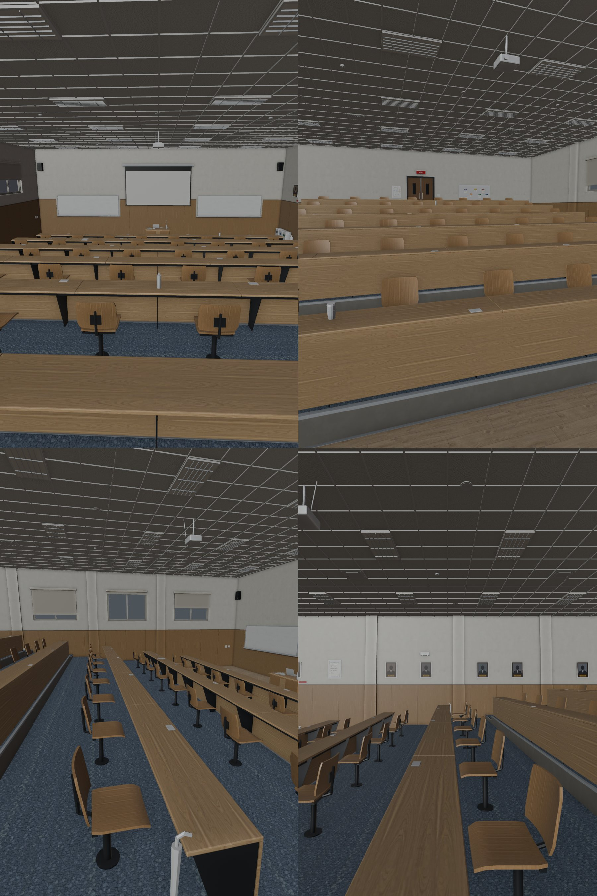
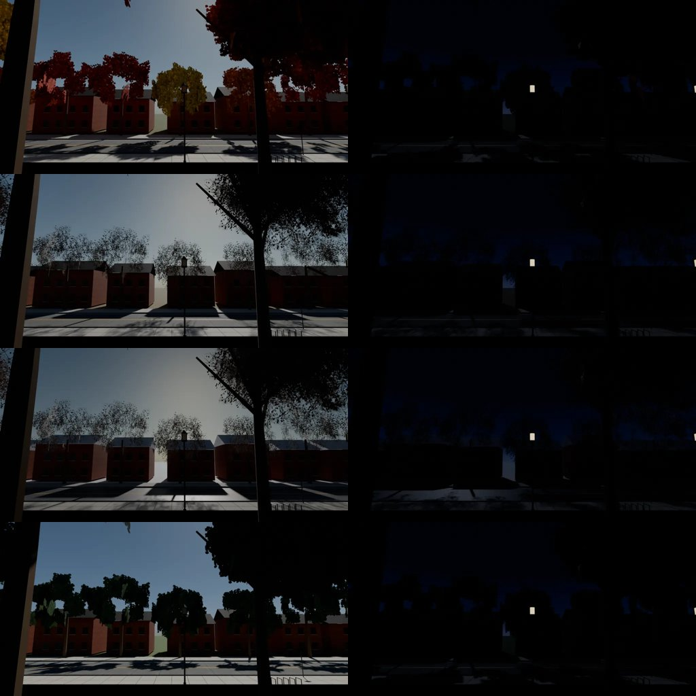

# US-CLASSROOM-3D-1110：美國法學院 Room 120 階梯教室（3D）— LAWWW2 帳號 A，2026-11-10

- 狀態：`MODEL_READY`＋區域接好（第 1 版），交給 LAWWW 整合。場景美術由 BB 判（D128）。以開發分支 `8b31bbaa0` 為底。
- 規格：AA_740（企劃線 `961025d4c`）＋LAWWW 11-10 14:42 派工：
  - 照 201 的做法：6 排×8 席，48 個位子都能坐；
  - 外觀是美國法學院，灰藍地毯（D112：不用深色木地板）；
  - 教室裡不放學姊。
- 分工：模型、layout、區域接線（D108）是 LAWWW2 做的；劇情接線由 LAWWW 做（一鍵上課淡入、字幕、門口「現在沒有課。」、期中和期末報告的站位）。
- 遊戲截圖請 CC 拍（D131）。建議拍三個角度：
  1. 門口往講台看（白天）；
  2. 第 1 排往後看；
  3. 窗邊（看窗景，白天和晚上各一張）。
- 下面的圖是 Blender 預覽，不是遊戲畫面。預覽沒有打燈、不畫頂點色，所以天花板看起來偏暗。

## 玩家會看到什麼
- 一間美國法學院的階梯教室：
  - 灰藍色地毯；
  - 淺色木頭長桌，每個座位一個插座；
  - 淺色木頭翻椅，有黑色鐵腳；
  - 木腰牆，上面是米白色的牆。
- 前面：
  - 兩塊白板，有筆槽、白板筆、板擦；
  - 中間是投影幕，天花板吊一台投影機；
  - 講台和講桌在正中間。左邊白板上的字由遊戲畫（`z.setBoard`），預設是 Comparative Constitutional Law。
- 東牆掛六幅歷任院長肖像。肖像只有剪影和年份，沒有名字。
- 牆上貼的都是虛構的英文東西：教室規則、ROOM 120 FALL 課表、座位表、滅火器標示、垃圾和回收分類、傳單。
- 西牆有三扇高窗和捲簾。窗外是美國校園正式模型（us_campus.glb）渲染的照片：
  - 四季（summer、autumn、bare、snow）各有白天和晚上，共 8 張；
  - 照 `US3.usSeasonKey()` 的日子換，和校園模型同一天換季。
- 南面是雙開門和 EXIT 燈。

## 做法
- `src/data/us_classroom_layout.js`（新）：
  - 和 201 的 `classroom_layout.js` 同樣的欄位：排、平台高、走道、座位；
  - 另外有：
    - 講桌、教授站位和來回走的兩端（`teacher.walk`）；
    - 白板、投影幕、窗、門；
    - 報告站位（`present`）、期末考監考位置（`exam`）；
    - 三門課的座位（`seatPlan`）。
- `src/us_classroom3d.js`（新）：
  - 區域 `us_classroom`，導航、平台、座位、互動點、程序化備用模型的寫法照 201；
  - 正式模型載入以後用 `Z3.attachRoomGLB` 接上；載入失敗就用備用模型，一樣可以走、可以坐。
  - 對外：
    - `US_CLASSROOM.SPAWN`（門口，最上面那一排）、`US_CLASSROOM.viewKind()`；
    - 區域上的 `z.seatOf(course,key)`、`z.others(course)`、`z.present`、`z.examProf`、`z.teacherSpot`、`z.teacherWalk`、`z.setBoard(title,l1,l2)`。
  - 出口「離開教室」→ us_campus 的 `spawn_class_out`（台階下）。
- `tools/blender/env_second/us_classroom.py`（新，從 `tools/blender/classroom_201.py` 改）→ `assets/models/env/second_ai/us_classroom.glb`：
  - 62 個網格、約 62,000 個三角形、29 個材質、3.6 MB；
  - 48 張椅子的位置讀同一份 layout。
- `tools/blender/env_second/us_classroom_view.py`（新）→ `assets/models/env/views/us_cls120_<季節>_{day,night}.webp`：
  - 鏡頭在法學院東翼外，二樓窗口高度，往南看：看得到馬路和對面的紅磚老建築；
  - 第一次拍時，x 12 的正前方剛好是一棵行道樹，樹幹擋在畫面中間；改成 x 16.8，在兩棵樹中間，重拍了。
  - 看得出來的缺點：
    - snow 那一張和 bare 幾乎一樣：美國校園模型的雪景只換了少數材質，地上沒有積雪；
    - 晚上那幾張很暗，只看得到幾扇亮的窗。
    - 這兩點請 BB 判；要改，就改 us_campus.glb 的雪景或窗景的夜間曝光。
- `src/assets3d.js`：加 `bldg.us_classroom`，接在 `bldg.us_lawlib` 後面。
- `src/data/zone_assets.js`：用 `node tools/gen_zone_assets.js` 重新產生，新增 `us_classroom`。
- `index.html`：在 us3d.js 後面加兩個 script。
- `LICENSES.md`：加一列。模型和窗景是本作；地毯、木頭、牆、天花板貼圖是 Poly Haven，CC0。

## 座位（AA_740 第 2 節；寫法 [排, 欄]：排 0 是最前面，欄 0 是面向講台最左邊）
| 課 | 玩家 | 有名字或固定的人 | 路人 |
|---|---|---|---|
| Introduction（intro） | [2,7]：第 3 排、右邊靠走道 | korean [3,7]：玩家正後方 | 28 人，前 5 排（全班 30 人） |
| Comparative（comp） | [0,4]：第 1 排、中間偏右 | german_before [1,7]：第 4 次以前，第 2 排最右邊 german_after [0,3]：`att.us_comp>=4` 起，坐玩家左邊 brazil [0,0]：第 1 排最左 japan [1,3]：第 2 排、玩家左後方 | 10 人，前 2 排 [0,7] 留給教授：期中和期末報告時她坐那裡聽 |
| Legal Writing（lw） | [1,4]：第 2 排、中間 | long_met [1,5]：見過他（MET_LONG），坐玩家右邊 long_unmet [0,4]：沒見過，坐玩家正前方 | 10 人，前 2 排（全班 12 人） |

- **報告站位（`present`）**：
  - 玩家站在講桌西邊 (−1.25, −6.0)，德國同學站在東邊 (1.25, −6.0)，兩人都面向同學（yaw 0）；
  - 教授的座位是 `professorSeat` [0,7]。
- **要請 AA 確認的一點**：AA_740 寫「玩家在右」。我照**玩家自己的右手邊**放（面向同學的右手＝−x）。
  - 但同一份文件的座位寫法是「左右＝面向講台」。如果「玩家在右」也是照台下看的方向，玩家應該站 +x。
  - 要對調，只改 layout 裡 `present.player.x` 和 `present.partner.x` 的正負號就好，測試不用改。
- **期末考監考**：教授站在講桌後面 (0, −7.1)。
  - 原本放在 −6.7，但講桌的導航格（0.5 m 一格）擋到那裡，測試抓到站不住；
  - 現在這個位置站得住。

## LAWWW 要接的（劇情接線，這個 patch 沒碰）
- **進來**：
  - 現在 us_campus 的「進教室」是 `it.usClass='law'`（`us_life3d.js` 第 267 行：有課就直接 2D 上課）。
  - 要改成：有課時 `exit:{to:'us_classroom',spawn:US_CLASSROOM.SPAWN}`，再走到 `z.seatOf(課,'player')` 坐下；
  - 沒課時照舊只說「現在沒有課。」。
- **一鍵上課**：淡出淡入以後，把玩家放在 `z.seatOf(課,'player')` 坐下；其他人放在 `z.seatOf` 的有名字的位子和 `z.others(課)`，人數在手機上可以減。
- **教授**：在 `z.teacherWalk` 兩端之間來回走（AA_740：待機動作就好，不能聊天）。
- **名字撞到 2D 背景**：2D 背景也有一個叫 `us_classroom` 的（`OUT.bg('us_classroom')`，迎新、國際學生辦公室、課堂都借用它）。
  - 兩個是不同的命名空間：區域在 `Z3.ZONES`，2D 背景在 OUT。
  - 如果有任何地方是用「目前的區域 id」去找 2D 背景，進 3D 教室時會拿到那張 2D 教室圖。這應該不會出錯，但提醒一下。

## 測試
- 新測試 `tests/us_classroom_unit.js`：照 index.html 的順序載入程式，在 Node 建出遊戲真正的區域，用 `E.simWalk` 模擬（dt 1/30、0.1，再加跑步 4.1 m/s）。檢查項目：
  1. **註冊**：
     - index.html 有載入兩個檔；
     - 6 排×8 席，一排高 30 cm，面向講台；
     - 48 個「坐下」。
  2. **走得到**：
     - 門口高 1.8 m、站得住；
     - 48 個座位坐下前站的位置（椅子後面 0.6 m）站得住、在同一排平台上、從門口走得到；
     - 講台、教授來回走的兩端、報告站位、監考位置都站得住、走得到。
  3. **出口**：只有一個「離開教室」，到 us_campus 的 `spawn_class_out`；從座位走得回門口。
  4. **座位照 AA_740**：
     - 上面表格的每一位；
     - 人數和排數的限制；
     - 路人不坐有名字的人的位子，德國同學前後兩個位子都留著；
     - 教授的座位沒人坐；
     - 沒有學姊。
  5. **正式模型**：
     - manifest、zone_assets、GLB 檔都在；
     - GLB 裡 48 張椅面對得上配置的座位（離地 0.3～0.6 m）；
     - 牆和天花板圍出的大小和配置一樣（W×D×H）；
     - 地毯不是深色木地板（D112）；
     - 8 張窗景都在；
     - 窗景照 `US3.usSeasonKey()` 換。
- **結果**：
  - 開發分支 `8b31bbaa0`：**FAILED 4**（沒有這兩個檔、區域沒註冊）；
  - 套上 patch：**ALL PASS**。
- **第一次跑抓到兩個配置錯誤，改的是配置，測試條件沒有放寬**：
  1. Comparative 的路人坐在教授的座位 [0,7] → 從路人名單拿掉，Comparative 變成 14 個學生加教授；
  2. 監考位置貼著講桌、站不住 → 移到講桌後面。
- **回歸**：讀到 us3d、us_campus、zone_assets、index.html、ASSETS.manifest、Z3.ZONES 的測試，加上 nav_buildings_unit（201），共 360 支：359 支 ALL PASS（含新測試、zone_prefetch_unit、nav_us_unit、nav_buildings_unit）；另一支 pg_harness_jobs 是給別的測試 require 的輔助模組，沒有輸出，不算測試。見 `regression.log`。

## 整合
- `git apply --binary us_classroom_3d_1110.patch`，已確認可以套在 `8b31bbaa0` 上。
- 內容：
  - `src/us_classroom3d.js`、`src/data/us_classroom_layout.js`；
  - `src/assets3d.js`、`src/data/zone_assets.js`、`index.html`；
  - GLB、8 張窗景 webp；
  - 兩支 Blender 腳本、兩張自製貼圖（`textures/gen/usc120_*.png`）；
  - 新測試、`LICENSES.md`。

## 沒做、沒測的
- 瀏覽器裡的畫面（D131）：要請 CC 拍。
- 手機效能：3.6 MB、約 62,000 個三角形，和 201（classroom_201.glb）同一個等級。
- 光照烘焙：沒做，和 201 第一版一樣，用遊戲的燈。
