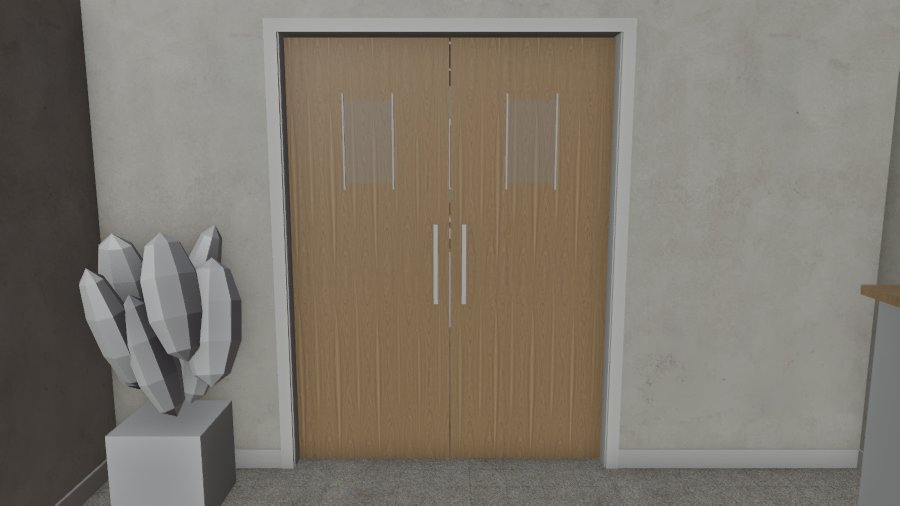

# US-CLUB-LOUNGE-CLOSE-1110：會所交誼廳的門關著（12/14 晚上沒排晚餐）— LAWWW2 帳號 A，2026-11-10

- 狀態：做好，交給 LAWWW 整合。以開發分支 `ba066c2d5` 為底（已經有會所）。
- 派工：LAWWW 11-10 17:15。AA 定：12/14 晚上 18:30～21:30 沒排晚餐的玩家走進會所，交誼廳的門關著；門廳、自習室照常。

## 玩家會看到什麼
- 門廳往交誼廳那個 1.6 m 的口，關著兩扇淺色木門：上半截有一小塊玻璃窗，兩扇各一支直的拉把，兩面都有。
- 門廳這邊走到門前，有一個「交誼廳」的「看」，字是「今晚交誼廳有聚餐。」（LAWWW 給的字）。
- 門廳、自習室照常走得到。

## 做法
- `tools/blender/env_second/us_clubhouse.py`：加 `LOUNGE_DOOR` 群組，重新匯出 `us_clubhouse.glb`。
  - 2.26 → 2.28 MB，多 3 個網格（門板、玻璃、拉把），其他網格頂點數不變。
- `src/us_clubhouse3d.js`：新增 `z.setLoungeClosed(on)`。
  - **true**：門板看得到；導航擋住門口；鏡頭牆多一片，鏡頭不穿過門；門廳這邊的「看」出現。
  - **false**：全部回到原本，導航和原本一格都不差。
  - **玩家已經在交誼廳裡**時不關，回傳 false，門照舊開著（D36：玩家一定離得開）。如果要等玩家出來再關，在玩家換區域或離開交誼廳時再叫一次。
- `tests/us_clubhouse_unit.js` 第 5 項改成：平常看得到的「看」只有櫃台；交誼廳那一個平常藏著，字一定是 AA 定的那一句。
  - 這是需求變了（多了一個 AA 定的字），不是放寬。

## LAWWW 要接的
- `USL.dinnerNight` 那一段：玩家走進會所時呼叫 `GAME.E.zone.setLoungeClosed(true)`。
- 時段過了或下一次進來時，呼叫 `setLoungeClosed(false)`；換區域時區域會重建，預設就是開著。

## 測試
- 新測試 `tests/us_club_lounge_unit.js`：在 Node 建出會所，接上真的 GLB（貼圖拿掉），用 E.simWalk 模擬走路。檢查：
  - 平常走得進交誼廳；
  - 關門：交誼廳走不到、門廳和自習室走得到；「看」和門板出現、鏡頭牆多一片；
  - 開門：導航一格都不差；
  - 玩家在交誼廳裡時不關；
  - GLB 的門板擋滿門口。
- 結果：
  - 開發分支 `ba066c2d5`：**FAILED 1**（沒有 setLoungeClosed）；
  - 套上 patch：**ALL PASS**。
- 回歸：會所、zone_assets、zone_prefetch、nav_us 相關的 11 支全部 ALL PASS，見 `regression.log`。

## 整合
- `git apply --binary us_club_lounge_close_1110.patch`。
