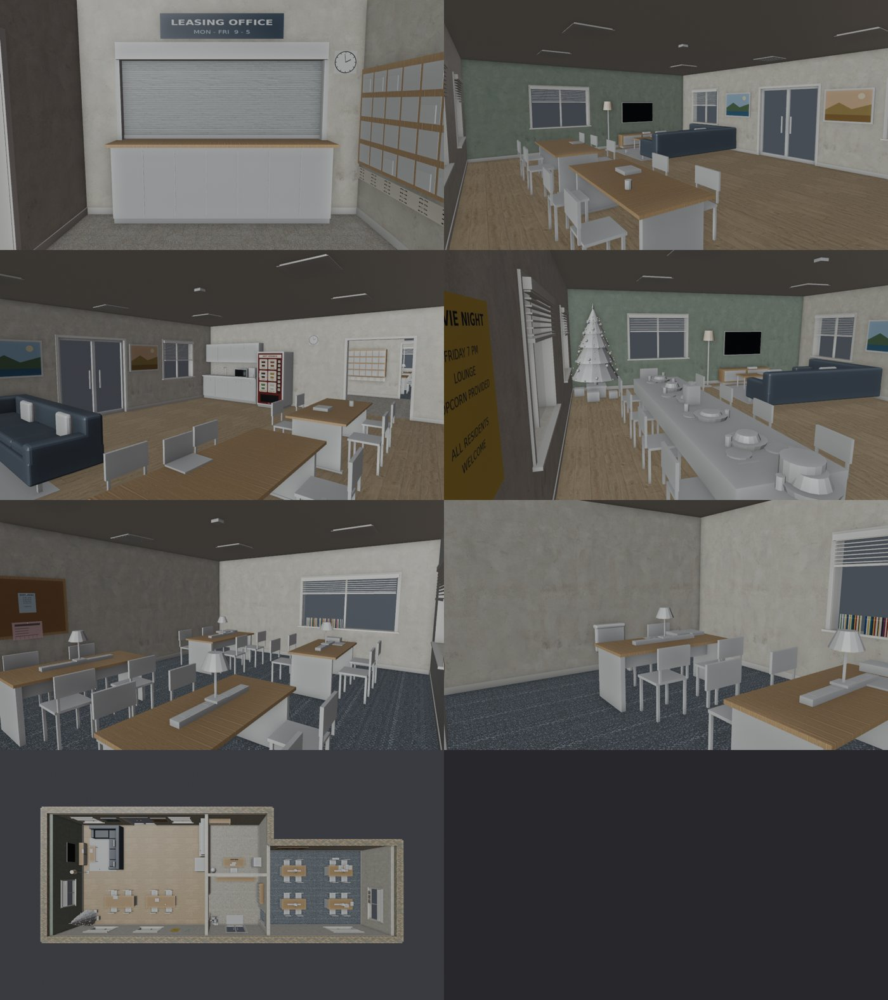
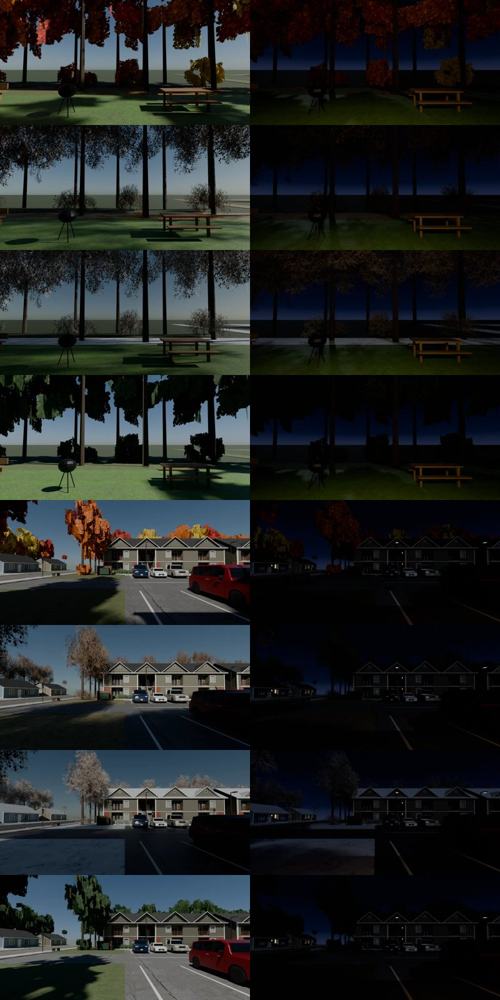

# US-CLUBHOUSE-3D-1110：美國社區會所的室內（門廳＋交誼廳＋自習室，3D）— LAWWW2 帳號 A，2026-11-10

- 狀態：`MODEL_READY`＋區域接好（第 1 版），交給 LAWWW 整合。場景美術由 BB 判（D128）。以開發分支 `01bab1823` 為底（已經有美國教室）。
- 規格：AA_741（企劃線 `bd4f5df43`）＋LAWWW 11-10 14:43 派工。
- 分工：模型、配置、區域接線（D108）是 LAWWW2 做的；劇情接線由 LAWWW 做（讀書、招呼、旁白、五場事件、晚餐）。作息、台詞都沒改。
- 遊戲截圖請 CC 拍（D131）。下面的圖是 Blender 預覽，不畫頂點色，所以椅子、聖誕樹、沙發抱枕看起來是白的，遊戲裡有顏色。

## 玩家會看到什麼
- **門廳（4×4）**：
  - 磨石子地磚、兩扇鋁框玻璃大門（關著）、深灰色腳踏墊；
  - 社區辦公室的櫃台（LEASING OFFICE MON–FRI 9–5）：
    - 平日 09～17 窗口開著，看得到辦公桌、電腦、檔案櫃、資料夾；
    - 其他時間拉下鐵捲百葉；
  - 東牆木頭信件架（格子上是 A1～D6 這種虛構編號）、盆栽、時鐘。
- **交誼廳（10×8）**：
  - 淺色木地板（D112）、西牆一面灰綠色的牆＋55 吋電視；
  - L 型藍灰色布沙發、茶几、地毯、落地燈；
  - 東牆小廚房：白色櫥櫃、灰色檯面、水槽、微波爐、吊櫃、咖啡機；
  - 熱飲販賣機（HOT DRINKS：COFFEE、MOCHA、COCOA……，沒有品牌）；
  - 北牆通後面草地的鋁框玻璃門，關著；
  - 牆上：電影之夜、回收的傳單，兩幅風景畫。
  - **兩張長桌**：
    - 平常分開（中間 0.9 m），8 張椅子；
    - 12/14 晚餐併成一張，10 張椅子、白色桌巾、每個位子一套碗盤、桌子中間一排菜、一鍋、一盒果汁。
  - **聖誕樹**（西南角）：12/1 起放，晚上亮燈。
- **自習室（8×6）**：
  - 灰色地毯；
  - 四張長桌，一張四席，共 16 席；每張桌子中間一條插座盒、一盞檯燈、一片擋板；
  - 北牆軟木公布欄，上面有幾張紙和 QUIET HOURS 告示；
  - 東牆和南牆的窗（東南那張桌子＝「靠窗那張」），窗台上有書；
  - 門口上面有 STUDY ROOM / QUIET PLEASE 的牌子。
- **窗外**：
  - 後面（北牆的玻璃門、東西牆的窗）：修剪過的草地、黑色烤肉架、野餐桌、長椅、後面的樹林；
  - 正面（南牆的窗）：門廊、社區的停車場和車、對面的公寓。
  - 兩組都是用社區的正式模型拍的，四季、白天和晚上各一張，照 `US3.usSeasonKey()` 換。

## 平面配置（AA_741 第 1 節）
- 門廳 x −1～3、z 0～4；大門在南牆 x 0.3～1.7。
- 交誼廳 x −11～−1、z −4～4；從門廳往西，門口寬 1.6 m、沒有門板。
- 自習室 x 3～11、z −2～4；從門廳往東，木門開到底、貼著牆。
- 辦公室 x −1～3、z −4～0：在櫃台窗口後面，走不進去。
- 外觀和室內大小不一樣：
  - 社區模型的會所外觀是 13×7.6 m，室內照 AA_741 的大小，是 22×8 m。
  - 玩家在室內看不到外觀，兩邊不會同時比對到。要一致的話，改社區的外觀。

## 座位、人、劇情站位（AA_741 第 2～4 節；配置的 `seats`、`npc`、`events`）
| 誰／哪一場 | 位置 |
|---|---|
| 舊序章人物己 | 自習室東南那張桌子（靠窗）南邊東側 `st_SE_s1`；旁邊 `st_SE_s0` 空著 |
| 學姊 | 自習室東北那張桌子（離自習室的門最遠）北邊東側 `st_NE_n1`，背對北牆；旁邊 `st_NE_n0`：交往中空出來，挽回中放她的外套 |
| 辦公室的人 | 櫃台後面 (0.9, −0.35)：辦公室裡，不在導航上 |
| 交誼廳的住戶 | 沙發 `sofa_2`、長桌 `lt_A_n0`、販賣機前、微波爐前 |
| 自習室的住戶 | `st_SW_s0`、`st_NW_n1` |
| ev_usl_long3 | 舊序章人物己 `st_SE_s1`、玩家 `st_SE_s0`；公布欄多一張單子 |
| ev_usb_fb_study | 學姊 `st_NE_n1`；玩家站在她桌子東頭 (10.4, −0.3) |
| ev_sis_plan_us | 學姊 `st_NE_n1`、玩家 `st_NE_n0`；桌上攤著讀書計畫 |
| ev_usl_thanks_long | 販賣機前兩個人 → 沙發 `sofa_2`（玩家）、`sofa_1`（舊序章人物己） |
| ev_us_club_dinner | 併桌：學姊 `ld_w`（西頭主位）、室友 `ld_n0`／`ld_s0`（她兩邊）、舊序章人物己 `ld_n3`、玩家 `ld_s3`（他對面）、其他 5 位交換生 |

- **座位 id 的讀法**：
  - `st_<桌>_<n 北邊｜s 南邊><0 西｜1 東>`：自習室；
  - `lt_<A｜B>_…`：交誼廳長桌平常的擺法；
  - `ld_…`：晚餐併桌；
  - `sofa_*`：沙發。

## 做法
- `tools/blender/env_second/us_clubhouse_layout_gen.py` → `src/data/us_clubhouse_layout.js`：牆、開口、家具、座位、人、劇情站位。遊戲和 Blender 讀同一份。
- `src/us_clubhouse3d.js`（新）：區域 `us_clubhouse_in`。
  - 導航：0.2 m 一格，牆擋剛好一格。
  - 鏡頭碰撞的牆、備用模型（地板、矮牆、家具方塊）。
  - 互動點：38 個座位，自習室的座位帶 `usClubStudy`；「看櫃台」；出口「離開會所」到社區的 `US3.SPAWN.us_clubhouse`。
  - 窗景：W3.windowMat 視差，和總圖三樓同一套。
  - 正式模型用 `Z3.attachRoomGLB` 接上（牆淡出、玻璃）。
- `tools/blender/env_second/us_clubhouse.py`（新）→ `assets/models/env/second_ai/us_clubhouse.glb`：
  - 72 個網格、約 20,500 個三角形、23 個材質、2.3 MB；
  - 告示、傳單、販賣機面板、信件架牌子是腳本畫的虛構英文（`textures/gen/usch_print.png`、`usch_cork.png`）。
- `tools/blender/env_second/us_clubhouse_view.py`（新）→ `assets/models/env/views/usch_*`、`usch_front_*`（共 16 張）：
  - 社區的會所後面原本是一整片樹林、一路蓋到後牆，往南看整張是黑的。
  - 拍照時，在渲染場景裡清出一塊草地，放上烤肉架、野餐桌、長椅、後門外的水泥小平台。
  - 這些只在照片裡，社區模型和遊戲都不改。
  - 停車場的車照社區配置擺。
- `src/assets3d.js`：加 `bldg.us_clubhouse`，接在 `bldg.us_community` 後面。
- `index.html`：在 `encounter3d.js` 後面加兩個 script。
- `src/data/zone_assets.js`：用 `node tools/gen_zone_assets.js` 重新產生，只多 `us_clubhouse_in` 一行。
- `LICENSES.md`：加一列。

## 正式模型裡可以切換的節點（`z.refreshState()` 照狀態開關）
| 節點 | 什麼時候看得到 | 誰叫 |
|---|---|---|
| `XMAS_TREE` | 12/1 起（`US_CLUBHOUSE.xmasOn`） | 自動；`z.setXmas(true/false/null)` 可以強制 |
| `XMAS_LIGHTS` | 聖誕樹在、而且晚上（17:30～06:00） | 自動 |
| `TABLES_APART`／`TABLES_MERGED`＋`DINNER_SET` | 平常／12/14 晚餐 | `z.setDinner(true)`：座位也換成併桌的 10 個 |
| `SIS_COAT` | 挽回中，學姊在自習室 | `z.setSisCoat(true)`：她旁邊那張不能坐 |
| `CORK_NOTICE` | ev_usl_long3 開頭 | `z.setNotice(true)` |
| `SIS_PLAN` | ev_sis_plan_us | `z.setPlan(true)` |
| `SHUTTER_DOWN` | 平日 09～17 以外（`US_CLUBHOUSE.officeOpen`） | 自動 |

## LAWWW 要接的（劇情接線，這個 patch 沒碰）
- **進來**：社區「會所」門口（`it.usClub==='door'`）在開放時間改成 `exit:{to:'us_clubhouse_in',spawn:US_CLUBHOUSE.SPAWN}`。
  - 關門時照舊說原本那一句。
  - 勞動節烤肉照舊 2D。
  - 12/14 晚餐改成進 3D：`z.setDinner(true)`，人照 `z.events.ev_us_club_dinner` 放。
- **讀書**：自習室座位的互動點有 `usClubStudy:true`，坐下以後照現在的 `CLS.chooseStudy → studySession`。
- **招呼、旁白**：
  - 舊序章人物己 `z.npc.long`、學姊 `z.npc.sis`；
  - 「走到離他 3 公尺內」用玩家和 `z.npc.long` 的距離判斷；
  - 交往中，`z.npc.sisNext` 上方提示「坐她旁邊」；挽回中呼叫 `z.setSisCoat(true)`。
- **「看櫃台」**：互動點 `usClubLook:'counter'`，字照舊用 aa287 那句。AA_741 不加新台詞，所以其他地方沒有「看」。

## 測試
- 新測試 `tests/us_clubhouse_unit.js`：照 index.html 的順序載入程式，在 Node 建出遊戲真正的區域，用 `E.simWalk` 模擬（dt 1/30、0.1，再加跑步）。
  - 檢查 AA_741 的大小和地板；
  - 38 個座位坐下前站的位置都站得住、從門口走得到，包括晚餐併桌的 10 個；
  - 舊序章人物己是靠窗那張桌子、學姊是最裡面那張而且背對牆；外套那張不能坐；
  - 五場劇情的站位：都走得到；晚餐 10 人，學姊在主位、室友在她兩邊、舊序章人物己在玩家對面；
  - 出口；辦公室和後面草地走不進去；聖誕樹 12/1；「看」只有櫃台；
  - GLB 的九個切換節點、房間大小、材質；16 張窗景，每扇窗外都有一片、南牆用正面那一組。
- **結果**：開發分支 `01bab1823`：**FAILED 4**（沒有這兩個檔、區域沒註冊）；套上 patch：**ALL PASS**。
- **第一次跑抓到的，都是改配置或模型，測試條件沒有放寬**：
  - 自習室北邊那排坐下前站不住：導航格把牆算成 0.4 m 厚 → 改成和牆線對齊（0.2 m）；
  - 「靠窗那張桌子」不明確：南牆兩扇窗離兩張桌子一樣近 → 拿掉西邊那扇；
  - 沙發和茶几中間太窄 → 茶几往西挪 0.1 m。
- **Blender 預覽抓到的**：
  - 自習室的門板開 90° 凸進房間、導航沒擋 → 改成開到底、貼著牆；
  - 牆的灰泥貼圖有髒斑 → 換成美國公寓那一張。
- **回歸**：讀到 us3d、us_campus、zone_assets、index.html、ASSETS.manifest、Z3.ZONES 的測試，加上 nav_buildings_unit，共 363 支全部 ALL PASS（含新測試、zone_prefetch_unit、us_classroom_unit、nav_us_unit），見 `regression.log`。

## 整合
- `git apply --binary us_clubhouse_3d_1110.patch`，已確認可以套在 `01bab1823` 上。

## 窗景試拍時改掉的
- 第一次拍：
  - 後面整張是黑的（樹林一路蓋到後牆）→ 渲染時清出草地；
  - 晚上停著的車大燈全亮 → 關掉（遊戲也只有 waiting 的車才亮）；
  - 正面被最近的兩台車擋掉半張 → 鏡頭移到南牆窗戶實際的位置（門口西邊約 6 m）。
- 第二次拍：後面右邊浮著一條灰帶（社區模型外圍沒有地面、露出天空）→ 整片墊一層林地，藏起後面看不到的柏油。
- **還看得出來的**：
  - 後面那組遠處林地的地平線上，有幾條淡淡的亮線；
  - snow 和 bare 很像（社區模型的雪景地上沒積雪；美國教室也一樣）。
  - 這兩點請 BB 判。

## 沒做、沒測的
- 瀏覽器裡的畫面（D131）：要請 CC 拍。
- 光照烘焙：沒做（用遊戲的燈）。
- 會所的外觀還是社區模型那一版（13×7.6 m）。
- 手機效能：2.3 MB、約 20,500 個三角形，比美國公寓（4.3 MB）小。
