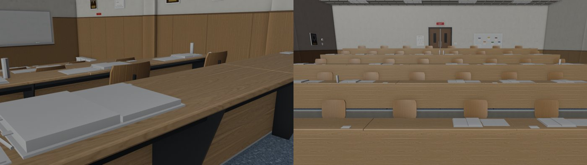

# US-EXAM-PROPS-1110：美國教室 Room 120 的期末考道具（12/6 Introduction 期末考）— LAWWW2 帳號 A，2026-11-10

- 狀態：`MODEL_READY`，交給 LAWWW 整合。以開發分支 `2a0dfe40b` 為底（已經有美國教室、教室的劇情接線）。
- 派工：LAWWW 11-10 15:45：「美國教室 12/6 期末考桌上的考卷和書（劇情那邊會在那一場呼叫，你給我一個開關或 prop 群組就好）」。
- 依據：AA_531 的 12/6 Introduction 期末考是開書考，事件裡寫「你帶去的書，有一半的頁數貼了便利貼」。
- 遊戲截圖請 CC 拍（D131）。下面是 Blender 預覽，不畫頂點色，所以答案本和書看起來是白的。

## 玩家會看到什麼
- Introduction 有人坐的 30 個位子（配置的 `seatPlan.intro`：玩家、韓國同學、其他 28 人），每個人的桌上都有：
  - 一本攤開的藍色答案本：藍封面、白內頁，寫了幾行（灰線）；
  - 一支筆；
  - 一本攤開的教科書：深色硬殼，有的貼了幾張便利貼；
  - 大約四分之一的位子多一瓶水。
- **玩家那一本書**的兩側貼滿便利貼（22 張，黃、粉紅、藍、綠、橘）。
- 沒人坐的位子沒有，最後一排整排空著。
- 講桌上一疊空白答案本、一疊題目卷。

## 做法
- `tools/blender/env_second/us_classroom.py`：新增 `EXAM_PROPS` 群組。座位照 `src/data/us_classroom_layout.js` 的 `seatPlan.intro`。
  - 重新匯出 `assets/models/env/second_ai/us_classroom.glb`：3.58 → 3.97 MB，多了一個網格（約 9,800 個頂點）。
  - 其他 62 個網格和部署中的版本頂點數完全一樣，已逐一比對過。
  - 第一次匯出時，答案本上的手寫線一條是一個方塊，光這部分就多了 0.4 MB；改成貼在紙面上的薄片以後，頂點從 15,200 降到 9,780。
- `src/us_classroom3d.js`：新增 `z.setExam(on)`。
  - 平常藏著；劇情那一場 `z.setExam(true)`，結束 `z.setExam(false)`。
  - 模型還沒載入時先記著，載入後照這個開關。

## LAWWW 要接的
- `ev_usl_intro_final`（mode exam）開始時：`GAME.E.zone.setExam(true)`；離開教室或事件結束時：`setExam(false)`。

## 測試
- 新測試 `tests/us_exam_props_unit.js`：在 Node 建出 us_classroom，接上真的 GLB（貼圖拿掉）。檢查：
  1. GLB 有 `EXAM_PROPS` 群組；
  2. 開關：平常藏著、true 看得到、false 藏起來；模型載入以前叫的開關，載入後照樣生效；
  3. 位置：30 個有人坐的位子前面的桌上都有東西；18 個沒人坐的位子沒有；玩家那本書的東西比別人多；講桌上有一疊答案本。
- 結果：
  - 開發分支 `2a0dfe40b`：**FAILED 2**（沒有群組、沒有 setExam）；
  - 套上 patch：**ALL PASS**。
- 回歸：讀到 us3d、us_classroom、second_ai 模型、zone_assets、index.html、ASSETS.manifest 的測試，共 446 支全部 ALL PASS（含新測試、us_classroom_unit），見 `regression.log`。

## 整合
- `git apply --binary us_exam_props_1110.patch`。已確認可以套在最新的開發分支 `06e779533` 上，套上後 us_exam_props_unit、us_classroom_unit 都是 ALL PASS。
- 內容：us_classroom.glb、us_classroom.py、us_classroom3d.js、新測試。
