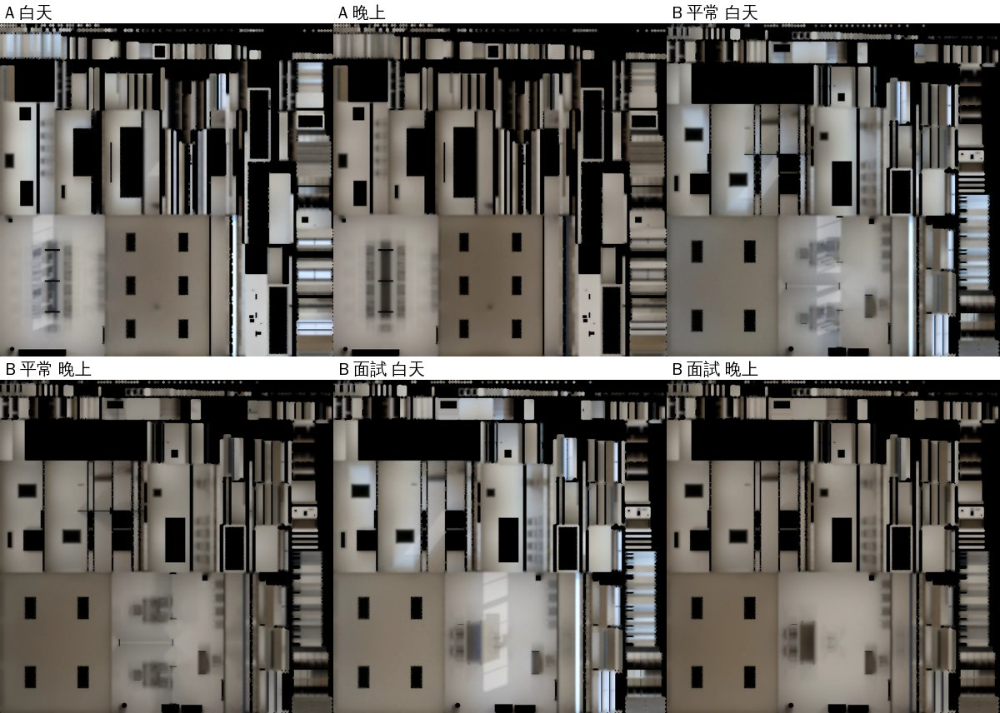

# 萬才館研討室 A、B 光照烘焙（INTERIOR-AAA-REVIEW-1028 P1；LAWWW2-B 2026-11-07）

**派工**：LAWWW-B 10:14「回去推 INTERIOR-AAA #113」。

**做這兩間的原因**：霖澤 3F／4F 之後，萬才館 2F 的研討室最常用。
- A：大四的研討課、公法讀書會（以安的事件「反駁的次數」「走回宿舍」）在這裡。
- B：法服的初談室；語彤阿姨的初談、SQ02、2028-10-26 推甄面試都在這裡。

**狀態**：READY_FOR_ART_REVIEW（場景：BB／使用者看）。遊戲內畫面要 CC 拍。

## 做法

**腳本** `tools/blender/env_second/lightbake/bake_wancai_sem.sh`：
- 直接烘 assets 裡現在的 GLB，不重新產生。
- 每次烘焙 512 取樣，CPU 約 18 分鐘（同時在做別的事，單獨跑會快一些）；B 要烘兩次，三次共約 55 分鐘。

**燈**：
- 用新的 `tube_lights.py`，從 GLB 的燈管網格讀出每一盞燈；每盞放一個 30 W 面光源，在燈管下緣。
- 讀出來的位置和產生器裡寫的一樣：
  - A 是 6 盞（x −2.8、0、2.8 × z ±1.7）；
  - B 是 4 盞（x ±1.9 × z −1.5、1.4）。

**白天和晚上**：
- 白天：天空＋太陽（方位 160°、仰角 35°），和 202、多功能教室同一組。
- 晚上：只有燈。
- 外殼只開南面（窗）；門是關著的。

**不烘的（照舊即時光）**：
- 燈管、冰箱燈；
- 頂點色的小東西（椅子、桌上的東西）；
- 金屬件；
- 書櫃裡一本一本的書：A 有 5,004 個三角形，小島太多。

這些東西照樣擋光，所以地板上桌椅的接觸陰影照樣烘進去。

## 研討室 B 有兩套家具：兩張光照貼圖

B 平常是兩個初談隔間（`SET_CONSULT`：屏風、小桌）；2028-10-26 推甄面試那天換成面試桌（`SET_INTERVIEW`）。光照貼圖是整間共用一張。

**如果只烘平常那一套**：面試那天，地上還會留著已經收掉的屏風、隔間桌的影子。

**所以烘兩張**：
1. 兩套家具本身都不烘（照舊即時光），所以兩次烘焙的網格一樣。
2. 平常那一張：烘的時候把面試的家具藏起來。
3. 面試那一張：烘的時候把隔間的家具藏起來。
4. `lm_sets.py` 先逐一比對兩個 GLB 的第二套 UV。全部一樣，才把面試那一張寫進 `extras.lightmap.sets.interview`；不一樣就停下來。

**遊戲端（patch，`rooms_glb3d.js` 加 4 行）**：
- 新增 `pickLM`：今天的布置有自己的那一張，就在接光照貼圖前換掉；沒有的話照預設那一張。
- 換的是這一次 clone 出來的 userData，不動快取的 GLB。

**烘焙工具順便修一個 bug**（`bake_room.py`）：
- `--hide` 的物件以前不複製 `_rt` 材質。
- B 面試那一套家具烘的時候藏起來，但照樣輸出；它和會烘的東西共用木頭材質。
- 遊戲把光照貼圖接在材質上，沒有第二套 UV 的網格會讀到錯的地方。
- 現在藏起來的也複製一份。新測試第 3 項檢查兩個 GLB 沒有這種共用。

## 檔案

| 檔案 | 大小 |
|---|---|
| `wancai_sema.glb` | 1.62 MB（原本 1.55） |
| `wancai_semb.glb` | 1.36 MB（原本 1.29） |
| 光照貼圖 6 張（WebP 1024×1024）：A 白天／晚上；B 平常白天／晚上；B 面試白天／晚上 | 每張 52～62 KB |

- B 的兩張看得出差別：平常那張，地上是兩個隔間的桌椅、屏風的影子；面試那張是中間一張長桌、考生椅的影子。

平均亮度：

| | 白天 | 晚上 |
|---|---|---|
| A | 0.38 | 0.26 |
| B 平常 | 0.34 | 0.23 |
| B 面試 | 0.40 | 0.26 |

- 面試那天比平常亮一點，多半是因為屏風收掉、窗邊的光照得進來（推測，沒有逐項拆開驗）。
- `lm_sets.py`：兩次烘的 23 個網格第二套 UV 完全一樣，面試那一張寫進 `extras.lightmap.sets.interview`。

## 測試（Node，開發 `126bdf93e`）

| | 開發原樣 | 換新的 GLB＋貼圖，不加 `rooms_glb3d.js` | 換新的＋patch |
|---|---|---|---|
| 新 `tests/wancai_sem_lm_unit.js`（`wancai_sem_lm_1107.patch`） | **FAILED 3**（沒有光照貼圖） | **FAILED 1**（面試那天還是平常那一張） | **ALL PASS** |
| 會讀研討室、`rooms_glb3d.js` 的其他測試，加上光照相關的 room_rtnight、lm_instancing、singleside_interiors | — | — | 22 支全過 |

新測試檢查五件事：
- ① 兩個 GLB 都有 extras.lightmap，B 另有 sets.interview；
- ② 地板、天花板、牆、腰牆、收邊條有第二套 UV；燈管、小東西、金屬、書、玻璃、B 的兩套家具沒有；
- ③ 沒有材質同時給有、沒有第二套 UV 的網格；
- ④ 淡出的牆、SET_ 節點都在；
- ⑤ 遊戲裡平常的日子用平常那一張、2028-10-26 用面試那一張；換回平常的日子會換回來；快取的 GLB 沒被改；A 照原本那一張。

## 還沒驗

- **遊戲內畫面（CC）**：
  - A：白天 11:00、晚上 20:00，從門口往窗；
  - B：平常的日子、2028-10-26 各拍一次，看面試那天地上有沒有屏風的影子。
- 人物照同一間的光沒做，照舊是遊戲的半球光，和其他烘過的房間一樣。
