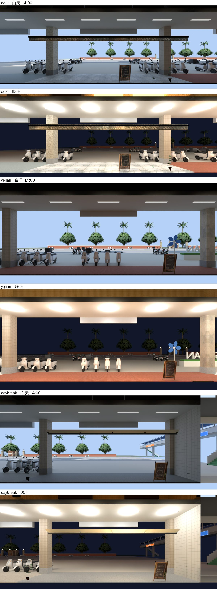

# 第一包：公館青木、頁間、Daybreak 窗外換成公館街景（WINVIEW-AUDIT-1105，LAWWW2-C 2026-11-05）

- 使用者 07:4x：「應該很多店面看出去的街景都不對吧，你要檢查一下。」
- 檢查表：[README.md](README.md)。
- 這三間的窗景卡原本是木曜日那張手繪的樹（`mok_view`），和 afar 一樣。這一包照 afar 的做法換成公館街景。

上圖是 Blender Cycles 渲染，**不是遊戲畫面**。照片貼到窗景卡上時左右鏡像過，圖上是人眼看出去的方向。

## 玩家會看到什麼

從三間店裡往外看：

- 自己這一棟的騎樓、柱子；
- 騎樓外一排機車；
- 羅斯福路；
- 對面校園的紅磚圍牆、椰子樹、校門。

各間看到的不同：

- Daybreak 在東邊盡頭，看得到捷運出口和天橋。
- 頁間看得到路邊 GONGGUAN 字樣的背面。

晚上：騎樓的燈亮著，對面是暗的。

## 怎麼拍的

- 工具：`tools/blender/env_second/wz_window_view.py --gg-street`，和 afar 同一支，沒改。
- 模型：gongguan_shops、gongguan_far、gongguan_mrt_exit、campus_gate、street_trees（校門裡面一排）。
- 機車：照遊戲公館區域實際的 122 台位置（Node 建公館區域讀 `userData.ggScooter`；afar 那一包是手寫的 14 台）。
- 鏡頭：
  - 放在窗景卡正中間後面、和遊戲一樣遠（模型原點）。
  - 視野剛好蓋滿那一片卡：焦距＝36 × 距離 ÷ 卡寬；shift_y＝（卡中心高 2.25 − 1.4）÷ 卡寬。
  - 自己這一棟的玻璃用 `--clip-start` 剪掉（玻璃再往外 0.5 m）。
- 店的位置：Node 建公館區域，讀每一棟的中心 x（`userData.ggShop`：G01 青木、G02 頁間、G14 Daybreak）。
- 白天照遊戲 14:00 的太陽（`--hour 14`）；晚上 `--night`。

| 店 | 鏡頭（公館座標，朝北） | 卡寬×高、距離 | 焦距 | shift_y | clip | 解析度 |
|---|---|---|---|---|---|---|
| 青木 | (−52.2, 1.4, 25.57) | 17 × 6.5、6.0 m | 12.706 | 0.05 | 4.1 | 1600 × 612 |
| 頁間 | (−41.0, 1.4, 27.07) | 14 × 6.5、7.5 m | 19.286 | 0.0607 | 5.6 | 1600 × 743 |
| Daybreak | (73.1, 1.4, 26.07) | 15 × 6.5、6.5 m | 15.6 | 0.0567 | 4.6 | 1600 × 693 |

## 改了什麼

- `src/zones3d.js`：`GG_VIEW` 加青木（`aok_window_view`）、頁間（`yej_window_view`）、Daybreak（`dbk_window_view`）三筆，用 afar 同一套（`ggAAattach`）：
  - 白天、晚上各換一張，晚上不調暗；
  - 照片載入失敗就換回模型原本那張、照舊調暗。
- 照片 6 張：`assets/models/env/second_ai/aa_support/{aoki,yejian,daybreak}_view_{day,night}.webp`，35～50 KB。
- `LICENSES.md` 一列。
- 新測試 `tests/gg_views_1105_unit.js`。
- `tests/afar_view_unit.js` 第 ④ 項：原本檢查「頁間照舊調暗、不換照片」，這一包就是要換頁間。改成「頁間不會換成 afar 的照片」。

## 測試（Node，不用瀏覽器）

`node tests/gg_views_1105_unit.js`：ALL PASS（15 項）

- ① 每間的白天、晚上照片都在，長寬比＝窗景卡（青木 17、頁間 14、Daybreak 15 × 6.5）。
- ② 白天換成白天那一張、不調暗。
- ③ 晚上換成晚上那一張、不調暗；回到白天換回來。
- ④ 不再是 `mok_view`。

修改前（開發分支 `c474bdbab`）：FAIL 16。

一起跑：`afar_view_unit`（④ 改過以後 ALL PASS）、`gg_shops2_1104_unit`、`seat_reach_unit` ALL PASS。讀到青木／頁間／Daybreak／GG_VIEW／窗景卡的其他 33 支 `*_unit.js` 也全部 ALL PASS。

## 先將就的

1. 窗景是一張平面照片（照 W3 的窗景卡做法），走動時窗外不會跟著換角度。
2. 車道上沒有在開的車，只有停著的機車。遊戲裡也沒有車流。
3. 晚上騎樓的燈比較亮（和 afar 一樣：Blender 的燈照遊戲的 GLOW 位置算的）。
4. 青木窗外正中間有一條木頭橫楣，是青木自己店面外觀的遮雨板。從店裡看出去本來就在那裡，沒有拿掉。
5. 頁間窗外的 GONGGUAN 字樣看到的是背面，字是反的；實際從店裡看也是這樣。
6. 瀏覽器沒跑（D131）。請 CC 拍：三間各自靠窗的座位往外看，白天、晚上。

## 接法（LAWWW-C）

1. 拿照片：`git checkout <這一包的 commit> -- assets/models/env/second_ai/aa_support/{aoki,yejian,daybreak}_view_{day,night}.webp`。
2. `git apply docs/art-rebuild/second_ai/wip/winview_audit_1105/winview_gg3_1105.patch`（`src/zones3d.js`、`LICENSES.md`、兩支測試）。
