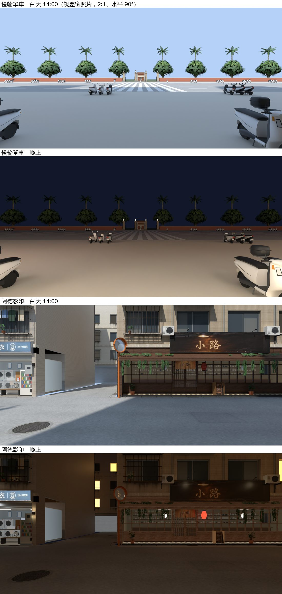
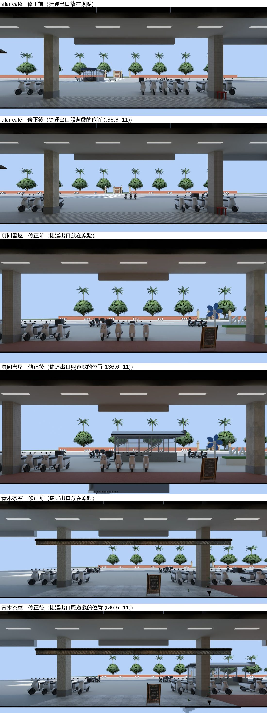

# 第四包：慢輪單車、阿德影印接上窗景＋修正 afar、頁間、青木的捷運出口（WINVIEW-AUDIT-1105，LAWWW2-C 2026-11-05）

- 使用者 07:4x：「應該很多店面看出去的街景都不對吧，你要檢查一下。」
- 檢查表：[README.md](README.md)。前三包：[公館三間](README_gg3.md)、[小路、日常失速](README_wz2.md)、[日和、燒臘、林家](README_pane3.md)。

上圖是 Blender Cycles 渲染，**不是遊戲畫面**。

## 一、慢輪單車、阿德影印

### 原因

- 兩間都沒有窗景照片：
  - 慢輪的備用房間有窗，但沒設照片（看到的是程序化的假街景）。正式模型載入以後整個備用房間藏起來，玻璃外面只剩天空。
  - 阿德的房間沒設照片，玻璃外面也是天空。

### 玩家會看到什麼

- **慢輪**（公館 G06，羅斯福路正對校門）：
  - 騎樓外一排機車；
  - 羅斯福路、校門口的斑馬線；
  - 對面的校門、紅磚圍牆、椰子樹。
  - 晚上：騎樓的燈亮著，校門的燈亮著。
- **阿德**（溫州街 A1，朝北）：
  - 巷子、停在門口的機車；
  - 對面 B 側那一排公寓。
  - 晚上：路燈的光圈。

### 怎麼拍的

- 工具：`tools/blender/env_second/wz_window_view.py`，沒改。
- 照視差窗的格式拍：
  - 2:1，水平 90°（焦距 18）；
  - 鏡頭放在視差窗那一片的正中間（照片就是從平面中心看的）；
  - 不鏡像（和窗景卡不一樣）。
- 照片 4 張：`assets/models/env/views/{bikeshop,wz_print}_{day,night}.webp`，1024 × 512。

| 店 | 鏡頭（區域座標） | 店內座標＝視差窗中心 | 朝 | 模型 |
|---|---|---|---|---|
| 慢輪 | 公館 (0.0875, 1.7, 21.39) | (0.21, 1.7, 6.61) | 北 | gongguan_shops、gongguan_far、campus_gate、street_trees、捷運出口（照遊戲的位置）、機車 122 台 |
| 阿德 | 溫州街 (−8.0, 1.45, 4.4) | (0, 1.45, 5.2) | 北 | wenzhou_street、wz_props、wz_jphouse、wz_park、機車 31 台；晚上照小路那一包的路燈光圈 |

### 改了什麼

- `src/bikeshop3d.js`：
  - 房間加 `view:'bikeshop'`（地平線 1.7 m、景深 24 m）；
  - 正式模型接上以後呼叫 `Z3.ggViewPanes`，把窗搬到正式模型的玻璃外面。
- `src/data/ade_layout.js`、`src/data/wz_shops_layout.js`：`print.front` 加 `view:'wz_print'`、`viewY:1.45`、`viewDepth:10`。兩個檔一起加（`wz_shops_layout.js` 的 `print` 是照抄 `ade_layout.js` 的，`ade_v1c_unit` 比對兩邊一樣）。
- `src/zones3d.js`：
  - `ggViewPanes` 改成照牆分組。慢輪的備用房間有兩扇櫥窗，兩片視差窗合成一片，放在整面玻璃的正中間。
  - 往外推到「正面玻璃最外面＋0.05 m」，至少比原本的位置再往外 0.3 m。
  - 匯出 `ggViewPanes`，讓 `bikeshop3d.js` 用。
- 新測試 `tests/shop_viewpanes2_1105_unit.js`。

### 測試（Node，不用瀏覽器）

`node tests/shop_viewpanes2_1105_unit.js`：ALL PASS（8 項）

- ① 正式模型載入、有視差窗、照片名字對、照片檔在。
- ② 在正面玻璃外面、蓋住整片玻璃、面向店裡。
- ③ 視差窗中心＝照片拍的位置（差 ≤ 0.15 m；兩間都是 0.00）。
- ④ 在 `z.wins`、`z.winParts`（朝店裡），換時段不出錯、照片設進材質。

修改前（開發分支 `c22f9ee43`＋第三包）：FAILED 8。

回歸：讀到慢輪／阿德／`ade_layout`／視差窗（`ggViewPanes`、`z.wins`、`winParts`）／afar、頁間、青木窗景的 40 支 `*_unit.js` 全部 ALL PASS（在 `c22f9ee43`＋第三包上）。

- `ade_v1c_unit` 一開始 FAIL 1：它比對 `wz_shops_layout.js` 的 `print` 和 `ade_layout.js` 要一模一樣。我原本只在 `wz_shops_layout.js` 補，改成兩個檔一起加（同樣三個值）以後 ALL PASS。
- patch 在最新的開發分支 `313a97267`（已含第三包）上 `--check` 通過，套上以後 `shop_viewpanes2`、`shop_viewpanes`、`ade_v1c` ALL PASS。

## 二、修正：afar、頁間、青木窗外的捷運出口

- 之前拍公館街景時，捷運出口的模型（`gongguan_mrt_exit.glb`）**放在原點**，沒有照遊戲的位置（`zones3d.js`：(−36.6, 0, 11)、轉 90°）。
- 結果：
  - **afar**：窗外羅斯福路中間、校門前面多了一座捷運出口（這是錯的）。
  - **頁間**、**青木**：遊戲裡捷運出口在店的右前方（騎樓外的人行道上），照片裡沒有。
  - Daybreak 在東邊盡頭，兩種擺法都看不到捷運出口，不用重拍。
  - 這一包的慢輪一開始也拍錯了，已經重拍。
- 這一次照遊戲的位置放（`--place gongguan_mrt_exit.glb@-36.6,0,11,1.5708`），三間各重拍白天、晚上。
- afar 這一次也換成遊戲實際的 122 台機車（之前是手寫的 14 台）。

- 只換照片，程式不用改：`assets/models/env/second_ai/aa_support/{afar,yejian,aoki}_view_{day,night}.webp`（檔名、大小不變）。
- 照片照舊左右鏡像（窗景卡的 UV）；上圖是人眼看出去的方向。
- `afar_view_unit`、`gg_views_1105_unit` 照舊 ALL PASS。

## 先將就的

1. 慢輪的玻璃很寬（8.5 m）、景深 24 m：
   - 走到櫥窗的兩頭往斜的方向看，照片的邊會看到（視差窗算到照片外面時取邊上那一排）。
   - 平常從店裡往外看不會碰到。
2. 阿德的視差窗在玻璃外面 0.7 m（`ggViewPanes` 從房間原本的窗再往外推 0.3 m）：
   - 照片是從那個位置拍的，玻璃到那 0.7 m 之間的東西照片裡沒有（門口那一小段）。
3. 照片是一張平面照片＋視差，不是真的 3D：走動時窗外有前後關係，但近的機車和遠的公寓在同一個平面上。
4. 沒有在開的車、沒有路人。
5. 瀏覽器沒跑（D131）。請 CC 拍：慢輪櫃台往門口看、阿德長桌往門口看、afar 和頁間靠窗的座位往外看，白天、晚上。

## 接法（LAWWW-C）

1. 拿照片：`git checkout <這一包的 commit> -- assets/models/env/views/{bikeshop,wz_print}_{day,night}.webp assets/models/env/second_ai/aa_support/{afar,yejian,aoki}_view_{day,night}.webp`。
2. `git apply docs/art-rebuild/second_ai/wip/winview_audit_1105/winview_pane4_1105.patch`（`src/zones3d.js`、`src/bikeshop3d.js`、`src/data/{ade_layout,wz_shops_layout}.js`、`LICENSES.md` 一列、新測試）。在 `313a97267` 上 `--check` 通過。
