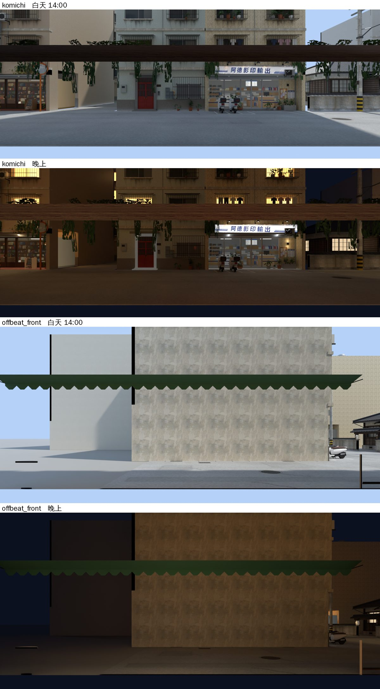

# 第二包：溫州街小路、日常失速窗外換成溫州街街景（WINVIEW-AUDIT-1105，LAWWW2-C 2026-11-05）

- 使用者 07:4x：「應該很多店面看出去的街景都不對吧，你要檢查一下。」
- 檢查表：[README.md](README.md)。第一包公館三間：[README_gg3.md](README_gg3.md)。
- 兩間的窗景卡原本是木曜日那張手繪的樹（`mok_view`）。
- 小路（AA 新的 `komichi.glb`）：11-04 拍的 `views/wz_teishoku_*` 是舊模型 `wz_teishoku_interior.glb` 用的，換成 `komichi.glb` 以後就沒用到了。這一包照新模型窗景卡的大小重拍、接上。

上圖是 Blender Cycles 渲染，**不是遊戲畫面**。照片貼到窗景卡上時左右鏡像過，圖上是人眼看出去的方向。

## 玩家會看到什麼

- **小路**：對面是阿德影印那一排，有紅門的公寓、陽台的盆栽、停在門口的機車，晚上窗戶和招牌亮著。
- **日常失速前窗**（朝東，看西側橫巷）：
  - 巷子對面是後排那棟公寓的側牆（遊戲裡也是這樣）；
  - 左邊（北）是往新生南路那一頭；
  - 窗頂是店自己的綠色遮雨棚。
- **日常失速右窗**（朝北）：照舊是原本那張樹。

## 怎麼拍的

- 工具：`tools/blender/env_second/wz_window_view.py`，沒改。
- 模型：wenzhou_street、wz_props、wz_jphouse、wz_park。
- 機車 39 台（`wz_scooters_wenzhou.json`）。
- 晚上照小路那一包的路燈光圈（`wz_lamp_pools.json`、`--lamp-k 4 --exposure -0.7`）。
- 日常失速前窗加 `--ground '#a3a29d'`：那一頭在溫州街模型的邊上，模型沒有地面。
- 鏡頭：
  - 放在窗景卡正中間後面、和遊戲一樣遠；
  - 視野剛好蓋滿那一片卡；
  - 自己的玻璃用 `--clip-start` 剪掉。
- 店的位置：
  - 小路：照配置的門 (−2.0) ↔ `enterAt` (−4.8)，B 側建築正面在 z −5。
  - 日常失速：照配置寫的換算，室內 (x, z) → 溫州街 (z − 42.2, −13.5 − x)。

| 卡 | 鏡頭（溫州街座標） | 朝 | 卡寬×高、距離 | 焦距 | shift_y | clip | 解析度 |
|---|---|---|---|---|---|---|---|
| 小路 | (−2.8, 1.4, −9.07) | +z（南） | 14 × 5.5、6.5 m | 16.714 | 0.025 | 4.6 | 1600 × 629 |
| 日常失速前窗 | (−42.2, 1.4, −13.5) | +x（東） | 14 × 6.5、7.5 m | 19.286 | 0.0607 | 5.6 | 1600 × 743 |

## 改了什麼

- `src/zones3d.js`：
  - 新的 `WZ_VIEW` 表＋`wzViewSwap`（溫州街 AA 的店的窗景照片，白天／晚上）。
  - 小路從 `wzAAattach` 接。
  - 日常失速不是 `WZ_AA_NEW` 的店，從 `offbeatAttach` 接。
  - 換照片的那一塊卡複製一份材質：日常失速前窗、右窗共用 `dof_window_view`，只換前窗。
  - 換過的卡自己管日夜，`wzAAattach` 原本的調暗那一段跳過它們（`userData.wvOwn`）。
  - 晚上換晚上那一張、不調暗；照片載入失敗就換回模型原本那張、照舊調暗。
- 照片 4 張：`assets/models/env/second_ai/aa_support/{komichi_view,offbeat_view_front}_{day,night}.webp`。
- `LICENSES.md` 一列。
- 新測試 `tests/wz_views_1105_unit.js`。

## 測試（Node，不用瀏覽器）

`node tests/wz_views_1105_unit.js`：ALL PASS（11 項）

- ① 照片都在、長寬比＝窗景卡（小路 14 × 5.5、日常失速 14 × 6.5）。
- ② 白天換成自己那一張、不調暗。
- ③ 晚上換成晚上那一張、不調暗；回到白天換回來。
- ④ 不再是 `mok_view`。
- ⑤ 日常失速右窗照舊是模型原本那張，和前窗不是同一份材質。

修改前（開發分支 `f4be7869a`，已含第一包）：FAILED 10。

一起跑：讀到小路／日常失速／溫州街 AA 的店／窗景卡的其他 72 支 `*_unit.js`：

- 71 支 ALL PASS。
- `shop_npc_unit` FAIL 6，修改前也是 6：這台讀不到企劃線的 git 物件（ebea3a2b0），和這一包無關。

## 接法（LAWWW-C）

1. 拿照片：`git checkout <這一包的 commit> -- assets/models/env/second_ai/aa_support/{komichi_view,offbeat_view_front}_{day,night}.webp`。
2. `git apply docs/art-rebuild/second_ai/wip/winview_audit_1105/winview_wz2_1105.patch`（`src/zones3d.js`、`LICENSES.md` 一列、新測試）。在 `f4be7869a` 上做的。

## 先將就的

1. 窗景是一張平面照片，走動時窗外不會跟著換角度。
2. **日常失速右窗（朝北）照舊是那張樹**：
   - 那一面朝地圖外，遊戲裡什麼都沒有。
   - 照實際位置拍出來是一片空地加天空，比現在那張樹難看。
   - 之後新生南路那一頭的背景做好（XS-FARVIEW）再拍。
3. 日常失速前窗：
   - 對面是一面沒有窗的側牆，遊戲裡也是這樣。
   - 往北那一頭（往新生南路）很空，只有地面和天空。
4. 小路窗外上緣有一條深色橫木，是小路自己店面外觀的屋簷。
5. 沒有在開的車、沒有路人（遊戲裡的路人不會出現在照片上）。
6. 瀏覽器沒跑（D131）。請 CC 拍：小路靠窗的座位、日常失速長桌往前窗看，白天、晚上。
