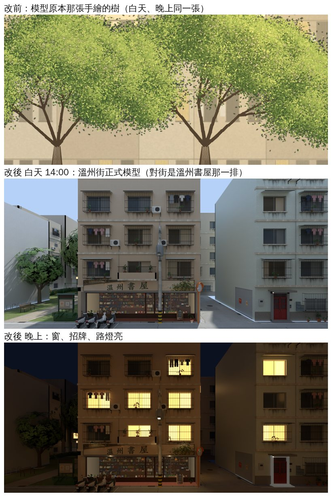

# 木曜日窗外換成溫州街街景（WINVIEW-AUDIT 最後一項；LAWWW2-B 2026-11-07）

- **第 1 版**（這個窗景；店的室內是 AA 的 v3c，沒動）。
- 起因：WINVIEW-AUDIT-1105 的檢查表（[../winview_audit_1105/README.md](../winview_audit_1105/README.md)）。木曜日的窗景卡原本是一張手繪的樹（`mok_view`），白天晚上同一張。
  - 使用者 11-05 07:4x：「應該很多店面看出去的街景都不對吧」。
- 狀態：`MODEL_READY`。照片是 Blender Cycles 渲染，不是遊戲畫面；遊戲內截圖要排 CC 在使用者的電腦拍（D131）。

## 玩家會看到什麼

- 坐在二樓臨街窗邊往南看：對街是溫州書屋那一排公寓（陽台、冷氣、晾的衣服），一樓是書屋的店面和門口的機車；左邊是往小公園那一頭的樹。
- 晚上：對面窗戶、書屋招牌、店裡亮著；天是深藍的。原本的手繪樹晚上也一樣亮。

## 怎麼拍的

- 工具：`tools/blender/env_second/wz_window_view.py`（沒改），指令在 `render.sh`，翻向、對照圖在 `finish.py`。
- 模型：wenzhou_street、wz_props、wz_jphouse、wz_park；機車照 `komichi_nightview_1104/wz_scooters_wenzhou.json`；晚上照小路那一包的路燈光圈。
- 鏡頭（溫州街座標）：
  - 木曜日區域座標 → 溫州街：x＋11.15、z−12.25（`mokuyobi3d.js` 的 CX、CZ）。
  - 窗景卡 `WALL_front_VIEW_mok_window_view`：區域 x −6.5～7.5、y −1～5.5（整組抬到 3.2）、z 9.5 → 溫州街 x 4.65～18.65、y 2.2～8.7、z −2.75，14 × 6.5 m。
  - 眼睛在卡的正中間後面 6.5 m：(11.65, 4.6, −9.25)，朝 +z（南）；焦距 16.714（剛好蓋滿卡寬）、shift_y 0.0607（卡的中心比眼睛高 0.85 m）。
  - `--clip-start 5.2`：剪掉自己這棟（B4）。4.6 的時候畫面最上面會有一排浮著的鐵欄杆（三樓的陽台），5.2、5.8 拍出來一樣，取 5.2。
  - 1600 × 743（＝卡的比例），64 取樣；白天 `--hour 14`。
- **左右翻**：卡的 UV u＝0 在西邊（x −6.5）。人往南看，西邊在右手邊，所以存檔前左右翻（和小路、日常失速那一包一樣）。對照圖是翻回來的人眼方向。

## 改了什麼（patch：`winview_moku_1107.patch`，對開發分支 `77195b12a`）

- `src/zones3d.js`：`WZ_VIEW` 多一筆 `mokuyobi`（卡的網格名 `mok_window_view`）；`Z3` 多匯出 `wzViewSwap`（`mokuyobi3d.js` 在 zones3d.js 外面）。
- `src/mokuyobi3d.js`：室內正式模型載入後呼叫 `Z3.wzViewSwap(z, r1, 'mokuyobi')`。白天、晚上換照片的做法和小路、日常失速同一套：換過的卡自己管日夜、不調暗；照片載入失敗就換回模型原本那張。
- `LICENSES.md` 一列（本作 Blender 渲染）。
- 照片 2 張：`assets/models/env/second_ai/aa_support/mokuyobi_view_{day,night}.webp`（1600 × 743；22 KB、78 KB）。
- 新測試 `tests/mok_view_1107_unit.js`。
- 一樓鐵門外那一張街景卡（樓梯 GLB 的 `mks_street_view`）不動。

## 測試（Node，不用瀏覽器）

- `node tests/mok_view_1107_unit.js`：
  - 開發分支 `77195b12a` 原樣：**FAIL 5**（① 照片不在、② ③ 沒換、④ 還是 mok_view）。
  - patch＋照片：**ALL PASS**。
- 一起跑（patch＋照片＋另一包 `window_flicker_1107`）：`mokuyobi_unit`、`dakou_unit`、`wz_views_1105_unit`、`xs_wincard_1105_unit`、`xs_north_ext_unit`、`spawn_exit_unit`、`dakou_nightcard_unit` 都 ALL PASS。
- 沒跑：瀏覽器、手機實機（D131 排 CC）。

## 接法（給 LAWWW-B）

1. 照片：`git checkout <這一包的 commit> -- assets/models/env/second_ai/aa_support/mokuyobi_view_day.webp assets/models/env/second_ai/aa_support/mokuyobi_view_night.webp`
2. `git apply docs/art-rebuild/second_ai/wip/winview_moku_1107/winview_moku_1107.patch`（開發分支 `77195b12a` 上做的）。
3. 和 `window_flicker_1107` 那一包改的檔案不重疊，兩包可以一起套。

## 先將就的

1. **參考圖窗外是幾棵樹、樹後面才是公寓**（企劃線 `ref_images/wz_cafes/mokuyobi_ref_v2.webp`）。遊戲的溫州街在木曜日門前沒有樹，所以這一版照遊戲真的街景，窗外看不到樹，少了參考圖的綠意。
   - 建議（要 LAWWW、BB 同意）：在木曜日（B4）門前人行道真的種兩棵行道樹，窗外重拍。這樣窗外和外觀都會像參考圖。要動溫州街的導航（樹幹擋路），鐵門的「上二樓」互動點 (7.4, −4.55) 要避開。
2. 窗景是一張平面照片，走動時窗外不會跟著換角度（和其他店一樣）。
3. 機車用 11-04 讀的位置（39 台），之後機車有搬就要重拍。
4. 瀏覽器、遊戲內同角度截圖沒拍（D131 排 CC）。

## 檢查清單

- [x] 參考圖是哪一種：使用者給的生成圖（企劃線），這一包沒有用它疊圖；照片是遊戲模型渲染。
- [x] 沒有招牌、店名的新字（照片裡的「溫州書屋」是遊戲裡本來就有的店）。
- [x] 沒有複製貼上（D133）。
- [x] Node 測試修改前 FAIL、修改後 PASS。
- [x] 驗收狀態：MODEL_READY；遊戲內截圖以後才請 BB 判。
