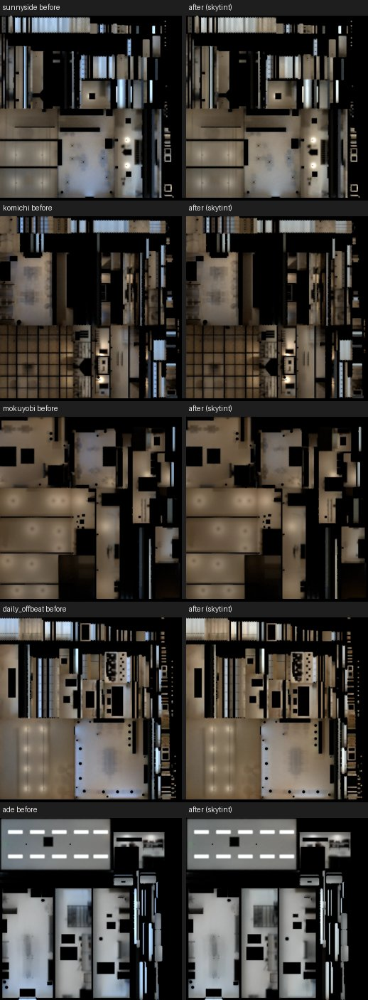

# #196 溫州街五間白天光照重烘：店門口不再偏藍（LAWWW2-B 2026-11-09）

狀態：`READY_FOR_REVIEW`（光照已換；遊戲內畫面等 CC 拍、BB-B 判）。低優先：BB-B 11-08 00:13 判「不擋」，CPU 有空才做。

## 為什麼
- 11-08 BB-B 判一盞（WZ6_LM_cloud）：店門口的淺色木地板變灰藍，像水泥。
  - 原因：烘焙沒有太陽，白天只吃 Nishita 晴空的藍天光；遊戲裡有光照貼圖的材質，間接光整個換成貼圖，木頭乘上偏藍的貼圖就變灰藍。
  - 一盞已經用 `--skytint 1.32,1.0,0.72` 重烘（f164950dd）。說明：`docs/art-rebuild/second_ai/wip/wz6_yizhan_tint_1108/README.md`。
- 溫州街其他四間（SUNNY SIDE、小路、木曜日、日常失速）和阿德還是 11-07 沒套色調的版本。這一包把它們都照同一組色調重烘。

## 做法
- 工具、參數和一盞完全一樣：`bake_gg_new.sh`，色調 `SKYTINT=1.32,1.0,0.72`。
  - 只乘白天的天光，燈不動、晚上那張不動。
  - 512 取樣、1024 解析度。
  - 阿德這一組的預設色調是 7b82a4f53 加的。
- **輸入都是沒烘過的原檔**，不是 assets 裡已經烘過的檔。每個原檔的 sha256 都和開發分支 `_lm.json` 記的 `src_sha256` 一致：

| 店 | 誰做的 | 原檔 git blob | 原檔 sha256（前 16） | 烘焙時間 |
|---|---|---|---|---|
| SUNNY SIDE `aa_support/sunnyside.glb` | AA | `ee1aee00` | `d94d70d09acb4958` | 863 s |
| 小路 `aa_support/komichi.glb` | AA | `d000b6ce` | `0bf1488b17908710` | 543 s |
| 木曜日 `aa_support/mokuyobi.glb` | AA | `24e2df31` | `24f7d6406f2a496c` | 1158 s |
| 日常失速 `aa_support/daily_offbeat.glb` | AA | `6dcba992` | `edf01702b399a919` | 1042 s |
| 阿德 `bb_support/ade.glb` | BB | `49e0de80` | `e4d554c959a0ef12` | 1417 s |

- 跑法：`OUTDIR=<out> IN=<原檔> BAKE_CACHE=<cache> bash tools/blender/env_second/lightbake/bake_gg_new.sh <aa_sunnyside|aa_komichi|aa_mokuyobi|aa_offbeat|bb_ade> 512`

## 結果
地板白天光照貼圖（WebP 編碼值，地板網格朝上的面取樣），店門口那一段（1 m）的藍／紅：

| 店 | 店門口 藍／紅 改前 → 改後 | 整張平均 改前 → 改後 | 過曝（>0.99） |
|---|---|---|---|
| SUNNY SIDE（z 3～4） | 1.17 → **0.98** | 0.254 → 0.251 | 0.4% → 0.1% |
| 小路（z 0～1） | 0.88 → **0.81** | 0.189 → 0.187 | 0.1% → 0.1% |
| 木曜日（z 4～5） | 0.93 → **0.82** | 0.209 → 0.208 | 0.0% → 0.0% |
| 日常失速（z 4～5） | 1.22 → **0.99** | 0.291 → 0.289 | 0.2% → 0.0% |
| 阿德（z 3～4） | 1.26 → **1.11** | 0.324 → 0.323 | 1.4% → 1.2% |

- 參考：一盞改後店門口 1.10。
- 店裡面也一樣往暖的方向偏（例：日常失速 z −5～−4 是 0.81 → 0.71），亮度差 1～2%。
- 阿德降得比較少：店裡大多是燈光（色調只乘天光），本來就接近中性。
- 白天光照貼圖改前（左）、改後（右）：

## 動了什麼（和開發分支比）
- **只重烘光照**：五個 GLB 的網格節點名字、材質、索引數、有第二套 UV 的網格都和開發分支那一版一樣（逐節點比過：30／25／29／34／42 個節點，有光照的 10／10／6／10／6 個）。
- **晚上那張五間都逐位元組一樣**，沒有改，不在這一包。
- GLB 大小只差烘焙紀錄（`extras.lightmap` 多 `skytint`）：+0～+244 B。

| 檔案 | 開發 `e767a3e3e`（sha256 前 16） | 新 |
|---|---|---|
| `assets/models/env/second_ai/aa_support/sunnyside.glb` | `35a15a7123f0ec6b` | `6f43f9c9e258d388` |
| `assets/models/env/second_ai/aa_support/sunnyside_lm_day.webp` | `55d47428b24adb27` | `94896764b7d1ec19` |
| `assets/models/env/second_ai/aa_support/komichi.glb` | `d518ff509d744b1c` | `2640197aea55739a` |
| `assets/models/env/second_ai/aa_support/komichi_lm_day.webp` | `5a20dc9423a59142` | `b69e5fcdb0bdcdf2` |
| `assets/models/env/second_ai/aa_support/mokuyobi.glb` | `85d92842089d4c5e` | `3c884474019d0f42` |
| `assets/models/env/second_ai/aa_support/mokuyobi_lm_day.webp` | `0fc05fb910d83da9` | `3a9fb2aae5388ed6` |
| `assets/models/env/second_ai/aa_support/daily_offbeat.glb` | `aaf60340d91c02a6` | `565433809f09377c` |
| `assets/models/env/second_ai/aa_support/daily_offbeat_lm_day.webp` | `7706ebf53f1a7ec4` | `b43a168b6778141a` |
| `assets/models/env/second_ai/bb_support/ade.glb` | `91b26ea5b7934126` | `e2b362c9d88e3ec2` |
| `assets/models/env/second_ai/bb_support/ade_lm_day.webp` | `6765aff86a8054e3` | `2d1a564703c0a766` |
| `tools/blender/env_second/lightbake/sunnyside_lm.json` | `dc9a8075dc15f1c2` | `b6edc94ba5fb5e0c` |
| `tools/blender/env_second/lightbake/komichi_lm.json` | `ba25eea8cfae03d4` | `e037fe94d33289ba` |
| `tools/blender/env_second/lightbake/mokuyobi_lm.json` | `586796836e00309d` | `707e408e84fafbdb` |
| `tools/blender/env_second/lightbake/daily_offbeat_lm.json` | `dbe96dff24c4c137` | `5046d2ba189bc37b` |
| `tools/blender/env_second/lightbake/ade_lm.json` | `93d6dcfb989308e1` | `b95bb1ba52bdfcdd` |

**不用改程式、不用改測試**：直接從 `claude/funny-albattani-iawshm` 複製這 15 個檔。

## 測試（Node，D131；工作樹＝開發 `e767a3e3e`＋這 15 個檔）
- 提到這五間或光照紀錄的 63 支 `*_unit.js`／`*check*.py`（含 ade_v1c、ade_seat_clip、mokuyobi、offbeat_storefront、offbeat_cat_board、te_komichi_stage、gg_new_lm、shop_npc、quick_travel、invites_quote 系列）：**63／0 全過**。

## 還沒驗
1. **遊戲內**（請 CC 拍、BB-B 判）：五間 14:00 的店門口（door）、店裡（clerk 或 corner）。21:00 不用拍（晚上那張沒變）。
2. GPU 顏色、手機（PC）。
