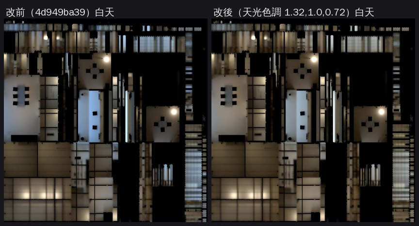

# 一盞白天光照重烘：店門口木地板不再灰藍（LAWWW2-B 2026-11-08；BB-B 00:04 WZ6_LM_cloud 第 1 點）

BB-B 判溫州街六間光照（4d949ba39，CC 雲端 f440 對 5490，cc-testing 9c115cd9d9 `docs/story_planning/CC/logs/WZ6_LM_cloud/`）：功能 PASS；**一盞 14:00 門口那張的淺色木地板變成偏冷的灰藍、像水泥**，clerk 那張的地板也偏灰綠。這一包只修這一點。

## 原因
- 一盞的緣側整片開口，烘焙時又沒有太陽（`--sun` 強度 0，這一組都一樣），白天只吃到 Nishita 晴空的藍天光。
- 白天光照貼圖在店門口一帶的藍／紅（WebP 值，地板網格取樣）：

  | 位置（地板 z） | 改前 | 改後 |
  |---|---|---|
  | 店裡（−0.6～1.7） | 0.73～0.85 | 0.73～0.75 |
  | 中段（2.8～3.9） | 1.27 | **1.04** |
  | 店門口（3.9～5.1） | 1.39 | **1.10** |
  | 緣側（5.1～6.2） | 1.34 | **1.12** |
  | 榻榻米靠前（−1.6～−0.6） | 1.01 | 0.81 |

  - 參考：其他四間的店門口改前是 1.09～1.20，BB-B 判可以。
- 遊戲裡白天室內的即時光是暖灰（0xf4f1ea）；有光照貼圖的材質，間接光整個換成貼圖。所以木頭乘上藍色的貼圖，就變灰藍。
- clerk 那張的榻榻米：貼圖本身是中性灰，乘上去就偏綠，是同一個原因。

## 怎麼修
- **`bake_room.py --skytint r,g,b`**（`dd0502c68`）：
  - 只乘白天那一張的天光，燈不動；晚上那一張不動。
  - 沒給這個參數就不建節點，其他店的烘焙結果完全不變。
  - 烘焙紀錄多一個 `skytint` 欄位。
- **`bake_gg_new.sh`**（`1aa6be18a`）：
  - AA 那一組和慢輪單車預設 `SKYTINT=1.32,1.0,0.72`：藍天光的亮度不變，顏色接近中性。
  - 一盞從 AA 的原檔（git blob `33ba0087`，sha256 `a4d1bc30…`）重烘，不是用 assets 裡已經烘過的檔。
  - 輸入檔的場景如果已經有 `extras.lightmap`，就停下來，不會讓第二套 UV 疊兩次。
- **試烘**（128 取樣，色調 1.25,1.0,0.78）：店門口 1.39 → 1.16，白天平均 0.31 → 0.31。正式版再推一點，到 1.32,1.0,0.72。

## 動了誰做的哪個檔
| 檔案 | 誰做的 | 原檔 sha256 | 大小 |
|---|---|---|---|
| `assets/models/env/second_ai/aa_support/yizhan.glb` | **AA**（v1；第三批光照 4d949ba39 在原檔上烘過一次） | `a4d1bc30917e7463a6bc1b33ed6731be4e3eb67ad3210927c83a0a890f86a529`（沒變） | 1,134,060 → 1,134,100 B |

- 只重烘光照：節點、名字、材質、第二套 UV 的網格（11 個）和 4d949ba39 那一版一樣（逐節點比過）。
- 新檔：
  - `yizhan_lm_day.webp`（69,628 → 69,386 B）
  - 烘焙紀錄 `tools/blender/env_second/lightbake/yizhan_lm.json`（多 `skytint`）
- `yizhan_lm_night.webp` 重烘後逐位元組一樣，沒有改。

## 亮度
| | 白天 | 晚上 | 過曝 |
|---|---|---|---|
| 改前 | 0.31 | 0.22 | — |
| 改後 | 0.305 | 0.220 | 0.1% |

## 測試（Node，D131；工作樹＝開發 `eacc5837d`＋這一包）
- `gg_new_lm_unit.js`（開發原樣，已有一盞）：**ALL PASS**。
- 提到一盞／茶屋的 66 支裡，64 支過。
- 另外 2 支 `aa625_yt_study_unit`、`aa667_vacgap2_unit` 是劇情測試：開發原樣也是 FAILED 12／11，和這一包無關。
- **不用改程式、不用改測試**。

## 還沒驗
1. **遊戲內**（請 CC 重拍、BB-B 判）：一盞 14:00 的 door、clerk，要和 f440 同機位；21:00 不用重拍（晚上那張沒變）。
2. 溫州街其他四間（SUNNY SIDE、小路、木曜日、日常失速）和阿德還是沒套色調的 11-07 版本。BB-B 00:13 判不擋，之後 CPU 有空再重烘（LAWWW2 待辦）。
3. 公館 afar、青木、Daybreak、慢輪單車（第二級，烘焙中）第一次烘就套。
4. GPU 顏色、手機（PC）。
