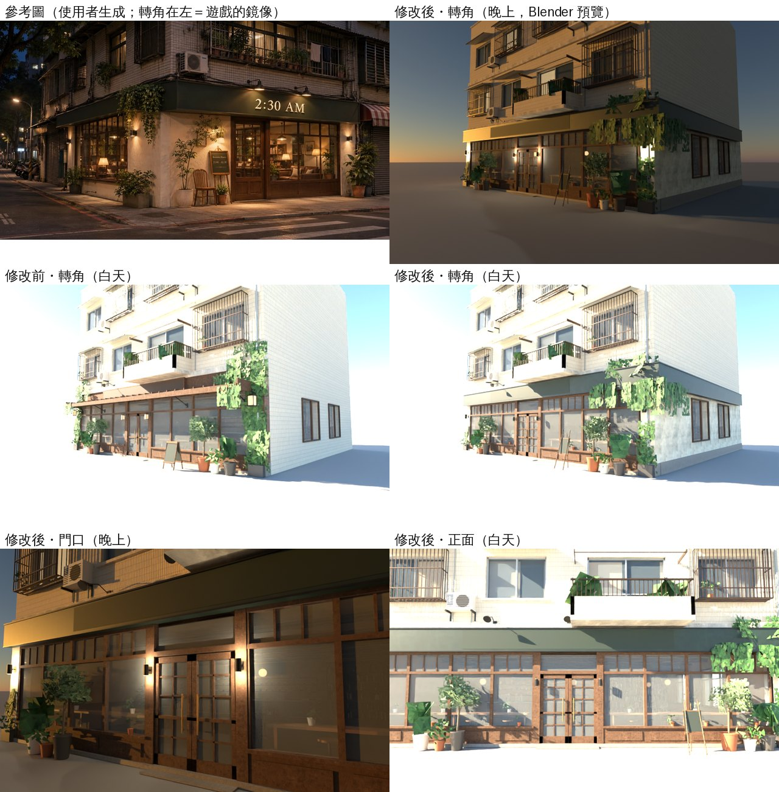

# WZ-FIVE-1104：2:30 AM 外觀（溫州街東端路口）

LAWWW2-C 2026-11-04。狀態：**MODEL_READY**。只換 `assets/models/env/second_ai/cafe_exterior.glb`（和 `.json`），**遊戲程式不用改**。還沒在瀏覽器看過。

## 依據

- AA_654 第 6 節：溫州街第一批五間，外觀由 LAWWW2 做。使用者 11-04 04:4x 授權四人自己決定。
- 參考圖：企劃線的 `docs/story_planning/ref_images/shops/wz_230am_ext.webp`，使用者自己生成的。
- 參考圖的轉角在左邊，遊戲在右邊（x=+7 是轉角那一面），所以外觀是鏡像。
- 營業時間照使用者定的 11:00～02:30。參考圖的牌子寫 21:00～02:30，已經改掉。

## 改了什麼（`tools/blender/env_second/cafe_exterior.py`）

| 參考圖 | 遊戲 |
|---|---|
| 一樓奶油色粗灰泥 | 兩邊壁柱、轉角那一面的一樓側牆改成灰泥（Poly Haven `white_plaster_02`，CC0，`LICENSES.md` 已經有）。原本是咖啡色外牆板 |
| 深綠招牌帶，包過轉角 | 門窗頂（2.98 m）到二樓樓板線下面（3.68 m），往外凸 0.32 m。正面整條，包過右邊轉角，沿著側面到店的後牆（12 m）。上緣一條深色壓條，下緣有滴水邊 |
| 招牌字「2:30 AM」（奶油色襯線字） | `SIGN_FACE` 的屬性改成 `sign: 2:30 AM`、`bg: #1c2c23`（和招牌帶同色）、`color: #efe2c2`。字照舊由遊戲畫（`zones3d.js` 的 `cafeSignTex`）。原本的咖啡色招牌框拿掉 |
| 招牌上面的鵝頸燈 | 照舊三盞，往前伸到招牌帶前面、往下照字 |
| 深色木框、上面一排小格子 | 氣窗每格加兩支直櫺，門的玻璃加十字格子（外面那一面） |
| 黑色圓筒壁燈，上下出光 | 兩邊壁柱、門柱各一盞，原本的方形燈籠拿掉；上下各一個光暈 |
| 從轉角的招牌帶垂下來的爬藤 | 正面、側面招牌帶的轉角垂下一大片，頂上也冒出一些。兩邊壁柱只留下半段（不蓋到壁燈） |
| 木畫架、營業時間黑板 | A 字立牌改成木畫架：前面寫「Business Hours／11:00 – 02:30」，背面寫手沖菜單。位置和導航阻擋照舊（三支腳都在遊戲的 `blockCircle` 半徑 0.35 裡） |
| 原本的木頭雨遮 | 拿掉（參考圖沒有雨遮，招牌帶就是遮雨的） |

沒有動的：
- 樓上：磁磚、鐵窗、陽台、冷氣、水塔。
- 門窗的位置、店門互動點、門口盆栽和它們的導航阻擋。



Blender Cycles 預覽（Standard 色彩），不是遊戲畫面。說明：
- 招牌面在預覽裡是空白的：字是遊戲畫的。
- 白天的木框看起來偏粉，是預覽的太陽太強。
- 晚上的光是預覽放的點光，遊戲用光暈和 `CAFE_NIGHT`。

## 規格

| 項目 | 修改前 | 修改後 |
|---|---|---|
| GLB | 2.59 MB | 2.70 MB |
| 網格 | 26 | 28（招牌帶、灰泥各一個材質，各多 1 次 draw call） |
| 材質 | 23 | 25 |
| 三角形 | 35,244（畫出來 37,736） | 36,474（38,966） |

灰泥、招牌帶故意不併進貼圖集：併進 `cafe_ext_small_atlas` 以後，灰泥的細節和顏色會被壓掉（試過，壁柱看起來又變回咖啡色）。

## 測試

開發分支 `effb5d9b3`＋新 GLB（Node，不是瀏覽器）：`cafe_kit_glow_unit`、`zone_prewarm_unit` ALL PASS。舊的 GLB 也過。

**瀏覽器測試 `tests/cafe_glb_integration.py` 沒跑**（要電腦上的瀏覽器，D131）。我照它的檢查項目對過：
- 有四個畫字的面：招牌、畫架兩面、菜單。所以畫架背面也做成黑板。
- 名字照舊：`cafe_exterior` 根節點、`SIGN_FACE`、`ABOARD_FACE_front`／`_back`、`MENU_FACE`。
- 導航沒動。

## 給 LAWWW-C

```
git checkout <交件 SHA> -- assets/models/env/second_ai/cafe_exterior.glb assets/models/env/second_ai/cafe_exterior.json
```

不用改程式。請跑 `tests/cafe_glb_integration.py`、`tests/wz_street_integration.py`。

## 還沒做／已知的不足

- **從玻璃看進去的店內，還是我原本做的那一版**（`CL.interior` 的簡化版），不是 AA 新做的室內（`cafe230.glb` v1d：護牆板、吊燈、層架、深色天花板、地毯）。
  - 要一致的話，下一步是從 AA 的室內往外拍窗卡，或把簡化版改成 AA 的配置。
- 參考圖門口有一張木椅子，沒放：那裡沒有導航阻擋，人會穿過去。
- 參考圖轉角有一棵白色盆的小樹，沒加。轉角現在是原本的盆栽組，位置和阻擋照舊。
- 側面兩扇窗照室內的位置，沒有照參考圖做成一整排。室內右牆只有兩扇窗。
- 美術要 BB 判（D120／D128），我不標 ART_APPROVED。
