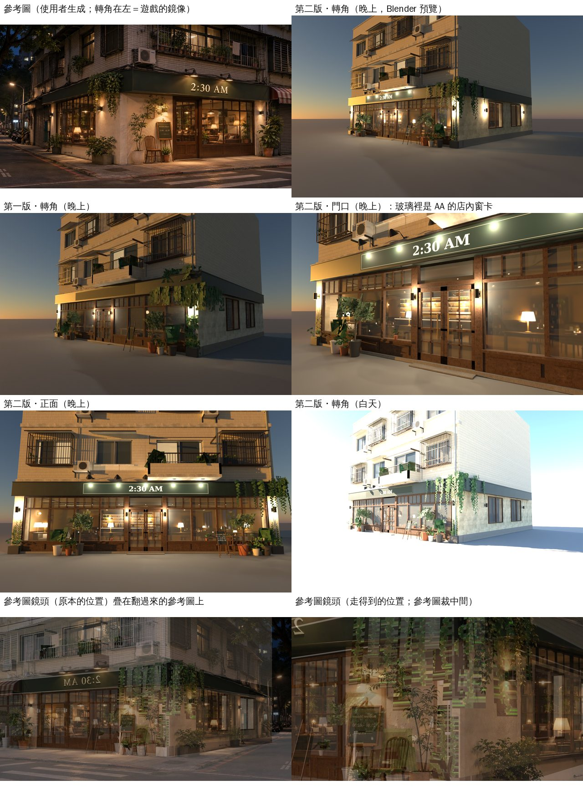

# WZ-FIVE-1104：2:30 AM 外觀（溫州街東端路口）

LAWWW2-C 2026-11-04。狀態：**第二版 MODEL_READY**。

- 只換 `assets/models/env/second_ai/cafe_exterior.glb`（和 `.json`），**遊戲程式不用改**。
- 還沒在瀏覽器看過（D131）。
- 第一版的說明留在下面「第一版（記錄）」。

## 第二版（BB-C 19:02 判第一版的四點）



Blender Cycles 預覽（Standard 色彩），不是遊戲畫面：
- 招牌、畫架、菜單的字是預覽自己貼的圖；遊戲照舊用 canvas 畫。
- 晚上的光是預覽在光暈的位置放的點光。遊戲用光暈（`TK.glowSprite`）和 `CAFE_NIGHT`，牆面不會真的被照亮——晚上的樣子要等遊戲截圖。
- 最下面兩張是 Workbench 拍的（對構圖用），藤條的透明看不出來，像一塊一塊的。

| BB-C 的意見 | 第二版怎麼做 |
|---|---|
| ① 晚上從玻璃看進去，一整間暖黃的燈、書架、檯燈 | **店內窗卡**：AA 的店內模型（`aa_support/cafe230.glb`，遊戲裡走進去的那一間）在 Cycles 開燈拍兩張（`tools/blender/env_second/cafe230_wincard.py`）。<br>燈的位置照 `lightbake/bake_cafe230.sh`：吧台吊燈、壁燈、檯燈、立燈、軌道燈。<br>正面那一排玻璃後面 0.9 m 一張（13.4×3.05 m），轉角那一面兩扇窗後面一張（7.6×2.8 m）。<br>第一版玻璃後面的簡化店內拿掉。 |
| ② 招牌上方的鵝頸燈照亮招牌 | 三盞改五盞（x −2.9、−1.45、0、1.45、2.9）。<br>燈罩口朝招牌（第一版朝街上），燈泡在燈罩裡，燈罩內側晚上發光（`cafe_lampglass`）。<br>每盞一個光暈：同時是燈罩口和照在招牌上的那一片。 |
| ③ 轉角的爬藤細長、帶透明 | 一條藤＝一張細長的卡（寬＝長的 1/4）。<br>貼圖 `ivy_strands.png`（`gen_leaves.py strands`：四條藤，一條 128×512，有透明）。<br>正面招牌帶 13 條、側面 10 條、轉角斜 45° 4 條、兩邊壁柱下半段往上爬 6 條。<br>第一版的大塊葉片卡縮成轉角頂上一小團（14 張，0.24～0.4 m），當藤的起點。 |
| ④ 門口木椅；轉角一樓牆色和正面一樣 | **木椅**：畫架和右邊盆栽中間，靠牆、轉 15°，朝門（世界 (54.98, 4.2)）。<br>**牆色**：轉角那一面的一樓本來就和正面是同一個灰泥材質（`cafe230_stucco`）。調暖一點（`#e3d5b9` → `#dcc8a2`）。<br>晚上那一面偏灰，是因為沒有燈：照參考圖在兩扇側窗外側各加一盞壁燈（z′ −2.9、−10.1，和正面同一款，上下出光）。 |

### 窗卡怎麼接（遊戲程式不用改）

- 材質名用 `cafe_int_plaster`：`zones3d.js` 的 `CAFE_BOUNCE` 本來就有這個名字。
  - `TK.bounce` 讓底色貼圖自己發光：白天 0.42、晚上 0.85。
  - 名字是 `cafe_int_` 開頭，`WZ_NO_SHADOW` 照舊不投影。
- 貼圖集 `textures/gen/cafe230_wincard.png`（1024×512：上面正面、左下側面；範圍寫在同名 `.json`）。
- 窗卡後面有一層暗的背板，窗卡和玻璃中間有一塊地板：斜著看進去不會看到空的。
- 從正前方 8 m 看，窗卡上的畫和真的店內一樣；斜著看有一點視差（窗卡是平的）。
- 窗卡上的燈放了光暈，位置投影到窗卡上：正面檯燈 4、吊燈 3，側面 2。
- 菜單板（`MENU_FACE`）：第一版在簡化店內的牆上，第二版改放在窗邊的小畫架上（x −4.3，窗台上）。遊戲照舊畫四個字面。
- AA 改了店內以後要重拍：
  ```
  /opt/blenv/bin/python tools/blender/env_second/cafe230_wincard.py -- <cafe230.glb> tools/blender/env_second/textures/gen/cafe230_wincard.png --samples 64 --exposure 0.25
  ```
  拍完重跑 `cafe_exterior.py`。

### 導航

- **木椅不用加阻擋**。`zones3d.js` 本來就有 `blockRect(54.8,4.22,0.7,0.65)`（畫架和盆栽之間的縫，v9.3 #31），已經蓋住。
  - 用遊戲自己的碰撞量（`E.canStand`，人物半徑 0.30）：站得住的人中心離椅子最近 0.47 m，身體碰不到。
- **畫架（舊問題，不是這次造成的）**：`blockCircle(54.4,3.6,0.35)` 在 0.5 m 的導航格上只擋一格，人可以站在畫架三支腳中間（最近 0 m）。
  - 第一版以前的 A 字立牌就是這個阻擋。
  - 建議改法（`zones3d.js` 畫架那一行，LAWWW-C 決定）：
    ```
    nav.blockCircle(54.4,3.6,0.35)  →  nav.blockRect(54.45,3.6,0.9,0.9,0,0)
    ```
    改了以後最近 0.33 m，店門前、畫架兩邊、街上都走得到，沒有小孤島。
  - 新的測試 `tests/cafe230_ext_nav_unit.js`：開發分支原樣 ② FAIL，套用改法 ALL PASS。
- 新的壁燈在牆上 2.2 m 高，不影響走路。

### 規格

| 項目 | 第一版 | 第二版 |
|---|---|---|
| GLB | 2.70 MB | 1.60 MB |
| 網格（draw call） | 28 | 23 |
| 材質 | 25 | 21 |
| 三角形 | 36,474（畫出來 38,966） | 16,560（16,560） |
| 光暈 `GLOW_` | 18 | 26（壁燈 12、窗卡上的燈 9、鵝頸燈 5） |

- 簡化店內拿掉（−2 萬面），店內的兩個貼圖集（`cafe_int_atlas`、`cafe_int_rows`）不用了。
- 多兩張貼圖：窗卡 1024×512（39 KB）、藤條 512×512（75 KB）。
- 藤條不併進葉片貼圖集（一格 256 太糊），多 1 次 draw call。
- 材質名少了 `seethru_cafe_cord`、`cafe_int_atlas`、`cafe_int_wood`、`cafe_int_beam`、`cafe_int_ceiling`（都是簡化店內的）。遊戲照名字查表，少了不會出錯。

### 參考圖鏡頭（refcam；BB-C 20:15）

**用的是翻過來（鏡像）的參考圖**（企劃線 `wz_230am_ext.webp` 左右翻，1672×941）：遊戲的轉角在右邊。比對時參考圖也要翻過來。

- 從參考圖量：正面、側面兩組水平線的消失點 (−2467, 594)、(2483, 605)，地平線 y≈600。
- **焦距 50.2 mm**（36 mm 片幅、`sensor_fit` HORIZONTAL；≈ 2332 px）。
- **鏡頭水平**（不往上下看），**`shift_y` 0.0775**（地平線在畫面中線下面 130 px）。
  - three.js 沒有 shift：`fov` 28.85°（垂直）、`aspect` 1672/1200，再 `camera.setViewOffset(1672, 1200, 0, 0, 1672, 941)`，畫出來的 1672×941 就是同一張。
  - 不用 view offset 的話：一樣 `fov` 28.85°、拍 1672×1200，取上面 941 列（0～940）。
  - 水平視角 39.44°。
- 眼睛高 1.44 m。

| | 眼睛（世界座標） | 看的點 | 說明 |
|---|---|---|---|
| 原本的位置 | (41.06, 1.44, 15.87) | (49.23, 1.44, 10.11) | 和參考圖整張一樣，離轉角 16.86 m。這裡在遊戲裡被房子擋住（導航走不到，7.8 m 處有牆）：拍的時候要把擋住的建築藏起來 |
| 走得到的位置 | (49.09, 1.44, 10.90) | (57.26, 1.44, 5.14) | 同一個方向、同一個焦距，沿著「眼睛→轉角」往前 56%（離轉角 7.42 m）。參考圖裁中間再放大到 1672×941 比：比例 (0.326, 0.357)～(0.767, 0.797)，像素 (545, 335)～(1282, 749) |

- Blender 預覽用外觀座標：原本的位置 眼睛 (15.87, 1.44, 14.34)、看 (10.11, 1.44, 6.17)；走得到的位置 眼睛 (10.90, 1.44, 6.31)、看 (5.14, 1.44, −1.86)。
- 外觀和世界：外觀 (x′, y, z′)＝世界 (55.4 − z′, y, x′)。
- **對不齊的地方**：遊戲的正面 14 m 寬（套件的建築大小），比參考圖的正面長，所以門和左邊那一端對不上；轉角、招牌帶、側窗對得上。

### 測試

開發分支 `effb5d9b3`＋第二版 GLB（Node，不是瀏覽器）：
- `cafe_kit_glow_unit`、`zone_prewarm_unit`、`cafe230_nobldg_nav_unit`：ALL PASS。
- `cafe230_ext_nav_unit`（新）：① 木椅、③ 走得到 PASS；② 畫架 FAIL（舊問題，見上面「導航」）。套用建議改法後 ALL PASS。

**瀏覽器測試 `tests/cafe_glb_integration.py`、`tests/wz_street_integration.py` 沒跑**（要電腦上的瀏覽器，D131）。我照它的檢查項目對過：
- 四個畫字的面都在：`SIGN_FACE`、`ABOARD_FACE_front`／`_back`、`MENU_FACE`，屬性照舊。
- 根節點照舊 `cafe_exterior`。
- 光暈都是 `GLOW_` 開頭（遊戲換成 `TK.glowSprite`）。

### 給 LAWWW-C

拿檔：

```
git checkout 75383530f -- assets/models/env/second_ai/cafe_exterior.glb assets/models/env/second_ai/cafe_exterior.json tests/cafe230_ext_nav_unit.js
```

- 不用改程式。
- 要跑的測試：`tests/cafe_glb_integration.py`、`tests/wz_street_integration.py`、`node tests/cafe230_ext_nav_unit.js`。
- 畫架的阻擋（可選，上面「導航」）：要改的話改 `zones3d.js` 一行，`cafe230_ext_nav_unit` 就會全過。

### 還沒做／已知的不足

- 窗卡是一張固定的圖：
  - 店裡的人（客人、店員）從外面看不到。
  - AA 改了店內要重拍（指令在上面）。
- 遊戲裡沒有真的燈照牆：壁燈、鵝頸燈是光暈。晚上轉角那一面看起來暖不暖，要等 CC 的遊戲截圖。
- 參考圖轉角那棵白色盆的小樹沒加：轉角照舊是原本的盆栽組，位置和阻擋照舊。
- 側面兩扇窗照室內的位置，沒有照參考圖做成一整排：室內右牆只有兩扇窗。
- 正面 14 m 比參考圖寬，門和左端和參考圖對不齊（見「參考圖鏡頭」）。
- 美術要 BB 判（D120／D128），我不標 ART_APPROVED。

---

## 第一版（記錄）

LAWWW2-C 2026-11-04，`69e953668`。

### 依據

- AA_654 第 6 節：溫州街第一批五間，外觀由 LAWWW2 做。使用者 11-04 04:4x 授權四人自己決定。
- 參考圖：企劃線的 `docs/story_planning/ref_images/shops/wz_230am_ext.webp`，使用者自己生成的。
- 參考圖的轉角在左邊，遊戲在右邊（x=+7 是轉角那一面），所以外觀是鏡像。
- 營業時間照使用者定的 11:00～02:30。參考圖的牌子寫 21:00～02:30，已經改掉。

### 改了什麼（`tools/blender/env_second/cafe_exterior.py`）

| 參考圖 | 遊戲 |
|---|---|
| 一樓奶油色粗灰泥 | 兩邊壁柱、轉角那一面的一樓側牆改成灰泥（Poly Haven `white_plaster_02`，CC0，`LICENSES.md` 已經有）。原本是咖啡色外牆板 |
| 深綠招牌帶，包過轉角 | 門窗頂（2.98 m）到二樓樓板線下面（3.68 m），往外凸 0.32 m。正面整條，包過右邊轉角，沿著側面到店的後牆（12 m）。上緣一條深色壓條，下緣有滴水邊 |
| 招牌字「2:30 AM」（奶油色襯線字） | `SIGN_FACE` 的屬性改成 `sign: 2:30 AM`、`bg: #1c2c23`（和招牌帶同色）、`color: #efe2c2`。字照舊由遊戲畫（`zones3d.js` 的 `cafeSignTex`）。原本的咖啡色招牌框拿掉 |
| 招牌上面的鵝頸燈 | 照舊三盞，往前伸到招牌帶前面、往下照字 |
| 深色木框、上面一排小格子 | 氣窗每格加兩支直櫺，門的玻璃加十字格子（外面那一面） |
| 黑色圓筒壁燈，上下出光 | 兩邊壁柱、門柱各一盞，原本的方形燈籠拿掉；上下各一個光暈 |
| 從轉角的招牌帶垂下來的爬藤 | 正面、側面招牌帶的轉角垂下一大片，頂上也冒出一些。兩邊壁柱只留下半段（不蓋到壁燈） |
| 木畫架、營業時間黑板 | A 字立牌改成木畫架：前面寫「Business Hours／11:00 – 02:30」，背面寫手沖菜單。位置和導航阻擋照舊（三支腳都在遊戲的 `blockCircle` 半徑 0.35 裡） |
| 原本的木頭雨遮 | 拿掉（參考圖沒有雨遮，招牌帶就是遮雨的） |

沒有動的：
- 樓上：磁磚、鐵窗、陽台、冷氣、水塔。
- 門窗的位置、店門互動點、門口盆栽和它們的導航阻擋。


Blender Cycles 預覽（Standard 色彩），不是遊戲畫面。說明：
- 招牌面在預覽裡是空白的：字是遊戲畫的。
- 白天的木框看起來偏粉，是預覽的太陽太強。
- 晚上的光是預覽放的點光，遊戲用光暈和 `CAFE_NIGHT`。

### 規格

| 項目 | 修改前 | 修改後 |
|---|---|---|
| GLB | 2.59 MB | 2.70 MB |
| 網格 | 26 | 28（招牌帶、灰泥各一個材質，各多 1 次 draw call） |
| 材質 | 23 | 25 |
| 三角形 | 35,244（畫出來 37,736） | 36,474（38,966） |

灰泥、招牌帶故意不併進貼圖集：併進 `cafe_ext_small_atlas` 以後，灰泥的細節和顏色會被壓掉（試過，壁柱看起來又變回咖啡色）。

### 測試

開發分支 `effb5d9b3`＋新 GLB（Node，不是瀏覽器）：`cafe_kit_glow_unit`、`zone_prewarm_unit` ALL PASS。舊的 GLB 也過。

**瀏覽器測試 `tests/cafe_glb_integration.py` 沒跑**（要電腦上的瀏覽器，D131）。我照它的檢查項目對過：
- 有四個畫字的面：招牌、畫架兩面、菜單。所以畫架背面也做成黑板。
- 名字照舊：`cafe_exterior` 根節點、`SIGN_FACE`、`ABOARD_FACE_front`／`_back`、`MENU_FACE`。
- 導航沒動。

### 給 LAWWW-C（第一版）

```
git checkout 69e953668 -- assets/models/env/second_ai/cafe_exterior.glb assets/models/env/second_ai/cafe_exterior.json
```

不用改程式。請跑 `tests/cafe_glb_integration.py`、`tests/wz_street_integration.py`。

### 第一版還沒做的（第二版已經處理 ①～④）

- 從玻璃看進去的店內，還是我原本做的那一版（`CL.interior` 的簡化版），不是 AA 新做的室內 → 第二版改成窗卡。
- 參考圖門口有一張木椅子，沒放 → 第二版放了（原本的阻擋已經蓋住）。
- 參考圖轉角有一棵白色盆的小樹，沒加（第二版也還沒）。
- 側面兩扇窗照室內的位置，沒有照參考圖做成一整排（第二版也還沒）。
