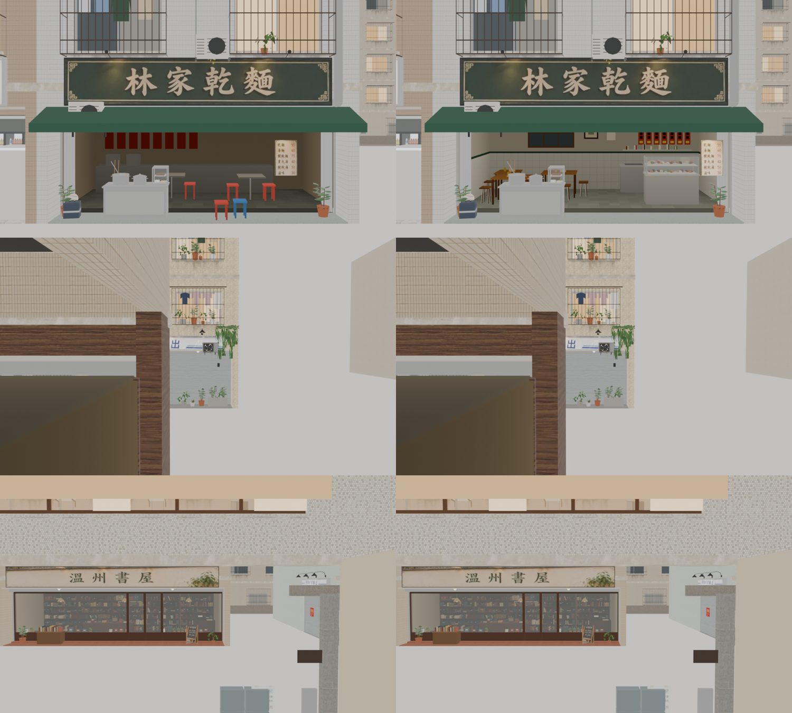
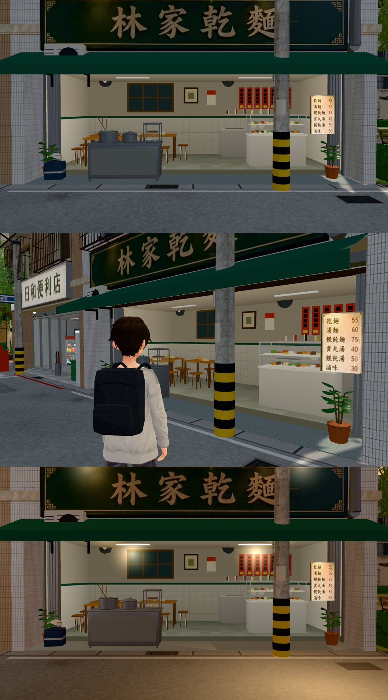

# 林家乾麵從街上看進去的那一面照參考圖重做（WZ-LIN-STREET-REF-1112；LAWWW2-C 2026-11-12）

使用者 11-12（附線上版截圖）：「林家乾麵我明明有給參考圖 還這麼醜」——街上看進去是空的褐色牆、一排紅色方塊、幾張紅藍塑膠凳。

參考圖：企劃線 `docs/story_planning/ref_images/shops/wz_lin_ext.webp`（使用者給的；沒有放進這個分支）。

## 修改前／後（Blender 預覽，同一個鏡頭；左＝線上版，右＝這一版）

第一排是林家乾麵；第二、三排是街上別的地方（確認重建沒有動到別間：這兩個鏡頭畫面完全一樣）。

## 修改後（遊戲畫面，雲端瀏覽器：正面 14:00、斜看、20:30）

## 改了什麼（只動玻璃線後面 2.6 m 的淺店內和門口的雜物；招牌、雨遮、攤車、盆栽、導航不動）
- 牆：褐色 → 白牆＋白磁磚腰牆（磁磚縫、上緣一條墨綠），兩側牆一樣。
- 後牆：木框六格窗、相框、月曆、兩支壁扇。
- 一排紅色方塊 → 七條紅紙菜單（紅紙條上一格格深色的字、最下面黃色的價錢）。
- 紅藍塑膠凳、白色小桌 → 三組木桌＋木凳，桌上筷子筒、面紙盒。
- 右後方不鏽鋼工作檯（水槽、疊碗、電鍋）＋層板上的調味料罐。
- 右前方滷味的玻璃菜櫃（兩層盤子）。
- 店裡亮度 0.62 → 0.86（參考圖裡面是亮的）。
- 門口的紅、藍塑膠凳拿掉；價目牌從開口中間（x 2.4）移到靠右邊門柱（x 3.22），不擋菜櫃。

## 怎麼做的
- `tools/blender/env_second/wz_shopkit.py`：新函式 `_lin_inside`（只有溫州街 A4 用），`shallow_interior` 在 A4 改呼叫它；`L118/WZ` 其他店不受影響。
- **整條溫州街重建**（`wz_street.py --set wenzhou`）。這個環境原本重建不了，今天確認 Poly Haven 連得到、貼圖抓回來以後可以重建（23 秒）。
- 重建時發現的坑：**最新的招牌圖集 `wz_signs_atlas`、店面圖集 `wz_fronts_atlas` 沒有進版本庫**（開發分支追蹤的是舊版，林家那一格是空的；第一次重建招牌整塊空白）。從線上的 `wenzhou_street.glb` 把兩張圖集取出來放回 `textures/gen/`，這個 patch 一起帶進去，之後重建才對。
- patch：`wz_lin_street_v1.patch`（`git apply --binary`；在開發分支 `b145d2a5e` 上 `--check` 過）。動：`wz_shopkit.py`、`wenzhou_street.glb／json／props.json`、兩張圖集和它們的 json、兩支測試的預期數字（三角形 155,087 → 157,859；頂點色分組少了兩張塑膠凳）。

## 驗證
- 重建前後比對：內嵌貼圖除了那兩張圖集（重新壓過一次）以外雜湊完全相同；Blender 兩個別處的鏡頭畫面差 0.00%；材質數 52 不變。
- 讀溫州街模型或林家的 60 支 `*_unit.js`：全部 ALL PASS（含今天的 `shop_flicker_1112_unit`——日常失速那兩面牆在重建版裡照樣錯開，早上沒實跑的那一段重建程式這次實跑過了）。
- `tools/glb_coplanar.py`：林家這一格沒有新增的疊面。
- 雲端瀏覽器：溫州街林家門口白天、晚上各拍過（上圖），沒有報錯。

## 沒做／先將就的
1. 兩張圖集是從線上模型取出來再存一次（JPEG 96）→ 模型裡等於多壓一次，肉眼看不出差別，但不是原圖。原本產生圖集的參考圖在企劃線，要原圖品質要重跑 `sign_atlas.py`。
2. 紅紙菜單上的「字」是深色小方塊，不是真的字；月曆、相框是色塊。
3. 壁扇不會轉；窗是暗色的平面。
4. 參考圖的攤車在右邊、桌椅在左邊；遊戲裡攤車（門口的雜物）原本在左邊，沒搬（搬了導航要跟著動）。
5. 走進去的林家乾麵室內（BB 的 `lin_interior.glb`）和街上看到的這一面不是同一套擺設——這是 SHOP-WINDOW-3D-1112 要處理的「裡外不一樣」。
6. PC 瀏覽器、手機沒看，請 CC 拍（溫州街 (36, −1) 朝南）。
