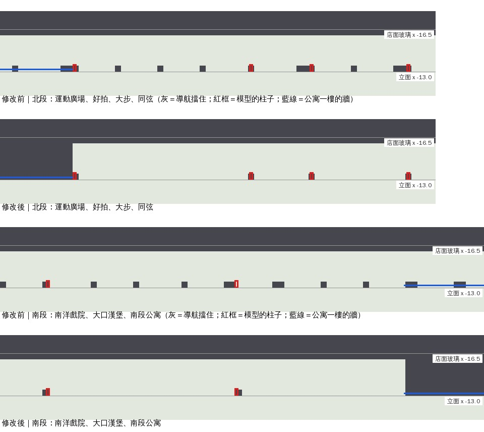

# 新生南路騎樓的導航照正式模型（XS-ARCADE-NAV-1105，LAWWW2-C 2026-11-05）

- 修的是**擋玩**的問題（D141 照樣要修）：
  - 看不到的柱子：導航擋住，但畫面上沒有柱子。
  - 走得進牆裡：沒有騎樓的公寓，導航開著騎樓，人走進公寓的牆裡 3 m。
- 起因：做南洋戲院（ART-NANYANG-CINEMA-1103）查出來的。`src/xinsheng3d.js` 是 LAWWW2 11-03 的草案，這是我自己的錯。
- 檔案：`src/xinsheng3d.js`、`tests/xinsheng_unit.js`。patch：`xs_arcade_nav_1105.patch`（在開發分支 `07dfffe15` 上乾淨；和南洋的接線 patch 可以分開接、一起接）。
- 美術沒有改：模型、貼圖、店面都一樣，只改導航、鏡頭碰撞、載入失敗時的備用方塊。

## 1. 原本錯在哪

1. **看不到的柱子**：
   - 導航：每間店從 z0 開始每 4 m 擋一根柱子（店和 fill 段加起來 38 根）。
   - 模型：wz_street.py 的 `xs_front` 只在每間店靠北那一端做一根（7 根：運動廣場 −40、好拍 −25.4、大步 −20.4、同弦 −12.4、山嵐 2.6、南洋 17.8、大口 33.4）。
   - 結果：騎樓靠街那一條有 31 根看不到的柱子。南洋戲院（25.3）、大步（−16.7）的店門正前方各有一根；山嵐（10.4）、大口（40.6）、運動廣場（−32.8）差 0.2 m。
2. **走得進公寓的牆裡**：
   - 模型：街的南北兩段（z −68～−40、47.4～68）是一般公寓，一樓沒有騎樓，牆在立面往裡 0.2 m（x −13.2）。
   - 導航：騎樓從 x −16.15 一路開到底。
   - 結果：從騎樓南端往南走，會直接走進公寓裡 3 m（Node 模擬 (−14.6, 46) → (−14.6, 60) 走得通）。
   - 鏡頭碰撞也從 x −16.5 開始，鏡頭可以進到牆裡。

## 2. 改了什麼（`src/xinsheng3d.js`）

- `XS3.arcadeShops(L)`：照模型的規則（wz_street.py 的 `_xinsheng_lj`）。店和店、店和溫州街巷口之間不到 1.5 m 的縫，店面加寬補滿。
- `XS3.noArcade(L)`：其他段＝沒有騎樓的公寓（現在是 [−68, −40]、[47.4, 68]）。
- 柱子：每間店 z0 一根。位置照模型：x 立面往裡 0.6 m、z z0～z0＋0.3（導航擋一格 0.5 m）。
- 沒有騎樓的那幾段：
  - 導航擋到 x −13.2（牆）。牆外的人行道照舊走得到。
  - 鏡頭碰撞、載入失敗時的一樓備用方塊也從牆開始。

## 3. 測試（`tests/xinsheng_unit.js` 加 17、18，讀 `xinsheng_street.glb` 的頂點）

- **17**：模型的每一根騎樓柱子（wz_pillar 材質、騎樓靠街那一條）導航都擋住；導航在柱子那一欄擋住的格子，每一格都對得到模型的一根柱子。
- **18**：用模型驗證沒有騎樓的那幾段：沒有騎樓天花板，一樓的牆在 x −13.2。
  - 牆裡面（x −13.6、−15.5）站不住；牆外的人行道（x −12.4）站得住。
  - 騎樓兩端走不進公寓。

| | 17 | 18 | 其他 16 項 |
|---|---|---|---|
| 修改前（`07dfffe15`） | FAIL：看不到的柱子 36 格 | FAIL：50 處在牆裡面卻走得到 | PASS |
| 修改後 | PASS（模型 7 根） | PASS | PASS |

相關的 Node 測試在 `07dfffe15`＋這一包上：

- ALL PASS：`nanyang_unit`、`tongxian_unit`、`seat_reach_unit`、`bike_park_1104_unit`、`bike_shop_park_unit`、`spawn_exit_unit`、`aa619_guitar_zone_unit`、`aa653_shops_unit`、`mokuyobi_aa618_unit`、`wz_offbeat_unit`、`prop_restand_unit`。
- 瀏覽器沒跑（D131）。

## 4. 先將就的、沒做的

- 柱子的導航只擋一格：柱子 0.3 m 寬，格子是 0.5 m，人最多可以貼進柱子 5 cm。和原本一樣。
- 南北兩段公寓沒有騎樓，所以騎樓走到那裡就沒了，要走到外面的人行道。
  - 參考圖的新生南路是整排騎樓。要整排都有騎樓，得改 wz_street.py 的 fill 段、重出 xinsheng_street.glb。那是美術改動，給使用者看了再說（D141）。
