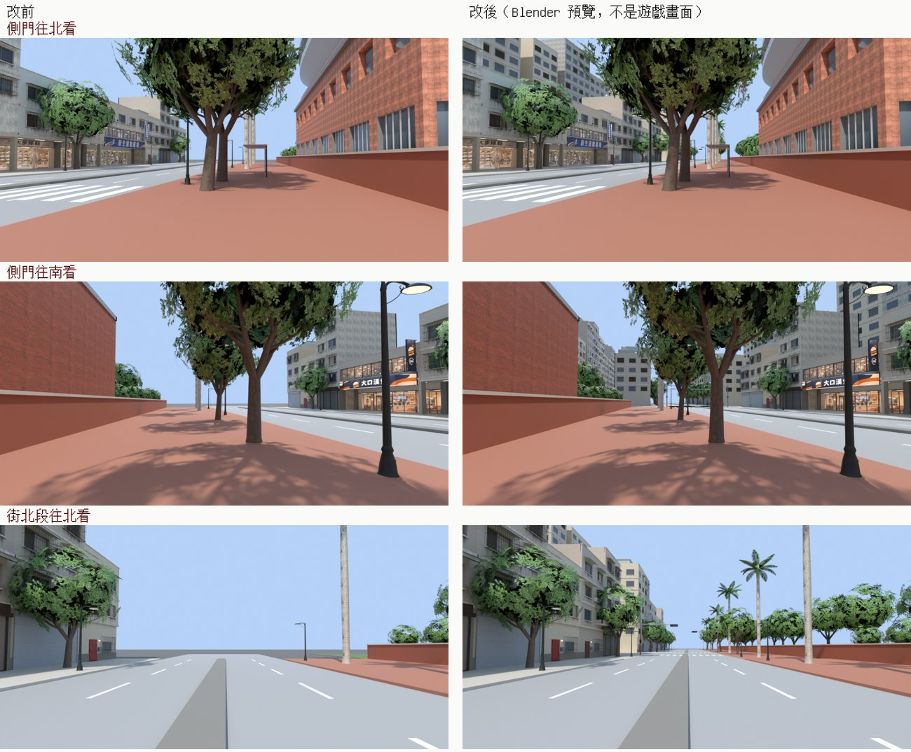
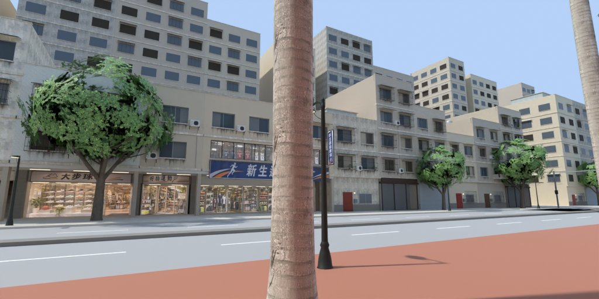

# XS-FARVIEW-1105：新生南路側門的遠景（LAWWW2-B 2026-11-07）

**起因**：使用者 11-05 08:1x 對 LAWWW-C 說「新生南路側門 遠景太假」（UA-LAWWW-1105-32，X247）。LAWWW-C 整理成兩點：
- 一排方盒；
- 路口外面是平的。

店面照 X234 的決定：3D 沒有比較漂亮就照舊，這一包不動店面。

**派工**：LAWWW-B 07:46 列為 c)，排在新生南路往北那一段之後。

**狀態**：**READY_FOR_ART_REVIEW**（場景美術由 BB／使用者看）。D141 第 1 版。遊戲內畫面要 CC 拍。

## 原因

| 看到的 | 為什麼 |
|---|---|
| 一排方盒 | 引擎在所有戶外區域畫一圈城市剪影：圓筒半徑 118 m、灰色方塊加小窗（`engine3d.js` makeSkyline）。新生南路的東邊是校園，118 m 正好落在校園裡面，圍牆後面的樹上面就是一排灰方塊（使用者截圖 `refs/xs_gate_1105/00_game_now_xinsheng.webp`） |
| 路口外面平的 | 區域只做到 z ±68。再過去是深灰的平地，一路通到 118 m 外的剪影 |

## 這一包

**1. 正式模型 `assets/models/env/second_ai/xinsheng_far.glb`**
- 來源：`tools/blender/env_second/wz_street.py --set xinsheng_far`。和 `xinsheng_street.glb` 同一套台北公寓、材質、窗戶原型，同一條街不會一段長得不一樣。
- **西側店面那一排往兩頭接下去**，到 z ±178：
  - 3～7 層；
  - 一樓有店、住家鐵門、鐵捲門。
- **北端 T 字路口**：z −100～−84，往西。東側照舊是校園圍牆。
- **南端十字路口**：z 74～90。路口過去，東側（校園西南角外面）也是一排樓。
- **店面那一排後面一排 6～13 層的樓**：x −37 起。從街上看，屋頂線上面多一層，不再是天空。偶爾留 2～4 m 的防火巷。
- **路口往兩邊看過去的盡頭有一棟樓**，不是一直看到天邊。
- **號誌**：橫式燈頭掛在懸臂上，桿子上有行人號誌，綠燈自己發光。
- **規格**：
  - 畫出來 60,991 個三角形、26 個網格、4.7 MB；
  - 原本整條新生南路 `xinsheng_street.glb` 是 29,067；這次範圍是它的 2.6 倍。
- **遠景的窗**（`far_window`）：
  - 每層一整片牆，玻璃貼在牆面前；
  - 亮燈那戶用 `wz_room_lit`，晚上發光，和近景同一個材質；
  - 鐵窗只做朝外那一面；
  - 第一版用近景的窗原型，畫出來 26.6 萬個三角形，所以改成這樣。

**2. `xs_farview_1107.patch`**（對開發 `79214e4e1`，`git apply --check` OK）
- **`src/xinsheng3d.js`**：
  - `S.FAR` 和 wz_street.py 的 `XSF` 是同一組數字，改一邊要一起改；
  - 路面、人行道、分隔島、斑馬線、校園圍牆、行道樹、路燈往兩頭延伸到 ±178，近景同一套；
  - 草地往北接、往南停在路口前的圍牆，原本會蓋到路口；
  - 區域外的平地放大；
  - 載入 `bldg.xinsheng_far`，接上以後 `zone.noSkylineCity=true`。
- **`src/engine3d.js`**：一行。區域有 `noSkylineCity` 時不畫城市剪影圓筒，山照舊。
  - 遠景模型載入失敗時，圓筒照舊畫。
- **新測試 `tests/xs_farview_unit.js`**。
- **導航不動**：區域外本來就走不到。

**3. `tools/blender/env_second/wz_street.py`**：
- 加了 `xinsheng_far` 這個 set、`far_window()`；
- 其他 set 不受影響：
  - 重建 `xinsheng` 三角形數和交出去的完全一樣（18,023／29,067）；
  - `lane118` 和改之前的腳本建出來一樣。

## 測試（Node，開發 `79214e4e1`）

| | 開發原樣 | 加 patch＋GLB |
|---|---|---|
| `xs_farview_unit` ①～⑥ | **FAIL 6**（0～④ 和 ⑤ 的數字） | **ALL PASS** |
| 會建新生南路、讀城市剪影的 40 支 `*_unit.js` | — | 40 支全過 |

- `xs_farview_unit` 的內容：
  - ① 街兩頭 z ±130、±160 的車道、兩側人行道有路面；
  - ② 兩頭兩側、後排有樓。每 4 m 打一點，七成以上打到遠景模型的屋頂；
  - ③ 兩個路口的橫向路面上沒有樓，草地沒蓋到路；
  - ④ `noSkylineCity`；
  - ⑤ 導航格數不變（10,513 格）；
  - ⑥ 網格數上限。
- 預覽（`preview/render_after.sh`）：第一次算圖北端路口有一條黑帶，是預覽用的原本路面和延伸段重疊（只有預覽才有）。遊戲裡原本的路只到 ±68，延伸段從 ±68 開始，不會重疊。已修，重算過。

## 還沒驗、先將就的

- **遊戲內畫面（CC）**：
  - 側門往北、往南看；
  - 東側人行道往西看（後排高樓）；
  - 校園那一側往東看（不再有方盒）；
  - 白天、晚上（亮窗、路燈）。
  - 另外要量 draw call 和 fps：遠景模型 27 個網格、地面樹燈 32 個。
- 兩頭的樓是遠景做法，窗是平的；最近在 z ±68 外面，走不到。
- 地理對不上（舊的，這一包沒動）：
  - 校園北牆外往北那一條路（XS-NORTH-ROAD-1107，校園 x −56）換到新生南路這一區，會落在 z −35.4，也就是店面中間；
  - 這一區的北端路口在 z −100。兩個區域各自說得通，放在一起看不一樣。
- 號誌燈頭的綠燈白天也亮；紅、黃燈不亮，不會切換。
