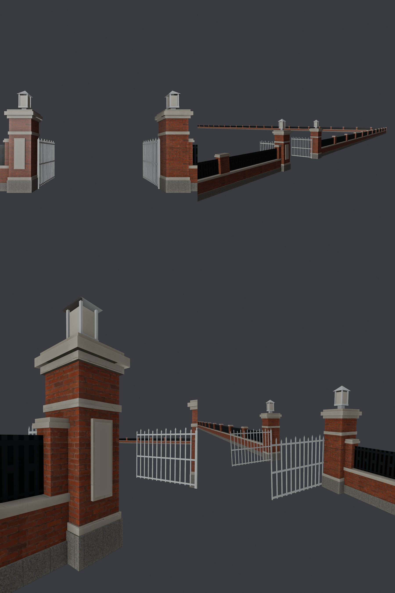

# XS-GATE-FORMAL-1110：新生南路側門正式門柱、鐵門、圍牆（X246）— LAWWW2 帳號 A，2026-11-10

- 狀態：`MODEL_READY`（第 1 版），交 LAWWW 整合；BB 判。
- 以開發分支 48aa47a5b 為底。和紅磚人行道那一包（xs_brick_walk_1110）先後套都可以，兩包疊起來也確認過。
- 遊戲截圖請 CC 拍（D131）。

## 依據
- 使用者 11-05：「新生南路側門改成我的照片的樣子」（USER_WANTS X246）。照片沒進 repo。
- 配置 `sideGate.note`：門柱寫「首都帝大」、鐵柵門開著、門柱上一盞燈。
- LAWWW 11-10 13:39 派：
  - 門柱、鐵門、圍牆做正式模型（D38 近景）；
  - 導航、門洞、候車亭位置不動；
  - draw call 盡量不加；
  - D141 最多 3 版。
- D136 像但不照抄：語彙和校門（`campus_gate.py`）同一套：紅磚、石材、唭哩岸石感的花崗石、鑄鐵燈籠。尺寸、欄杆花樣、牆墩間距是自己的。

## 玩家會看到什麼
- **圍牆**：
  - 花崗石勒腳、紅磚矮牆、石材壓頂，上面一排鑄鐵欄杆，看得到牆裡面的校園樹林、望月台、體育館；
  - 每 5.4 m 一根紅磚牆墩，戴石材柱帽；
  - 原本是一整面 1.8 m 高的色塊牆。
- **門柱**：
  - 花崗石柱礎、紅磚柱身、石材腰帶、三層出挑的柱帽；
  - 頂上一盞鑄鐵燈籠：晚上亮，有光暈；
  - 北邊門柱面向馬路，掛直式石牌「首都帝大」，字由遊戲畫。
- **鐵門**：兩扇，開著，往校內打開、和圍牆垂直，不擋門洞。
- **範圍**：
  - 近景整段 z −68～68；
  - 遠景兩頭：北到 z −178；南端到路口前轉角往東到 x 150。遠景的套件牆也換掉，接頭不會一邊磚牆、一邊色塊。
- 街那一面是平的，花台照舊靠牆：牆面在 x 18.2，花台到 18.15。

- 這張是 Blender 預覽，不是遊戲畫面。預覽工具不畫頂點色、不做透明裁切，所以：
  - 鐵門、燈座看起來是白的，遊戲裡是深鐵灰；
  - 欄杆看起來是一整片黑，遊戲裡是一根一根的鐵條，透得過去；
  - 石牌是空白的，遊戲畫字。
- 左上、右上兩張的鏡頭擺得不好，看下面兩張：左下是北邊門柱和石牌，右下是從校內看門洞。

## 腳踏車停車架（LAWWW 13:47 併進來：BB_255 P3「側門正面右邊那台腳踏車疊進花台」）
- `src/zones3d.js` 的 `BIKE_RACKS.xinsheng`：側門兩邊那兩個停車架從 x 17 移到 **x 15.5**（往人行道 1.5 m）。
- 量過：架子的外框是 x 16.18～17.82，花台是 x 16.45～18.15。
  - LAWWW 說的 0.5 m 不夠，移 0.5 m 還會疊 0.87 m；
  - BB 說的是右邊那台，但左邊那台（z 1.5）一樣疊到花台，兩台一起移。
- 新位置的停車架佔 x 14.7～16.3：人行道中間（x 12）、椰子（x 11.2）不受影響；腳踏車的合法停車處（bike3d.js）讀同一份。

## 做法
- `tools/blender/env_second/xs_gate.py` → `assets/models/env/second_ai/xs_gate.glb`：7 個網格、3,222 個三角形、357 KB。
- 材質：
  - 紅磚 `xg_brick`：Poly Haven red_brick，和行政大樓同一張；
  - 石材 `xg_stone`：sandstone_blocks_08；
  - 花崗石 `xg_base`：granite_tile_03；
  - 鐵件：頂點色 `wz_vc_xg`；
  - 燈籠 `wz_lamp_lens`：照 WZ_NIGHT，晚上亮；
  - 欄杆 `xg_rail`：一片貼圖卡，本作 PIL 畫的直條、尖頭、小圓環，MASK。
- `src/xinsheng3d.js`：
  - 新增 `bldg.xs_gate`，用 `Z3.attachWenzhouModel(…,'xsGate')` 接上；
  - 近景套件的牆、壓頂、門柱標 `xsGate`，接上就藏起來。
  - 遠景的套件牆從 `xs_far_ground` 拆出來，另外合成 `xs_far_wall`（標 xsGate）：牆、壓頂各一個網格，和原本一樣。
  - 欄杆：alphaTest 0.5、兩面、不投影。
  - 載入前、載入失敗時照舊是套件（D38 ③）。
- **導航完全不動**：照舊是套件那幾個 blockRect。
- **draw call**：看得到的網格從 238 變成 237。另外多兩個燈籠光暈（sprite，白天透明）。

## 測試
新測試 `tests/xs_gate_formal_unit.js`：
1. GLB：
   - 兩根門柱各一盞燈籠和光暈；
   - 北邊門柱面向馬路有「首都帝大」直式石牌；
   - 欄杆卡是 MASK。
2. GLB：
   - 圍牆蓋到近景和遠景（北到 −178、南端往東到 150）；
   - 街那一面 ≥ 18.15（花台靠牆）；
   - 門洞（導航開的那一格）裡沒有任何頂點。
3. 遊戲（Node 建出新生南路、接上真的 GLB）：
   - 接上了，標 xsGate 的 7 件套件都藏起來；
   - 欄杆裁切、兩面、不投影；
   - 燈籠有登記晚上亮；
   - 石牌有畫字，合成 plates atlas。
4. 導航不動：門洞、門口站得住，門柱、圍牆擋住，人行道中間站得住；看得到的網格不比套件多。
5. 側門兩邊的停車架不疊進花台（照 xs_planters.json 每一段的範圍）。

結果：
- **開發分支 48aa47a5b：FAILED 4**（第 1、2、3、5 項；第 4 項是不能壞掉的項目，修改前後都 PASS）；套上 patch：**ALL PASS**。
- 回歸：新生南路、腳踏車（BIKE_RACKS、bike3d）的 106 支（含新測試、bike_park_1104、xs_planters），全部通過，見 `regression.log`。

## 沒驗證
- 遊戲畫面：
  - 磚、石材的比例；
  - 欄杆從人行道看的密度；
  - 晚上燈籠的亮度；
  - 石牌的字能不能讀。
- 手機效能：多 3,222 個三角形、三張 PBR 貼圖（紅磚和行政大樓共用同一張原圖，但材質是這個模型自己的）。

## 整合
- `git apply --binary xs_gate_formal_1110.patch`。
- 內容：xinsheng3d.js、zones3d.js（停車架兩個座標）、xs_gate.glb／json、xs_gate.py、新測試、LICENSES.md。
- 欄杆貼圖 `textures/gen/xs_gate_rail.png` 不放進 patch：腳本每次會重畫，已經嵌在 GLB 裡。

## 先將就（D141：BB 判了再說）
- 門柱上的燈籠是校門那一款縮小，沒有另外設計。
- 鐵門沒有軌道、地上沒有門擋。
- 側門內的小廣場地面不在這個區域。
