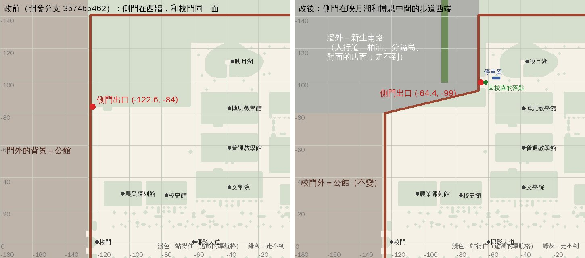

# 新生南路側門搬到映月湖和博思中間（XS-GATE-MOVE-1105，LAWWW2-C 2026-11-05）

- 使用者 07:5x：「新生南路側門有，但怎麼跟公館同側。我希望它在映月湖和博思中間。」
- LAWWW-C 07:32 確定方案（側門搬家、牆外新生南路背景先做；新月台、停車場之後）。
- 狀態：**已做，交 patch**。在 Node 驗過；瀏覽器沒跑（D131），請 CC 拍。

上圖是 Node 建出遊戲真的校園、照導航格畫的，**不是遊戲畫面**。淺色＝站得住，綠灰＝走不到；x 往東、−z 往北。（第一版的方案圖 `gate_before_after.jpg` 留著。）

## 玩家會看到什麼

- 從映月湖和博思中間那條步道往西走到底，就是側門（兩根門柱、門洞 5.2 m）。走出去到新生南路。
- 從新生南路回來，落在側門內的小廣場 (−61.6, −99)，面向東：前面就是那條步道，左邊映月湖、右邊博思。
- 側門外看得到新生南路：
  - 牆外人行道（4.5 m）、行道樹；
  - 柏油路面、車道線、中間一條種樹的分隔島；
  - 對面一排四到七層的店面公寓（正面朝校園）。
  - 都走不到。
- 從校門往北的西牆，到 z −80 以後斜著往東北接到側門那一段。
- 校門外看出去照舊是公館。
- 原本西牆北段的側門、往東那條小路、那塊空草地都沒有了（變成牆外）。

## 改了什麼（`src/zones3d.js`、`src/data/xinsheng_layout.js`）

1. **圍牆**：
   - 西牆 x −124 照舊到 z −80。
   - 從 (−124, −80) 斜到 (−66, −94)，再沿 x −66 往北接北牆 z −141。
   - 側門的門洞在 x −66、z −96.4～−101.6。
   - 北牆從 x −66 開始（x −124～−66 那一段現在在牆外）。
2. **導航**（`xsGateNav`）：
   - 斜牆外一格都走不到。
   - 側門內開一塊小廣場（x −65.6～−60、z −102.8～−95.2），接上原本的步道。
3. **出口**：「往新生南路（側門）」在 (−64.4, −99)，半徑 2.0。
4. **落點**：`XINSHENG_LAYOUT.sideGate.campusSpawn` 改成 (−61.6, −99)，面向東。新生南路那一區自己的座標不動。
5. **牆外的新生南路**（`xsRoad`，遠景）：
   - 人行道只鋪到對面那排房子的背面 (x −124)，不和公館那一套背景的人行道疊兩層。
   - 北端接辛亥路的南側人行道 (z −141)。
6. **停車架**：舊側門的那一座 (−113.5, −82.5) 搬到側門往東那條步道的北邊 (−55, −101.6)。
   - 一開始放在小廣場裡，`bike_park_1104_unit` 抓到兩個問題：架子底下沒擋住、壓到出口。
   - 往東挪了 8 m。
7. **校園的樹**：新圍牆 (x −66) 以西不種。行道樹、分隔島的樹在 `xsRoad`。

## 手機地圖、劇情

- 手機地圖（`placemap3d.js`）沒有新生南路側門的圖釘，不用改。
- `src/` 裡沒有劇情或 NPC 用到舊側門的座標（−122.6, −84）。

## 測試（Node，不用瀏覽器）

`node tests/xs_gate_move_unit.js`：ALL PASS（11 項）

- ① 出口在 (−64.4, −99)；落點站得住、不在出口範圍裡。從落點走得到：
  - 側門出口；
  - 映月湖南岸步道；
  - 博思北側步道；
  - 校門內側；
  - 校園出生點。
- ② 牆外：
  - 斜牆外、x −66 牆外一格都走不到。
  - 舊側門的小路、草地中間走不到。
  - 牆內貼著斜牆的草地照舊站得住。
- ③ 舊存檔存在舊側門 (−120, −83)：`E.unstick` 放到 (−118.25, −80.25)。
  - 距離 3.3 m，比方案寫的「3 m 內」多一點，所以測試的門檻是 3.5 m。
  - 那一點走得到校園出生點。
- ④ 從上往下打：
  - 牆外 (−95, −120) 是柏油（有 `userData.asphalt`，晚上會跟著調暗）。
  - 牆外 (−68.5, −120) 是人行道。
- ⑤ 舊出口、舊停車架都不在了。

修改前（開發分支 `3574b5462`）：FAIL 9。

一起跑（51 支：會建校園的、讀到新生南路／停車架／側門的，加 `spawn_exit`、`placemap`、`nav_buildings`、`seat_reach`）：

- 47 支 ALL PASS。
- `bike_park_1104_unit` 修了停車架位置以後 ALL PASS。
- 另外 3 支修改前就 FAIL，和這一包無關：
  - `xs_close_unit` 2b；
  - `xsports_act_unit` ⑨；
  - `xsshop_act_unit` ⑪。
  - 原因：這台機器讀不到企劃線的 git 物件（0e112816a、481cf075d、bf0efded8）。

patch 在開發分支最新的 `d83e9a92b` 上也套得上，`xs_gate_move`、`xinsheng`、`bike_park_1104` ALL PASS。

## 先將就的

1. 牆外的新生南路是遠景：
   - 路面、分隔島、對面那排公寓是套件做的（`TK.Bin` 盒子＋店面材質）。
   - 不是 Blender 正式模型，也沒有車。
   - 和 XS-FARVIEW（「新生南路側門遠景太假」）一起換成正式的街廓背景。
2. 門柱是套件的方柱，和舊側門一樣；沒有門扇。
3. 北端和辛亥路交叉的地方：
   - 辛亥路南側那條人行道照舊橫過新生南路（z −141～−145）；
   - 路口沒有斑馬線。
4. 斜牆那一段的對面只鋪了人行道和柏油，沒有房子：那一段從校園裡看是樹林擋著。
5. 公館背景照舊鋪到 z −141，但都在新生南路那排房子後面，看不到。人行道已經不疊兩層。
6. 新月台＋地下停車場（使用者 08:0x）還沒做，照 LAWWW-C 排在這之後。

## 接法（LAWWW-C）

`git apply docs/art-rebuild/second_ai/wip/xs_gate_move_1105/xs_gate_move_1105.patch`。內容：

- `src/zones3d.js`、`src/data/xinsheng_layout.js`；
- `tests/xinsheng_unit.js` 第 6 項的說明文字；
- 新測試 `tests/xs_gate_move_unit.js`。

和燒臘、一盞、樓梯、南洋長椅、阿德、afar、日常失速幾包互不相干。

瀏覽器請 CC 拍：

- 從映月湖和博思中間的步道往西看側門，白天、晚上；
- 走出側門再走回來的落點；
- 從校門往北看西牆斜過去那一段。
