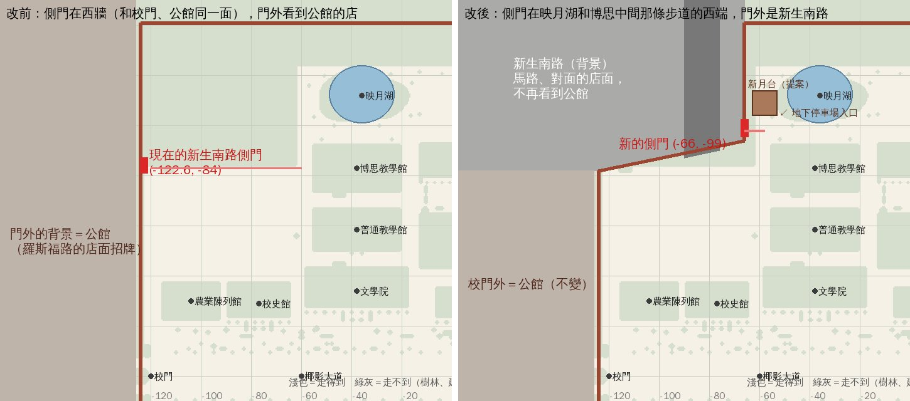

# 新生南路側門搬到映月湖和博思中間：方案（XS-GATE-MOVE-1105，LAWWW2-C 2026-11-05）

- 使用者 07:5x：「新生南路側門有，但怎麼跟公館同側。我希望它在映月湖和博思中間。」
- 狀態：**方案，還沒動手**。LAWWW-C 要先看俯視圖，確定了再做；不進 v9.10.21。

俯視圖是 Node 裡建出遊戲真的校園量的：淺色＝站得住，綠灰＝走不到（樹林、建築）；座標是校園區域座標，x 往東、−z 往北。

## 現況

- 側門在西牆 (−122.6, −84)，和校門、公館同一面牆。
- 門外的背景是公館（「校門外照公館區域座標換算」那一套），所以從校園裡看側門，門外是公館那排招牌。
- 映月湖中心 (−36, −112)，湖南岸的長椅在 z −100。博思在 (−38, −83)。
- 兩個中間本來就有一條東西向步道（z −96～−100，x −60 往東到 10）。步道西端 x −60 以西到西牆，是走不到的樹林。

## 方案

1. **新的圍牆**：
   - 西牆 x −124 照舊到 z −82。
   - 從 (−124, −82) 斜著往東北接到 (−66, −94)，再往北沿 x −66 接到北牆 z −141。
   - 斜的那一段照真的新生南路：從校門那個路口往東北斜。
2. **新的側門**在 (−66, −99)，就是映月湖和博思中間那條步道的西端，步道往西接 6 m。從那兩棟中間往西走出去，就到新生南路。
3. **門外**：圍牆外換成新生南路的背景（馬路、對面的店面、行道樹），不再看到公館。
   - 公館的背景只留在 z −82 以南（校門那一段）。
   - 背景照新生南路區域的店面，用 TK 套件組，走不到。
4. **切掉的地方**：z −82～−95、x −124～−66 那一塊空草地（沒有互動點、座位、劇情站位）變成牆外。舊側門往東那條小路 (z −83) 拿掉，舊的出口拿掉。
5. **舊存檔**：存在舊側門附近 (−120, −83) 的，`E.unstick` 會放到最近站得住的地方（z −81 那一排，3 m 內）。做的時候寫測試驗。
6. **新生南路那一區**（`xinsheng`）：區域自己的座標不動。側門在那一區照舊在 (18.4, 10)，溫州街的出入口照舊只從新生南路進出（X199）。只改校園這邊的出口位置和進校園的落點。
7. **手機地圖的新生南路圖釘**：照新的側門 (−66, −99)。

## 一起看的（第二步，先確定上面的再做）

- **新月台＋地下停車場**（使用者 08:0x，參考照片 `docs/art-rebuild/refs/xs_gate_1105/`）：
  - 放在側門北邊、湖的西邊（現在是樹林）。D136：像，但不照抄。名字請 AA 照 WORLD_NAMING。
  - 停車場要走得進去：入口在新月台旁邊，進去是一個小區域，一台車旁邊有「開車出去」的互動點。
- **XS-FARVIEW**（「新生南路側門遠景太假」）：新生南路那一區路口外面是一排方盒、地是平的。換成看得出是街廓的背景，和上面的門外背景同一套。

## 要 LAWWW-C 確定的

1. 側門位置 (−66, −99)、圍牆斜到 (−66, −94) 這樣可以嗎？要更靠湖（更東）的話，步道西端以東就是湖和博思本身，門會貼著兩棟。
2. 切掉那塊空草地可以嗎？
3. 新月台、停車場排在側門搬完以後，對嗎？
