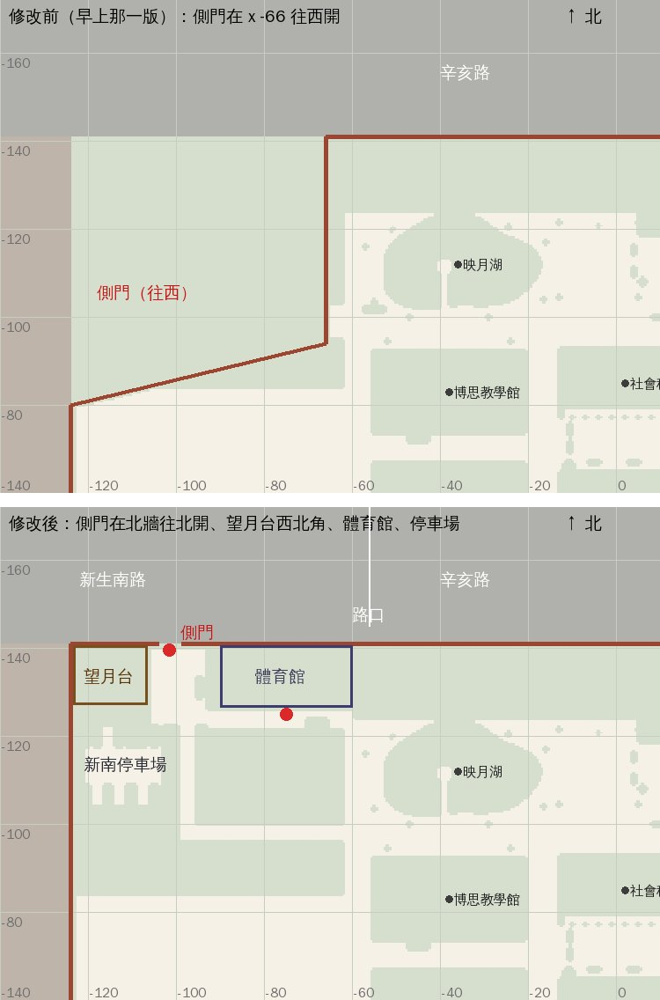

# 新生南路側門開在北牆、望月台在西北角、體育館搬到望月台和法學院中間（XS-GATE-NORTH-1105，LAWWW2-C 2026-11-05）

使用者：

- 09:0x「我覺得既然要新增新月台，那他就要很靠新生南路那門就不要往左邊開了直接往上面開跟公館不同側／新月台也貼著上方上方的最左邊」
- 09:1x（問「側門外那條路要不要改叫新生南路、辛亥路從東邊一點才開始」）「好 118巷從東邊開門」
- 09:2x「體育館實際上是在新生南路辛亥路交接口 遊戲中就改到新月台法學院中間」

取代今天早上的 [XS-GATE-MOVE-1105](../xs_gate_move_1105/README.md)（門在 x −66 往西開，還是和公館同一側）。方案圖 v1：[plan_v1.jpg](plan_v1.jpg)。

狀態：**已做，交 patch**。Node 驗過；瀏覽器沒跑（D131），請 CC 拍。

上圖是 Node 建出遊戲真的校園、照導航格畫的，**不是遊戲畫面**。淺色＝站得住，綠灰＝走不到；x 往東、−z 往北（上）。

## 玩家會看到什麼

- **側門**在北牆、靠西北角 (−101.4, −141)，兩根門柱、門洞 5.2 m，往北走出去就是新生南路。
  - 從新生南路回來落在門內 (−101.4, −137.2)，面向南。
  - 門內是一塊小廣場，往南一條步道接到映月湖和博思中間那條步道。
- **望月台**（新月台）在西北角，貼北牆和西牆，兩層樓，招牌「望月台」，正門朝東對著小廣場。
- **新南停車場**在望月台南邊：
  - 柏油、白色車位線，南北兩排車位；
  - 停著 10 台車；北排第 3 格空著，給「開車出發」用（`Z3.XSG.carSpot`）；
  - 西牆邊一排機車。
- **體育館**在望月台東邊、貼北牆（x −90～−60），四層，招牌「體育館」，門朝南。
  - 門前一塊鋪面：西接小廣場、東接映月湖西岸的步道。
  - 館內（1F、B1、3F 球場）不動。
- **北牆外的路**：
  - 側門前那一段叫新生南路，路名牌在側門東邊。
  - 路口在體育館東邊 (x −56)。路口的路名牌兩塊：往東是辛亥路，往北是新生南路。
  - 新生南路往北那一段，對面兩排房子空出來。
  - 斑馬線三條：側門前、路口西側（過辛亥路／新生南路）、路口北邊（過往北那一段）。
- **118 巷**：後門照舊在霖澤館後面（辛亥路那一段），沒動。
- **手機地圖**：
  - 體育館自己一顆圖釘（校園北邊、法律系館 A 西邊）。原本和宿舍同一顆。
  - 新生南路在校園北邊，往下接溫州街，不再沿著公館那一側。
- **西牆**：舊側門 (−124, −84) 補回圍牆。早上那一版的斜牆、牆外的新生南路、對面那排店都拿掉了。

## 改了什麼

先把 XS-GATE-MOVE-1105 那份 patch 反著套回去（`git apply -R`），再改：

- `src/zones3d.js`：
  - `XSG`：側門、望月台、小廣場、停車場、步道、體育館、體育館門前的範圍，路口 `xh`。匯出成 `Z3.XSG`。
  - `xsGateNav`：
    - 開出小廣場、步道、停車場、體育館門前；
    - 擋住望月台、體育館本體；
    - 開出來的地方裡的停車架、汽車、機車再擋一次。
  - 校園導航格往北多 10 m（z −142 起），北牆邊才在格子裡。
  - 圍牆：
    - 北牆在門洞兩邊分兩段；
    - 西牆北段 z −141～−80 一整段；
    - 門柱改到北牆。
  - 望月台、體育館：`CK.modern`（套件暫代），用 `ckPlace` 放，導航阻擋和鏡頭碰撞照套件。
  - 鋪面、停車場：
    - 車位線；
    - 汽車用 `us_cars.glb`，有低面數版本；
    - 機車用 `TK.scooter`。
  - 北牆外：路名牌、三條斑馬線、北邊兩排房子在路口那一段空出來。
  - 校園的樹不種在這些地方上。
  - 停車架：
    - 舊側門那一座 (−113.5, −82.5) 搬到小廣場 (−94.6, −131)；
    - 體育館門前加一座 (−68, −123)；
    - 原本體育館那一座 (66.5, 59.5) 照舊。
  - 映月湖北邊那排矮灌木從 x −58.6 開始，讓出體育館門前。
- `src/data/xinsheng_layout.js`：`sideGate.campusSpawn` 改成 (−101.4, −137.2)、yaw 0；`note`。
- **體育館門口**（LAWWW 的檔，一起改）：
  - `src/classes3d.js`：`DOORS.gym` 改成 (−75, −125)，`CAMPUS_AT.gym` 改成 (−75, −123.4)、yaw 0。
  - `src/data/gym_layout.js`：`enterAt` 改成 (−75, −125)，`exit.spawn` 改成 (−75, −123.4)、yaw 0。
  - `src/gym3d.js`：`CAMPUS` 同上。
  - `src/data/sis_b13_events.js`：學姊「游完泳的早上」的 `near` 改到新門口。只改觸發位置，台詞沒動。
- `src/placemap3d.js`：
  - 體育館圖釘 (190, 59)；
  - 新生南路圖釘 (138, 44)；
  - 新生南路的底色加一條北邊的；
  - `gym*` 區域對到體育館圖釘。
- 測試：
  - 新的 `tests/xs_gate_north_unit.js`。
  - 拿掉 `tests/xs_gate_move_unit.js`：它測的是門在 x −66 往西開，使用者否決了。
  - `tests/aa512_sis_b13_unit.js` 第 8 節：站的位置從舊門口 (74, 57) 改到新門口。
  - `tests/gym_unit.js` 第 7 項：改讀 `gym_layout` 的落點和門口，原本寫死 (74, 58)。
  - `tests/xinsheng_unit.js` 第 6 項：只改字。

## 測試（Node，不用瀏覽器）

`node tests/xs_gate_north_unit.js`：ALL PASS（18 項）

- ① 側門出口在北牆邊、靠西北角。落點站得住、面向南，走得到：
  - 側門出口；
  - 映月湖和博思中間；
  - 校門；
  - 校園出生點；
  - 體育館門口。
- ② 西牆外、北牆外一格都走不到；西牆舊側門沒有出口了；北牆門洞 5.2 m。
- ③ 望月台貼西牆、北牆；體育館在望月台東邊、法學院西邊、貼北牆；兩棟本體走不到。
- ④ 進體育館的地方在南面中間、站得住；從體育館出來站得住、面向南、走得到出生點；舊門口座標不在任何檔案裡。
- ⑤ 停車場在望月台南邊、走得到；10 台車、空一格；那一格和旁邊站的位置走得到。
- ⑥ 路名牌（新生南路、辛亥路），新生南路往北那一段對面沒有房子。
- ⑦ 手機地圖：體育館自己一顆圖釘、新生南路在北邊。
- ⑧ 舊存檔在舊側門 (−120, −83)、早上那一版的側門 (−66, −99) 和落點 (−61.6, −99)：站得住，走得到出生點。

修改前（開發分支 `93d4d94df`＝XS-GATE-MOVE 那一版）：FAILED 14。

回歸（讀到校園、體育館、新生南路、手機地圖、停車架、學姊事件的 52 支 `*_unit.js`，修改前後各跑一次）：

- 改完以後全部 ALL PASS。
- 和修改前比，只有兩支結果不一樣：
  - `aa512_sis_b13_unit`：修改前 PASS，改完 FAIL 1。測試寫死舊門口 (74, 57)；改成新門口以後 ALL PASS。
  - `xs_gate_north_unit`：修改前 FAILED 14，改完 ALL PASS。
- `gym_unit` 兩邊都 PASS，但第 7 項測的是舊座標，改成讀配置以後照樣 ALL PASS。
- patch 在最新的開發分支 `313a97267` 上 `--check` 通過；套上以後 xs_gate_north、xinsheng、bike_park_1104、placemap、gym、aa512_sis_b13、nav_buildings 七支 ALL PASS。

## 先將就的

1. **望月台、體育館是套件（`CK.modern`）**，不是 Blender 正式模型。
   - 位置、大小、導航、門口都定了，外觀之後照照片用 Blender 做（像但不照抄）。
   - 真的新月台是玻璃多、屋頂平的兩層小樓；新體育館是很大的弧形屋頂。現在都是一般的方正系館樣子。
2. **體育館比真的小很多**（30 × 14 m、四層）。真的大得多，遊戲的校園是壓縮過的。
3. **停車場的車是美式汽車**（`us_cars.glb`，沒有車牌、廠牌），在台灣的停車場看起來偏大台。
4. **「開車出發」沒有接**：只留了空的車位和站的位置（`Z3.XSG.carSpot`、`.stand`），劇情、互動是 LAWWW 的 DRIVE-PICKUP-1105。
5. **望月台、體育館外觀沒有夜間燈光**（窗戶不亮）。
6. **新生南路往北那一段只是把對面的房子空出來**。路面就是城市底色的柏油，沒有車道線、分隔島、行道樹。
7. **新生南路區域（xinsheng）自己的配置沒動**：走出側門進的那條街，方向和這裡的北牆沒有對到（那是另一個區域）。
8. **舊的東南角 (74, 68) 那棟本來就是沒有名字的系館**，照舊。體育館門口拿掉以後，那裡就是一棟普通系館。
9. 瀏覽器沒跑（D131）。請 CC 拍：
   - 從新生南路走進側門往南看；
   - 小廣場看望月台；
   - 停車場；
   - 體育館門口往北看；
   - 北牆外的路口；
   - 白天、晚上。

## 接法（LAWWW-C）

`git apply docs/art-rebuild/second_ai/wip/xs_gate_north_1105/xs_gate_north_1105.patch`

- 在開發分支 `313a97267` 上 `--check` 通過，已含 XS-GATE-MOVE 那一版；patch 會把它換掉。
- 內容：`src/zones3d.js`、`src/classes3d.js`、`src/gym3d.js`、`src/placemap3d.js`、`src/data/{xinsheng_layout,gym_layout,sis_b13_events}.js`、四支測試、拿掉 `xs_gate_move_unit.js`。
