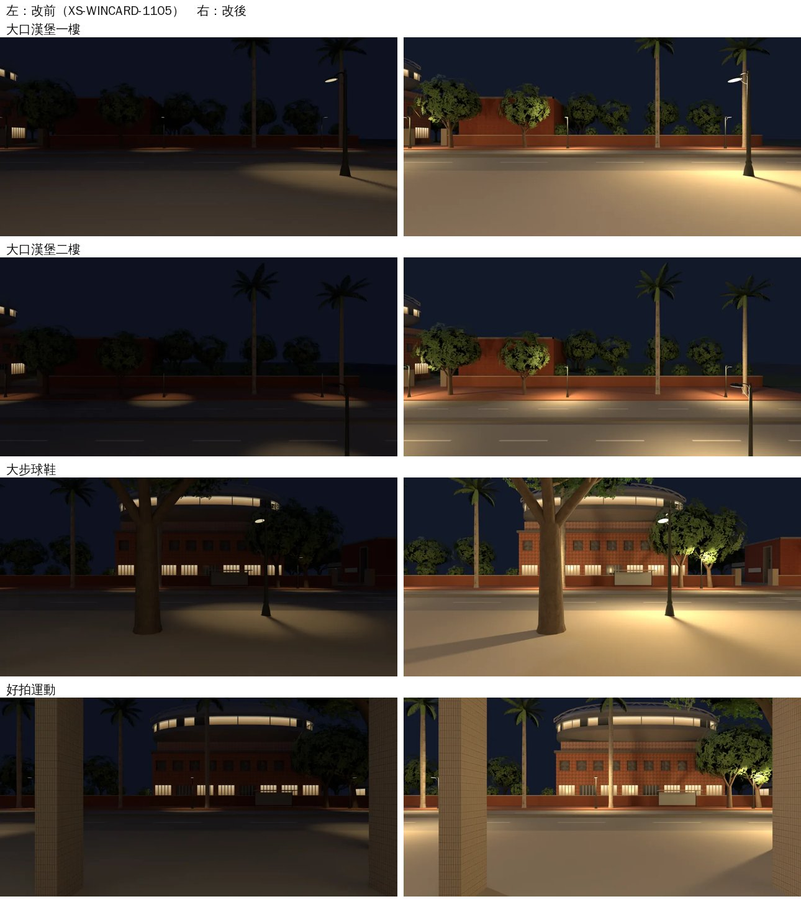

# XS-NIGHT-1107：新生南路四張夜景重拍（LAWWW2-B 2026-11-07）

**起因**：BB-B 11-07 03:4x 對 XS-NORTH-EXT／XS-WINCARD 的意見（P3，不擋）：「大口窗景晚上只看得到天空，看不到街」。記在 `TODO_SHORTCUTS.md`。

**狀態**：**READY_FOR_ART_REVIEW**（場景美術：BB-B／使用者看）。
- 下面是 Blender 渲染的窗景照片本身，不是遊戲畫面；
- 遊戲內從店裡往外看（晚上），排 CC（D131）。

## 原因

XS-WINCARD-1105 拍新生南路四張夜景時：
- 用了 `--exposure −0.7`（壓暗）；
- 月光只有 0.04；
- 路燈只有往下照的聚光圈（220 W、半徑 4 m）。

對街的紅磚圍牆、樹冠是直立的，往下照的光照不到，所以一片黑。畫面上最亮的反而是天空和近處的路面。

量起來（1024×512 的灰階平均）：

| | 全圖 | 中間那一帶（對街：圍牆、人行道、樹） |
|---|---|---|
| 大口一樓 改前 | 0.110 | 0.044 |
| 溫州街、118 巷的夜景照 | 0.17～0.33 | — |

## 改法

`tools/blender/env_second/wz_window_view.py` 加三個選項，預設都和原本一樣，其他店的照片不受影響：
- `--moon W`：月光、城市的天光照在地面和牆上，天空顏色不變；原本固定 0.04；
- `--pool-r k`：路燈光圈半徑的倍率；
- `--pool-point W`：每盞路燈的燈頭再加一顆往四周的點光源，照得到圍牆、樹冠。

新生南路這四張：
- 曝光 0（原本 −0.7）；
- 月光 0.2；
- 光圈 450 W、半徑 ×1.8；
- 燈頭點光源 900 W；
- 燈頭倍率 4 → 8。

場景資料沿用 XS-WINCARD-1105（`../xs_wincard_1105/` 的 slabs／trees／lamps／pools.json）。重拍腳本：`render_night.sh`。

試了五組才定：
- 只拉曝光：對街還是黑；
- 月光 0.8：近處路面變灰藍、像黃昏；
- 燈頭倍率加到 80：沒有用，路燈柱本身沒有光源；
- 最後是加燈頭點光源。

## 結果

| 照片 | 全圖 | 中間那一帶 | 檔案 |
|---|---|---|---|
| 大口一樓 `xs_dakou_night` | 0.110 → 0.302 | 0.044 → 0.169 | 9 → 24 KB |
| 大口二樓 `xs_dakou_2f_night` | 0.067 → 0.218 | 0.051 → 0.126 | 9 → 25 KB |
| 大步 `xs_dabu_night` | 0.115 → 0.352 | 0.068 → 0.244 | 14 → 34 KB |
| 好拍 `xs_haopai_night` | 0.123 → 0.339 | 0.096 → 0.301 | 17 → 39 KB |

看得到的：路面、對街的紅磚圍牆和人行道、被路燈照亮的樹、亮著窗的望月台和體育館。

**白天那四張不動。**

## 接法（給 LAWWW-B）

- 換四張：`assets/models/env/views/{xs_dakou,xs_dakou_2f,xs_dabu,xs_haopai}_night.webp`；
- 不用改程式，沒有 patch；
- `tools/blender/env_second/wz_window_view.py`：新選項，預設值不變。

## 測試（Node）

讀到大口、大步、好拍、新生南路、窗景的 19 支，換新照片以後 18 支 ALL PASS：
- dakou、dakou_nightcard、dakou_act、dakou_clerk_1107；
- xs_wincard_1105、xs_close、xsshop、xsshop_act、xsports_act；
- close_unify、placemap、quick_travel、quick_travel_areas、seat_reach、shop_crowd_new、shop_npc、stair_tap、zhe_dakou_msg。

`invite_places_1107` 有 1 項 FAIL：要讀企劃線的 commit 696254f1c，我這邊沒有。開發原樣也一樣，和這一包無關。

## 還沒驗、先將就的

1. **遊戲內**：晚上從大口一樓、二樓、大步、好拍往外看（CC）。照片在遊戲裡還會照時段調色，實際亮度要看遊戲畫面。
2. **路燈旁的樹冠**：被燈頭點光源照得比較亮（黃綠色）。BB 覺得太亮可以改 `--pool-point 600` 重拍。
3. **大口西側窗**：照舊是 BB 的夜景卡 `NIGHT_WEST`（外面 0.6 m 是隔壁的牆，沒有視差窗）。
